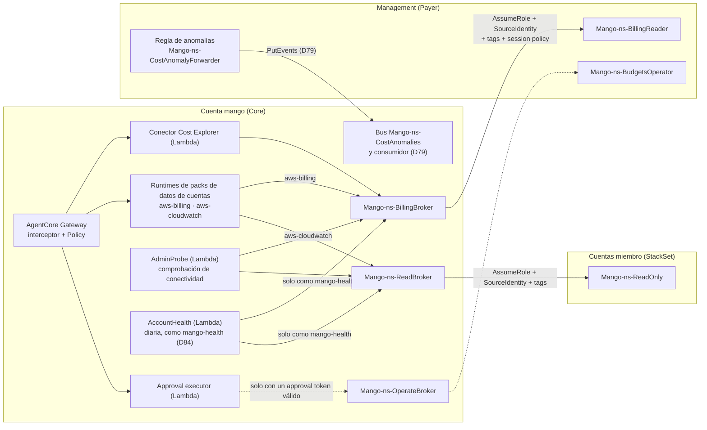

# Mango Hub: arquitectura AWS de referencia

> Fecha: 2026-09-28 · Revisión de coherencia: 2026-10-05 · Puesta al día con lo construido: 2026-10-29 · Estado: **adoptada**. Nació como propuesta para discusión; sus decisiones están tomadas y registradas en §8 (las primeras son del mismo 2026-09-28).
> **Cómo leerla:** §1 a §7 describen el sistema que existe y la parte del plan que sigue sin construir. Lo que no está construido lleva la marca **previsto**. Donde este texto y una decisión de §8 difieran, manda la decisión. El resumen de qué existe: la tabla «Estado de lo construido», antes de §1.
> Base: análisis de [`aws-samples/bedrock-chat`](https://github.com/aws-samples/bedrock-chat) @ `4419d62` y verificación del estado de los servicios AWS a sep-2026.
> Los reportes de detalle, con referencias `archivo:línea` y URLs, están en [`research/`](./research):
> - [infra](./research/infra.md): infraestructura y CDK de bedrock-chat
> - [codebase](./research/codebase.md): backend y frontend de bedrock-chat
> - [vectors](./research/vectors.md): RAG y vector stores
> - [runtime](./research/runtime.md): runtime de agentes: AgentCore vs EKS/ECS/Lambda
> - [governance](./research/governance.md): identidad, RBAC, budgets, HITL, auditoría
> - [isb-multiaccount](./research/isb-multiaccount.md): despliegue multi-cuenta de Innovation Sandbox on AWS
>
> Diagramas en draw.io: [`diagrams/mango-reference-architecture.drawio`](./diagrams/mango-reference-architecture.drawio). Tiene 4 páginas: Overview, Request flow, Multi-account access y Release & upgrade. **Puestas al día el 2026-10-25:** dibujan lo construido, con lo previsto en un bloque aparte de cada página, marcado como «previsto».
> Modelo de amenazas: [`../security/threat-models/mango-architecture-threat-model.md`](../security/threat-models/mango-architecture-threat-model.md).
>
> Hechos críticos verificados en fuentes primarias de AWS el 2026-09-28:
> - AgentCore harness GA (jul-2026); Policy y Evaluations GA (mar-2026); Agent Registry GA (ago-2026).
> - Bedrock Agents Classic en *maintenance mode* desde el 30-jul-2026.
> - CloudTrail Lake cerrado a clientes nuevos desde el 31-may-2026.
>
> Nota: `research/codebase.md` §8 marca como "preview" servicios que ya son GA; en eso manda `research/runtime.md`.

---

## Estado de lo construido (2026-10-06)

Cada fila se comprobó contra el código de `main`: el archivo citado existe y hace lo que dice. La tabla se armó el 2026-10-05 y se repasó entera el 2026-10-06, al poner al día el cuerpo del documento; las filas que nombran otra fecha se comprobaron ese día. «Hecho» significa que hay código y pruebas, no que esté probado en una instalación de producción. Lo que no está aquí no se comprobó.

| Capacidad | Estado | Dónde está | Decisiones |
|---|---|---|---|
| Chat con streaming y fase del turno en vivo | Hecho | `POST /api/chat` en `apps/api/src/mango_api/app.py` | D39, D57 |
| Agente FinOps de la release | Hecho. Desde D80 (2026-10-15), una versión de la release que trae otra definición del agente lo actualiza en una instalación existente: añade la versión siguiente, aprobada por la release, y la publica, si nadie de la instalación cambió el agente; si alguien lo cambió (D18), no lo toca y lo audita; con el mismo contenido no pasa nada. Antes, esa actualización fallaba en el provisioner y saltaba su alarma. Comprobado con tests y síntesis, y **visto en una instalación el 2026-10-15** (D80 (5)): el agente pasó a la versión 2 sin alarma | `agents/finops/agent.json`; `infra/lib/constructs/release-agents.ts`; `functions/provisioner/src/mango_provisioner/release.py` | D4, D34, D42, D80 |
| Marketplace, Agent Builder, Revisión y Org Chart | Hecho | `apps/api/src/mango_api/agents.py`; `apps/web/src/pages/` | D18, D30, D38 |
| Publicar y retirar agentes por SDK, sin CodeBuild | Hecho. En una cuenta que nunca usó AgentCore la primera publicación fallaba: el provisioner no podía crear el rol vinculado de identidad de AgentCore (visto en una primera instalación el 2026-10-07). Desde D40 (5) puede crear ese rol y solo ese: visto ese mismo día en otra instalación desde cero (el provisioner creó el rol y el agente de la versión se publicó) y, el 2026-10-08, en la actualización de una instalación con datos (D40 (6)). Al retirar, IAM solo deja al deprovisioner borrar un rol que lleve el boundary de agentes (D48 (7), 2026-10-09; comprobado con tests de la plantilla). Lo mismo para el rol que el provisioner borra al compensar una publicación fallida (D40 (7), 2026-10-09; igual comprobado). Las dos políticas llegaron ese día a una instalación de laboratorio que se actualizó a `v0.1.0-gc1c233a` y, leídas de IAM, llevan la condición (D48 (8), D40 (8)). Ese mismo día, en una cuenta de ensayo con esa versión, el deprovisioner borró con ella el rol de un agente retirado: a los 43 s no quedaban ni el harness ni el rol. Sin ver: el provisioner borrando un rol, que solo lo hace al compensar una publicación fallida | `functions/provisioner`; `infra/lib/constructs/provisioner.ts` y `deprovisioner.ts` | D25, D40, D48 |
| MCP packs firmados, con egress restringido | Hecho: tres packs de lectura. El provisioner de packs también puede crear el rol vinculado de identidad de AgentCore (D43 (4), del 2026-10-07; comprobado con tests y visto llegar en una actualización el 2026-10-08, sin que ninguna instalación lo haya ejercitado: el rol lo creó antes el provisioner de agentes, D43 (5)). Al verificar las tools de un Runtime recién creado, el provisioner vuelve a pedir `tools/list` si AgentCore responde que el servidor del pack aún no está listo (error JSON-RPC `-32010`), con el tope de reintentos del paso; la lista que llegue se compara igual con el manifiesto firmado (D43 (6), decidido por el dueño el 2026-10-08, con su detalle aceptado el 2026-10-09; comprobado con tests y **visto el 2026-10-09 en una cuenta de ensayo,** sin provocarlo: bastó un reintento, 14 s después, y el pack quedó habilitado sin que nadie pulsara «Reintentar», D43 (9); **visto otra vez ese día en un segundo ensayo,** otra instalación nueva: el mismo error en la primera `verify_tools`, un solo reintento, 15 s después, y el pack habilitado sin que nadie pulsara nada, D43 (10); con la del 2026-10-08 son tres instalaciones nuevas seguidas en las que el primer `tools/list` de un Runtime recién creado falla así; sin ver: que se agoten los reintentos). Al deshabilitar un pack, IAM solo deja al provisioner de packs borrar un rol que lleve el boundary de packs (D43 (7), 2026-10-09; en ese ensayo borró así el rol de un pack deshabilitado, D43 (8)) | `packs/aws-pricing`, `packs/aws-billing`, `packs/aws-cloudwatch`; `infra/lib/constructs/pack-network.ts` | D19, D36, D43, D54 |
| Tags del cliente en lo que Mango crea en ejecución | Hecho; visto en una instalación el 2026-10-14 (D76 (8)): los provisioners copian los tags del stack `Core` (salvo `aws:` y `mango:`) a roles, harness, Runtimes, sus endpoints y sus log groups, y AgentCore los pasa al Runtime de un harness y a su identidad | `functions/provisioner/src/mango_provisioner/stack_tags.py`; `infra/lib/constructs/provisioner.ts`, `pack-provisioner.ts` | D76 |
| Tags del cliente en lo que CloudFormation no puede etiquetar | Hecho; visto en una instalación el 2026-10-14 (D77 (10)): el etiquetador del stack (`Custom::MangoStackTags`) los pone al instalar y en cada versión en las políticas administradas, los recursos por defecto de las VPC y las reglas de los security groups | `functions/provisioner/src/mango_provisioner/stack_tagger.py`; `infra/lib/constructs/stack-tagger.ts` | D77 |
| Investigación de anomalías de costo por evento | Hecho (D79, 2026-10-15): la regla de `Payer` reenvía cada evento de Cost Anomaly Detection al bus `Mango-<ns>-CostAnomalies`; el consumidor lo valida, lo audita y deja un mensaje en la cola de tareas `Mango-<ns>-TaskRuns` (D78), con el id de la anomalía como id del evento y solo id, monitor y fechas; la ejecución guarda las fechas y el id, que se ven en Schedules (D85). `mango-api` arranca una ejecución del agente FinOps por cada automatización suscrita, como su dueño, con las dos reglas de D79 que aplica el motor: solo personas centrales y 5 al día. La instrucción de la investigación está en el agente FinOps. Comprobado con tests e **instalado el 2026-10-15** (D79 (13)): la regla y el bus, y que el bus rechaza a otro principal y AWS una fuente `aws.ce` publicada por un cliente; y **una anomalía real llegó por este camino** con suscripciones solo diarias; y **la primera investigación de una anomalía real terminó sola** (D79 (13)). La primera noche, 5 anomalías en 3 entregas: 2 llegaron mientras otra se investigaba y quedaron omitidas por solapamiento. Desde D81 (2026-10-16), una anomalía que llega mientras otra se investiga espera «En cola» a la anterior (hasta 30 min, dentro del tope del día) y su anomalía no se pierde; con tests, **sin ver en una instalación**. El id de la anomalía en cada ejecución (D85) y que una anomalía que AWS publica otra vez no arranca una segunda ejecución, **vistos en una instalación el 2026-10-20** (D85 (3)) | `infra/lib/stacks/payer-stack.ts`; `infra/lib/constructs/cost-anomaly-events.ts`; `functions/cost-anomaly-consumer/`; `agents/finops/agent.json`; las reglas, en `apps/api/src/mango_api/tasks.py` y `task_worker.py` | D78, D79, D81, D85 |
| RBAC L1 (Verified Permissions) | Hecho. Desde D99 (2026-10-27), las políticas viven en el stack anidado `Authorization` de `Core`; el almacén y su esquema siguen en `Core` | `policies/cedar/platform/` (29 políticas; las 3 de tareas desde D78, las 6 de knowledge bases desde D88 (29) y (38), `ViewGovernance` desde D89, `ViewActivity` desde D90 y las 2 de skills desde D92) | §4.5 |
| RBAC L2 (Cedar en el Gateway) | Hecho por tool y por tipo de usuario; no por agente | `infra/lib/constructs/tools.ts` y `write-tools.ts`; `functions/provisioner/src/mango_provisioner/packs/gateway.py` | D33, D45 |
| Salud diaria de las cuentas miembro (2026-10-16) | Hecho y visto en una instalación (D84 (2), (6) a (11)): la función `Mango-<ns>-AccountHealth` entra cada día a cada cuenta miembro por `ReadBroker` → `ReadOnly` como la identidad del sistema `mango-health`, con una sesión que solo permite `sts:GetCallerIdentity`; guarda `valid`, `invalid` o `pending` por cuenta en `Settings` y alarma al topic. Solo ese rol puede usar esa identidad en los brokers, y él no puede usar otra. La pantalla es la del diseño (ronda del 2026-10-16b, D84 (12)). **Vista en una instalación (D84 (11)):** la primera corrida reveló que al rol le faltaba `kms:Decrypt` sobre la llave de datos para guardar el resultado; ya corregido, la corrida siguiente dio todas las cuentas válidas. | `functions/admin-probe/src/mango_admin_probe/health.py`; `infra/lib/constructs/account-health.ts`; `apps/web/src/components/admin/MemberHealth.tsx` | D17, D41, D84 |
| Identidad del usuario hasta el destino | Hecho: pagadora y cuentas miembro | `packages/py/mango-aws`; `infra/lib/constructs/member-access.ts` | D10, D37, D49, D51, D55 |
| Presupuesto con reserva previa | **A medias:** solo por usuario y por agente | `apps/api/src/mango_api/budget.py` | §4.5 |
| Un turno cortado nunca cuesta cero (comprobado el 2026-10-06) | Hecho. **Visto en una instalación de laboratorio** el 2026-10-06 (D73 (17)): la reserva y el registro del turno van en una transacción; con final desconocido se cobra lo conocido y el resto queda retenido y cuenta para el tope; una función cada 5 minutos concilia con las trazas de AgentCore. Esa validación encontró que un turno cortado por su límite de tiempo se conciliaba con costo cero (D73 (18)). **La corrección se vio ese día en una instalación de laboratorio** (D73 (19) y (21)): se suman también las llamadas al modelo y se espera a que terminen; un turno cortado por tiempo se concilió por su llamada, con el costo de su traza, 3 min 24 s después de empezar. Un turno retenido puede esperar dos pasadas (se vieron 8 min 27 s, D73 (22)). Sin ver: el cobro por la reserva al plazo, el motivo `model_call_unfinished`, las filas 6, 7, 9 y 10 de la tabla de D73 y las dos alarmas (D73 (23)). La fila 6 está comprobada con tests que leen el error como lo lanza el SDK; un error que llegara como evento termina el turno igual, y una conversación nueva cuyo primer turno no se respondió no recibe título (D73 (24) a (26), decididos el 2026-10-07; sin ver en una instalación). Un turno a un agente cuyo harness no existe no empezó y no cobra nada (D73 (27)): **visto en una cuenta de ensayo** el 2026-10-08, con costo 0, nada retenido y ningún turno pendiente (D73 (28)). La pantalla de ese turno se vio esa noche en un navegador (D73 (29)): un solo aviso con «Reintentar», la consola sin errores y la conversación con la pregunta como título; la fila 6 sigue sin verse en una instalación. **El tope de tokens en cada llamada al modelo está desplegado en una instalación de laboratorio** desde el 2026-10-06 (D74 (12)): viaja y corta; la reserva cubre una llamada entera; un turno de varias llamadas puede costar más. Esa instalación mostró que una respuesta cortada en su tope terminaba como error, sin guardarse y con la reserva retenida. **El arreglo se desplegó y se vio ese día en esa instalación** (D74 (13), aceptado por delegación del dueño el 2026-10-06, que lo confirmó el 2026-10-07; D74 (15)): ese turno termina como final conocido, con su texto guardado y liquidado al momento. Visto en un turno, sin tools; sin ver, el tope en un turno con tools (D74 (16)). Una tool de escritura cortada por el tope, o por cualquier otro final que no sea `tool_use`, no pide confirmar nada (D74 (18), 2026-10-07): comprobado con tests, sin ver en una instalación | `packages/py/mango-core/src/mango_core/budget_turns.py`; `apps/api/src/mango_api/budget.py`, `pricing.py` y `harness.py`; `functions/budget-reconciler`; `infra/lib/constructs/budget-reconciler.ts` | D73, D74 |
| Jerarquía de presupuestos instalación → área → equipo → usuario | No hecho | — | §4.5 |
| Límite de presupuesto por agente editable | No hecho | La API solo edita los valores por defecto y el límite por usuario (`apps/api/src/mango_api/admin.py`) | D17, D22 |
| Reconciliación del gasto contra CUR | No hecho | — | §4.5 |
| Clase de cada tool de un pack: `read`, `write` o `destructive` (2026-10-16) | Hecho, sin ver en una instalación (D84 (1), (3) a (5)): campo `access` del manifiesto firmado; sin clase cuenta como `write`; el pipeline compara la clase con las anotaciones MCP del servidor; una tool `destructive` no entra en una release, el provisioner la rechaza (`destructive_tool`) y no se da a ningún agente; el interceptor del Gateway solo deja pasar las tools de pack que la release clasifica `read`. En el catálogo y el Builder, una `destructive` lleva la insignia «Destructiva · nunca se habilita» y una sin clase, «Sin clasificar» (D84 (12)). Los tres packs de la release son de lectura | `packages/py/mango-packs/src/mango_packs/manifest.py`, `tools.py`; `functions/provisioner/src/mango_provisioner/packs/release.py`; `functions/gateway-interceptor` (`PACK_TOOLS`) | D19, D56, D84 |
| Aprobación de tools de escritura | Hecho, con una tool. Solo un mensaje del modelo que terminó como llamada a tool (`tool_use`) pide confirmar una escritura: cualquier otro final, o ninguno, no pide nada (D74 (18), decidido el 2026-10-07; comprobado con tests, sin ver en una instalación) | `connectors/aws-budgets` (`create_budget`); `apps/api/src/mango_api/approvals.py`; `functions/approval-executor` | D27, D56, D74 (18) |
| Tool de escritura en un agente de la release | No hecho | `approval_tools: []` en `infra/lib/constructs/release-agents.ts` | — |
| Auditoría en S3 con Object Lock | **A medias:** hash por evento, sin cadena ni digest firmado; bucket en la cuenta de la instalación, `GOVERNANCE` por defecto | `apps/api/src/mango_api/audit.py`; `infra/lib/constructs/governance.ts` | §4.5 |
| Guardrail base compartido | Hecho | `infra/lib/constructs/agent-platform.ts` | D34 |
| Guardrail por agente y sobre salidas de tools | No hecho | `ApplyGuardrail` solo aparece como permiso de IAM | §4.5, D34 |
| RAG y bases de conocimiento | **Hecho y visto en una instalación el 2026-10-23** (D88 (55)): se instaló esa versión y se probó en el navegador crear una KB, subir documentos, indexarlos, «Probar búsqueda», un agente con la KB que buscó y citó sus fuentes en el chat, y una fuente de bucket propuesta por un administrador y aprobada por otro desde la Bandeja; ese día se vio también el arreglo de la primera sincronización tras aprobar una fuente (D88 (52)). Lo construido, con tests: los recursos fijos en `Core` (D88 (28)): el bucket de documentos y el bucket vectorial con la llave propia `alias/Mango-<ns>-knowledge`, el índice de S3 Vectors, una base de Bedrock con un *data source* `CUSTOM` y su rol de servicio, la tabla `Mango-<ns>-Knowledge`, el boundary `Mango-<ns>-kbsrc-boundary` y dos alarmas. Desde D88 (29), el registro en `mango-api` (`knowledge.py`, `knowledge_store.py`): crear, listar, ver, editar y marcar para borrar una KB, con las cuatro acciones Cedar nuevas, auditoría `kb.create`, `kb.update` y `kb.delete`, y el cliente TypeScript regenerado. Desde D88 (30), la subida de documentos: un POST prefirmado de 15 minutos por archivo, directo del navegador al bucket (la CSP de CloudFront admite ese bucket, y solo en `connect-src`), y el guardado, que comprueba tamaño y bytes y copia en S3 a `kb/<kb_id>/docs/`. Desde D88 (32), la sincronización (`Mango-<ns>-KnowledgeSync`): ingesta con los metadatos del registro, estado por documento, borrado verificado con una búsqueda filtrada por `kb_id`, reserva previa contra el presupuesto de quien sincroniza y un barrido cada hora. El 2026-10-22, en la instalación, el borrado fallaba con `AccessDenied`: la ingesta directa pide cinco permisos sobre la KB, no tres, y el rol de sincronización los tiene desde D88 (34). Desde D88 (35), la asociación con agentes en la API: el campo `knowledge_bases` de la versión (hasta 5), que solo añade quien puede usar cada KB, sus reglas en la revisión, la alerta de D26 con su sentido nuevo y el bloqueo del borrado de una KB que usa un agente. Desde D88 (36), la tool `knowledge-retrieve` detrás del Gateway: una versión con KBs la tiene sola; `mango-api` firma sus KBs en la invocación y el interceptor se las pasa; la tool busca solo en las que puede usar quien pregunta, con los grupos de su token y los del registro, con un límite por persona, auditoría `kb.retrieve` y el costo de cada búsqueda en el turno. Desde D88 (37), «Probar búsqueda» en `mango-api` (`POST …/search`): la misma búsqueda sobre una sola KB, para quien ve sus documentos y está en sus grupos, con límite por persona y auditoría `kb.search`. Desde D88 (38), las fuentes de bucket existente en la API: un creador propone un bucket de la cuenta y un prefijo, que se comprueban, y un administrador distinto los aprueba o rechaza. Desde D88 (39), al aprobar se crea por SDK el rol `Mango-<ns>-kbsrc-<src>` (con su boundary, solo para ese bucket y prefijo, y solo para la sincronización), y se borra al quitar la fuente. Desde D88 (40), cada sincronización copia las fuentes aprobadas al bucket de Mango con el rol de la fuente y la identidad de quien sincroniza, con los mismos chequeos que una subida, y borra lo que ya no está en el origen. Desde D88 (41), una KB con fuentes se sincroniza también con su frecuencia, por un horario de EventBridge Scheduler que arranca la sincronización a nombre de su dueño. Desde D88 (42), cada KB trae sus documentos de una sola manera, elegida al crearla y que no cambia (`origin`: archivos subidos o un bucket); una KB de bucket lee un solo bucket, y cambiarlo es una propuesta que, al aprobarse, reemplaza al anterior; aprobar lleva una nota opcional y rechazar una obligatoria, que lee quien propuso. Desde D88 (43), cada KB dice en la API lo que su pantalla muestra: por qué no terminó la última sincronización (presupuesto, con su estimación, error o tope) y cuándo intentó y terminó, si quien la mira puede probar la búsqueda, sus fuentes y los agentes que la sirven con la alerta de D26. Desde D88 (44), el chat recibe de cada búsqueda el evento `knowledge` (las KBs, el conteo y, de cada fuente, documento y página, nunca el texto del fragmento, en texto plano) y la respuesta guarda sus fuentes. Desde D88 (45) y (46), la pantalla en la web (`apps/web/src/pages/knowledge/`): la lista, el alta y el panel con el resumen, los documentos con la subida directa al bucket, «Probar búsqueda» y el acceso. Desde D88 (47), el Builder ofrece las KBs que su autor puede usar y la revisión muestra las que una versión agrega o quita. Desde D88 (48), `GET /api/knowledge-sources` da a Aprobaciones las propuestas de bucket que uno firma, las propias y las decididas de los últimos 30 días. Desde D88 (49), la Bandeja trae las que uno puede firmar. Desde D88 (50), Aprobaciones y la Bandeja las muestran y se deciden ahí. Desde D88 (51), el chat muestra «Buscó en…» y las fuentes de cada respuesta. Desde D88 (53), la API dice si la sincronización espera el acceso a una fuente recién aprobada y, si no empezó por presupuesto, de quién era y si la arrancó el horario. Primera versión solo con S3: documentos subidos con URL prefirmada y buckets que ya existen en la cuenta, propuestos por un creador, aprobados por un administrador distinto y copiados al bucket de Mango con un rol limitado a su ARN; la KB es una entidad compartida entre agentes que se asocia en el Builder. D88, aceptada por el dueño el 2026-10-21. La prueba técnica previa, hecha ese día en la cuenta de Mango de la instalación con recursos temporales ya borrados, confirmó los tipos de CloudFormation, la ingesta directa con metadatos, los filtros y el borrado en 6 s o menos (D88 (27)). Modelo de amenazas: `knowledge-bases-threat-model.md` | `infra/lib/constructs/knowledge.ts`; `apps/api/src/mango_api/knowledge.py`, `knowledge_store.py` y `knowledge_uploads.py`; `functions/knowledge-sync`; `connectors/knowledge-retrieve`; `policies/cedar/platform/knowledge-*.cedar`; `apps/web/src/pages/knowledge/` | §4.4, D26, D88 |
| Router «Asistente Mango» | No hecho | — | §4.3 |
| Memoria de AgentCore | No hecho: desactivada a propósito | `functions/provisioner/src/mango_provisioner/harness.py` | D13 |
| Tareas sin chat: a pedido y por horario (2026-10-15) | Hecho (D78). Una tarea corre un agente publicado como quien la creó, con un token de Cognito de esa persona emitido para cada ejecución (cliente `Mango-<ns>-tasks`, solo `CUSTOM_AUTH`, con secreto en Secrets Manager, reto firmado con una llave KMS que solo firma `mango-api`); la crea cualquiera con un agente que pueda usar (D82, 2026-10-16); se pausa sola si su dueño pierde el acceso; la instrucción y el resultado solo los ve su dueño; una pausa de un administrador frena también al dueño y lleva un motivo que el dueño lee (visto en una instalación el 2026-10-20, D82 (5)); una persona sin rol de administrador ni de creador creó, ejecutó y retiró una tarea (visto el 2026-10-21, D82 (5)); una alarma avisa de un mensaje de ejecución que agotó sus recepciones; reserva y concilia como un turno; nunca escribe (lo que pida queda como aprobación de su dueño). Las ejecuciones salen de la cola `Mango-<ns>-TaskRuns`, que leen las tareas de `mango-api`; EventBridge Scheduler deja ahí cada hora prevista. El disparador por evento existe en el modelo (con las reglas de D79: solo centrales y 5 al día) y su consumidor lo conecta D79. Una ejecución a la vez por tarea: una por horario o a pedido que se solapa queda «Omitida»; una por evento espera «En cola» a la anterior, sin ocupar un hilo (un mensaje con retraso la reanuda y se repiten todas las comprobaciones), hasta 30 minutos (D81, 2026-10-16, con tests, sin ver en una instalación). Pantalla «Schedules» del diseño de la ronda del 2026-10-16, para todos los roles: el resultado por pasos dentro del detalle, el disparador por anomalía con su tope del día y las fechas y el id corto de la anomalía de cada ejecución (D85), las próximas ejecuciones del editor calculadas por el servidor (D82 (4)); el resultado queda en el detalle y cada ejecución completada o fallida deja un aviso en la Bandeja de su dueño (D83). Comprobado con tests y en el navegador contra el mock; **instalado el 2026-10-15** (D78 (24)): lo que crea en la cuenta, y una persona que creó tareas y las ejecutó, vistos; **sin ver** una programación que entregue | `apps/api/src/mango_api/tasks.py`, `tasks_store.py`, `task_worker.py`, `task_identity.py`; `functions/task-auth`; `infra/lib/constructs/tasks.ts`; `apps/web/src/pages/schedules/` | D26, D78, D81, D82, D85 |
| Reportes descargables de las tareas (2026-10-19) | Hecho (D86, D87), con tests, y **visto en una instalación el 2026-10-20** (D87 (8)). Desde el 2026-10-23, el PDF de anomalía raya los días que Cost Explorer aún no tiene completos y dice de qué consulta sale cada causa (D87 (9)). Desde el 2026-10-21 (D86 (10)), el enlace lo firma el rol `Mango-<ns>-Presign` con una sesión del dueño, no la tarea de `mango-api`, porque GuardDuty marca las credenciales de un recurso usadas desde el navegador (con tests, sin ver en una instalación). Lo visto: un «Resumen de costos» generado, descargado y auditado, el 403 a un administrador, la firma vieja rechazada y «Generar de nuevo»; el 2026-10-21, una «Investigación de anomalía» de una anomalía real (con dos detalles por decidir: el último día sin datos de Cost Explorer y el pie de «Qué la explica»), y un fallo real al dibujar, que mostró y dejó corregido que la pantalla no se quedara en «Generando» si el reintento vuelve a fallar. Una tarea puede entregar además un PDF de cada ejecución completada: solo PDF, dos tipos fijos por disparador («Resumen de costos» por horario o a pedido, «Investigación de anomalía» por anomalía), pedido con la casilla del editor, apagada por defecto y solo con agentes que leen costos. El agente entrega los datos con la tool interna `mango_report`, una `inline_function` del harness que solo devuelve datos a `mango-api` (D87 (3)), que los valida, calcula variaciones, partes y totales y toma la serie diaria de la consulta `get_cost_and_usage` diaria cuando puede (de sus filas o, si es agrupada, de sus totales por día, D87 (7)). Los dibuja la función `Mango-<ns>-TaskReport` con ReportLab e IBM Plex del zip de la release (asíncrona, con DLQ y alarma, D25), en un bucket propio con llave propia, solo TLS y borrado a los 90 días. Solo su dueño lo descarga, con un enlace de 5 minutos emitido por `mango-api` y auditado (`schedule.report_download`); un administrador ve el estado. «Generar de nuevo» tras `render`, sin volver a ejecutar al agente. Modelo de amenazas: `task-reports-threat-model.md` | `packages/py/mango-core/src/mango_core/task_reports.py`; `functions/task-report/`; `apps/api/src/mango_api/task_reports.py`, `tasks.py`, `task_worker.py` y `harness.py`; `infra/lib/constructs/task-reports.ts`; `apps/web/src/pages/schedules/` | D24, D25, D78, D79, D86, D87 |
| Bandeja (2026-10-16) | Hecho (D83). Cada persona ve las aprobaciones que puede firmar (derivadas en cada lectura con la regla de Aprobaciones, D56), desde D88 (49) también las propuestas de bucket de las knowledge bases que puede firmar (derivadas igual, con la regla de D88 (48)), y un aviso por cada ejecución de sus tareas que terminó completada o fallida, con la primera línea del informe o el motivo; leído, no leído y archivado (un botón, no una pestaña); contador en la barra lateral, que trae también lo que la persona puede firmar para el punto de Gobernanza de la barra colapsada (D83 (7)); páginas de 20 con «Mostrar más»; en pantalla angosta el detalle reemplaza la lista (D83 (6)); 90 días. Los avisos viven en la tabla `Conversations`, en la partición de su destinatario y con la misma RLS (`dynamodb:LeadingKeys`); L1 `ViewInbox`. Menciones, tickets, presupuesto y sistema son «Próximamente». Comprobado con tests, e2e contra el mock y en el navegador. En una instalación, el aviso de una ejecución terminada llegó a la Bandeja de su dueño (D83 (5)); las aprobaciones, todavía sin ver | `apps/api/src/mango_api/inbox.py`, `inbox_store.py`, `task_worker.py`; `policies/cedar/platform/inbox-view.cedar`; `apps/web/src/pages/inbox/` | D56, D78, D83 |
| Vista Gobernanza (2026-10-24) | **Hecho y visto en una instalación el 2026-10-25** (D89, vigente desde 2026-10-25; D89 (8); la variante de `finops-central`, solo en Cedar y tests): el resumen `GET /api/governance` (L1 `ViewGovernance`, administradores y `finops-central`), con cada sección decidida con el permiso de su pantalla: aprobaciones del tramo de aprobadores y propuestas de bucket en conteos, agentes y personas al 80 % o más de su presupuesto, cambios de áreas pendientes, eventos de 24 h sin lecturas (tope de 5.000) y los 7 últimos de gobernanza; límite de 30 por minuto y caché de 30 s por persona; el cliente TypeScript regenerado. Desde el 2026-10-24, la pantalla (`apps/web/src/pages/governance/`) con el diseño de la ronda 19: modo «Disponible hoy», variante de `finops-central` (sin presupuestos, áreas ni auditoría; políticas a todo el ancho), carga y error; la actividad con los textos de Auditoría (`budget.exceeded` es «Turno bloqueado por presupuesto»); «Revisar» de áreas abre Ajustes › Áreas y OUs (`/settings/areas`). Comprobado con tests, e2e contra el mock y capturas. Desde D89 (9), «Agente aprobado» y «Agente retirado» traen el nombre del agente y el correo de quien lo creó, resueltos al leer desde el catálogo. Salud de los agentes y gasto de equipos: «Próximamente». Modelo de amenazas: `governance-threat-model.md` | `apps/api/src/mango_api/governance.py`, `audit.py`; `policies/cedar/platform/governance-view.cedar`; `apps/web/src/pages/governance/` | D17, D27, D70, D89 |
| Actividad (2026-10-24) | **Hecho y visto en una instalación el 2026-10-25** (D90, vigente desde 2026-10-25; D90 (8)). `mango-api` registra cada llamada a una tool de la versión (nombre, resultado y latencia, nunca argumentos ni resultados) en la partición de la persona, al momento, y en particiones por día de `AuditIndex` al terminar el turno; también el turno que bloqueó el presupuesto del agente. `GET /api/activity` (L1 `ViewActivity`): lo propio para cada persona; lo de todos, solo metadatos, para quien tiene `ViewAudit`; 30 días. La pantalla, con el diseño de la ronda 19 (modo «Disponible hoy»): KPI, filtros, «En vivo» cada 15 s con la pestaña visible, «Exportar CSV» con celdas a prueba de fórmulas, «agentes más activos» y, para administradores, «sin actividad en el periodo»; carga y error con el patrón de las otras pantallas (brief `sync-2026-10-24-actividad.md`). Comprobado con tests, e2e contra el mock y en el navegador. Desde D90 (9), una aprobación abierta que pasó su vencimiento llega como `expired` | `apps/api/src/mango_api/activity.py`, `activity_store.py`, `harness.py`; `policies/cedar/platform/activity-view.cedar`; `apps/web/src/pages/activity/` | D16, D23, D56, D83, D90 |
| Playground: probar un borrador antes de enviarlo (2026-10-25) | **Hecho e instalado el 2026-10-26, sin ver en uso** (D91, vigente desde 2026-10-26). Construido, con tests: el harness de pruebas compartido, `Mango_<ns>_a_playground`, y su rol bajo el boundary de agentes, que el provisioner crea y pone al día en cada versión (con los modelos habilitados del catálogo) y anota en `Settings` (`PLAYGROUND`/`HARNESS`, que `mango-api` no puede escribir); la marca `pg` de la firma, con la que el interceptor rechaza toda tool de escritura; el conciliador diario, que espera el harness y el rol y avisa si faltan; y la ruta `POST /api/playground/runs` de `mango-api`, que ejecuta una pregunta sobre el borrador o la versión publicada, con tres cambios sin guardar (prompt, modelo y temperatura), solo para quien edita el agente y como esa persona, con reserva en su presupuesto y en el del agente, 2 pruebas a la vez y 60 por hora por persona (contadas entre las tareas), sin escrituras (se muestran simuladas), con las skills aprobadas de la versión en la invocación del harness de pruebas (armadas en el servidor, D91 (12)) y auditada sin contenido (`playground.run`). Cambiar los modelos habilitados pone al día el rol del harness. La pantalla (ronda 21 de Claude Design, 2026-10-25) la ven creadores de agentes y administradores: elige un borrador propio o un publicado que la persona edita, cambia prompt, modelo y temperatura, compara con el publicado o con otro modelo, encola las pruebas de dos en dos, muestra la traza de tools (con el tiempo medido en el navegador), las insignias, el costo y los avisos de bloqueo (posible secreto, presupuesto, límite con cuenta atrás, modelo, y desde D95 (4) la skill que ya no está aprobada, con su nombre), y guarda en borrador o envía a aprobación | `apps/api/src/mango_api/playground.py`; `apps/web/src/pages/playground/`; `functions/provisioner/src/mango_provisioner/playground.py`; `infra/lib/constructs/playground.ts`; `packages/py/mango-core/src/mango_core/playground.py` | D91 |
| Skills de solo instrucciones (2026-10-25) | **API, pantalla Skills y sección del Agent Builder hechas e instaladas el 2026-10-26, sin ver en uso** (D92, vigente desde 2026-10-26). Admins y creadores proponen skills y versiones; aprueba otro admin; cada versión aprobada se escribe una vez como `SKILL.md` en un bucket propio y la versión del agente la fija (`skills: <id>@<N>`). El provisioner las pone en el harness y da al rol del agente lectura solo de sus versiones; `mango-api` cuenta las activaciones y no las muestra. Sin scripts. La pantalla Construir › Skills (ronda 21 de Claude Design: catálogo, detalle, editor de skill y de versión, duplicar, y las solicitudes con su texto completo y su diff por líneas) es para admins y creadores. En el chat, el popover «Qué puede usar {agente}» (ronda 23) muestra a quien usa el agente nombre, descripción y versión de las skills de la versión que responde, desde el detalle del agente (D95); el compositor ya no tiene botón «Skill». El Agent Builder tiene su sección «Skills» (fijar cada una en su versión aprobada, pasar a una más nueva, hasta 10, con los avisos de lo que impide enviarla) y la Revisión muestra las que la versión agrega, quita o cambia de versión. El patrón de `allowedTools` de la tool `skills` está por verificar en una instalación | `apps/api/src/mango_api/skills.py` y `skills_store.py`; `apps/web/src/pages/skills/`, `pages/agentBuilder/SkillsSection.tsx` y `components/chat/ToolsPopover.tsx`; `packages/py/mango-core/src/mango_core/skills.py`; `infra/lib/constructs/skills.ts`; `functions/provisioner/src/mango_provisioner/harness.py` y `role.py` | D26, D38, D92, D95 |
| Evals | No hecho | Sin pantalla ni API | D26, D38 |
| Delegación entre agentes | No hecho (fase 2) | — | D30 |
| SSO con el IdP del cliente | No hecho en la infraestructura | El cliente del User Pool solo admite `COGNITO` (`infra/lib/constructs/identity.ts`) | D20, D53 (6) |
| Editar MFA, duración de sesión e IdP desde la app | No hecho | — | D21 |
| Gestión de personas y grupos de acceso | Hecho | `apps/api/src/mango_api/people.py` y `group_admin.py` | D44, D60 a D62, D66 |
| Sesión web que sobrevive a la recarga | Hecho. Se crea y se renueva con la operación firmada de Cognito, que no pasa por el WAF del user pool | `apps/api/src/mango_api/web_session.py` | D63, D64, D72 |
| Límites por IP para una oficina detrás de una sola dirección | Hecho; los tres bloqueos y las dos alarmas se vieron el 2026-10-06 en una instalación de laboratorio: 6.000 peticiones a `/api/*` y 20.000 en total en el borde, 1.500 operaciones con secreto y 5.000 en total en el user pool, cada 5 minutos. Los números son aproximados: el WAF tarda entre 34 y 52 segundos en empezar a bloquear y hasta entonces deja pasar todo. Un bloqueo del borde responde 429 con una espera de 180 segundos y avisa. Los bloqueos del borde se vieron ese día en un navegador: cada pantalla muestra su error genérico, sin decir que es un límite ni cuánto esperar, y la persona no vuelve al ingreso; en una red con más de una salida el bloqueo puede ser parcial. La regla de correos del user pool bloqueó de verdad, dos veces; la segunda, con las pantallas de ingreso ya corregidas, las tres se quedaron en su formulario con el error genérico (D20, puntos del 2026-10-06; D72 (20)). Falta provocar la regla total del user pool. Sin redes de confianza | `infra/lib/constructs/edge.ts` e `identity.ts`; `operational-alarms.ts`; `apps/web/src/pages/login/errors.ts` | D72, D20 |
| Distribución por plantillas, con seis parámetros | Hecho. De lo que conserva una actualización: el 2026-10-09, en una instalación de laboratorio, dos usuarios de prueba seguían viendo en su lista, y abriendo, conversaciones anteriores a las cinco actualizaciones de esa instalación del 2026-10-08 y el 2026-10-09 (D58 (26)). No se comparó la misma lista antes y después de una actualización, ni se contó que no faltara ninguna. Desde D99 (2026-10-27, con tests, sin ver en una instalación), `Core` lleva tres stacks anidados (`Operations`, `Authorization` y `RemoteMcp`): sus plantillas se publican como assets de la release, nombradas por su contenido, y el manifiesto firmado las lista; la plantilla de `Core` de una release baja de 437 recursos a 381, y un test exige que no pase de 450 con packs. Quien instala sigue creando y actualizando solo `Core` | `infra/lib/config/release.ts`; `docs/runbooks/install.md`; `infra/lib/stacks/core-nested.ts`; `deployment/dist.py` | D8, D58, con su punto (26), D99 |
| Comprobación de una instalación, de solo lectura (comprobado el 2026-10-08) | Hecho. Falla si un agente de la versión no está publicado y servido, o si ningún usuario de prueba tiene un agente activo; un código TOTP que Cognito rechaza se reintenta una vez. **Visto en una instalación de laboratorio** el 2026-10-08 (D75 (8)): la corrida pasó con su agente publicado, y un rechazo provocado (`ExpiredCodeException`) se reintentó y pasó. Ese día pasó también en una instalación sin segundo administrador y con el stack `Core` en `DELETE_FAILED`. Sin ver en una instalación: el veredicto de fallo por un agente sin publicar y un segundo rechazo seguido (con tests). No prueba que el agente responda: eso es el recorrido con efecto `chat`. **Tampoco ve un agente cuyo harness ya no existe** (lee la API, que no pregunta a AgentCore): visto el 2026-10-08 tras un fallo del `UninstallGuard` a medio barrido, pasó con el harness borrado (D75 (9)). Con `aws.namespace` en su configuración pregunta además a AgentCore si el harness de cada agente servido existe y falla si falta (D75 (10): **visto en una instalación de laboratorio** el 2026-10-08 con el harness en su sitio, «su harness existe en AgentCore». **El veredicto de fallo se vio ese día en una cuenta de ensayo,** con el harness borrado a mano: 11 recorridos pasaron y falló `06-agents`, diciendo que AgentCore no tiene harness para ese agente (D75 (11)). **Los otros tres veredictos se vieron esa noche en otra cuenta de ensayo** (D75 (12)): cuando no puede preguntar a AgentCore, con el harness sin endpoint `live` y con el harness en `DELETING`; cada vez, 11 pasaron y 1 falló. Desde el 2026-10-09, cuando solo no pudo preguntar, el fallo ya no añade el párrafo de qué mirar de un harness que falta (D75 (13); con tests, sin ver en una instalación)) | `tests/install`; `docs/runbooks/install.md` | D75 |
| Dominio propio y TLS de punta a punta | No hecho | Certificado por defecto de CloudFront (`infra/lib/constructs/edge.ts`) | D15 |
| Más de una tarea de `mango-api` | Hecho: dos tareas en dos zonas, con IP pública y sin autoescalado. Los límites de tasa que sostienen una excepción de seguridad o acotan abuso se cuentan en DynamoDB; cuatro siguen por tarea (el cuarto, el de las listas de agentes, desde D70 (11)). Un turno de chat abierto durante una actualización terminó bien (2026-10-06, en una instalación de laboratorio). Medido ese día con una prueba de carga: 80 lecturas por segundo con margen y 160 en el límite, unas 330 personas activas a la vez; se promete «hasta unas 300», si la cuota de Bedrock de la cuenta acompaña (`deployment/check-bedrock-quotas.py`). Visto ese día con la versión instalada: el balanceador reparte por peticiones abiertas (la tarea rápida recibió el 57 %); `mango-api` espera a un turno lo que dura su límite (con la cuota de Bedrock baja los turnos se alargan y no fallan); al parar una tarea con turnos abiertos terminaron todos, dentro de los 120 s de espera; y el límite de las listas de agentes corta exacto. Que `mango-api` suelta los clientes de datos por persona que caducan: hecho, sin probar todavía en una instalación. Si la tabla de los límites compartidos no responde, la llamada se rechaza y una alarma avisa (D71 (18), 2026-10-09). La alarma y su filtro llegaron ese día a una instalación de laboratorio, con la métrica en cero y la alarma en `OK` (D71 (19)); sin ver: un rechazo de verdad y la alarma saltando | `infra/lib/constructs/api-service.ts`; `apps/api/src/mango_api/harness.py` (`TurnClients`); `apps/api/src/mango_api/limits.py` y `rate_limits.py`; `docs/specs/api-state-inventory.md` | D15, D70, D71 (18), (19) |
| Alarmas operativas y tablero (comprobado el 2026-10-06) | Hecho; el correo llega (dos alarmas de prueba, 2026-10-06, en una instalación de laboratorio). `PackDns-blocked` ya no cuenta lo que pide la máquina de AgentCore (`time.aws.com`, lista aparte) y la red de packs registra sus consultas DNS: visto desplegado el 2026-10-06 con el pack `aws-cloudwatch`; faltan `aws-pricing` y `aws-billing`. Dos alarmas de saturación desde el 2026-10-06: `Bedrock-throttled` (Bedrock rechaza llamadas por la cuota de la cuenta) saltó ese día con rechazos de verdad en una instalación de laboratorio; `Api-slow` (la aplicación responde lento) tiene datos y no se ha visto saltar. Desde el 2026-10-08, `UninstallGuard-deletion-failed`: un borrado de `Core` que el guard detiene avisa al buzón, con una métrica que el guard escribe en su log y sin permisos nuevos (decidido por el dueño ese día). **Visto ese día en una cuenta de ensayo** (D58 (20)): saltó alrededor de minuto y medio después de cada uno de dos fallos provocados y el correo llegó con la suscripción confirmada; el aviso publicado con la suscripción pendiente se perdió. Avisa una vez por episodio, no por intento: se queda 15 minutos en `ALARM`. En una instalación de laboratorio que se actualizó ese día a esa versión, la alarma quedó en `OK` con su única acción, al topic: 32 alarmas, 31 de `Core` y 1 de `PackNetwork`. **Un segundo ensayo de ese día** (D58 (21)) mostró lo que faltaba: un segundo y un tercer fallo dentro del episodio no mandaron otro aviso, y la alarma volvió a `OK` 25 minutos después de saltar, unos 15 después del último; `UninstallGuard-failed` saltó 6 min 14 s después de un `delete-stack` cuyo guard no llegó a responder; y `Reconciler-findings` saltó 99 s después de una reconciliación, lanzada a mano, que encontró un harness borrado (D75 (12)). Desde el 2026-10-09, `Api-rate-limit-store-unavailable`: `mango-api` rechaza llamadas porque la tabla de los límites compartidos no responde (decidido por el dueño ese día; el filtro, que precisa a D71 (8), lo confirmó también ese día, y el detalle lo propuso un agente y lo aceptó el dueño). Sale del único filtro de métricas de la instalación, sobre el log de `mango-api`, sin permisos nuevos. Comprobado ese día contra CloudWatch Logs que el patrón se acepta y que cuenta la línea de rechazo y no otras. **Visto ese día en una instalación de laboratorio que se actualizó a `v0.1.0-g5bd07b3`** (D71 (19)): el filtro con el patrón de la plantilla, la métrica con ceros desde el primer minuto y la alarma en `OK` 81 s después de ejecutar el change set; al terminar, 33 alarmas, todas en `OK`. No se provocó: lo eligió el dueño. **Sin ver:** la línea de un rechazo entregada por un contenedor real, la métrica con un valor, la alarma en `ALARM`, su correo y la vuelta a `OK`. Con ella la plantilla de ejemplo tiene 32 alarmas en `Core` y 1 en `PackNetwork`. Desde D78 (2026-10-15), dos más: `TaskRuns-failed` (un mensaje de una ejecución de una tarea agotó sus recepciones y está en su cola de errores) y `Table-Tasks-throttled` (la de la tabla `Tasks`, como la de cada tabla); con ellas, 34 en `Core` (con tests, sin ver en una instalación). Desde D79 (2026-10-15), `CostAnomalies-rejected` (llegó al bus de anomalías algo que no es una anomalía de la pagadora) y `CostAnomalyConsumer-failed` (una anomalía agotó sus reintentos y está en la cola de errores del consumidor): 36 en `Core` (con tests, sin ver en una instalación). Desde D86 (2026-10-19), `TaskReport-failed` (el PDF de una ejecución agotó sus reintentos y está en la cola de errores de su función): la plantilla de ejemplo sintetizada ese día tiene 39 en `Core` (con tests, sin ver en una instalación). Desde D88 (2026-10-21), `Knowledge-retrieve-throttled` (Bedrock rechaza búsquedas de knowledge bases por la cuota de la cuenta), `Knowledge-deletion-unverified` (un borrado de knowledge base sin verificar a las 6 horas) y `Table-Knowledge-throttled`: 42 en `Core` (con tests, sin ver en una instalación; las dos primeras esperan las métricas que publicarán la sincronización y la tool). Desde D88 (32), `KnowledgeSync-failed` (una sincronización de knowledge base falló o se quedó sin tiempo), y la sincronización publica `DeletionsOverdue` cada hora: 43 en `Core` (con tests, sin ver en una instalación). **Desde D99 (2026-10-27)** las 28 alarmas de `operational-alarms.ts`, su filtro y el tablero viven en el stack anidado `Operations` y se llaman `Mango-<ns>-ops-<nombre>` (el tablero, `Mango-<ns>-ops`): la próxima actualización de una instalación las crea con el nombre nuevo y borra las de antes (con tests, sin ver en una instalación) | `infra/lib/constructs/operational-alarms.ts`; la del DNS Firewall, en `pack-network.ts`; la del guard, en `uninstall-guard.ts`; `docs/runbooks/operations.md`; `infra/lib/stacks/core-nested.ts` | D71, con sus puntos (18) y (19); D58 (19), (20), (21); D75 (12); D99 |
| Firma de la release y verificación antes de instalar (comprobado el 2026-10-06) | Hecho: manifiesto firmado con la llave de KMS del proveedor; quien instala lo verifica con un guion. Desde D99 (2026-10-27), `verify-release.py` exige también las plantillas de los stacks anidados de `Core`, con su sha256, y que cada stack anidado salga de una de ellas (con tests, sin ver contra una release publicada) | `deployment/dist.py`; `deployment/verify-release.py`; `infra/lib/stacks/provider-stack.ts` | D36, D58 (4), D69, D99 |
| Reconciliación diaria de agentes, solo lectura (comprobado el 2026-10-06) | Hecho. El hallazgo `harness_missing` se vio el 2026-10-08 en una cuenta de ensayo, con un harness borrado a mano en AgentCore y la función invocada a mano: un hallazgo, y la alarma `Reconciler-findings` saltó a los 99 s (D75 (12)). Sin ver: ese hallazgo por su horario diario. **Su primera pasada diaria después de D80 dio una falsa alarma** el 2026-10-16 en la instalación de un cliente: no conocía la definición que siembra la release (`RELEASE#<hash>`) y la tomó por un registro mal formado (`record_invalid`). Desde D80 (6) la reconoce, también las de versiones anteriores, y sigue marcando `record_invalid` una mal formada o una bajo un agente que la release no trae. Con tests; sin ver en una instalación | `functions/reconciler`; `infra/lib/constructs/reconciler.ts` | D41, D48, D75 (12), D80 (6) |
| Desinstalación que borra lo creado por API (comprobado el 2026-10-06) | Hecho, con un permiso corregido el 2026-10-07. El `UninstallGuard` corrió por primera vez con algo que borrar el 2026-10-07 (dos agentes y un pack, en una instalación de laboratorio): no pudo borrar la política del pack y `Core` quedó a medio borrar. Le faltaba `bedrock-agentcore:ManageResourceScopedPolicy` sobre el Gateway; con ese permiso puesto a mano completó el barrido en unos 9 minutos. La plantilla ya lo trae y el guard dice qué operación le falló. Desde el 2026-10-08 el guard depende de todos los demás recursos de `Core`, y de los cinco con condición a través de un ancla: si falla, el stack no borra nada más y la instalación queda en pie, y su mensaje dice si repetir el borrado sirve (decidido por el dueño ese día; el ancla, probada en AWS con stacks de relleno). **Visto en una instalación ese mismo día** (D58 (18)), con `v0.1.0-g6f9b8e4` instalada desde cero y el fallo provocado dos veces: `DELETE_FAILED` a los 11 s y a los 317 s, con un solo recurso fallido, nada más borrado y los cinco condicionales en pie; arreglada la causa, `Core` se borró en 18 min 4 s y nada empezó a borrarse antes de que el guard terminara (unos 23 minutos el camino completo, como antes del cambio). Ninguna alarma saltó con esos fallos, y tras el segundo la aplicación siguió listando un agente sin harness. La actualización de una instalación con datos a esa versión trajo 17 entradas y no invocó la función del guard. Nombrar al segundo administrador por parámetro redespliega la API. Las desinstalaciones de ese día mostraron además dos cosas: `Core` fallaba la primera vez por el almacén de políticas de Verified Permissions (nacía con protección de borrado y la plantilla mandaba borrarlo; ya nace sin ella, decidido por el dueño ese día; para las versiones anteriores la salida está en el runbook), y la purga de lo retenido dejó 3 de 4 buckets y 7 llaves KMS. La purga está corregida (llaves por la etiqueta `mango:namespace`, salto de retención solo donde hay Object Lock, error si algo queda, y no corre hasta saber que `Core` y `PackNetwork` no existen). **Los tres arreglos, vistos en una instalación:** el 2026-10-07, con `v0.1.0-g5c86ad2`, `Core`, con dos agentes y un pack, se borró a la primera en 23 min 34 s (el guard borró la política del pack y el almacén se borró con el stack); el 2026-10-08 la purga corrió en dos instalaciones ya desinstaladas, 89 s cada una, sin error y sin dejar nada de lo que listó. El 2026-10-08 una instalación con datos se actualizó a esa versión: el almacén perdió la protección sin reemplazo y conservó su id y sus 15 políticas. Falta ver en la purga un bucket en otra región, la retención `COMPLIANCE`, una llave ilegible y un fallo a medias (solo con tests). La red de packs se borra en dos veces si hubo algún pack: AgentCore soltó sus interfaces de red unas 8 horas después de borrarse el Runtime (dos medidas), sin costo mientras tanto. Desinstalar no apaga CloudWatch Application Signals, que queda activo para toda la cuenta; desde el 2026-10-08 la purga nombra su log group y no lo borra (D58 (15)). **Con `v0.1.0-gd578994`, el 2026-10-08 en una cuenta de ensayo** (D58 (20)): dos fallos provocados del guard, `DELETE_FAILED` a los 11 s con la instalación en pie, y esta vez la alarma `UninstallGuard-deletion-failed` saltó y su correo llegó; quitada la causa, `Core` se borró en 17 min 50 s sin ningún recurso fallido, con el harness del agente borrado a mano desde antes, y la purga no dejó nada de lo que listó. Ese día una instalación con datos se actualizó a esa versión: 16 entradas, la alarma entre ellas, sin invocar la función del guard y con su rol igual. **Un segundo ensayo de ese día, con un pack habilitado** (D58 (21)): el guard falló a los 11 s con la instalación en pie, después de borrar el target y la política del pack, que la aplicación siguió mostrando habilitado; agotó su hora y respondió `FAILED` a los 53 min 5 s ante un rol de agente con una política administrada adjunta a mano, que no puede quitar (el dueño decidió el 2026-10-09 que el guard la quite: es el cambio del final de esta fila; con una versión anterior, la salida es a mano y está en el runbook); y, con su función sin poder responder, CloudFormation esperó 60 min 21 s antes de dar el borrado por fallido. Con todo restaurado, `Core` se borró en 19 min 7 s sin ningún recurso fallido; AgentCore soltó las interfaces de la red de packs unas 8 horas después (tercera medida), y la purga, 115 s, no dejó nada de lo que listó. **Desde el 2026-10-09 el guard quita él mismo esas políticas adjuntas** (D58 (22), decidido por el dueño): las lista y las desadjunta antes de borrar el rol, solo en roles con el prefijo y un boundary de la instalación; su rol gana `iam:ListAttachedRolePolicies` e `iam:DetachRolePolicy`, la segunda con la misma condición de boundary que `DeleteRole`. Si el rol sigue sin poder borrarse (por ejemplo, está en un instance profile), el guard falla a la tercera pasada y lo dice, en vez de esperar su hora (propuesto por un agente y aceptado por el dueño el 2026-10-09). Al retirar un agente rige otra cosa: el deprovisioner deja para una persona un rol con políticas gestionadas (D48 (3)); el dueño confirmó ese día la diferencia. Y ya no vuelve a pedir el borrado de un Runtime o de un harness que está `DELETING` (decidido por el dueño ese día). Comprobado con tests y síntesis. **El 2026-10-09 una instalación con datos se actualizó a la versión que lo trae** (`v0.1.0-gc1c233a`, D58 (23)): 19 entradas, todas `Modify`, entre ellas la política del rol del guard, que leída de IAM tiene sus dos acciones nuevas; el recurso del guard no tuvo ningún evento y su función no se invocó. **Ese mismo día, un ensayo corto en una cuenta de ensayo con esa versión** (D58 (24)), con una política administrada de AWS adjunta a mano al rol del agente de la versión y ese rol metido a mano en un instance profile: el guard quitó la política y borró la política en línea; no pudo borrar el rol y falló a la tercera pasada seguida de su segunda invocación, con el mensaje que nombra el instance profile: `Core` en `DELETE_FAILED` a los 14 min 8 s (unos 13 del harness), con la instalación en pie y la alarma `UninstallGuard-deletion-failed` en `ALARM` a los 88 s. El harness estuvo `DELETING` 7 min 6 s y el guard no volvió a pedir su borrado. Sacado el rol del instance profile, el guard lo borró a los 5 s sin que nadie quitara la política, y `Core` se borró en 1.052 s. **Un segundo ensayo corto ese día, en la misma cuenta y con esa versión** (D58 (25)), con el pack `aws-pricing` habilitado y esa política adjunta a mano al rol del agente de la versión, sin instance profile: el guard pidió una sola vez el borrado del Runtime del pack y, en la pasada siguiente, con el Runtime todavía en la lista, no lo volvió a pedir; el harness siguió en la lista 19 pasadas (6 min 46 s) sin otro `DeleteHarness`; y en su primera pasada sobre los roles quitó la política adjunta y borró el rol, en el mismo segundo, y borró también el rol del pack. `Core` se borró al primer intento, en 25 min 34 s, sin ningún fallo y sin que nadie tocara nada a mano después de adjuntar la política; el guard, 26 pasadas en una sola invocación, terminó a los 8 min 42 s. Sin ver: una política adjuntada por una regla de la organización, un fallo pasajero del guard, y muchos agentes y packs a la vez | `infra/lib/constructs/uninstall-guard.ts`; `functions/provisioner/src/mango_provisioner/uninstall.py`; `deployment/purge-retained.sh`; `docs/runbooks/install.md`, paso 5 | D58 (7), (8), (9), (12), (13), (14), (15), (16), (17), (18), (19), (20), (21), (22), (23), (24), (25) |
| Trazas de agentes sin contenido (comprobado el 2026-10-06) | Hecho | `infra/lib/constructs/observability.ts`; `functions/provisioner/src/mango_provisioner/harness.py` | D16 |
| Otra región que `us-east-1` | No hecho: la configuración solo admite esa región | `infra/lib/config/schema.ts` | D2, D71 (7) |
| Migraciones de datos y modo mantenimiento | No hecho | — | D9, §4.12 |
| Diagnóstico exportable y stack de soporte | No hecho | — | D7, §4.11 |
| Acceso de admins a conversaciones | No hecho | — | D23 |
| Clientes M2M y MCP remotos del cliente | No hecho. Los MCP remotos de terceros tienen diseño (D93, vigente desde el 2026-10-26): perfiles curados y firmados en la release, token de cada persona por 3LO en el vault de Identity, solo lectura y consentimiento iniciado por el Gateway, que `mango-api` muestra y cierra (D94); piloto Azure DevOps. La prueba en vivo se hizo el 2026-10-26 (D94). «Desconectar» borra del vault el token de la persona con `forceAuthentication`, probado el 2026-10-27 (D97, que reemplaza la marca de D96). Los contratos para construirlo están fijados (D98, 2026-10-27): ítems de `Settings`, perfil firmado, rutas, Cedar, el claim `cx` de la firma, la vuelta por la SPA y el parámetro de stack `RemoteMcpEnabled`, apagado por defecto. En construcción. Construido (2026-10-27): el núcleo compartido (`mango_core.remote_mcp`: nombres, ítems de `Settings`, el ítem firmado y su verificación, el consentimiento pendiente y la validación de su URL; el claim `cx` de la firma de la invocación y el id reservado `mangoconn`); el perfil firmado de Azure DevOps (`remotes/azure-devops/`, con el esquema de 13 tools capturado en vivo ese día; 19 desde el 2026-10-29, con el toolset «Repositorios», D98 (6)), su comprobación sin red y su firma en el workflow `packs`, la descarga en la release y el construct `RemoteRelease`, que verifica los perfiles en la síntesis y los copia al bucket de packs; el registro en `mango-api` (`/api/mcp/remotes`: catálogo de perfiles y registros, pedir, aprobar por otro administrador, rechazar, retirar, cambiar tenant o app, cambiar toolsets o grupos, rotar el secreto sin aprobación, reintentar y deshabilitar), con el proveedor de Identity que crea `mango-api` con el secreto de la app y los tags del stack, Cedar L1 (`ManageRemoteMcp`, `ApproveRemoteMcp`, `UseRemoteMcp`), la auditoría, la política `Mango-<ns>-ApiRemoteMcp`, el `Deny` de escritura de `MCP_REMOTE#` y `MCP_CONSENT#` y el parámetro de stack `RemoteMcpEnabled`; el lado del Gateway (D98 (13), (15), (16)): el interceptor `REQUEST` verifica el ítem firmado en cada llamada a un target `remote-*` (caché de 30 s), deja pasar solo sus tools, borra todo `_meta` salvo el de «Desconectar», no pone `_mango_ctx` y fuerza las dos cabeceras sin `Authorization` (desde D101, `X-MCP-Readonly` y `X-MCP-Tools` con las tools aprobadas, nunca `X-MCP-Toolsets`); el interceptor `RESPONSE` nuevo (`Mango-<ns>-GatewayResponseInterceptor`, con su rol y su alarma) cambia el `-32042` por `consent_required` sin URL, guarda el pendiente bajo el `sub` de la firma verificada, recorta los resultados y quita las URL de los errores; la llave `alias/Mango-<ns>-remote-mcp`, con `kms:Sign` negado a todos salvo `Mango-<ns>-RemoteMcpProvisioner`; y el permiso del rol del Gateway sobre el vault y los secretos de los proveedores `Mango-<ns>-remote-*`; las tools remotas en los agentes (D98 (2), (17), (18), (20)): `remote-<reg>.<tool>` cuenta solo mientras el registro está `active` y el ítem firmado la nombra (si no, `unavailable_tools` y el agente responde sin ella); solo la añade a una versión quien está en los grupos del registro (`remote_not_usable`), y las que la versión ya tenía se quedan; el Builder la ve en `GET /api/mcp/catalog` (`remotes`, solo los registros de sus grupos) y la revisión, el aviso `remote_audience_outside_groups` (grupos del agente fuera de los del registro); el chat, el Playground y las tareas firman y permiten las tools remotas solo de los registros de quien llama; un `consent_required` de una tool remota es el evento `remote_connection_required` (sin URL) y se guarda en el mensaje (`connection_required`, y `remote_sources` para «Leyó {servicio}»); en una tarea, la ejecución falla con `remote_consent_required` y deja en la Bandeja de su dueño el aviso `remote_connect`; y el provisioner de agentes solo publica tools remotas del ítem firmado que verifica con la parte pública de la llave. La web de administración (2026-10-27, D98 (8) y (20)): la pestaña «Servicios externos» del catálogo de MCP con la ficha de cada perfil y su historial, el alta en dos pasos con la URL de callback de Identity para pegar en Entra, aprobar, rechazar, retirar, rotar el secreto, cambiar tenant o app, deshabilitar y pedir de nuevo; el bloque «Servicios externos» de Ajustes › Conectividad con los avisos del secreto, y las solicitudes de alta en la Bandeja de los administradores. El provisioner de remotos (`Mango-<ns>-RemoteMcpProvisioner`, en el stack anidado `RemoteMcp` (D99): su máquina de estados, su Lambda y su rol, el único que firma con esa llave): con una aprobación crea o converge el target `remote-<reg>` (OAuth `AUTHORIZATION_CODE`, esquema fijo con solo las tools `read` de los toolsets elegidos y las dos cabeceras permitidas, `X-MCP-Readonly` y `X-MCP-Tools` desde D101), añade la vuelta `/conexiones/vuelta` a la identidad de carga del Gateway, escribe sus políticas Cedar L2 y, al final, el catálogo aprobado y firmado; al deshabilitar lo borra en el orden inverso, catálogo primero, y borra los proveedores; un cambio de toolsets o grupos (`params`) vuelve a firmar sin tocar el proveedor. D101 (2026-10-29, construido ese día con tests, sin ver en la instalación): la tool aprobada `search_code` fallaba en la instalación con `Unknown tool` porque no está en ningún valor de `X-MCP-Toolsets`; el Gateway manda ahora `X-MCP-Tools` con las tools del ítem firmado (versión 2 del payload; el interceptor rechaza la 1), y tras instalar la release un barrido del provisioner, que arranca un custom resource cuando cambia el catálogo de perfiles y mientras `RemoteMcpEnabled` está encendido, pone al día las cabeceras del target y firma otra vez el catálogo de los registros activos sin aprobación nueva, si la release no cambia lo aprobado. Falta ver en la instalación una cabecera con varias tools. La desinstalación barre también las políticas y los proveedores de los remotos. «Mis conexiones» en `mango-api` (`/api/me/connections`: listar, conectar con el sondeo `cx = connect`, desconectar con `forceAuthentication` y `cx = disconnect`, y la vuelta `POST /api/oauth/callback`, que cierra con `CompleteResourceTokenAuth` y el token de la persona), con la conexión de cada persona en `Conversations` (RLS) y `CompleteResourceTokenAuth` en `Mango-<ns>-ApiRemoteMcp`; y el registro de CloudFront en el estándar v2, sin la query ni las cookies (D98 (9)). La web de las personas (2026-10-27, D98 (20)): «Mis conexiones» en el menú de la persona («Desconectar», D97, y desde la ronda 24 del diseño «Cambiar grupos» (D98 (8))), la vuelta `/conexiones/vuelta` con el `session_id` solo en memoria, la tarjeta «Conecta tu cuenta» del chat y del Playground, la marca «Leyó {servicio}» con el diálogo de enlaces que dice si el enlace va a una organización de la empresa (A1), también en el turno en vivo (`remote_sources` en el evento `done`), el grupo de tools remotas del Agent Builder con su aviso de grupos y el aviso `remote_connect` de la Bandeja. Visto en la primera instalación (2026-10-28): el chat ya pide el consentimiento, pero la vuelta no lo cierra porque Identity exige el mismo access token que inició el flujo; D100 lo cambia: la vuelta le pasa el `session_id` a la pestaña que pidió «Conectar», que cierra con su propio token (construido el 2026-10-28 con la ronda 25 del diseño; falta verlo en la instalación). Con esa ronda, la web dice también cuándo los servicios externos están apagados en la instalación, ofrece «Reintentar» a un registro que falló y explica «Falló» según su código. Con la ronda 26 (2026-10-28): «Enviar de nuevo» en la tarjeta «Conectado», el texto propio de la pestaña bloqueada por el navegador, «Mis conexiones» y la tarjeta con la función apagada (`GET /api/me/connections` dice `enabled`) y, en un turno con la tarjeta «Conectar», los enlaces del agente que no van a una organización registrada se muestran tachados y sin enlace (D98). La revisión de seguridad previa a la release (2026-10-27) dejó: la vuelta no elige entre varios pendientes sin hash (`consent_ambiguous`), «Desconectar» funciona con el secreto vencido, el interceptor `REQUEST` solo deja pasar los métodos de una sesión de tools (sin `_meta`) y el `kms:Sign` del provisioner de remotos solo admite `ECDSA_SHA_256` sobre un `DIGEST` (D98). P9 se prueba antes de habilitarlo en un cliente. Los clientes M2M siguen sin diseño | — | §4.2, §4.5, §4.6, D19 (3), D93, D94, D96, D97, D98, D100, D101 |
| Plantilla de SCP y tests de aislamiento | No hecho | No existen `policies/scp` ni `tests/isolation` | D11 |

---

## 1. Resumen ejecutivo

1. **bedrock-chat se usa como cantera, no como fork.** Aporta buenos patrones de dominio. Su esqueleto choca con Mango en tres puntos:
   - Aprovisiona con `cdk deploy` en runtime vía CodeBuild, un stack por bot.
   - Usa OpenSearch Serverless y OSIS, que suman ~550 USD/mes fijos sin usuarios.
   - Ejecuta el agente dentro de una Lambda WebSocket, con el mismo rol IAM para todos los bots, sin MCP, sin HITL y sin budgets.
2. **El plano de ejecución de agentes es Amazon Bedrock AgentCore:**
   - Runtime con microVM por sesión.
   - *Harness* declarativo: agente = configuración.
   - Gateway MCP como única superficie de tools, con Policy (Cedar).
   - Observability: trazas sin contenido (D16).
   - **Previsto, sin usar todavía:** Identity para OBO/3LO, Memory (desactivada a propósito, D13) y Evaluations.
   - **EKS se descarta por ahora**: exige 1–2 FTE de plataforma para reconstruir lo que AgentCore ya trae.
3. **El plano de control lo construimos nosotros, y es el producto.** Incluye marketplace y Agent Builder, RBAC, **presupuestos en dólares con reserva antes de cada turno**, aprobaciones, gestión de personas, audit trail e historial de conversaciones. AgentCore no trae nada de esto. El router que elige el agente es **previsto**.
4. **RAG sin OpenSearch Serverless** (primera versión hecha y vista en una instalación el 2026-10-23, D88):
   - Hoy: una Bedrock KB sobre **S3 Vectors** para toda la instalación, con documentos de S3 y filtros de metadata por KB y área, que arma la tool `knowledge-retrieve` desde el token, nunca el LLM.
   - **Previsto:** el tier premium, **Bedrock Managed Knowledge Base**, con conectores Drive/SharePoint/Confluence, ACL por usuario, hybrid search y rerank.
5. **Costo fijo por instalación sin tráfico: entre 210 y 230 USD/mes** a precios de lista, estimado y sin contrastar con una factura (§6). Más que los ~100–150 del plan original: la red cerrada de los MCP packs (D54) es hoy la partida mayor. Todo lo demás se paga por consumo. **La palanca de costo real son los tokens**; por eso los presupuestos son la pieza propia más importante.
6. **Una instalación sirve hasta unas 300 personas activas a la vez** (D70 (9)), si la cuota de Bedrock de la cuenta deja pasar sus turnos. De dónde sale la cifra y cómo se opera: §4.15.

---

## 2. Principios de arquitectura

| # | Principio | Consecuencia |
|---|---|---|
| P1 | **Serverless y pago por uso por defecto** | Lo que tiene costo fijo es lo que no admite otra forma: `mango-api` con su balanceador, los dos WAF y la red de los MCP packs. Sin NAT: `mango-api` sale con IP pública (D15) y los packs solo alcanzan endpoints de VPC (D54) |
| P2 | **Un solo punto de paso para tools** | Toda tool que alcance un sistema, MCP propio o de terceros, va detrás de AgentCore Gateway. Ahí se aplican identidad, policy, la firma de la invocación y el token de aprobación, fuera del alcance del LLM. Queda fuera una `inline_function` del harness que solo devuelve datos a `mango-api`, validados ahí, sin tocar ningún sistema: la tool interna de los reportes (D87 (3)) |
| P3 | **El agente es configuración, no un despliegue** | Crear o publicar un agente es una llamada a API. **Nunca build ni `cdk deploy` en runtime** (lección de bedrock-chat); stacks de CloudFormation solo desde plantillas de la release (D25) |
| P4 | **Gobernanza preventiva, no reactiva** | Autorizar y reservar presupuesto *antes* de gastar. Lo que se hace después solo reconcilia: hoy, la conciliación de turnos cortados con las trazas (D73); la reconciliación contra la factura (CUR) es prevista |
| P5 | **Identidad del usuario hasta el sistema destino** | AssumeRole con `SourceIdentity` (hoy); OBO/3LO para sistemas externos (previsto). Prohibido que una tool use el rol del runtime para datos de usuario |
| P6 | **Estándares abiertos en los bordes** | En uso: MCP (tools), OTel GenAI y Cedar. Previstos: AgentSkills.io (skills) y A2A (delegación). Mitiga el lock-in con AgentCore |
| P7 | **Contexto organizacional en todo** | Como la instalación es de un solo cliente (D1), el aislamiento principal es la cuenta. Dentro de ella, el área (`business_unit`), los grupos de acceso y el usuario viajan en el token, en las claves de DynamoDB (`LeadingKeys` por usuario), en las políticas Cedar y en los eventos de auditoría. No existe un identificador de cliente: el `tenant_id` que el plan original reservaba para un modo SaaS no se construyó |

---

## 3. Vista general

> Este diagrama está al día (2026-10-27; ese día entró el provisioner de MCP remotos de D98 junto a los de agentes y packs, y se añadió a lo previsto «Desconectar», que borra el token de la persona (D96, D97), y la vuelta del consentimiento por la SPA y el consentimiento pendiente en `Settings` (D98); el 2026-10-26 se añadieron a lo previsto los MCP remotos de terceros de D93, con el consentimiento que inicia el Gateway de D94; el 2026-10-25 entró el harness de pruebas del Playground de D91, con su ruta de `mango-api`, y la Gobernanza de D89 y la actividad de los agentes de D90 en `mango-api` y sus tablas, y las knowledge bases de D88, vistas en una instalación el 2026-10-23, pasaron del bloque de lo previsto al cuerpo, y se añadió el bucket de skills de D92 con su tabla `Skills`; el 2026-10-21 cambió la cifra de alarmas, con las de sus recursos fijos): lo construido va con línea continua y lo previsto, aparte y con línea discontinua. El archivo de draw.io ([`diagrams/mango-reference-architecture.drawio`](./diagrams/mango-reference-architecture.drawio)) se puso al día el 2026-10-29 (D101: el interceptor fuerza `X-MCP-Tools` en la vista general y en el flujo de un turno, y la release dibuja el barrido del provisioner de remotos tras instalar; el 2026-10-28, la vuelta del consentimiento de D100, que «Conectar» abre en otra pestaña) y dibuja con más detalle la vista general, el flujo de un turno de chat, el acceso multi-cuenta y la release con su actualización.

```mermaid
flowchart TB
  U(("Persona<br/>(navegador)"))

  subgraph EDGE["Borde"]
    CF["CloudFront + WAF<br/>reglas gestionadas y límites por IP (D72)<br/>CSP y HSTS; connect-src también al bucket de documentos (D88)"]
    SPA[("S3: SPA React")]
  end

  subgraph IDN["Identidad"]
    COG["Cognito Plus<br/>login propio: SRP + TOTP (D20)<br/>WAF regional con límites por IP (D72)<br/>cliente de tareas: solo CUSTOM_AUTH (D78)"]
    TRG["Lambdas pre sign-up y pre-token<br/>dominio del correo · rol, área y grupos<br/>TaskAuth: reto firmado de una ejecución (D78)"]
  end

  U --> CF --> SPA
  U -- "ingreso y registro" --> COG --> TRG
  CF -- "VPC origin (HTTP en la PoC, D15)<br/>access token · SSE · cookie de sesión (D63)" --> ALB["ALB interno<br/>reparto por peticiones abiertas (D70)"]

  subgraph CP["PLANO DE CONTROL MANGO (nuestro)"]
    API["mango-api (FastAPI)<br/>2 tareas de Fargate en 2 zonas (D70)<br/>chat SSE · Marketplace y Builder · aprobaciones<br/>personas y grupos · presupuestos · auditoría<br/>gobernanza: un resumen (D89) · actividad de los agentes (D90)<br/>tareas sin chat: lee la cola de ejecuciones (D78)"]
    AVP["Verified Permissions<br/>(Cedar L1)"]
    DDB[("DynamoDB, 11 tablas<br/>Conversations, Bandeja y actividad propia (RLS LeadingKeys) · Budgets · Agents<br/>Settings · Approvals · AuditIndex (y la actividad de todos, D90)<br/>WebSessions · RateLimits · Tasks · Knowledge · Skills (D92)")]
    SCH["EventBridge Scheduler<br/>grupo Mango-ns-tasks, por SDK (D78)"]
    TQ[("SQS TaskRuns + DLQ<br/>horario, a pedido y eventos (D78)<br/>y esperas de un evento (D81)")]
    SFN["Step Functions + Lambda<br/>provisioner y deprovisioner de agentes<br/>provisioner de packs y de MCP remotos (por SDK, D25, D98)"]
    BREC["BudgetReconciler<br/>Lambda cada 5 min (D73)"]
    CAE["Bus CostAnomalies + consumidor<br/>valida la anomalía y la deja<br/>en la cola de tareas (D79)"]
    REC["Reconciler<br/>Lambda diaria, solo lectura (D41)"]
    AH["AccountHealth<br/>Lambda diaria, entra como mango-health (D84)"]
    TRP["TaskReport<br/>Lambda asíncrona + DLQ: dibuja el PDF<br/>de una ejecución con ReportLab (D86, D87)"]
    S3R[("S3 de reportes + KMS propia<br/>owner/…, 90 días, enlaces de 5 min")]
    S3SK[("S3 de skills + KMS propia (D92)<br/>SKILL.md de cada versión aprobada,<br/>escrito una vez")]
  end

  ALB --> API
  API -- "renueva la sesión con una operación firmada (D72)" --> COG
  API -- "token del dueño para cada ejecución (D78)" --> COG
  API -- "crea y cambia las programaciones" --> SCH
  SCH -- "hora prevista" --> TQ
  CAE -- "un mensaje por anomalía" --> TQ
  TQ -- "ejecuciones" --> API
  API -- "«Ejecutar ahora» y esperas con retraso (D81)" --> TQ
  API --> AVP
  API -- "reserva y turno pendiente, luego liquidación" --> DDB
  API --> SFN
  BREC -- "cierra los turnos cortados" --> DDB
  REC -. "compara con los harness" .-> DDB
  AH -- "estado de cada cuenta miembro" --> DDB
  API -- "pide el PDF de una ejecución (D86)" --> TRP
  TRP -- "lee los datos validados, marca el estado" --> DDB
  TRP -- "escribe el PDF" --> S3R
  U -- "descarga con el enlace de 5 min del dueño" --> S3R
  API -- "escribe el SKILL.md al aprobarse (D92)" --> S3SK

  subgraph AC["AMAZON BEDROCK AGENTCORE (misma cuenta)"]
    RT["Un harness por agente (D32)<br/>microVM por sesión · memoria desactivada (D13)"]
    GW["Gateway MCP<br/>JWT de Cognito · interceptor: firma de la invocación,<br/>tools del agente, solo tools de pack read (D84)<br/>y approval token · Policy (Cedar L2)<br/>interceptor RESPONSE de MCP remotos (D98)"]
    PK["Runtimes de MCP packs (D36)<br/>aws-pricing · aws-billing · aws-cloudwatch"]
    PG["Harness de pruebas del Playground (D91)<br/>Mango_ns_a_playground · rol con los modelos habilitados<br/>firma con la marca pg: ninguna escritura"]
  end

  API -- "InvokeHarness<br/>(sesión calculada en el servidor, token del usuario, firma)" --> RT
  API -- "ejecuta una escritura aprobada (D56)" --> GW
  SFN -- "crea y borra harness, roles,<br/>Runtimes y targets" --> RT
  SFN --> PK
  RT -- "tools/call" --> GW
  SFN -- "lo pone al día en cada versión<br/>y al cambiar los modelos (D91)" --> PG
  API -- "una prueba de quien edita el agente (D91)<br/>sesión nueva, token de la persona, firma pg" --> PG
  PG -- "tools/call" --> GW
  PG --> BR
  RT --> BR["Bedrock: modelos del catálogo<br/>guardrail base compartido (D34)"]
  RT -- "skills de su versión, con el rol del agente (D92)" --> S3SK
  PG -- "skills de la versión probada,<br/>con el rol de pruebas (D91 (12))" --> S3SK

  subgraph KNOW["KNOWLEDGE BASES (D88)"]
    KR["Lambda: knowledge-retrieve<br/>(target knowledge del Gateway)<br/>filtro kb_id y área desde el token"]
    KBB["Bedrock KB Mango-ns-knowledge<br/>data source CUSTOM · índice en S3 Vectors<br/>una para todas las KBs"]
    KBS[("S3 de documentos + KMS knowledge<br/>uploads/ (1 día) y kb/…/docs/")]
    KSY["KnowledgeSync<br/>Step Functions + Lambda · horario por Scheduler<br/>ingesta directa y borrado verificado"]
    KSRC["KnowledgeSources<br/>crea por SDK el rol kbsrc de cada fuente aprobada"]
    CBK[("Bucket existente de la cuenta<br/>propuesto por un creador, aprobado por otro admin")]
  end

  GW --> KR
  KR -- "Retrieve" --> KBB
  U -- "sube con POST prefirmado (D88 (30))" --> KBS
  API -- "registro de KBs, sincroniza" --> KSY
  API -- "al aprobar una fuente" --> KSRC
  KSY -- "copia e indexa" --> KBS
  KSY -- "ingesta directa con metadatos" --> KBB
  CBK -- "lee con el rol kbsrc de la fuente" --> KSY

  GW --> CE["Lambda: conector Cost Explorer"]
  GW --> AE["Lambda: approval executor<br/>(aws-budgets.create_budget)"]
  GW --> PK
  PK -- "solo sale por" --> PN["Red de packs (stack PackNetwork, D54)<br/>endpoints de VPC por servicio declarado<br/>DNS Firewall con registro de consultas (D71)<br/>sin internet ni NAT"]

  subgraph ORG["Otras cuentas de la organización"]
    PAY["Pagadora<br/>BillingReader · BudgetsOperator<br/>regla de anomalías (D79)"]
    MEM["Cuentas miembro<br/>ReadOnly (StackSet)"]
  end

  CE -- "BillingBroker + SourceIdentity" --> PAY
  PK -- "BillingBroker + SourceIdentity<br/>(aws-billing)" --> PAY
  PK -- "ReadBroker + SourceIdentity<br/>(aws-cloudwatch)" --> MEM
  AH -. "ReadBroker como mango-health<br/>solo GetCallerIdentity (D84)" .-> MEM
  AE -- "OperateBroker + SourceIdentity<br/>+ aprobación" --> PAY
  PAY -- "evento aws.ce Anomaly Detected<br/>rol CostAnomalyForwarder (D79)" --> CAE

  API & SFN & BREC & CAE -- "AuditEvent (hash por evento)" --> FH["Firehose"] --> S3A[("S3 Object Lock + KMS<br/>cuenta de la instalación")]

  RT -. "trazas sin contenido (D16)" .-> SP[("CloudWatch<br/>aws/spans")]
  PG -. "trazas sin contenido" .-> SP
  BREC -- "lee los tokens de un turno cortado" --> SP

  subgraph OPS["Operación (D71)"]
    AL["43 alarmas en Core y 1 en PackNetwork<br/>las operativas en el stack anidado Operations<br/>Mango-ns-ops-…, tablero Mango-ns-ops (D99)"] --> SNS["SNS Alerts, por correo"]
  end

  subgraph PLAN["PREVISTO, SIN CONSTRUIR"]
    SSO["SSO con el IdP del cliente"]
    ROUTER["Router «Asistente Mango»"]
    KBP["Knowledge bases de Confluence, Drive y GitHub<br/>Managed KB · ACL por documento"]
    EXT["Sistemas externos: SAP, Google Drive<br/>(OBO / 3LO con AgentCore Identity)"]
    RMCP["MCP remotos de terceros (D93)<br/>Azure DevOps: target mcpServer 3LO, solo lectura<br/>token de cada persona en el vault de Identity<br/>interceptor RESPONSE · consentimiento: lo inicia el Gateway,<br/>lo muestra y lo cierra mango-api (D94)<br/>vuelta por la SPA, pendiente en Settings,<br/>apagado por defecto: RemoteMcpEnabled (D98)<br/>Desconectar: mango-api borra el token de la persona<br/>con forceAuthentication (D97)"]
    MEMO["Memory y Evaluations de AgentCore"]
    CUR["Reconciliación del gasto contra CUR"]
  end

  COG -.-> SSO
  API -.-> ROUTER
  KBB -.-> KBP
  GW -.-> EXT
  GW -.-> RMCP
  API -.-> RMCP
  RT -.-> MEMO
  DDB -.-> CUR
```



Qué cambió respecto al diagrama del plan: el ingreso es propio y no un SSO; no hay router; el Gateway tiene cuatro clases de target (un conector, el ejecutor de escrituras aprobadas, los packs y, desde D88, la búsqueda en knowledge bases); los packs corren en una red cerrada propia; `mango-api` son dos tareas con sesión por cookie y límites de tasa compartidos; y hay dos funciones de conciliación, alarmas y un tablero. Desde D78, las tareas sin chat: Scheduler y una cola que lee `mango-api`, y un segundo cliente de Cognito para el token de cada ejecución. Desde D92, el bucket de skills: `mango-api` escribe el `SKILL.md` de cada versión aprobada y el harness de cada agente descarga solo las de su versión. Desde D86 y D87, el PDF de una ejecución: una función que lo dibuja y un bucket propio, del que la persona descarga con un enlace de 5 minutos; la tool interna con la que el agente entrega los datos no pasa por el Gateway porque no toca ningún sistema (P2). Desde D89, `mango-api` da a Gobernanza un resumen de aprobaciones, presupuestos, áreas y auditoría, cada parte con el permiso de su pantalla. Desde D90, registra cada llamada a una tool de un turno, solo nombre, resultado y latencia: al momento en la partición de la persona, en `Conversations`, y al terminar el turno en `AuditIndex`, para los administradores. No hay tablas ni roles nuevos. Desde D88, las knowledge bases: una Bedrock KB sobre S3 Vectors para toda la instalación, un bucket de documentos al que el navegador sube con un POST prefirmado, la sincronización que copia e indexa (también desde buckets existentes de la cuenta, con un rol por fuente aprobada) y la tool `knowledge-retrieve`, que busca solo en las KBs del agente que puede usar quien pregunta; su tabla es `Knowledge`. Las cifras de alarmas son las de la plantilla sintetizada con la configuración de ejemplo el 2026-10-21.

---

## 4. Decisiones por dominio

### 4.1 Runtime de agentes

| Decisión | Detalle | Estado |
|---|---|---|
| **AgentCore Runtime + harness por defecto** | Cada agente del marketplace es un *harness* con modelo, prompt, tools (referencias al Gateway) y límites. Hay **un harness por agente**: cada versión aprobada es un `UpdateHarness` y `mango-api` invoca el endpoint `live` (D32). Lo crea el provisioner (Step Functions + Lambda) por SDK, sin contenedor. El primer Runtime de una cuenta hace que AgentCore cree su rol vinculado de identidad con los permisos de quien llama: los dos provisioners pueden crear ese rol y ningún otro de ese tipo, salvo el de red en el de packs (D40 (5), D43 (4)). Memoria desactivada (D13). Skills de solo instrucciones desde S3, puestas por el provisioner en el harness y nunca en la invocación (D92), sin `shell` ni `file_operations` | Hecho |
| **Fuente de verdad = definición del agente en DynamoDB** | Tabla `Agents`. Qué versión sirve un agente lo dice el puntero `PUBLISHED#<id>`, que solo escribe el provisioner (D40). `mango-api` arma cada invocación desde la versión publicada; solo el Playground (D91) arma una desde una versión sin aprobar, para quien la edita. Como el harness exporta a Strands, la misma definición podría correr en un runtime propio si hiciera falta salir de AgentCore | Hecho |
| **Harness de pruebas compartido (Playground)** | Un harness más, `Mango_<ns>_a_playground`, sin skills propias, con su rol `Mango-<ns>-agent-playground` bajo el boundary de agentes, los modelos habilitados del catálogo y la lectura de las versiones aprobadas de skills (`skills/`, D91 (12)), que el provisioner crea al instalar, en cada actualización y cuando cambian los modelos habilitados. `mango-api` lo invoca con el prompt, el modelo, la temperatura, las tools y los límites de la versión probada, una sesión nueva por prueba y sin historial. Prueba solo quien edita el agente (`EditAgent`); la prueba no se guarda ni sirve a nadie más (D91) | Hecho e instalado el 2026-10-26 (el harness y su rol creados por el provisioner); sin ver en uso: una prueba, su puesta al día y la pantalla (D91) |
| **Strands code-defined en Runtime para casos avanzados** | Supervisor multi-dominio y prompts por etapa. El harness solo soporta *agent-as-tool* y no *routing* multi-agente | Previsto |
| **Claude Agent SDK en Runtime** solo para agentes "trabajador de archivos/código" | Necesitan filesystem y skills estilo Claude Code | Previsto |
| **Contrato interno `AgentInvoker`** en mango-api | Ocultaría harness, runtime code-defined u otro backend futuro. Hoy la invocación del harness vive en un solo módulo (`apps/api/src/mango_api/harness.py`), sin esa interfaz | Previsto |
| **Descartados** | Bedrock Agents Classic (maintenance mode). EKS/kagent: se revisa si hay requisito multicloud/on-prem. Lambda no ejecuta el loop del agente; solo tools y jobs | — |

Límites a tener presentes:
- **De Mango:** una sesión del runtime por conversación, con 300 s de inactividad y 8 h de vida máxima (D39). Un turno dura 120 s por defecto y hasta 600 s si el agente lo configura (D70 (6)). Un turno a la vez por conversación. Una ejecución de una tarea (D78) es un turno en una sesión nueva, sin historial; una a la vez por tarea y dos a la vez por tarea de `mango-api`. Una ejecución por evento que encuentra su tarea ocupada espera a la anterior en la cola, con un mensaje con retraso que la reanuda, hasta 30 minutos; después queda «Omitida» (D81).
- **De AgentCore** (verificados el 2026-09-28): 2 vCPU/8 GB por sesión; 25 sesiones nuevas por segundo y 2 500–5 000 sesiones activas por cuenta.
- **De Bedrock:** la cuota de llamadas por minuto de cada modelo es de la cuenta y es lo primero que se agota en el chat (§4.15).
- **Región:** hoy Mango solo se instala en us-east-1 (§4.7).

### 4.2 Tools, MCP y skills

- **Un AgentCore Gateway por instalación**, con sesiones MCP (D47) y las versiones de MCP `2025-03-26`, `2025-06-18` y `2025-11-25`. La última es la de la elicitación por URL, que necesita el consentimiento de los MCP remotos (D98). Para recibir esa URL, un cliente debe declarar `elicitation.url` en `initialize` y enviar `MCP-Protocol-Version` en cada petición; si no envía la cabecera, el Gateway trata la petición como `2025-03-26`. `mango-api` hace las dos cosas. Targets que existen hoy:
  - `finops`: el conector de Cost Explorer (Lambda).
  - `ops`: el approval executor (Lambda), que ejecuta las escrituras aprobadas (D56).
  - Uno por MCP pack habilitado, de tipo `mcpServer`, hacia su Runtime (D36).
- **`knowledge-retrieve`** (target `knowledge`, Lambda de clase `read`, D88 (14), (36)): conector de Mango que recibe el token y las KBs que `mango-api` firmó para la versión. Una versión con KBs lo tiene sin nombrarlo, y no está en el catálogo.
- **Previstos:** targets OpenAPI (SAP OData), Runtime como *agent-as-tool* y **MCP remotos de terceros** (D93; piloto Azure DevOps; Drive seguiría el mismo patrón):
  - un **perfil curado y firmado en la release** por servicio: host fijo, proveedor de Identity y scopes de lectura, toolsets, el esquema de cada tool con su hash y su clase D84, las cabeceras que se fuerzan y la marca «los datos salen de AWS». Nunca una URL libre;
  - un target `mcpServer` por registro (`remote-*`) con OAuth `AUTHORIZATION_CODE` (3LO) y el esquema fijo del perfil (`mcpToolSchema`): no se sincroniza con el servidor. El token de cada persona queda en el vault de AgentCore Identity y el destino la ve con su propia identidad (regla 5);
  - **solo lectura** en cuatro capas: `X-MCP-Readonly`, el esquema solo con tools `read`, el interceptor y los scopes de la app del cliente. Además, el servidor solo sirve las tools aprobadas: el interceptor manda `X-MCP-Tools` con la lista exacta del ítem firmado, nunca `X-MCP-Toolsets` (D101);
  - un administrador pide habilitarlo con los datos de su tenant y el secreto de su app (que va a Identity por API y no vuelve), y otro lo aprueba (D46);
  - el consentimiento lo inicia el Gateway en el primer `tools/call` sin token (D94). Un interceptor `RESPONSE` nuevo quita del resultado su URL, para que nunca llegue al modelo, y se la entrega a `mango-api` ligada a la persona; `mango-api` la muestra como «Conectar» (chat y «Mis conexiones»). Identity devuelve el navegador a la ruta `/conexiones/vuelta` de la SPA (D98, que precisa D94 (2)). Identity solo acepta cerrar con el mismo access token que inició el flujo, así que la vuelta no cierra: pasa el `session_id` por un `BroadcastChannel` a la pestaña que pidió «Conectar». Esa pestaña llama a `POST /api/oauth/callback` con su token en memoria, y `mango-api` exige el consentimiento pendiente de esa persona y cierra con ese token (D100; antes la vuelta fallaba siempre con «no es tuyo», visto en la primera instalación el 2026-10-28). «Conectar» abre el proveedor en otra pestaña, sin `opener`, y mientras esa pestaña espera la SPA no renueva un token vigente (D100 (7)). El pendiente vive en la partición `MCP_CONSENT#<sub>` de `Settings`, con 10 minutos de vida, y solo lo escribe el interceptor `RESPONSE` (D98). El interceptor `REQUEST` borra el `_meta` del modelo y lee las tools aprobadas de un ítem de `Settings` firmado por el provisioner con `alias/Mango-<ns>-remote-mcp`. Los dos interceptores y la llave están construidos desde el 2026-10-27; los targets y el ítem firmado, todavía no;
  - **«Desconectar»** (D97, que reemplaza la marca de D96): la persona lo pulsa en «Mis conexiones» y `mango-api` hace por el Gateway, con el JWT de la persona, un `tools/call` con el `_meta` 3LO documentado y solo `forceAuthentication: true`. El token sale del vault al instante; volver a conectar pasa por Microsoft. El interceptor `REQUEST` deja pasar ese `_meta` solo con una marca de desconexión en la firma `X-Mango-Invocation`, que pone únicamente `mango-api`, y a todo lo demás (también al modelo) le borra el `_meta`. Revocar en Entra (P7) no corta a tiempo. Cortar en el lado de Microsoft, o a todas las personas, va en el runbook de operación;
  - **cómo se construye (D98):** un registro por perfil y organización con id estable y target `remote-<reg>`; cambiar el tenant o la app, o los toolsets o los grupos, es una solicitud con doble aprobación sobre el mismo registro (solo la del tenant o la app cambia el proveedor); `mango-api` no firma tools remotas para quien no está en los grupos del registro (`UseRemoteMcp`), y el Agent Builder avisa si el agente se comparte fuera de ellos; el parámetro de stack `RemoteMcpEnabled` (apagado por defecto) bloquea habilitarlo hasta probar P9; el registro de CloudFront pasó a v2 sin la query de las URLs (ni las cookies), para que el `session_id` de la vuelta no quede en los logs (construido el 2026-10-27). Toolsets del perfil v1: proyectos, work items, wiki, pipelines y búsqueda de código, sin artefactos ni adjuntos (TM-011), y desde el 2026-10-29, a pedido del dueño, repositorios: repositorios, ramas, archivos, commits, pull requests y sus hilos, solo lectura (D98 (6)); el esquema sale de un `tools/list` capturado en vivo (2026-10-27). Desde D101 (2026-10-29) los toolsets no tienen valor de cabecera: un `tools/list` en vivo mostró que `search_code` no está en ningún valor de `X-MCP-Toolsets` (la documentación de Microsoft la pone en *Repos* y se equivoca), así que el perfil fuerza `X-MCP-Tools: "{tools}"` y el Gateway le dice al servidor las tools aprobadas, ordenadas y separadas por `, `. El target solo deja pasar `X-MCP-Readonly` y `X-MCP-Tools`. El perfil se firma con la llave y el entorno de los packs, en el mismo workflow (`remotes/README.md`). El provisioner de remotos (`Mango-<ns>-RemoteMcpProvisioner`, construido el 2026-10-27) es una máquina de estados hermana de la de packs, con su propio rol: arma el target solo desde el perfil firmado (la organización es lo único que pone el registro), escribe el catálogo aprobado como último paso y lo borra como primero, y del registro solo escribe el estado del ciclo de vida; lo que está vivo (la generación del proveedor) lo dice el catálogo firmado. Tras instalar una release cuyo catálogo de perfiles cambió, un custom resource arranca la misma máquina con `{release}`: firma otra vez, sin aprobación nueva, el catálogo de cada registro activo al que la release solo le cambia las cabeceras (mismas tools, toolsets, organización, proveedor, endpoint, scopes y esquema), con `revision` + 1, después de poner al día las cabeceras de su target; si cambia algo más, el registro se queda con su catálogo y hace falta una solicitud (D101). Un toolset nuevo que el registro no eligió (como «Repositorios») no cambia lo aprobado: el barrido solo firma otra vez, y añadirlo es una solicitud de cambio de toolsets (D101 (7)). Mientras tanto el interceptor rechaza el catálogo viejo;
  - la prueba en vivo de lo que la documentación no dice (D93 (11)) se hizo el 2026-10-26 (D94) y se completó el 2026-10-27 (D97): `forceAuthentication`, un `returnUrl` fuera de la allowlist (se rechaza) y cerrar con otro JWT el consentimiento de otra persona (`AccessDeniedException`). Falta el Acceso condicional (P9), que se prueba antes de habilitarlo en un cliente.
- **Fuera del Gateway, sin tocar ningún sistema (D87 (3)):** la tool interna `mango_report`, una `inline_function` del harness que `mango-api` añade solo a las ejecuciones de una tarea con reporte. El harness devuelve su llamada a `mango-api`, que valida los datos (`mango_core.task_reports`) y termina ahí el turno; no cuenta como paso.
- **Conectores y packs:**

  | Sistema | Patrón | Identidad | Estado |
  |---|---|---|---|
  | Cost Explorer | Conector de Mango: Lambda target. Filtra por las cuentas del área de quien pregunta (`per_user`, D35) | `BillingBroker` → `BillingReader` en la pagadora, con `SourceIdentity` = usuario, session tags y una session policy de una acción por llamada | Hecho |
  | AWS Billing and Cost Management | Pack `aws-billing` (awslabs), 9 tools de lectura (D52). Solo usuarios centrales | La misma cadena de la pagadora, con una aserción firmada de quién llama (D49) | Hecho |
  | CloudWatch | Pack `aws-cloudwatch` (awslabs): métricas, alarmas y metadatos de log groups, sin eventos de log (D55). Solo usuarios centrales | `ReadBroker` → `ReadOnly` en la cuenta miembro que nombra la pregunta, con `SourceIdentity` = usuario | Hecho |
  | AWS Pricing | Pack `aws-pricing` (awslabs): precios de lista públicos | Rol propio del pack, sin datos de cuentas | Hecho |
  | AWS Budgets | Conector de Mango `aws-budgets`: `create_budget`, la única tool de escritura (D56) | `OperateBroker` → `BudgetsOperator` en la pagadora, solo con un approval token válido | Hecho |
  | SAP | OpenAPI (BTP/OData) o MCP de SAP, **VPC egress** a la red del cliente | OAuth **OBO** vía Identity; escritura siempre con aprobación | Previsto |
  | Google Drive | Lectura: Managed KB (ACL nativa). Acciones: MCP con **3LO** + Consent Portal | Token del usuario en el vault de Identity | Previsto |
  | Azure DevOps | MCP remoto de Microsoft (`mcp.dev.azure.com/{organización}`) como target `mcpServer` con 3LO y esquema fijo del perfil; solo lectura (D93) | Token de la persona en el vault de Identity, emitido por una app single-tenant del Entra del cliente con permisos delegados de lectura | Previsto (D93, D94, D97; probado en vivo el 2026-10-26 y el 2026-10-27) |

- **Clase de cada tool (D84):** el manifiesto firmado de cada pack clasifica cada tool como `read`, `write` o `destructive`. Sin clase cuenta como `write`, que pide aprobación y que un pack no tiene (D56 (5)). Una `destructive` no se habilita nunca, ni con aprobación: la release no distribuye un pack que la tenga, el provisioner lo rechaza y ningún agente la recibe. El pipeline falla si el manifiesto clasifica una tool por debajo de lo que anota el propio servidor (`readOnlyHint`, `destructiveHint`), y el interceptor del Gateway solo deja pasar las tools de pack que la release clasifica `read`. Un conector de Mango no declara tools `destructive`.
- **Red de los packs (D54):** los Runtimes de packs corren en una VPC propia sin internet ni NAT. Solo alcanzan los endpoints de VPC de los servicios que declara su manifiesto firmado, con un DNS Firewall que resuelve esos nombres y nada más, y registro de consultas (D71 (13), (14)).
- **Skills** en formato AgentSkills.io (`SKILL.md`), **solo de instrucciones** (D92; API, pantalla Skills y sección del Agent Builder hechas e instaladas el 2026-10-26):
  - Las proponen admins y creadores de agentes en la app; cada versión la aprueba otro admin (72 h) y es inmutable. Detección de secretos y frontmatter armado por `mango-api`.
  - Cada versión aprobada se escribe una vez en el bucket de skills (`skills/<id>/v<N>/<id>/SKILL.md`, llave KMS propia, `If-None-Match`). Datos en la tabla `Skills`.
  - La versión del agente fija `<id>@<N>` (hasta 10). El provisioner las pone en el harness como fuentes `s3` y suma la tool `skills` a `allowedTools`; el rol del agente solo lee los prefijos de sus versiones. `mango-api` nunca manda `skills` en la invocación a un harness de agente (se sumarían a las del harness, D92 (4)). La excepción es el harness de pruebas del Playground, que no tiene skills propias: su rol lee `skills/` entero y cada prueba nombra en la invocación las de la versión probada, armadas en el servidor (D91 (12)).
  - El harness las descarga una vez por sesión, pone nombre y descripción en el prompt y carga el cuerpo con la tool `skills`. `mango-api` cuenta cada carga (31 días) y no la muestra en el chat ni en Actividad.
  - Quién las ve: la vista Skills y `GET /api/skills`, administradores y creadores (D92 (3)). Quien usa un agente ve en el chat, desde `GET /api/agents/{id}` (`UseAgent`), nombre, descripción y versión de las de la versión que le responde; nunca sus instrucciones (D95). El Playground nombra en `skill_unavailable` las `id@versión` que dejaron de estar aprobadas (D95 (4)).
  - **Previsto:** skills con scripts firmados en la release (D26), que correrían con `shell` *dentro de la microVM de la sesión* y piden una decisión propia; `references/` y `assets/`; el flujo de aprobación de **Agent Registry** en la fase 2 como catálogo gobernado de tools/skills/MCP.
- **Cómo entran los MCP (D19):** conectores propios de Mango y **MCP packs** curados (servidores de awslabs empaquetados en un zip, escaneados y firmados en el CI de Mango, hospedados en AgentCore Runtime). Se habilitan desde la app con doble aprobación. Los MCP remotos son previstos: desde D93, SaaS de terceros con perfil curado y firmado en la release, 3LO por persona y solo lectura. Nunca se instalan paquetes arbitrarios en la cuenta del cliente. Detalle en `docs/specs/marketplace-v1.md`.

### 4.3 Plano de control y streaming

- Un solo servicio **`mango-api` (Python/FastAPI) en ECS Fargate** detrás de un ALB interno y CloudFront. Sirve el chat por streaming (**SSE**, con eventos propios: texto, fase del turno, aprobación, búsqueda en knowledge bases y error; D57, D88 (44)), el catálogo, la administración y la sesión web.
  - **Por qué Fargate y no Lambda + API GW WebSocket (como bedrock-chat):**
    - Elimina el límite de 32 KB por frame y el reensamblado por trozos en DynamoDB.
    - Elimina el tope de 15 min y el WebSocket anónimo en `$connect`.
    - Las conexiones de streaming largas son naturales en un contenedor.
  - **Dos tareas, una por zona, número fijo y sin autoescalado** (D70): 0,5 vCPU y 1 GB cada una, arm64, con IP pública (D15). El balanceador manda cada petición a la tarea con menos peticiones abiertas.
  - **Una actualización no corta el servicio:** arrancan las tareas nuevas y las anteriores conservan 120 s sus peticiones abiertas. Un turno más largo que eso se corta (D70 (6)).
  - **Sin estado que decida en la tarea:** cualquier tarea atiende a cualquier persona. Los límites de tasa que importan se cuentan en DynamoDB y las copias en memoria duran segundos. Inventario: [`docs/specs/api-state-inventory.md`](../specs/api-state-inventory.md).
  - **Sesión web (D63):** una cookie `HttpOnly` de `mango-api` permite renovar el access token tras recargar; dura 8 h como máximo. El resto de la API sigue validando access tokens de Cognito, que viven solo en memoria.
  - Costo: unos USD 36 al mes las dos tareas con sus IP y unos USD 16 a 20 el balanceador, a precios de lista (D70 (7); `docs/runbooks/install.md`).
- **Router (previsto, sin construir):**
  - Hoy la persona elige el agente en el marketplace, y la conversación guarda el agente de su primer turno (D42).
  - Plan: si el usuario no elige ("Asistente Mango"), un clasificador Haiku con structured output elige entre las Agent Cards *ya filtradas por RBAC*, con umbral de confianza. Viviría fuera de AgentCore para que la decisión sea barata, auditable y posterior al RBAC.
- **Step Functions** para operaciones largas, siempre por **llamadas SDK** (nunca CodeBuild + CDK):
  - Publicar un agente (`AgentProvisioner`), retirarlo (`AgentDeprovisioner`, D48) e instalar un pack (`PackProvisioner`, D43). Habilitar, cambiar o deshabilitar un MCP remoto (`RemoteMcpProvisioner`, D98, en el stack anidado `RemoteMcp`, D99): su target `remote-<reg>`, sus políticas y el catálogo aprobado y firmado, con un rol propio que es el único que firma con `alias/Mango-<ns>-remote-mcp`. La misma máquina de publicar agentes pone al día el harness de pruebas del Playground en cada versión (D91), sin permisos nuevos salvo escribir `PLAYGROUND`/`HARNESS` en `Settings`.
  - Cada una tiene su rol. Los dos que crean Runtimes crean roles solo bajo su prefijo y con su permissions boundary; fuera de eso solo pueden crear los roles vinculados al servicio que AgentCore necesita en la cuenta: el de identidad (los dos; D40 (5), D43 (4)) y el de red (el de packs, D54).
  - El que retira solo borra. De IAM solo puede borrar un rol de agente y sus políticas inline, y solo si el rol lleva el boundary de agentes: lo exige IAM en las dos acciones, además del código de la función (D48 (7)). No desadjunta políticas.
  - Los dos que crean roles tampoco pueden borrar ni cambiar uno ajeno: escribir la política de un rol, borrarla y borrar el rol exigen en IAM que el rol lleve su boundary (D40 (7), D43 (7)). Leer un rol y etiquetarlo no llevan esa condición.
  - Sincronización de KBs (`Mango-<ns>-KnowledgeSync`, construida en D88 (32) y visto en una instalación el 2026-10-23 (D88 (55))), con el lock y la ingesta incremental de bedrock-chat; y la creación por SDK del rol de lectura de cada fuente de bucket, una vez aprobada, con su boundary (`Mango-<ns>-KnowledgeSources`, D88 (10), (20) y (39)).
  - Las aprobaciones HITL **no** pasan por Step Functions (D56 (2)); ver §4.5.
- **Trabajos programados:** la reconciliación diaria de agentes, de solo lectura (D41), y la conciliación del presupuesto cada 5 minutos (D73). Las dos son Lambdas con cola de mensajes fallidos La diaria espera además el harness y el rol de pruebas del Playground y avisa si faltan o cambiaron (D91).

### 4.4 RAG / Knowledge

> **Estado: primera versión hecha, solo con S3, y vista en una instalación el 2026-10-23** (D88 (55)): crear una KB, subir e indexar documentos, «Probar búsqueda», un agente que buscó y citó sus fuentes en el chat, y una fuente de bucket propuesta por un administrador y aprobada por otro desde la Bandeja. Existen, con tests, los recursos fijos de `Core` ([`knowledge.ts`](../../infra/lib/constructs/knowledge.ts), D88 (28)): el bucket de documentos (sus prefijos `uploads/`, que dura un día, y `kb/`), el bucket vectorial y su índice (Titan Text Embeddings v2, 1024 dimensiones, coseno), ambos con la llave `alias/Mango-<ns>-knowledge`; la base de Bedrock `Mango-<ns>-knowledge` con su *data source* `CUSTOM`; su rol de servicio (`kb/*`, el modelo de embeddings y ese índice); la tabla `Mango-<ns>-Knowledge`; el boundary `Mango-<ns>-kbsrc-boundary`, y las alarmas de `Retrieve` rechazado y de borrado sin verificar. Desde D88 (29), `mango-api` tiene el registro: crear, listar, ver, editar y marcar para borrar, bajo Cedar L1 (`/api/knowledge-bases`). Desde D88 (30), la subida: el navegador sube cada archivo directo al bucket de documentos con un POST que `mango-api` firma para una clave hecha de ids, un tamaño y un tipo; al guardar, `mango-api` comprueba el tamaño y los primeros bytes, y S3 copia el archivo a `kb/<kb_id>/docs/` (`knowledge_uploads.py`). Desde D88 (32), la sincronización los indexa y borra los quitados, solo después de comprobar que no responden (`functions/knowledge-sync`). Desde D88 (35), una versión de agente nombra hasta 5 KBs (`knowledge_bases`), revisadas como sus tools, y una KB en uso no se borra. Desde D88 (36), la tool `knowledge-retrieve` (`connectors/knowledge-retrieve`) busca para el agente con el filtro de abajo. Desde D88 (37), «Probar búsqueda» usa la misma búsqueda sobre una KB, para quien la ve y está en sus grupos. Desde D88 (38), una KB tiene fuentes de bucket existente, propuestas y aprobadas por personas distintas (`knowledge_sources.py`); desde D88 (39), cada fuente aprobada tiene su rol, creado por `functions/knowledge-sources`; desde D88 (40), la sincronización las copia a `kb/<kb_id>/docs/`, por pasos, y refleja lo que cambia o se borra en el origen; desde D88 (41), también con la frecuencia de la KB (`Mango-<ns>-knowledge` en EventBridge Scheduler); desde D88 (42), una KB es de archivos subidos o de un bucket, para siempre, y una de bucket lee uno solo; desde D88 (43), la sincronización deja en la KB cuándo intentó y terminó, y por qué no terminó, para la pantalla. Desde D88 (44), el chat recibe de cada búsqueda solo sus metadatos (`knowledge_citations.py`): las KBs, el conteo y el documento y la página de cada fuente, en texto plano, nunca el texto del fragmento. Desde D88 (45) y (46), la pantalla de la web tiene la lista, el alta y el panel con el resumen, los documentos (con la subida), «Probar búsqueda» y el acceso. Desde D88 (47), el Builder y la revisión de agentes muestran las KBs de una versión. Desde D88 (48), una propuesta decidida queda en el índice `All` (`SRC_DECIDED`) para «Hechas» de Aprobaciones. El dueño decidió el 2026-10-21 el alcance de la primera versión y el cómo, y aceptó D88. La prueba técnica previa, hecha ese día en la cuenta de Mango de la instalación con recursos temporales ya borrados, confirmó lo que el diseño suponía (D88 (27)): los recursos fijos caben en `Core`, la ingesta directa pone los metadatos, el filtro `in` sobre `kb_id` aísla, y un documento borrado deja de salir en 6 s o menos. Modelo de amenazas: [`knowledge-bases-threat-model.md`](../security/threat-models/knowledge-bases-threat-model.md).

**Primera versión (D88):**
- **Solo S3.** Confluence, Google Drive y GitHub, «Próximamente»; las URLs web (crawler), fuera: para evaluar más adelante (salida a internet, SSRF). Sin escaneo de malware en v1; GuardDuty Malware Protection for S3: para evaluar más adelante.
- **Dos fuentes, una por KB (D88 (42)):** cada KB elige al crearse si trae archivos subidos o un bucket, y no cambia ni mezcla; para combinarlas, dos KBs en el mismo agente. Subida desde el navegador con un POST prefirmado a un prefijo temporal (`uploads/`, se borra al día; lo firma el rol `Mango-<ns>-Presign` con una sesión por persona, nunca la sesión de la tarea de `mango-api`, D88 (33)), que al guardar se valida (tamaño, tipo por sus bytes) y se copia a `kb/<kb_id>/docs/<doc_id>` del bucket de documentos de la instalación; y buckets que ya existen en la cuenta de la instalación: los propone un creador y los aprueba un administrador distinto; después la sincronización los lee con un rol por fuente limitado a su ARN, con un boundary que niega los buckets de Mango y los de otras cuentas, y los copia al bucket de documentos. Una KB de bucket lee uno solo: cambiarlo es una propuesta, que al aprobarse reemplaza al anterior; el rechazo lleva su motivo.
- **La KB es una entidad de Mango, compartida entre agentes:** la crean y editan administradores y creadores de agentes; tiene grupos, área y clasificación; se asocia en el Agent Builder (hasta 5 por versión) y pasa por la revisión de D18. Desde D88 (35), en la API: solo entra en una versión por alguien que puede usarla; la revisión ve sus nombres y la alerta de D26 dice qué grupos del agente no reciben respuestas de ella; y no se borra mientras la use una versión publicada, aprobada o con la publicación fallida. El selector del Builder espera su diseño. No crea recursos de AWS: es un registro en la tabla `Mango-<ns>-Knowledge` y un prefijo, todas sobre una sola base de Bedrock que nace con la plantilla `Core`.
- **Sincronización** por Step Functions y Lambda, por SDK (D25): lock, diff, ingesta incremental con `IngestKnowledgeBaseDocuments` sobre un *data source* `CUSTOM` y metadatos puestos inline desde el registro, sin Lambda de transformación; reserva contra el presupuesto de quien sincroniza antes de empezar; frecuencia por EventBridge Scheduler para las fuentes de bucket. Construida en D88 (32), con los cinco permisos de la ingesta directa de AWS desde D88 (34): una máquina estándar de Step Functions con una función de un paso por estado (`functions/knowledge-sync`), que `mango-api` arranca al guardar documentos, al quitar uno, al borrar una KB y con «Sincronizar ahora»; una sincronización pedida mientras otra corre arranca cuando esa termina. Una fuente aprobada que no se pudo leer deja la KB en «Error», no «Sincronizada»; la negativa del rol de una fuente recién aprobada se espera hasta dos minutos en la máquina, mientras IAM lo deja listo (D88 (52)), y la KB lo dice mientras tanto; si no empieza por presupuesto, la KB guarda de quién era y si la arrancó el horario (D88 (53)). Cada hora, la misma máquina barre: borrados sin verificar (la alarma), los que nadie terminó y las sincronizaciones muertas, cuya reserva se cobra entera.
- **Acceso:** solo responde a quien está en los grupos de la KB (regla 5). Por eso la alerta de D26 ya no avisa de una exposición sino de que esos grupos no recibirán respuestas de esa KB (D88 (15)).
- **Borrado verificable:** un documento, una fuente o una KB no se dan por borrados hasta que una consulta filtrada no devuelve vectores.

| Tier | Backend | Costo (chico / mediano / grande)* | Cuándo |
|---|---|---|---|
| **Standard (default)** | Bedrock KB customer-managed + **S3 Vectors**, pooled por "perfil de indexación" | ~0,3 / ~8 / ~125 USD/mes | Todo agente con documentos propios |
| **Premium** | **Bedrock Managed KB** | ~55 / ~1 250 / ~15 000 USD/mes (lo domina el costo por Retrieve) | Conectores con ACL nativa (Drive, SharePoint, Confluence), hybrid, rerank, agentic retrieval. *Pass-through* al cliente |
| Search+ (futuro) | OpenSearch con motor S3 Vectors o AOSS NextGen (scale-to-zero) | a evaluar | Búsqueda exacta de códigos (SAP) o <50 ms. Validar primero si Bedrock KB soporta NextGen |
| Add-on | Neptune Analytics (GraphRAG) | ~350 USD/mes, ~35 en pausa | Solo agentes que necesiten grafo |

*Escenarios de `research/vectors.md` §3: chico = 10 KB / 1 GB, mediano = 100 KB / 50 GB, grande = 1 000 KB / 1 TB.

- **Aislamiento.** Cada chunk lleva metadata `business_unit`, `kb_id`, `acl_groups` y `classification`, puesta inline en la ingesta directa desde el registro de la KB (D88 (23)), no con la custom transformation Lambda de bedrock-chat.
  - El filtro lo construye **siempre la tool `knowledge-retrieve`** (Lambda target del Gateway) a partir del JWT verificado, nunca el LLM: las KBs de la versión del agente, firmadas por `mango-api` en la invocación, intersecadas con las KBs cuyos grupos actuales comparte quien pregunta, y `andAll[kb_id ∈ permitidas, business_unit ∈ sus áreas]`. Con la lista vacía no consulta. No se filtra por `acl_groups`: el acceso se decide por KB, con sus grupos actuales (D88 (22)); `acl_groups` y `classification` quedan para un ACL por documento futuro.
  - Habrá tests de aislamiento entre áreas y KBs en CI.
- **Cuotas que condicionan el diseño:**
  - **100 KBs customer-managed por cuenta (no ajustable)**: obliga al modelo pooled.
  - **Retrieve a 20 req/s** (confirmado en la cuenta de una instalación el 2026-10-21, D88 (27)): si hace falta, cache semántico o subir a Managed KB (600 RPM por KB, ajustable).
  - **Ingesta directa:** 5 llamadas por segundo, 25 archivos y 6 MB por llamada, 10 llamadas de ingesta o borrado a la vez (confirmado el 2026-10-21).
  - **Un filtro `in` con la lista vacía es un error de `Retrieve`, no cero resultados:** la tool no llama a `Retrieve` cuando la persona no puede leer ninguna KB del agente (D88 (27)).
- Calidad sin hybrid: chunking jerárquico/semántico, rerank opcional por agente (Cohere Rerank 3.5, 2 USD/1k, cargado al budget del agente) y query rewriting.

### 4.5 Gobernanza

**Identidad:**
- **Cognito Plus** (D29; toda instalación es de tipo cliente, D58 (5)) con **login propio** en la SPA: flujo SRP, MFA con TOTP obligatorio y registro solo con correos de los dominios de la empresa, validados en una Lambda *pre sign-up* (D20). Un WAF regional protege las operaciones públicas del user pool (D28). Cuando ese WAF, el límite de tasa de Cognito, la red o el servicio rechazan el envío de un código, la pantalla se queda en su formulario con un error genérico en vez de decir que lo envió; lo que depende de la cuenta sigue respondiendo igual exista o no (D20, puntos del 2026-10-06). Visto ese día en una instalación de laboratorio, bajo un bloqueo real de ese WAF: «Enviar código», «Reenviar código» y «Crear cuenta» se quedaron en su formulario con el error, sin enviar ningún correo ni crear ninguna cuenta. Sin mirar en un navegador: el límite de intentos por usuario de Cognito, que sigue avanzando sin error.
- Access tokens de 60 minutos, enriquecidos por una Lambda *pre-token* con el rol, el área y la marca de usuario central (`mango_role`, `mango_business_unit`, `mango_central`), calculados desde los grupos de Cognito y el registro de grupos (D35, D44).
- **Sesión web con cookie del servidor** (D63): `mango-api` guarda el refresh token cifrado con KMS en una cookie `HttpOnly` y lo usa solo para renovar. La sesión dura 8 h. Crea y renueva con la operación firmada `AdminInitiateAuth`, que no pasa por el WAF del user pool (D72).
- Las personas y sus grupos se gestionan desde la app, con doble aprobación para los grupos sensibles (D44, D60). Un `bu-lead` sin `finops-central` necesita exactamente un `bu-<área>`: Personas rechaza el cambio o la invitación que lo deja sin él (`area_required`), y quien ya está así responde `403 area_required` en toda ruta, no un 401, porque volver a entrar no lo arregla. `mango-api` registra el código y el `sub` de cada rechazo de identidad, nunca el token (D60 (10)). Cambiar a alguien de área es un solo paso, que da el área nueva antes de quitar la anterior, y la búsqueda del directorio cuenta y filtra a los líderes que no pueden entrar (D60 (11)). Proponer la eliminación de un `bu-<área>` avisa a quién deja sin su única área, y la solicitud guarda cuántos son para quien aprueba; avisa, no bloquea (D44 (9)). La SPA muestra para ese 403 una pantalla propia, «Tu cuenta no tiene área» o «tiene más de un área», con «Volver a comprobar», que pide tokens nuevos (ronda de diseño 18).
- **Tareas sin chat (D78):** una ejecución corre con un access token de quien creó la tarea, emitido para ella por un segundo cliente del user pool, `Mango-<ns>-tasks`, que solo admite `CUSTOM_AUTH` y tiene secreto (solo en Secrets Manager; nadie más que `mango-api` inicia su flujo, y ninguna respuesta dice si un correo existe). `mango-api` responde el reto con una aserción firmada por una llave KMS que solo él usa; la Lambda `Mango-<ns>-TaskAuth` la verifica con la mitad pública. El token vive 15 minutos y lleva los grupos de ese momento; `mango-api` no lo acepta en ninguna ruta y el approval executor tampoco, así que una ejecución lee como su dueño y nunca escribe. Si la persona ya no existe, está deshabilitada, sin confirmar o debe cambiar su contraseña (se mira antes del flujo), o L1 niega el agente, la tarea se pausa sola; cualquier otro fallo es una ejecución fallida. Crea tareas cualquiera con un agente publicado que pueda usar (D82 (1)). La instrucción y el resultado solo los ve su dueño (D82 (3)), y cada ejecución completada o fallida le deja un aviso en su Bandeja con la primera línea del informe o el motivo, nunca el informe (D83); la pausa de un administrador frena también al dueño, lleva un motivo que el dueño lee (D82 (2)), y un administrador puede tomar la pausa del dueño.
- **Previsto, sin construir:** federación con **el IdP del cliente** (SAML/OIDC; una sola por instalación; falta decidir cómo recibe sus grupos un usuario federado, D53 (6)), clientes M2M con *client credentials* (no API keys) e IAM Identity Center para los operadores de Mango (D7).

**Autorización en 3 niveles, todo en Cedar:**

| Nivel | Pregunta | PDP / PEP |
|---|---|---|
| L1 plataforma | ¿Puede usar, crear, editar, publicar o aprobar el agente X, o administrar personas, grupos, modelos y packs? | Verified Permissions en mango-api, con 29 políticas estáticas (`policies/cedar/platform/`), las dos de skills (`ViewSkills`/`ProposeSkill` para admins y creadores, `ApproveSkill` solo admins) desde D92, las tres de tareas (`CreateTask`, `ViewTask`/`ControlTask`, `OwnTask`) desde D78, `ViewInbox` desde D83, `ViewGovernance` desde D89, `ViewActivity` desde D90 (toda persona de Mango; lo de todos exige además `ViewAudit`) (administradores y `finops-central`; cada sección del resumen se decide otra vez con la acción de su pantalla) y las cuatro de knowledge bases desde D88 (29): `CreateKnowledgeBase` y `ViewKnowledgeBase` sobre la plataforma (la lista, para administradores y creadores), `ViewKnowledgeBase` sobre la KB (sus documentos: dueño, administradores y creadores en sus grupos), `EditKnowledgeBase` (dueño mientras sea creador, o administrador) y `UseKnowledgeBase` (estar en sus grupos, nada más); `CreateTask` es de toda persona de Mango desde D82 (1), y `UseAgent` sobre el agente es lo que limita una tarea. `UseAgent` se decide en cada petición con los grupos y personas del agente como datos (D33) |
| L2 tools | ¿Puede *este tipo de usuario* llamar a esta tool? | **AgentCore Policy** en el Gateway, default-deny y con cada restricción repetida como `forbid` (D45 (5)). El Gateway solo ve al usuario, no al agente: las tools de cada agente se aplican con `allowedTools` y con la firma de la invocación que verifica el interceptor (D33) |
| L3 destino | ¿El sistema acepta la acción del usuario? | IAM, vía identidad propagada: el rol detrás del broker y una session policy por llamada. Permisos nativos de SAP o Google: previsto |

**Presupuestos (servicio propio; AWS no ofrece enforcement en tiempo real):**
- **Dos ámbitos hoy:** por usuario y por agente, por mes. Desde D88 (32), los embeddings de una sincronización de knowledge base reservan contra el ámbito de la persona que la pidió, al precio de `embeddingPrices` (configuración, regla 7). Valores por defecto de la release: USD 5 por usuario y USD 30 por agente (D58 (10)). Los administradores editan los valores por defecto y el límite de un usuario; el de un agente todavía no (D17).
- **Previsto:** la jerarquía `instalación → área → equipo → usuario` y el ámbito `api_client`.
- **Reserva antes de invocar:** una transacción condicional (`TransactWriteItems`) reserva en los dos ámbitos una estimación alta del turno (D74), con el precio del modelo elegido (D42), y escribe la fila del turno pendiente (D73). Si no cabe, el turno se rechaza (402) sin invocar nada. No se recorta `max_tokens` al saldo.
- **Final conocido:** se cobra el uso real, se libera el resto y se borra la fila, en una transacción.
- **Final desconocido** (`mango-api` dejó de leer, el harness falló, la tarea murió): se cobra lo ya sumado y **el resto queda retenido**. La regla: «no sé cuánto costó» nunca se anota como «costó cero» (D73).
- **Un agente cuyo harness ya no existe** (borrado fuera de Mango, o por una desinstalación que se detuvo a medias): `mango-api` no pregunta a AgentCore al servir un agente, así que lo nota al invocarlo. Si AgentCore rechaza la llamada con `ResourceNotFoundException` antes de abrir el stream, el turno no empezó: la reserva se libera en el momento, la persona ve el aviso de un turno fallido y `agent.completed` lleva `failure: harness_missing` (D75 (10), decidido el 2026-10-08). Visto ese día en una cuenta de ensayo, con el harness borrado a mano (D75 (11)): AgentCore respondió ese código, el turno terminó con error en 1,2 s y no quedó nada cobrado, retenido ni pendiente. La pantalla del chat se vio esa noche en un navegador (D73 (29)): la aplicación sigue ofreciendo el agente, la pregunta queda en pantalla y debajo aparece el aviso «El agente no está disponible en este momento. Inténtalo más tarde.» con «Reintentar». La reconciliación, invocada a mano, dio el hallazgo `harness_missing` y la alarma `Reconciler-findings` saltó (D75 (12)); sin ver, ese hallazgo por su horario diario. Cualquier otro error de la llamada sigue siendo un final desconocido.
- **Conciliación:** la función `Mango-<ns>-BudgetReconciler` corre cada 5 minutos y lee las trazas de la sesión del turno. Lo suma dos veces, por invocaciones (`invoke_agent`) y por llamadas al modelo (`chat <id del modelo>`), y cobra la mayor con el precio guardado. Sin nada legible 15 minutos después del límite de tiempo del turno, cobra la reserva entera, lo audita y dispara una alarma. Nada se cobra ni se libera dos veces. La tabla con todas las formas de terminar un turno está en D73 (6).
- **Un turno que el harness corta por su límite de tiempo** anota cero tokens en su invocación y la llamada al modelo sigue hasta acabar. Por eso el conciliador no cierra un turno mientras una llamada que el harness abrió no tenga su traza: la reserva sigue retenida hasta entonces, como mucho hasta el plazo (D73 (18) y (19)). Visto en una instalación de laboratorio el 2026-10-06 (D73 (21)): un turno así se concilió por su llamada al modelo, con el costo de su traza, 3 min 24 s después de empezar; y la llamada que siguió tras el corte paró en su tope. Un turno retenido puede esperar dos pasadas del conciliador si su hora de lectura cae segundos después de una: se vieron 8 min 27 s (D73 (22)). Sin ver: una llamada cuya traza no llega nunca y el cobro por la reserva al plazo (D73 (23)).
- **Cada llamada al modelo lleva un tope de tokens de salida** (D74; **desplegado en una instalación de laboratorio** desde el 2026-10-06): el «tokens por llamada» de la versión del agente o, si no lo fija, su máximo de tokens. `mango-api` lo envía en cada invocación, así que vale para los agentes ya publicados sin republicarlos. El `max_tokens` del agente, como límite del harness, no corta una llamada: se vieron 5.765 y 10.033 tokens con 4.096.
- **Una respuesta más larga que el tope se corta ahí.** El harness cierra entonces el turno con un error, después de entregar el mensaje y su uso. En la instalación del 2026-10-06 `mango-api` lo tomaba por un turno fallido: la persona veía un aviso de error, la respuesta no se guardaba y el resto de la reserva quedaba retenido hasta la conciliación (D74 (12)). **El arreglo** (D74 (13), aceptado por delegación del dueño el 2026-10-06, que lo confirmó el 2026-10-07): ese final es conocido, porque el uso de la llamada ya llegó y no queda ninguna en curso. Se guarda el texto hasta el corte, el chat lo muestra como una respuesta terminada, se cobra lo real y se libera el resto al momento. **Desplegado y visto ese día en una instalación de laboratorio** (D74 (15)), en un turno sin tools: la respuesta quedó guardada, el turno se liquidó al momento sin nada retenido, y el mensaje siguiente abrió una sesión nueva con la respuesta cortada a la vista del agente. La traza `invoke_agent` de ese turno sigue saliendo con error y sin tokens: la escribe el harness. Sin ver: el tope en una llamada posterior de un turno con tools, una llamada a una tool cortada a medias y un harness creado ya con el tope que pase una reconciliación diaria (D74 (16) y (17)). **Una tool de escritura cortada por el tope no pide confirmar nada** (D74 (18), decidido por el dueño el 2026-10-07): solo pide un mensaje que terminó como llamada a tool, así que de uno cortado no sale ninguna solicitud, ni de la llamada cortada ni de otra completa del mismo mensaje, y la persona repite la petición. El turno se liquida igual: final conocido si llegó el uso de ese mensaje. Comprobado con tests, sin ver en una instalación. La primera reconciliación diaria posterior a esos despliegues no marcó desvíos (D74 (17)). Cualquier otro error del harness sigue retenido (D73 (6), fila 6). La sesión del runtime de ese turno no se continúa: el siguiente abre una nueva con el historial guardado (D39). Nada avisa todavía a la persona de que la respuesta se cortó por su límite: falta en el diseño (D24).
- **La reserva cubre una llamada entera, no el turno entero:** cuenta como salida el mayor entre el máximo de tokens del agente y su tope por llamada, así que la salida de una llamada nunca pasa de lo reservado para salida. Sigue siendo una estimación: un turno con tools hace varias llamadas (por defecto, hasta USD 0,49 de salida con USD 0,205 reservados) y la entrada se estima, no se limita. Lo gastado de más se cobra entero. El límite de tiempo no detiene una llamada en curso, y parar la sesión del runtime tampoco y además pierde su traza: no se para (D73 (20)).
- **Lo que ve la persona:** lo retenido se suma al gasto mostrado hasta que se concilia; nunca aparece como disponible.
- **Una prueba del Playground (D91)** reserva, se liquida y se concilia igual que un turno, en los ámbitos de quien prueba y del agente (uno nuevo tiene el presupuesto por defecto). Su evento es `playground.run`, no `agent.completed`.
- **Una ejecución de una tarea (D78)** reserva, liquida y se concilia igual que un turno, en los ámbitos de su dueño y del agente; sin presupuesto queda «Omitida». Una tarea con disparador por anomalía de costo, como mucho 5 ejecuciones al día (D79), contadas cuando arrancan: una que espera a la anterior (D81) no cuenta hasta que corre.
- **Un turno falla de una sola manera** (D73 (24) y (25), decididos el 2026-10-07; comprobado con tests, sin ver en una instalación): el error del harness llega como una excepción del SDK mientras se lee el stream, y uno que llegara como evento del stream termina igual. El navegador recibe un solo error, se guarda solo la pregunta, se cobra lo conocido y el resto queda retenido. La única excepción es el error que sigue al uso de un mensaje cortado en su tope, que es un final conocido (D74 (13)). El turno visto en un navegador el 2026-10-08 es otro caso, el que no empezó (D73 (29)).
- **Fuera de todo presupuesto hoy:** el título de una conversación nueva (se cobra sin reserva previa) y el costo del guardrail (D73 (15)). El título solo se genera, y se cobra, si el primer turno de la conversación se respondió; si falló, la conversación queda con el inicio de la pregunta como título (D73 (26), decidido el 2026-10-07).
- Topes técnicos adicionales:
  - Límites de iteraciones, tokens y tiempo del harness (D13).
  - Lista de modelos permitidos por versión del agente (D22).
  - TPM por `jwt.sub` en el Gateway: previsto.
- Precios como datos: el catálogo de modelos vive en la tabla `Settings`, sembrado por la release y editable por administradores. El turno pendiente guarda el precio con el que se reservó.
- **Previsto:** atribución con *application inference profiles* etiquetados y reconciliación diaria contra CUR 2.0.

**Límites de tasa:**
- **Por persona, en `mango-api`** (D70). Los que sostienen una excepción de seguridad o acotan abuso o costo se cuentan en la tabla `Mango-<ns>-RateLimits`: valen para todas las tareas juntas, con ventana deslizante, y si la tabla no responde la llamada se rechaza y, desde el segundo rechazo en 5 minutos, la alarma `Api-rate-limit-store-unavailable` avisa (D71 (18); instalada el 2026-10-09 en una instalación de laboratorio con su métrica en cero, y sin verla saltar, D71 (19)). Cinco se cuentan en la memoria de cada tarea, a propósito: crear y renovar la sesión, actualizar el catálogo de modelos, las listas de agentes y el resumen de Gobernanza (D89 (6)). La lista, con el motivo de cada uno: `apps/api/src/mango_api/limits.py` y [`docs/specs/api-state-inventory.md`](../specs/api-state-inventory.md).
- `POST /api/chat` no tiene límite de tasa: lo acota el presupuesto.
- El Playground (D91) tiene dos por persona, contados en `RateLimits`: 2 pruebas a la vez (una concesión por prueba, que se suelta al terminar y caduca a los 720 s si la tarea muere) y 60 por hora.
- **Por dirección IP, en los dos WAF** (D72), cada 5 minutos:

  | Dónde | Límite | Qué responde |
  |---|---|---|
  | Borde, lo que llega a `mango-api` (`/api/*`) | 6.000 | 429 con el JSON de `rate_limited` y `Retry-After: 180` |
  | Borde, todo (archivos de la web incluidos) | 20.000 | 429 con una página mínima y `Retry-After: 180` |
  | User pool, operaciones con secreto (ingreso, códigos) | 1.500 | 403 |
  | User pool, operaciones que envían correo | 50 | 403 |
  | User pool, total | 5.000 | 403 |

  Son constantes de la release, no parámetros, pensadas para una oficina que sale por una sola dirección. Los números son aproximados: una regla por tasa de AWS WAF empieza a bloquear entre 34 y 52 segundos después de cruzar el límite (medido en una instalación de laboratorio el 2026-10-06, D72 (11)). Las redes de confianza no están construidas (D72 (6)).

**HITL en dos tramos (D27, D56):**
- Ninguna tool de escritura se ejecuta sin confirmación. El tramo lo calcula `mango-api` con los argumentos reales de la tool y la política de esa tool, nunca el LLM.
- **La solicitud se crea al terminar el mensaje del modelo que trae la llamada, y solo si terminó como llamada a tool** (`tool_use`). Un mensaje que termina de otra manera (su tope de tokens, el límite de tiempo, una intervención del guardrail, el contexto agotado, una llamada mal formada, un final que hoy no se conoce) o cuyo fin no llega no pide confirmar nada, aunque traiga una llamada completa: la persona repite la petición. Es una lista de permitidos de un solo valor, para fallar cerrado ante un final nuevo (D74 (18) y (19), decidido el 2026-10-07; comprobado con tests, sin ver en una instalación).
- **Autoconfirmación del usuario** (por debajo del umbral): una tarjeta en el chat, auditada.
- **Aprobación de terceros** (por encima): la solicitud vive en `mango-api`; el aprobador se autoriza por AVP `ApproveToolCall` con separación de funciones. **Aprobar no ejecuta nada:** quien pidió la acción la ejecuta con su propia sesión antes del vencimiento, y todo pasa por el Gateway y Cedar. No existe una identidad de servicio que escriba (D56 (2), que sustituye al `waitForTaskToken` de Step Functions de la versión original de este texto).
- **No evadible:** el interceptor del Gateway y el approval executor exigen un *approval token* firmado con KMS, de un solo uso y ligado a `hash(tool, args)`. Los dos tramos lo emiten.
- Hoy hay una tool de escritura, `aws-budgets.create_budget`, y ningún agente de la release la usa.
- **Una prueba del Playground nunca escribe (D91):** `mango-api` no crea la solicitud y el interceptor rechaza toda tool de escritura con una firma marcada `pg`, aunque traiga una aprobación. La pantalla la muestra como «pediría aprobación».
- **Una tarea nunca escribe (D78):** su token no consigue approval tokens; si el agente pide una escritura, queda la solicitud a nombre del dueño y la ejecución termina «Espera aprobación».

**Audit:**
- **Hoy:** Firehose → S3 con Object Lock + KMS CMK, en un bucket de **la cuenta de la instalación**. El modo y los días son parámetros (`AuditLockMode`: `GOVERNANCE` por defecto, `COMPLIANCE` a elección del cliente; `AuditRetentionDays`: 365 por defecto). Un índice en DynamoDB sirve la pantalla de Auditoría.
- **Quién escribe:** `mango-api`, los provisioners (agentes, retiro y packs) y la función conciliadora del presupuesto.
- **Hoy:** cada evento lleva el SHA-256 de su propio contenido (`apps/api/src/mango_api/audit.py`). Detecta que un registro cambió; **no** hay cadena entre eventos ni digest firmado, así que no detecta que falte uno.
- **Previsto, sin construir:** eventos encadenados (cada uno con el hash del anterior) y digest diario firmado; escritura o réplica en la cuenta Log Archive del cliente; `COMPLIANCE` por defecto; consulta con Athena; retención separada para decisiones (7 años) y contenido.
- **La vista Gobernanza (D89)** lee el índice de Auditoría acotada: cuenta los eventos de las últimas 24 h sin lecturas, examinando como mucho 5.000, y trae los 7 últimos de una lista cerrada de eventos de gobernanza de los últimos 7 días, solo lo aplicado, examinando como mucho 2.000. Solo para quien puede leer Auditoría (`ViewAudit` y administrador). En «Agente aprobado» y «Agente retirado», Auditoría y Gobernanza traen el nombre del agente y el correo de quien lo creó, resueltos al leer desde el catálogo de agentes (D89 (9)).
- El CloudTrail de cada cuenta lo gestiona el cliente; Mango no crea trails. **No CloudTrail Lake.**
- Los eventos de ingreso de Cognito se exportan a un log group propio, con retención de 365 días por defecto (D31).

**Guardrails:**
- **Hoy:** un guardrail base **compartido por todos los agentes** (D34), que el provisioner fija en cada harness. Bloquea ataques de prompt en la entrada, contenido dañino y credenciales o datos de tarjetas. Corre en modo síncrono: la respuesta se revisa antes de mostrarse y llega en bloques (D39).
- **Previsto:** forzarlo a nivel de cuenta u organización, un guardrail por agente y `ApplyGuardrail` sobre las salidas de tools y RAG (indirect prompt injection).
- Los guardrails son el costo de gobernanza dominante: ~1 000 USD por 1M de turnos (estimación del plan, sin medir), y hoy no entran en ningún presupuesto.

**Observabilidad:**
- Trazas de AgentCore (OTel GenAI) → CloudWatch, en el log group `aws/spans` de Transaction Search, que el stack habilita o declara gestionado por fuera (D16).
- Transaction Search es de toda la cuenta y, al encenderlo, queda activo CloudWatch Application Signals, con su log group `/aws/application-signals/data`. Borrar `Core` revierte Transaction Search y no apaga Application Signals (visto el 2026-10-08; D58 (15)).
- Contenido de prompts, respuestas y resultados de tools fuera de logs y spans: solo vive en la tabla de conversaciones.
- Esas trazas son además la fuente del gasto de un turno cortado (D73).
- La Actividad (D90) no las lee: `mango-api` registra cada llamada a una tool desde el stream del harness, con nombre, resultado y latencia, sin argumentos ni resultados. Los logs vendidos del Gateway, que traen el cuerpo de cada `tools/call`, siguen sin configurar.
- Alarmas operativas y un tablero: §4.15.

### 4.6 Datos (DynamoDB)

- Once tablas, todas on-demand y cifradas con la llave de datos de la instalación:

  | Tabla | Qué guarda |
  |---|---|
  | `Conversations` | Conversaciones y mensajes, y con qué se abrió la sesión del runtime; los avisos de la Bandeja de cada persona y lo que leyó o archivó, 90 días (D83); su actividad (llamadas a tools y turnos bloqueados, metadatos), 30 días (D90); su conexión a cada MCP remoto (`REMOTE#<reg>`: desde cuándo y con qué `generation` del proveedor, sin tokens; D98, construido el 2026-10-27) |
  | `Budgets` | Gasto y reservas por usuario y por agente, y los turnos pendientes (D73) |
  | `Agents` | Definiciones, versiones, revisión y puntero de publicación (D40), y la definición que trae cada versión de la release para sus agentes (`RELEASE#<hash>`, D80) |
  | `Settings` | Mapeo área↔OU, grupos, catálogo de modelos, límites de presupuesto, packs y solicitudes de doble aprobación. Los registros de MCP remotos y sus solicitudes (`REMOTE#`, `REMOTE_CHANGE#`, `REMOTE_ORG#` y el índice `REMOTE_INDEX`, de `mango-api`; construidos el 2026-10-27). Previsto (D98): el catálogo aprobado y firmado (`MCP_REMOTE#`, solo del provisioner) y el consentimiento pendiente de cada persona (`MCP_CONSENT#<sub>`, 10 minutos, solo del interceptor `RESPONSE`) |
  | `Approvals` | Solicitudes de tools de escritura (D56) |
  | `AuditIndex` | Índice de la pantalla de Auditoría (`DAY#`), y la actividad de todos para administradores (`ACTIVITY#`, metadatos, 30 días, D90) |
  | `WebSessions` | Registro de las sesiones web; ningún secreto (D63) |
  | `RateLimits` | Límites de tasa compartidos entre tareas (D70) |
  | `Tasks` | Tareas sin chat y sus ejecuciones, con su resultado 90 días (D78) |
  | `Skills` | Catálogo de skills, sus versiones aprobadas (inmutables), las propuestas con su decisión (90 días) y las activaciones por día (31 días) (D92) |
  | `Knowledge` | Registro de knowledge bases, sus fuentes, documentos y sincronizaciones (D88 (21)). Existe desde D88 (28); desde D88 (29) `mango-api` crea, lee y edita en ella las KBs (sin borrar ítems: borrar es un estado); desde D88 (32) la sincronización borra los registros de lo que verificó borrado |

- **RLS con STS session policy + `dynamodb:LeadingKeys`** (patrón de bedrock-chat) en `Conversations`: `mango-api` lee los datos de cada persona con credenciales que solo alcanzan sus filas (`USER#u`), también los avisos de su Bandeja, que el worker de tareas escribe en la partición del dueño con el mismo cliente (D83). Otras particiones tienen sus escritores fijados por IAM: el puntero de publicación (provisioner), el de packs instalados (provisioner de packs) y los turnos pendientes (`mango-api` y la función conciliadora).
- Conversación: **un item por mensaje** (`SK=MSG#…`) en lugar del `MessageMap` monolítico de bedrock-chat. El árbol (`parent`/`children`) para editar y regenerar y el offload a S3 de items grandes son previstos.
- Dos índices secundarios en `Agents` (por estado y por creador).
- `RETAIN` siempre, `deletionProtection` y PITR (D58 (7)). Es para lo que guarda datos: el almacén de políticas de Verified Permissions no guarda ninguno y se borra con el stack (D58 (14)). Lo retenido solo lo borra `deployment/purge-retained.sh`, un acto aparte de desinstalar: tablas, directorio, buckets y log groups por su nombre, que lleva el namespace, y las llaves KMS por la etiqueta `mango:namespace`. No corre mientras exista `Core` o `PackNetwork`, ni si no puede comprobarlo (D58 (12)). Lo que es de toda la cuenta y no de la instalación lo nombra y no lo borra: los log groups `aws/spans`, de Transaction Search, y `/aws/application-signals/data`, de Application Signals (D58 (15)).
- El diagrama ER de `research/governance.md` §11.2 es el modelo del plan original (con tenants, principals y api_clients): no describe estas tablas.

### 4.7 Modelo de despliegue: una instalación por cliente, en su cuenta (decidido 2026-09-28)

Mango se instala completo (plano de control + AgentCore + datos) **en la cuenta AWS del cliente**. No hay, por ahora, un plano de control central operado por Mango.

```
Organización AWS del cliente
├── (sus cuentas: management, security, log-archive…)
├── mango-prod   ← instalación de Mango (recomendado: cuenta dedicada)
└── mango-nonprod (opcional) ← pruebas de upgrades antes de prod
Cuentas "fuente" del cliente (Cost Explorer, CloudWatch) ← roles read-only asumidos por Mango
```

Qué implica:
- **Una instalación es de un solo cliente.** No hay modelo pool/silo ni identificador de cliente en los datos. El aislamiento dentro de la instalación lo dan las **áreas del cliente** (cada una con sus OU), los grupos de acceso y el usuario, en RBAC y presupuestos. La RLS por usuario en DynamoDB se mantiene.
- **Identidad:** hoy, login propio sobre Cognito (D20). La federación con **un solo IdP**, el del cliente (Entra, Okta o Google), es prevista.
- **Costos:** el cliente paga directo su factura AWS (tokens incluidos). Los presupuestos siguen siendo núcleo: sirven para evitar sorpresas y, cuando exista la jerarquía por área, para *chargeback* interno. El fijo (§6) lo absorbe cada instalación.
- **Cuotas por cuenta del cliente:** ya no hay *noisy neighbor* entre clientes, pero cada instalación depende de las cuotas de su cuenta. La de Bedrock decide cuánta gente puede chatear a la vez y se comprueba antes de instalar (`deployment/check-bedrock-quotas.py`; §4.15).
- **Audit:** va al bucket Object Lock de la instalación. Escribir o replicar en la cuenta log-archive del cliente es previsto.
- **Responsabilidades de Mango como "software instalable":**
  - Releases versionadas, firmadas e inmutables (hecho: D58, D69).
  - Upgrades con `UpdateStack` (hecho); las migraciones de datos son previstas.
  - Rol de soporte *break-glass* opcional, con consentimiento del cliente y auditado (previsto, D7).
  - Telemetría o licenciamiento *opt-in* (fase posterior).
- **Región:** sin requisito de residencia en LatAm (D2). **Hoy Mango solo se instala en us-east-1:** la configuración no admite otra región y las alarmas del borde dependen de ella (D71 (7)). us-west-2 y eu-west-1 son alternativas previstas; los packs solo leen la región de la instalación (D54 (6)).

### 4.8 IaC, CI/CD y calidad

- **AWS CDK v2 en TypeScript**, en un monorepo. Los stacks que existen (`infra/lib/stacks/`):
  - `Core`: borde, identidad, datos, `mango-api`, AgentCore, gobernanza y alarmas, todo en la cuenta de la instalación.
  - `PackNetwork`: la red de los MCP packs (D54, D58 (8)).
  - `Payer`, `OrgAccess` y `Member`: los roles en la pagadora y en las cuentas miembro (§4.10).
  - `Provider`: la cuenta del proveedor (buckets de la release, repositorio de la imagen, llave de firma y roles de GitHub Actions). No se instala en el cliente.
- **Constructs de AgentCore:** estables desde CDK v2.255, salvo Policy (alpha). Fijar versiones.
- **Buenas prácticas copiadas de bedrock-chat:** parámetros validados con zod, Aspects (retención de logs y **tags de costo obligatorios**) y tests Jest de CDK. La SPA se construye una vez por release, no al desplegar.
- **Añadido:** `AwsSolutionsChecks` (cdk-nag), cfn-guard y Checkov sobre las plantillas finales, auditoría de dependencias y búsqueda de secretos, todo en CI.
- **Despliegue:** el CI solo verifica, nunca despliega. Publicar una release y firmar packs lo hace GitHub Actions por OIDC, solo desde `main` y en entornos protegidos que exigen la aprobación del dueño (D59). La firma de packs solo arranca con un `push` que cambie lo que entra en un pack o lo que lo construye; `mise.toml` y `uv.lock` no la arrancan, y lo que de ellos llega a un pack (Python, uv y lo que escribe la declaración) está en un archivo testigo que un test mantiene al día (D36, 2026-10-09). Los perfiles de MCP remoto (`remotes/`, D98 (14)) se firman en el mismo workflow, con la misma llave y el mismo entorno: no tienen código que construir, así que un job los comprueba sin red y escribe la declaración, y el de firma la vuelve a escribir desde el commit y exige que sea idéntica antes de pedir la firma. No hay cuentas dev/stg/prod ni `cdk deploy` de desarrollo: el laboratorio se instala como un cliente (D58 (5), (6)). **Prohibido `cdk deploy` en runtime y runners con AdministratorAccess.**
- **CDK vs Terraform:** ver §4.9. Recomendación: CDK para escribir y CloudFormation para distribuir; Terraform solo como envoltorio para clientes que lo exijan.
- **Backend:** Python 3.13, `uv`, ruff, mypy estricto por módulo, pytest con moto en CI. La deuda de bedrock-chat es que no corre tests en CI.
- **Frontend:** Vitest + Playwright para el flujo de chat. Además, recorridos de navegador contra una instalación (`tests/install`): la corrida de solo lectura es lo primero que se corre tras instalar o actualizar, y falla si los agentes de la versión no están publicados y servidos (D75). Si su configuración trae el namespace de la instalación, pregunta además a AgentCore, con la AWS CLI de quien la corre, si el harness de cada agente servido existe (D75 (10)). No invoca el modelo: que el agente responda lo prueba su recorrido con efecto `chat`, opcional.

### 4.9 CDK/CloudFormation vs Terraform (decidido: D3)

**Decisión (D3, 2026-09-28): escribir la infraestructura con AWS CDK (TypeScript) y distribuirla como CloudFormation.** Es decir, la estrategia de bedrock-chat, corrigiendo sus errores. Cómo se distribuye lo fijan D8 y D58. El módulo de Terraform envoltorio no está construido.

Cobertura verificada el 2026-09-28:
- Terraform (`hashicorp/aws`) tiene 21 recursos `aws_bedrockagentcore_*`, incluidos `harness`, `gateway_target`, `policy_engine` y `registry`.
- CDK tiene L2 para Runtime, Gateway, Gateway Target, Memory, Policy Engine y Online Evaluation, además de L1 para el resto.

Ninguna de las dos herramientas es bloqueante. Además, los harness de cada agente **no se crean con IaC**: los crea el provisioner de Mango por API en runtime (P3). La cobertura de AgentCore pesa poco; lo que decide es **el modelo de instalación en la cuenta del cliente**.

| Criterio (instalación en la cuenta del cliente) | CDK → CloudFormation | Terraform |
|---|---|---|
| **Estado** | Lo guarda CloudFormation en la cuenta del cliente; nada que operar | Requiere backend de estado (S3 + lock) por cliente. Alguien tiene que custodiarlo, sea el cliente o Mango |
| **Qué necesita el cliente para instalar** | Solo la consola o CloudShell: "Launch stack" o el instalador de un clic | Toolchain de TF, backend y credenciales, o un runner que se lo provea |
| **Upgrades y rollback** | `UpdateStack` con rollback automático y *drift detection* nativos | `plan/apply`; rollback manual |
| **Distribución enterprise** | Service Catalog, StackSets y AWS Marketplace (productos CloudFormation) | Módulos en registry privado; menos canales nativos de AWS |
| **Revisión de seguridad del cliente** | Plantilla estática auditable (`cdk synth`), revisable con cfn-guard o cdk-nag | Código HCL auditable; también bien valorado |
| **Reuso de bedrock-chat** | Directo (constructs Frontend, Auth, Database, Step Functions) | Reescritura |
| **Contras** | Rollbacks lentos, límite de 500 recursos por stack, *bootstrap* de CDK si hay assets | Estado por cliente, drift y upgrades coordinados en N cuentas |

**Cómo se distribuye.** Patrón de Innovation Sandbox on AWS; detalle en [`research/isb-multiaccount.md`](./research/isb-multiaccount.md).

**Plantillas pre-sintetizadas desde el MVP.** No hay CodeBuild ni `cdk deploy` en la cuenta del cliente.
- **Synthesizer propio** (subclase de `DefaultStackSynthesizer`):
  - Assets en buckets **regionales** del proveedor: `s3://<mango-releases>-<region>/mango/assets/`, con el nombre sacado de su contenido y compartidos entre versiones (D69); las plantillas y el manifiesto, en `mango/<version>/` del bucket global.
  - Plantillas principales en un bucket global.
  - Todo **inmutable por versión**.
  - `generateBootstrapVersionRule: false`, así que **no hace falta bootstrap de CDK** en el cliente.
  - Assets empaquetados en la síntesis; el nombre de cada uno sale de su contenido (D69).
  - **Sin modo dual (D58 (6)):** no hay `cdk deploy` de desarrollo; el laboratorio se instala como un cliente. La versión original de este texto preveía un modo dual.
- **Stacks anidados en `Core` (D99).** CloudFormation admite 500 recursos por plantilla y un stack anidado cuenta uno. `Core` lleva tres: `Operations` (las alarmas operativas y el tablero), `Authorization` (las políticas Cedar del almacén, que sigue en `Core`) y `RemoteMcp` (lo que añaden los MCP remotos: la política `Mango-<ns>-ApiRemoteMcp` de `mango-api` y el provisioner de remotos).
  - Sus plantillas son de la release (D25): se sintetizan con ella, se publican en `mango/assets/` del bucket regional, nombradas por su contenido (D69), y el manifiesto firmado las lista en `nested_templates`. `verify-release.py` las verifica.
  - Solo recursos sin datos. Un recurso que pasa a un stack anidado se crea de nuevo antes de que se borre el de `Core`: con nombre fijo, cambia de nombre (las alarmas, `Mango-<ns>-ops-…`).
  - Cada uno es una hoja: lee recursos de `Core` como parámetros y `Core` no lee sus salidas. Por eso el Gateway y lo que él lee (el interceptor `RESPONSE`, la llave del catálogo de remotos) se quedan en `Core`.
  - Un test exige que `Core` no pase de 450 recursos con packs (`infra/test/packs.test.ts`) y otro, que los stacks anidados sigan estas reglas (`infra/test/nested-stacks.test.ts`).
- **Instalación y upgrade:** el cliente instala y actualiza con **"Launch stack" / `CreateStack` / `UpdateStack`** sobre la URL de una versión concreta.
- **Tags del cliente (D76):** los pone, los que quiera, como tags de los stacks al desplegar. CloudFormation los da a todo lo que declaran las plantillas, y los provisioners los copian del stack `Core` a lo que crean por SDK fuera de ellas: roles, harness y Runtimes con sus endpoints, y los log groups de los Runtimes. Nunca los `aws:` ni los `mango:`, que leen las condiciones de IAM. No llevan tags los targets del Gateway ni las políticas Cedar (AgentCore no los admite), ni lo que AWS crea por su cuenta. Lo que CloudFormation no puede etiquetar (las políticas administradas de IAM, el security group, la ACL y la tabla de rutas por defecto de cada VPC, y las reglas de los security groups) lo etiqueta un custom resource de `Core`, el etiquetador del stack, al instalar y en cada versión; si un tag no se puede poner, el stack se revierte (D77).
- **Imágenes de contenedor** (hoy solo `mango-api`; los runtimes de agentes code-defined son previstos):
  - No se usa `DockerImageAsset`, porque exige bootstrap y ECR en el cliente.
  - Se publican en el **ECR privado de la cuenta del proveedor**, con lectura por organización del cliente (`aws:PrincipalOrgID`), y se referencian **por digest** (D58 (3)). La imagen es reproducible (D69 (5)).
  - Una opción para clientes que no permiten registries externos (`privateEcrRepo`) es prevista.
  - Los MCP packs van a AgentCore Runtime como un zip en S3, sin contenedor (D36); así corren los tres packs de la release (D54). Un Runtime desde el ECR de otra cuenta no se ha probado.
- **Trazabilidad de versión:**
  - `release.yaml` como fuente única de versión, con un test de consistencia.
  - Qué release corre un stack lo dice el sha256 de su plantilla en el manifiesto firmado. **Ninguna descripción de stack nombra la release** (D69 (4), que retira el `(Mango) mango-hub vX.Y.Z` de la versión original de este texto). `Core` muestra la etiqueta (`vX.Y.Z-g<commit>`) en Ajustes › Instalación.
  - Previsto, sin construir: el contexto de build en un `CfnMapping` y un user-agent `Mango/<ver>` en los SDK.
- **Parámetro `Namespace`** (3 a 8 letras minúsculas o dígitos) en **todo** nombre global: roles, StackSet, alias KMS, log groups, tablas. Permite `mango-prod` y `mango-nonprod` en la misma organización. Tests de regresión dedicados.
- **Upgrades:** §4.12. `RETAIN` en datos. El modo mantenimiento, las migraciones y la validación de `version`/`schema` entre stacks son previstos.
- **Clientes con Terraform obligatorio (previsto):** módulo delgado que envuelve las plantillas con `aws_cloudformation_stack`.
- **Canales posteriores (previsto):** Service Catalog y AWS Marketplace, sobre las mismas plantillas.
- **Testing de IaC:**
  - Snapshots normalizados.
  - Aserciones dirigidas sobre IAM y trusts.
  - Tests de namespacing y de consistencia de release.
  - **cdk-nag** en synth, y **cfn-guard** y **Checkov** sobre las plantillas finales en CI.
  - Un test que falla si la plantilla de algún stack tiene un ciclo de dependencias entre recursos, sintetizada con las banderas de `cdk.json` (`infra/test/cycles.test.ts`, desde D88 (31)). Ni `cdk synth`, ni cdk-nag, ni cfn-guard, ni Checkov lo detectan.
  - Un test que falla si algún trust spoke no exige `PrincipalOrgID` y `SourceIdentity`.

**Cuándo elegir Terraform en su lugar:**
- Si el equipo de Mango es nativo en Terraform y no en TypeScript.
- Si el mercado objetivo (p. ej. banca) exige módulos TF nativos de forma generalizada.

---

### 4.10 Conectividad multi-cuenta (AWS Organizations / Control Tower del cliente)

Mango se instala en **una cuenta dedicada** (`mango`) dentro de la organización del cliente y opera sobre **todas las cuentas** mediante roles. La estructura de stacks sigue el patrón de Innovation Sandbox on AWS (ver [`research/isb-multiaccount.md`](./research/isb-multiaccount.md)), corrigiendo lo que no aplica a cuentas productivas.

**Stacks e instalación (una sola región por instalación):**

| Stack | Cuenta | Contenido | Obligatorio |
|---|---|---|---|
| `Mango-<ns>-Core` | `mango` | Plataforma completa (CloudFront incluido: no hay un stack `Edge` aparte), roles de ejecución de conectores y **brokers** | Sí |
| `Mango-<ns>-OrgAccess` | Management **o delegated admin de StackSets** (`CallAs`) | `AWS::CloudFormation::StackSet` **SERVICE_MANAGED** con auto-deployment sobre la raíz u OUs elegidas por parámetro. La plantilla del spoke va **embebida** (`TemplateBody`) y su sha256 es un output del stack (D51 (1)) | Sí (multi-cuenta) |
| `Mango-<ns>-Payer` | Management | `Mango-<ns>-BillingReader` (37 acciones de lectura de facturación e inventario, D52, y listados de Organizations) y `Mango-<ns>-BudgetsOperator`, el rol de la única tool de escritura (D56). Además, la regla `Mango-<ns>-CostAnomalies-forward` y su rol `Mango-<ns>-CostAnomalyForwarder`, que reenvían los eventos de Cost Anomaly Detection al bus de Mango (D79). Los StackSets no llegan a la management | Sí: es el primer paso de la instalación. Operar solo con CUR 2.0 es previsto |
| `Mango-<ns>-PackNetwork` | `mango` | Red de los Runtimes de packs; `Core` la importa (D54, D58 (8)) | Sí, antes que `Core` |
| `Mango-<ns>-Support` (**previsto, sin construir:** D7 está pendiente) | Cuenta de Identity Center (management o delegated admin) | Permission sets de soporte acotados a la cuenta `mango`, **sin assignment** (§4.11) | Opcional |
| `Mango-<ns>-Member` (template spoke) | Cada cuenta miembro, vía StackSet. La cuenta `mango` se excluye (D51 (2)) | `Mango-<ns>-ReadOnly`. Los roles `Operator` son previstos (D51 (5)) | Vía StackSet |

- **Orden independiente por diseño:**
  - Todos los nombres y ARNs son deterministas (`Mango-<ns>-…`) y se calculan a partir de los *account IDs* que recibe cada stack como parámetros.
  - **Entre cuentas, ningún stack lee a otro en deploy-time.** Se descarta el acoplamiento SSM+RAM de ISB. Dentro de la cuenta `mango`, `Core` importa de `PackNetwork` las subnets y los security groups de los packs.
  - Orden de instalación vigente (`docs/runbooks/install.md`): `Payer` → `OrgAccess` → `PackNetwork` → `Core`. `Support` no existe todavía.
  - El **connectivity check** (Ajustes › Conectividad) prueba `AssumeRole` contra la pagadora y contra las cuentas miembro objetivo, hasta 50 por comprobación (D53 (4)). Leer el estado de las instancias del StackSet es previsto.
  - **Salud diaria (D84):** la función `Mango-<ns>-AccountHealth` recorre a las 06:30 UTC la misma cadena para cada cuenta miembro objetivo (hasta 500 por ronda), como la identidad del sistema `mango-health`, con una sesión que solo permite `sts:GetCallerIdentity`, y lista las cuentas por la pagadora con la sesión de Organizations del probe. Guarda `valid`, `invalid` o `pending` por cuenta en `Settings` (solo ella escribe ese ítem) y avisa al topic de alertas (`AccountHealth-invalid`, `AccountHealth-failed`). Los dos brokers aceptan `mango-health` solo de ese rol, y el resto de sus llamadores no puede usarla. El rol de las cuentas miembro y el de la pagadora no cambian. Ajustes › Conectividad muestra el último resultado.
- **No modificamos la estructura de la organización:** no creamos OUs ni SCPs, a diferencia de ISB.
- **Desinstalar (D58 (8), (9), (13), (14), (15), (16), (17), (18), (19), (20), (21), (22), (24), (25)):** `Core` → `PackNetwork` → `OrgAccess` → `Payer`, con `delete-stack`.
  - Los agentes y los packs se crean por API, fuera de CloudFormation (D25), y sus roles llevan boundaries del stack: mientras existan, `Core` no se puede borrar. Los borra el `UninstallGuard`, un recurso de `Core` que depende de todos los demás recursos del stack: se crea el último y se borra el primero, antes que la aplicación, los provisioners, el directorio, las alarmas, los boundaries, el Gateway y el motor de políticas (D58 (16)). Los cinco recursos con condición (el segundo administrador y Transaction Search) no pueden ir en un `DependsOn`: los sujeta un ancla, un recurso que no crea nada y cuyo `Metadata` nombra cada uno bajo su condición; el guard depende del ancla y sigue sin propiedades propias (D58 (17)).
  - Si el guard detiene el borrado, lo ve quien lo lanzó, en los eventos del stack, y también el buzón de alertas: al responder `FAILED` el guard cuenta 1 en una métrica propia, escrita en su log, y la alarma `UninstallGuard-deletion-failed` la lleva al topic. Su rol no gana nada por eso. `UninstallGuard-failed` queda para el guard que no llega a responder (D58 (19)). Avisa una vez por episodio, no por intento: la alarma se queda 15 minutos en `ALARM` y CloudWatch solo avisa al cambiar de estado. Y solo llega al buzón si su suscripción está confirmada: un aviso publicado antes se pierde (visto en una cuenta de ensayo el 2026-10-08, D58 (20)). El aviso por episodio se queda así por decisión del dueño de ese día. Un segundo ensayo de ese día lo dejó visto (D58 (21)): dos fallos más dentro del episodio no mandaron otro aviso. Mostró también que las dos alarmas son dos casos: el guard que agota su hora responde `FAILED` y avisa por `UninstallGuard-deletion-failed`; el que no responde avisa por `UninstallGuard-failed` a los pocos minutos, y CloudFormation espera su hora entera con el stack en `DELETE_IN_PROGRESS`.
  - Solo actúa si el stack se está borrando. Su rol solo borra, y solo lo que lleva el prefijo de la instalación: harness y Runtimes, targets y políticas Cedar de packs, roles con un boundary de Mango y sus log groups.
  - Un rol se borra con lo que IAM pide quitar antes: sus políticas en línea y, desde el 2026-10-09, las políticas administradas que alguien le adjuntó después (a mano, o una organización que adjunta una a todos los roles). El guard las lista y las desadjunta, solo en esos roles; para eso su rol tiene `iam:ListAttachedRolePolicies` e `iam:DetachRolePolicy`, la segunda con la condición de boundary de `DeleteRole`. Quita políticas y no puede poner ninguna. Antes, un rol así le hacía agotar su hora sin decir la causa (D58 (21), (22); decidido por el dueño). Visto el 2026-10-09 en una cuenta de ensayo, con una política adjunta a mano: el guard la quitó y borró el rol en la misma pasada (D58 (25)). Sin ver: una política adjuntada por una regla de la organización.
  - Es distinto de retirar un agente: ahí el deprovisioner no borra un rol con políticas gestionadas y lo deja para una persona (D48 (3)). Al desinstalar se quitan porque el stack no puede borrarse mientras exista un rol con su boundary, y quien desinstala quiere que no quede nada (confirmado por el dueño el 2026-10-09).
  - Si un rol sigue sin poder borrarse con sus políticas quitadas, lo retiene algo que el guard no puede ver ni quitar, como un instance profile: a la tercera pasada seguida el guard falla y lo dice (D58 (22), propuesto por un agente y aceptado por el dueño el 2026-10-09).
  - Antes de pedir un borrado mira el estado: lo que ya está `DELETING` (endpoints, targets, políticas y, desde el 2026-10-09, Runtimes de packs y harness) no se vuelve a pedir, y sigue contando como pendiente (D58 (22), decidido por el dueño). Visto el 2026-10-09 en dos ensayos: con un harness (D58 (24)) y con el Runtime de un pack, que el guard pidió borrar una sola vez (D58 (25)).
  - Sobre el Gateway tiene tres acciones: listar y borrar targets de packs, y `ManageResourceScopedPolicy`, la autorización que AgentCore pide para borrar una política ligada al Gateway. No puede crear ni cambiar políticas, ni leer o invocar el Gateway.
  - Si una llamada falla, el borrado de `Core` falla y el guard dice qué operación y con qué código, que el resto del stack no se borró y si repetir el borrado puede servir (ante un permiso denegado, no). CloudFormation no borra aquello de lo que depende un recurso que falló al borrarse: la instalación queda en pie y usable, con el stack en `DELETE_FAILED`, y se repite el `delete-stack` después de arreglar la causa. Hasta `v0.1.0-g5c86ad2` el guard dependía solo de lo que agentes y packs retienen y un fallo dejaba la instalación a medias (visto el 2026-10-07). El orden nuevo se vio en una instalación el 2026-10-08 (D58 (18)): con el guard fallando a propósito, dos veces, `Core` quedó en `DELETE_FAILED` con un solo recurso fallido y la instalación entera en pie, también el segundo administrador y Transaction Search; arreglada la causa, se borró en 18 min 4 s y ningún recurso empezó a borrarse antes de que el guard terminara.
  - Lo que un fallo deja a la vista (visto ese día, sin decidir nada todavía): si el guard falla a medio barrido, la aplicación sigue listando agentes cuyo harness ya borró, y la comprobación de solo lectura no lo nota (D75 (9)); y ninguna alarma saltó, porque el guard responde a CloudFormation y no deja nada en su cola de errores (esa versión no traía la alarma `UninstallGuard-deletion-failed`, D58 (19): arriba).
  - En el camino bueno el barrido corre antes que el resto y no alarga el borrado de forma apreciable: unos 23 minutos con un agente y sin packs, como antes del cambio.
  - Lo que no guarda datos se borra con el stack, también el almacén de políticas de Verified Permissions, que no lleva protección de borrado: solo tiene el esquema y las políticas de la plantilla (D58 (14)).
  - `PackNetwork` se borra en dos veces si la instalación tuvo algún pack: AgentCore retiene sus interfaces de red unas 8 horas después de borrarse el Runtime del pack (tres medidas, del 2026-10-07 al 2026-10-09). El primer borrado falla a los 19 minutos; repetido sin interfaces, tardó segundos dos veces y unos 3 minutos la tercera. Mientras espera no cuesta nada: los endpoints ya se borraron.
  - Los datos se retienen y los borra la purga, un acto aparte (§4.6, D58 (7), (12)). Espera a que `PackNetwork` termine de borrarse.
  - Queda en la cuenta lo que es de la cuenta y no de la instalación: CloudWatch Application Signals activo, con su log group sin retención, `aws/spans` y los roles vinculados a servicios. La documentación de AWS no dice cómo se apaga Application Signals en una cuenta (consultada el 2026-10-08; D58 (15)).
- **Prerrequisitos (checklist de la guía de instalación):**
  - Trusted access de StackSets activado.
  - Delegated admin de StackSets (opcional).
  - Cost Explorer habilitado (~24 h).
  - OUs objetivo definidas.
  - Cuota de Bedrock de la cuenta y cupo de políticas de recursos de CloudWatch Logs (`docs/runbooks/install.md`, «Antes de empezar»).
  - Permiso para crear roles vinculados a servicios (`iam:CreateServiceLinkedRole`): en una cuenta nueva, CloudFormation crea seis con las credenciales de quien instala (Route 53 Resolver, los dos de CloudFront, Application Signals, Elastic Load Balancing y ECS). Los dos de AgentCore los crean los provisioners (D40 (5), D54). Visto el 2026-10-07 (D58 (15)).



**Patrón de roles:**
- **Brokers por nivel de privilegio** en la cuenta `mango` (`Read`, `Billing`, `Operate`). Los roles de conector asumen el broker y el broker asume el rol spoke.
  - Añadir o quitar conectores **no obliga a redesplegar el StackSet** en cientos de cuentas.
  - El trust de `ReadOnly` no permite llegar a `Operator`.
  - Costo: el *role chaining* limita la sesión a 1 h.
- **Trust del spoke:**
  - `Principal: arn:aws:iam::<MANGO>:root`, más la condición `aws:PrincipalArn` = broker correspondiente (no el ARN como `Principal`). Así el spoke puede existir antes que el broker y sobrevive a recreaciones.
  - Además `aws:PrincipalOrgID` y `sts:SetSourceIdentity`/`sts:TagSession`, con **`SourceIdentity` obligatorio**.
  - El trust de cada broker lista ARNs explícitos de conectores. No se usa ABAC con `:root`.
- **Trazabilidad:** `SourceIdentity` = usuario de Mango y session tags (`mango_user`, `mango_agent`, `mango_bu`; en una escritura, `mango_approval`). El **CloudTrail de cada cuenta destino muestra qué persona**, vía qué agente, hizo cada llamada.
  - Comprobado en una instalación de laboratorio: `SourceIdentity` llega al CloudTrail de cada cuenta miembro a través del broker (D51 (6), D55).
- **Permisos:**
  - `ReadOnly`: acciones explícitas por pack, **no** `ReadOnlyAccess`. Hoy son las del pack de CloudWatch: métricas, alarmas y metadatos de log groups (D55 (3)). Se evita leer datos sensibles (S3, Secrets, DynamoDB, eventos de log).
  - `BillingReader`: 37 acciones exactas de lectura, sin comodines (D52). Las de Cost Explorer van sobre `*` porque la API no admite recurso; documentado.
  - `BudgetsOperator`: `budgets:ModifyBudget` solo sobre presupuestos `Mango-<ns>-*` (D56 (1)).
  - `CostAnomalyForwarder` (D79): no es un rol de lectura ni de escritura sobre datos. Solo `events:PutEvents` sobre el bus `Mango-<ns>-CostAnomalies` de la cuenta `mango`, y solo lo asume EventBridge para la regla de reenvío (`aws:SourceAccount`, `aws:SourceArn`). El bus, a su vez, solo acepta a ese rol de la cuenta pagadora dentro de la organización (`aws:PrincipalArn`, `aws:PrincipalOrgID`).
  - `Operator` en las cuentas miembro: previsto; desactivado por defecto, solo tras HITL, acotado por caso de uso y con *permission boundary*.
  - `ExternalId` solo para accesos de terceros, no dentro de la organización.
- **StackSet:**
  - **Una sola región**, porque los roles IAM son globales y repetir la instancia en varias regiones colisiona por nombre. La multi-región aplica a los *conectores* en runtime (CloudWatch es regional).
  - Tolerancia a fallos razonable, **no 100 %**, y estado de las instancias monitoreado y visible en el connectivity check.

**Modelo de roles por agente (D10):**

| Capa | Granularidad | Control |
|---|---|---|
| Rol de ejecución del agente (AgentCore, cuenta `mango`) | **Uno por agente**, creado por API al publicar, con permissions boundary | Solo los modelos de su versión aprobada, el guardrail base y lo que el harness necesita para sí |
| Rol del conector (Lambda/MCP detrás del Gateway) | **Uno por conector** | Qué agente o usuario usa qué tool lo decide la Policy Cedar L2 del Gateway, no IAM |
| Roles spoke (`ReadOnly`, `BillingReader`, `BudgetsOperator`; `Operator-*` previsto) | **Compartidos por nivel**, sin roles por agente | Un rol por agente obligaría a redesplegar el StackSet en todas las cuentas y violaría "nada de IaC en runtime" |

- **Mínimo privilegio por llamada:** el broker genera en cada `AssumeRole` una **session policy** con la acción, el recurso y la cuenta concretos de la tool, más session tags (`mango_user`, `mango_agent` y, en una escritura, `mango_approval`). Los permisos efectivos son la intersección entre el rol y la session policy.
- **Escritura:**
  - Hoy hay un solo rol de escritura, `BudgetsOperator` en la pagadora (D56).
  - Solo el **approval executor** (Lambda dedicado) puede asumir `OperateBroker`, y antes valida el approval token (KMS, un solo uso, ligado a `hash(tool, args)`).
  - Previsto: `Operator` en las cuentas miembro, **dividido por dominio** (p. ej. `Operator-Tagging`, `Operator-Compute`), cada uno deshabilitado por defecto y habilitable por parámetro del StackSet.
  - Un conector comprometido no puede escribir sin aprobación.
- **Payer:** el conector de Cost Explorer **impone el filtro `LINKED_ACCOUNT`** con las cuentas permitidas del usuario, sin depender del LLM.
- Detalle y justificación: `docs/security/threat-models/mango-architecture-threat-model.md` (TM-003, TM-004).

**Datos de costo a escala (previsto, sin construir):** hoy cada pregunta de costos llama a la API de Cost Explorer (≈0,01 USD/request). El plan es un **Data Export CUR 2.0** hacia un bucket legible por la cuenta `mango` (Athena): más barato, más granular y sin depender de la pagadora en cada pregunta.

**Gobernanza de "quién ve qué cuenta":**
- El mapeo área ↔ OU vive en `Settings` y cambia con doble aprobación (D17). El inventario de cuentas se lee de Organizations en runtime.
- **El conector de Cost Explorer** resuelve las cuentas del área de quien pregunta y las impone como filtro: un líder de área solo ve las suyas (D35).
- **Los packs de datos de cuentas** no filtran por área: solo los usan los usuarios centrales, por Cedar L2 (D49 (4)). En el de CloudWatch, la cuenta que nombra la pregunta se valida por formato y el resto lo decide IAM en la misma llamada (D55 (2)).
- El LLM propone la cuenta; nunca decide.

**Riesgos:**
- El stack `Payer` en la management es lo más sensible para el equipo de seguridad del cliente. Debe ser mínimo. Hoy no es opcional: la alternativa de operar solo con CUR 2.0 no está construida.
- Las cuotas de STS y Cost Explorer al consultar cientos de cuentas requieren cache de credenciales y resultados, y paralelismo acotado.
- Instancias del StackSet fallidas en silencio: se mitiga con el monitoreo descrito arriba.

### 4.11 Soporte y diagnóstico

> **Estado (2026-10-06): previsto, sin construir.** D7 está `pendiente`: no existen el botón de diagnóstico ni el stack `Mango-<ns>-Support`. Lo que sigue es el diseño.

**Botón "Exportar diagnóstico"** en la consola admin de Mango, solo para el rol `mango-admin`:
- **Contenido del paquete:**
  - Versión instalada y estado de los stacks CloudFormation (incluida la detección de *drift*).
  - Configuración efectiva sin secretos.
  - Health checks de cada dependencia: AgentCore, Gateway targets, KB, roles cross-account por cuenta.
  - Uso de cuotas.
  - Errores recientes y trazas OTel **sin contenido de prompts ni respuestas**.
- **Redacción obligatoria:** PII, ARNs con account IDs opcionalmente enmascarados, tokens.
- **Entrega:** ZIP con manifiesto y hash, descargable por URL prefirmada de corta vida. El cliente decide si nos lo envía.
- Se genera un `AuditEvent` (`support.diagnostic_exported`).

**Acceso del equipo de Mango vía IAM Identity Center del cliente:**
- Stack opcional `Mango-<ns>-Support` en la cuenta de IAM Identity Center (management o delegated admin), siguiendo el patrón del stack IDC de ISB.
  - Crea los permission sets `Mango-<ns>-SupportReadOnly` y `Mango-<ns>-SupportOperator` **sin assignments**.
  - El cliente asigna y retira el acceso, solo sobre la cuenta `mango`, a los usuarios de Mango que dé de alta en su IdP.
- **Permisos de solo lectura operativa:** CloudFormation (describe), CloudWatch Logs y métricas, AgentCore Observability, estado de Step Functions y metadata de configuración.
- **Deny explícito** sobre el contenido de conversaciones (tablas y buckets de datos de usuario), auditoría y secretos.
- **Un permission set opcional `MangoSupportOperator`** para acciones de remediación (reintentar provisionamiento, reiniciar el servicio), activado solo durante un caso.
- La activación y la duración las controla el cliente, idealmente con acceso temporal elevado (TEAM o similar). Todo queda en su CloudTrail con la identidad nominal del ingeniero.
- Mango no mantiene credenciales ni roles de confianza hacia cuentas propias del proveedor.

---

### 4.12 Versionado, canales de actualización y upgrades

**Modelo comercial y técnico:**
- **Cada instalación queda fijada a una versión** (`vX.Y.Z`; la etiqueta de una release es `vX.Y.Z-g<commit>`): sus stacks apuntan a las plantillas de esa release y no cambian hasta que el cliente la actualiza (D58 (2)). Es el mismo principio que bedrock-chat (`bin.sh --version`), pero sin CodeBuild.
- **Dos canales:**

  | Canal | Contenido | Comercial |
  |---|---|---|
  | **Parches** `vX.Y.Z` | Seguridad (CVEs), compatibilidad con cambios de AWS (APIs de AgentCore/Bedrock, runtimes de Lambda), modelos nuevos o retirados, bugs | Incluido en el contrato de soporte/mantenimiento |
  | **Versiones** `vX.Y` / `vX` | Features nuevas (agentes, conectores, capacidades de gobernanza) | Se cobra |

- **Por qué hace falta el canal de parches:** una instalación congelada se degrada sola en 6–12 meses. Bedrock retira modelos, AgentCore y Strands cambian sus APIs, Lambda depreca runtimes y aparecen CVEs.
- **Política de versiones soportadas:** solo se dan parches a las **dos últimas versiones menores**. Una instalación más antigua tiene que actualizar para recibir soporte. Así se limita la dispersión de versiones entre clientes.
- **Futuro a evaluar:** licencias por feature (archivo firmado, verificado localmente, sin "llamar a casa"), con todos los clientes en una versión reciente, en lugar de cobrar por versión.

**Mecánica de actualización (igual para ambos canales, sin CodeBuild):**
1. **Build una sola vez por release, en el CI de Mango** (GitHub Actions, en cuentas de Mango): plantillas, Lambdas empaquetadas e imágenes. Se publica todo inmutable en los buckets del proveedor (plantillas y manifiesto en `mango/vX.Y.Z/`, assets en `mango/assets/`, D69) y en ECR, con imágenes referenciadas por digest.
2. **En la cuenta del cliente solo se ejecuta `UpdateStack`** con la URL de la plantilla de la versión destino.
   - Lo hace **el cliente**, desde la consola o la CLI (D58 (2); `docs/runbooks/install.md`, paso 4). D9 decía «el equipo de Mango vía IdC»: ese acceso depende de §4.11, que no está construido.
   - Siempre con un change set y a una etiqueta concreta, después de verificar la firma de la versión (`deployment/verify-release.py`). Qué entradas son normales en el change set: `docs/runbooks/install.md`, paso 4.
   - Un stack cuya plantilla no cambió no se actualiza: una actualización toca solo lo que cambió (D69).
   - Los stacks anidados en `Core` (D99) se actualizan con él: quien opera solo actualiza `Core`, y CloudFormation lee sus plantillas del bucket regional con las mismas credenciales. Uno cuya plantilla no cambió conserva su URL y no se toca. En el change set de `Core` aparece como `AWS::CloudFormation::Stack`; su detalle sale con `--include-nested-stacks`.
   - `mango-api` se despliega sin corte: arrancan las tareas nuevas y las anteriores conservan 120 s sus peticiones abiertas (D70 (2), (6)).
   - **Lo visto de las conversaciones** (2026-10-09, en una instalación de laboratorio): dos usuarios de prueba seguían viendo en su lista, y abriendo, conversaciones anteriores a cinco actualizaciones. No se comparó la misma lista antes y después de una, ni se contó que no faltara ninguna (D58 (26)).
   - **Los eventos de una actualización pueden traer un recurso que el change set no nombraba:** el del `UninstallGuard`, cuando la versión le cambia el `DependsOn`. Es un único `UPDATE_COMPLETE` y su función no corre (D58 (18), (20), (26)).
   - **Los agentes de la release se actualizan con la versión** (D80): si la versión trae otra definición de uno, la siembra la deja en la tabla (`RELEASE#<hash>`) y el provisioner añade la versión siguiente, aprobada por `release@<versión>`, y la publica, solo si todas las versiones del agente son de la release y ninguna está abierta. Si la instalación cambió el agente (D18), no lo toca: la ejecución termina sin fallo y deja `agent.release.update` `skipped` en Auditoría. Con el mismo contenido no corre nada.
   - **Cambiar un parámetro que `mango-api` lee es también un despliegue de la API,** aunque la versión sea la misma. Visto el 2026-10-08 con `SecondAdminEmail`, que el contenedor lee en una variable de entorno: nombrar al segundo administrador por parámetro trajo 8 entradas (el usuario y sus dos pertenencias, el `Modify` del ancla del `UninstallGuard`, y la task definition, el servicio y sus dos reevaluaciones) y tardó 205 s (D58 (18)). Nombrarlo desde Ajustes › Personas no redespliega nada.
   - Futuro: un botón en la consola admin que dispare un Step Functions en la cuenta `mango`.
3. **CloudFormation descarga los artefactos ya construidos.** En la cuenta del cliente no se compila nada.
4. **Migraciones de datos (previsto, sin construir):** recurso personalizado de CloudFormation (una Lambda) idempotente, que nunca pisa configuración guardada por un admin y revierte el stack si falla (patrón ISB).
5. **Modo mantenimiento** en la app durante el upgrade y **validación de compatibilidad de versión/esquema** entre stacks antes de reabrir (previsto, sin construir).
6. **Orden:** Core concentra casi todos los cambios. `OrgAccess`, `Payer` y `PackNetwork` cambian rara vez y se actualizan solo si la release lo indica en sus notas. `PackNetwork` va antes que `Core` cuando la versión añade un pack o cambia su red, y después cuando lo quita (`docs/runbooks/install.md`).

**Reglas de diseño que reducen la necesidad de releases:**
- **Catálogo de modelos y precios como configuración, no código:** agregar o retirar un modelo no exige una versión nueva.
- **Personalizaciones del cliente solo por parámetros de stack o configuración de la app** (y sus tags de stack, D76). Nunca edición manual de recursos gestionados, ni builds distintos por cliente.
- **Actualizar siempre a una versión concreta**, no a `latest`.

**Casos borde, todos sin CodeBuild:**
- Artefactos de AgentCore Runtime: no exige un ECR de la misma cuenta (verificado el 2026-10-01). Los MCP packs van como zip copiado por CloudFormation a un bucket de la instalación (D36); la imagen por digest queda como alternativa.
- El cliente no permite descargar desde buckets externos: replicar la release a un bucket del cliente e instalar desde ahí. No es el camino normal (D58 (2)) y no se ha probado.

**Uso de CodeBuild en Mango:** ninguno en la cuenta del cliente, ni para instalar, ni para actualizar, ni para crear agentes. Solo se reconsideraría si algún día hubiera que compilar código dentro de la cuenta del cliente, y el diseño evita ese caso.

---

### 4.13 Requisitos de seguridad del modelo de amenazas (D11)

Salen de [`docs/security/threat-models/mango-architecture-threat-model.md`](../security/threat-models/mango-architecture-threat-model.md) v0.1 y son **requisitos de diseño obligatorios** para la implementación:

| # | Requisito | Amenazas | Estado (D11) |
|---|---|---|---|
| R2 | **Taint de sesión y tools `egress`:** si una sesión leyó contenido no confiable (RAG, tools, web), toda tool con salida externa (correo, web, compartir) exige HITL. El interceptor del Gateway lo aplica | TM-001 | Falta. Hoy no hay tools con salida externa |
| R3 | **UI de aprobación con argumentos canónicos y diff** renderizados por el backend, nunca el resumen del LLM. SoD obligatoria (el aprobador es distinto del solicitante) | TM-002 | Construido (D56) |
| R4 | **Namespaces de AgentCore Memory por usuario** (`/{agent}/{user}`). La memoria compartida por área solo con opt-in explícito. Tests de aislamiento usuario↔usuario y área↔área en CI | TM-007 | Espera a que haya memoria: hoy está desactivada (D13) |
| R5 | **Firma de releases** (manifiesto firmado con KMS), verificada antes de cada `UpdateStack`. Bucket de releases con Object Lock | TM-008 | Firma construida (D36, D58 (4)). La verificación la corre quien instala (`deployment/verify-release.py`); CloudFormation no la exige |
| R6 | **Egress restringido** de la microVM de AgentCore y de los conectores a destinos en allowlist. Bloqueo de rangos privados salvo los hosts declarados (p. ej. SAP) | TM-009, TM-014 | **Construido para los Runtimes de packs (D54, 2026-10-02)**. Para los targets SaaS del Gateway (MCP remotos, D93) el control es el host fijo del perfil firmado, no una red. Pendiente para conectores y otros hosts externos |
| R7 | **Guardrails de recurso por agente de escritura:** allowlists de tipos, AMIs y regiones, tags obligatorios (`mango:agent`, `mango:user`, `mango:approval`) y límites de cantidad. Se aplican en Cedar L2 **y** en la session policy. Estimación de costo en la aprobación, con escalado por umbral | TM-016 | Falta |
| R8 | **Plantilla de SCPs recomendadas** al cliente: protege los roles `Mango-<ns>-*` y restringe lo que `Operator-*` puede crear. Se entrega con la instalación y es opcional | TM-004, TM-016 | Falta |

Contexto que los motiva (del plan; hoy ningún agente sale a internet y la única escritura crea un presupuesto):
- Habrá agentes con salida a internet.
- Las escrituras dependen de la naturaleza de cada agente (p. ej. un agente EC2 crea instancias).
- Los agentes manejan datos sensibles.
- La interfaz se expone a internet.

---

### 4.14 Estructura del monorepo (D12)

Monorepo políglota **organizado por dominio**:
- **uv workspace** para todo lo Python.
- **pnpm workspace** para todo lo TypeScript.
- **mise** para fijar versiones de herramientas y definir las tareas comunes.
- Sin Nx ni Turborepo al inicio.

```
mango/
├── AGENTS.md · README.md
├── release.yaml              # fuente única de versión
├── mise.toml                 # versiones (python, node, uv, pnpm, cfn-guard, checkov) + tareas lint/test/synth/dist/guard/checkov/audit/secrets
├── pyproject.toml            # raíz del uv workspace
├── pnpm-workspace.yaml       # raíz del pnpm workspace
├── apps/
│   ├── api/                  # mango-api (FastAPI): chat SSE, catálogo, aprobaciones, personas, admin, sesión web
│   └── web/                  # React + Vite; hojas CSS propias y utilidades de Tailwind; e2e/ con Playwright
├── packages/
│   ├── py/
│   │   ├── mango-core/       # dominio compartido: contratos de agentes y aprobaciones, grupos, firma de invocación, identidad de packs, dominios de correo público, turno pendiente de presupuesto (D73)
│   │   ├── mango-aws/        # broker, session policies, SourceIdentity (D10)
│   │   ├── mango-packs/      # formato de MCP packs: manifiesto, hash de tools, verificación de firma (D19)
│   │   └── mango-pack-runtime/ # punto de entrada común de los packs de datos de cuentas; va dentro de su zip (D37)
│   └── ts/
│       └── api-client/       # generado desde el OpenAPI de apps/api (no se edita a mano)
├── functions/                # Lambdas Python, un paquete por función
│   ├── provisioner/  approval-executor/  gateway-interceptor/  admin-probe/
│   └── pre-token/  pre-sign-up/  reconciler/  budget-reconciler/
├── connectors/               # tools detrás del Gateway: cost-explorer/, aws-budgets/
├── agents/                   # definiciones incluidas en la release (finops/agent.json)
├── policies/
│   ├── cedar/platform/       # L1 Verified Permissions (schema + policies + tests)
│   └── guard/                # ruleset de cfn-guard (Well-Architected Security Pillar)
├── infra/                    # CDK: bin/, lib/{stacks,constructs,synthesizer}/, test/
├── packs/                    # MCP packs de la release: manifiesto, lock con hashes, punto de entrada (D19)
├── deployment/               # dist.py (synth, empaquetado, firma R5, publicación), verify-release.py,
│   │                         # check-bedrock-quotas.py, check-real-data.py, purge-retained.sh, tests/
│   ├── pack-builder/         # pipeline de packs: lock, zip reproducible, snapshot de tools, firma KMS
│   └── provider/             # la cuenta del proveedor: cómo se despliega y se publica
├── tests/
│   ├── e2e/                  # pruebas de punta a punta contra una instalación (scripts de Python)
│   ├── eval/                 # evaluación del agente FinOps con verdad de referencia
│   └── install/              # recorridos de navegador contra una instalación (Playwright)
├── docs/
└── .github/workflows/
```

Árbol al 2026-10-06. **Previsto en D12 y sin construir:** `packages/py/mango-governance` (AVP, presupuestos y auditoría viven hoy en `apps/api`; los approval tokens, en `mango-core`), `functions/migrations`, el conector `cloudwatch` (se hizo como pack, D55), `agents/skills` (las skills de D92 son datos de la instalación, en su tabla y su bucket, no archivos del repositorio), `policies/scp` (R8) y `tests/isolation` (R4; los de las knowledge bases viven en `connectors/knowledge-retrieve/tests`, D88 (36)). `connectors/knowledge-retrieve` existe desde D88 (36). Las políticas Cedar L2 del Gateway se generan en `infra/lib/constructs/` y en el provisioner de packs, no en `policies/cedar/gateway`.

Reglas:
1. **Separación por responsabilidad, no por lenguaje.**
2. **Una Lambda por paquete**, con dependencias mínimas. Lo compartido va en `packages/py/`.
3. **Piezas críticas de seguridad aisladas y testeables por separado:** `mango-aws`, `approval-executor`, `gateway-interceptor` y `policies/`.
4. **Políticas Cedar como código**, con tests en CI.
5. **Agentes incluidos en la release como datos** (definiciones que el provisioner carga por API), no como despliegues. Una versión posterior que cambia la definición de uno añade su versión siguiente, aprobada por la release, solo si la instalación no lo cambió (D80).
6. **`packages/ts/api-client` es generado.** El CI falla si hay drift con el OpenAPI.
7. **`infra/` define los recursos; `deployment/` produce la release firmada.**
8. **Reglas de dependencias verificadas en CI:** p. ej. `connectors/` no importa `apps/api`, y solo `approval-executor` usa la capacidad de escritura de `mango-aws`.

---

### 4.15 Capacidad y operación

Lo medido sale de una prueba de carga del 2026-10-06 en una instalación de laboratorio, con las dos tareas de `mango-api` (0,5 vCPU y 1 GB cada una). Está registrado en D70 (9) a (11), D71 (16), D72 (11) y (15) y D73. Esa versión se validó ya instalada el mismo día, en la misma instalación: D70 (12) a (16), D71 (17) y D72 (16) a (19). Las dos versiones siguientes, también ese día: D73 (21) a (23), D74 (12) a (16), D20 y D72 (20).

**Cuánta gente aguanta una instalación:**

| Qué | Cifra | Origen |
|---|---|---|
| Lecturas de la API por segundo, con margen | 80: el 95 % responde en 0,1 s y la tarea más cargada va al 50 % de CPU | Medido (D70 (9)) |
| Lecturas por segundo, en el límite | 160: sin errores, ya lento (el 95 % en 0,5 s) | Medido (D70 (9)) |
| Lecturas por segundo, saturada | 200: en 30 s el 95 % pasa de 10 s. Sin reinicios; se recupera en 10 s al bajar la carga | Medido (D70 (9)) |
| Personas activas a la vez | Unas 330. **Se promete «hasta unas 300»** | Cálculo sobre lo medido, con los supuestos de abajo (D70 (9)) |
| Lecturas por segundo, con el reparto por peticiones abiertas | 120: sin errores, el 95 % responde en 0,12 s y la tarea más cargada va al 70 % de CPU. La tarea rápida recibe el 57 % | Medido, un solo escalón (D70 (12)) |
| Turnos de chat abiertos a la vez en `mango-api` | 40 sin efecto medible; no se encontró su techo | Medido (D70 (9)) |
| Turnos de chat a la vez con una cuota de Bedrock de 10 llamadas por minuto | Unos 5 responden en segundos. Con más no fallan: esperan. Con 35 a la vez terminaron todos, cerca de la mitad en más de 60 s y hasta uno de cada cuatro en más de 180 s. Antes de D70 (10), con 40 fallaba más de la mitad | Medido (D70 (9) y (14), `docs/runbooks/install.md`) |
| Listas de agentes del Marketplace, por persona | 30 llamadas por minuto y tarea (60 con dos tareas); corta exacto. Cada llamada cuesta la tercera parte que antes de D70 (11) | Medido (D70 (15)) |
| Personas de una misma dirección IP | Unas 400 trabajando a la vez, o unas 1.000 entrando a la vez; 500 ingresos en 5 minutos | Cálculo sobre los límites por IP (D72 (3)) |
| Turnos cortados a la vez que caben en un presupuesto de USD 5 | 14 | Cálculo sobre la reserva de un turno (D73 (12)) |

**Supuestos, a la vista.** Una persona activa envía un turno de chat por minuto y navega algo: 15 llamadas a la API cada 5 minutos. Un turno pesa unas 10 lecturas y abrir el Marketplace unas 6 (medido). En una oficina está activo el 30 %, así que 300 personas activas son una empresa de unas 1.000. Son supuestos razonados, **no datos de una empresa** (D72 (10)).

**Qué se agota primero:**
- **En el chat, la cuota de Bedrock de la cuenta,** mucho antes que `mango-api`. Es un requisito de la instalación: 300 personas con un turno por minuto son al menos 300 llamadas por minuto al modelo, y más si el agente usa tools. Una cuenta nueva puede tenerla muy por debajo del valor por defecto de AWS, y esa cuota no se sube desde Service Quotas sino con un caso de soporte. Con la cuota corta los turnos no se rompen: esperan su sitio y tardan minutos (D70 (14)). Se comprueba antes de instalar con `deployment/check-bedrock-quotas.py`.
- **En las lecturas, la CPU de una tarea.** No la memoria, DynamoDB ni Verified Permissions. Dos tareas iguales no rindieron igual: una gastó 1,8 veces la CPU de la otra por petición (1,9 en la segunda medición, con otras tareas). Por eso el balanceador reparte por peticiones abiertas: lo compensa en parte (D70 (12)).
- **En el correo, el remitente por defecto de Cognito:** 50 correos al día por cuenta. Frena un alta de más de 50 personas en un día; pide SES, que no está construido (D72 (9)).
- **Por encima de la cifra prometida no hay margen.** El tamaño y el número de tareas son de la versión, no parámetros, y no hay autoescalado (D70 (1)).

**Lo que no se ha medido** (D70 (16)): cuántos turnos a la vez aguanta `mango-api` más allá de 40; turnos largos de verdad, con tools; muchas personas distintas a la vez (las pruebas usaron cinco); crear y renovar sesiones bajo carga; un despliegue bajo carga, y la caída de una tarea bajo carga de lecturas (con una sola tarea la capacidad es la mitad o menos; con turnos abiertos sí se vio, D70 (13)); un turno todavía abierto cuando su tarea termina de drenar; y las cifras de uso de una empresa real.

**Operación:**
- **Alarmas.** 32 en `Core` y una en `PackNetwork` (plantilla de ejemplo, 2026-10-09). Notifican al topic `Mango-<ns>-Alerts`, que envía al correo del parámetro `AlertsEmail`; hay que confirmar la suscripción. Cubren lo que deja a la gente sin servicio o un gasto mal contado: la API y su balanceador, la saturación (`Api-slow`, `Bedrock-throttled`), las funciones de ingreso y de tools, las tablas, el borde y los límites por IP, la publicación de agentes, la red de packs, los turnos cobrados por su reserva, un borrado de `Core` que el `UninstallGuard` detiene y los rechazos de los límites compartidos cuando su tabla no responde (D41, D71, D72, D73, D58 (19)). Esta última es la única que sale de un filtro de métricas sobre el log de `mango-api`; las demás leen métricas de los servicios o las que escriben las funciones (D71 (18)).
- **Vistas saltar en una instalación de laboratorio** (2026-10-06): `Bedrock-throttled`, `Edge-rate-limited` y `Cognito-rate-limited`, con bloqueos y rechazos de verdad. Sin ver: `Api-slow` y las dos de la conciliación del presupuesto (D71 (17)), y `Api-rate-limit-store-unavailable`: instalada el 2026-10-09 en una instalación de laboratorio, con su métrica en cero y en `OK`, y sin provocar (D71 (19)).
- **Sin ruido:** solo avisan al pasar a `ALARM`, y los datos ausentes no cuentan, salvo en `Api-no-healthy-targets` (D71 (11)). Los umbrales son constantes de la versión.
- **Tablero** `Mango-<ns>-ops`: el estado de todas las alarmas y las señales de las que salen. Las alarmas de `operational-alarms.ts` se llaman `Mango-<ns>-ops-<nombre>` y viven, con el tablero, en el stack `Operations` anidado en `Core` (D99); las de los demás constructs conservan su nombre.
- **Trabajos programados:** la reconciliación de agentes, a las 07:00 UTC (D41), y la conciliación del presupuesto, cada 5 minutos (D73).
- **Lo que no existe todavía:** autoescalado, modo mantenimiento, migraciones de datos, diagnóstico exportable y acceso de soporte (§4.11), y dominio propio con TLS de punta a punta (D15).

**Runbooks** (qué hacer, paso a paso):
- [`docs/runbooks/install.md`](../runbooks/install.md): requisitos, la cuota de Bedrock, instalar, comprobar una instalación, actualizar (qué esperar en el change set) y desinstalar.
- [`docs/runbooks/operations.md`](../runbooks/operations.md): qué significa cada alarma y qué mirar primero, qué hacer cuando la aplicación va lenta, cuando Bedrock rechaza por cuota o cuando un límite por IP bloquea a una oficina, los turnos cortados y el presupuesto, y cómo comprobar que el correo de alertas llega.

---

## 5. Qué tomamos de bedrock-chat

La tabla es la del plan original. La última columna dice qué pasó con cada fila (2026-10-06).

| Tomar (copiar y adaptar) | Qué pasó |
|---|---|
| Excepciones de dominio mapeadas a HTTP en un solo sitio | Hecho. Las capas `routes → usecases → repositories → models` **no se adoptaron**: `mango-api` es un módulo por dominio (`AGENTS.md`) |
| Modelos pydantic de conversación: contenidos discriminados, árbol, `thinking_log` | Parcial: un item por mensaje, sin árbol. El razonamiento del modelo no se muestra (D57) |
| RLS DynamoDB con `LeadingKeys` | Hecho |
| Protocolo de eventos de streaming y máquina XState del front | No adoptado: SSE con eventos propios (D57), sin XState |
| `calculate_price` como base del metering | Hecho de otra forma: precios en el catálogo de modelos y reserva por turno (D42, D73) |
| Citas con `source_id`, extracción de fuentes y páginas (`vector_search.py`) | Hecho en D88 (44) y en pantalla en D88 (51), visto en una instalación el 2026-10-23 (D88 (55)): KB, documento y página de cada fuente, sin el texto del fragmento |
| Ingesta incremental de KB, lock S3 y Step Functions con compensación | Hecho en D88 (32), visto en una instalación el 2026-10-23 (D88 (55)): lock con vencimiento en DynamoDB (no en S3), ingesta directa por lotes y un paso final que libera la reserva y el lock aunque algo falle |
| Frontend (~60 %): auth Amplify/OIDC, chat, markdown/mermaid/katex, i18n `es`, Ladle | No adoptado como base: la interfaz es la de Claude Design (D24) y el login es propio, sin Amplify (D20, D28). Quedan la idea del chat, Markdown sin HTML crudo e i18n |
| Export incremental DDB → S3 → Glue (projection) → Athena para analítica | Previsto |

| Reescribir | Qué pasó |
|---|---|
| Adaptador Strands (1.9 → ≥1.57, hooks estables, interrupts, MCPClient) | No hizo falta: los agentes son harness de AgentCore. Strands code-defined es previsto (§4.1) |
| Registro de tools en duro → catálogo de definiciones de agente apuntando al Gateway | Hecho (D18, D19) |
| Persistencia de conversaciones (un item por mensaje) | Hecho |
| RBAC de 3 grupos fijos → Cedar (AVP + AgentCore Policy) | Hecho (D33, D35, D44) |
| Budgets (inexistentes) y precios hard-coded | Hecho por usuario y por agente (§4.5) |
| Validación JWT: ID token y JWKS por request → access token y JWKS cacheado | Hecho |
| Transporte de streaming: WebSocket por mensaje → SSE persistente | Hecho |
| Editor de bots → *Agent Builder*; Discover → marketplace gobernado; admin → presupuestos, aprobaciones, auditoría | Hecho. Las skills de una versión, en el Builder y en la revisión desde D92 (ronda 21 de Claude Design). Las KB de una versión existen en la API desde D88 (35), y el Builder y la revisión las muestran desde D88 (47) |

**Descartado, y sigue descartado:** `cdk deploy` en runtime vía CodeBuild (stacks por bot, KB, API y guardrail); Bot Store en OpenSearch Serverless + 2 pipelines OSIS; KB "dedicated" con una colección AOSS por bot; la tool `bedrock_agent` (Agents Classic) y la búsqueda web con DuckDuckGo; la Published API que opera como Admin, las API keys y los usage plans por stack; el logging de cabeceras `Authorization` y el bypass `test_user` fuera de Lambda; `bedrock:*` sobre `*`, `RemovalPolicy.DESTROY` en datos y un WAF sin reglas.

---

## 6. Costos orientativos

Todo son **estimaciones a precios de lista de `us-east-1`**, armadas con lo que dicen las decisiones y las plantillas. Ninguna está contrastada con la factura de una instalación.

**Fijo por instalación sin tráfico:**

| Componente | USD/mes | Origen |
|---|---|---|
| `mango-api`: 2 tareas de Fargate (0,5 vCPU, 1 GB, arm64) con IP pública | ~36 | D70 (7) |
| Balanceador interno | ~16–20 | `docs/runbooks/install.md` |
| Red de los MCP packs: 8 endpoints de interfaz en 2 zonas, con los tres packs de la release | ~117 | D54 (USD 7,30 por endpoint y zona) |
| WAF del borde y WAF del user pool: 2 web ACL con 5 reglas cada uno | ~20 | Precio de lista (USD 5 por web ACL y USD 1 por regla); D28 estimó ~8 para el del user pool con menos reglas |
| KMS: 9 llaves (8 en `Core`, 1 en `PackNetwork`) | ~9 | Recuento de la plantilla de ejemplo (2026-10-06), a USD 1 por llave |
| Alarmas, tablero, métricas de la función conciliadora y la métrica del filtro del log de `mango-api` | ~10 | D71 (9), (16) y (18), D72 (8), D73 (14), D58 (19); `docs/runbooks/operations.md` |
| Logs, PITR, Container Insights, flow logs, un secreto | Unos pocos dólares | Sin estimar: dependen del uso |
| AgentCore, DynamoDB, Lambda, Step Functions, Firehose, CloudFront | ~0 en reposo | Pago por uso |
| **Total** | **~210–230** | Suma de lo anterior |

- El plan original estimaba ~100–150. La diferencia es casi toda la red cerrada de los packs (D54), que existe aunque no se habilite ningún pack: la crea el stack `PackNetwork` a partir de los packs que trae la release.
- **Sin NAT.** `mango-api` sale con IP pública (D15) y los packs no tienen salida a internet. Un NAT (+~33 USD/mes por zona) solo entraría con conectores privados (SAP), que son previstos.
- Subir las tareas a 1 vCPU y 2 GB sumaría unos USD 29 al mes (D70 (9)).

**Variable:**
- **Cognito Plus:** USD 0,020 por usuario activo al mes, sin capa gratuita: unos USD 20 con 1.000 usuarios activos (D29).
- **Tokens LLM:** la partida mayor. Un turno simple con el modelo por defecto, sin tools, costó USD 0,013 (medido en una instalación de laboratorio el 2026-10-06: unos 3.000 tokens de entrada y 250 de salida). Un turno con tools cuesta varias veces más y no se ha medido. El plan original estimaba ~3 000–8 000 USD/mes para 300 usuarios y 20k conversaciones; sigue sin validar.
- **AgentCore:** el plan estimaba ~225 USD/mes para ese escenario, con Memory como partida mayor; hoy Memory está desactivada (D13). La sesión del runtime factura memoria mientras espera: 300 s de inactividad por conversación (D39) y 60 s en los packs (D47). Sin medir.
- **Guardrails:** ~100–500 USD/mes según volumen (estimación del plan, sin medir). No entran en ningún presupuesto (D73 (15)).
- **Cost Explorer:** ≈0,01 USD por llamada a la API.
- **Playground (D91):** cada prueba es un turno con su modelo, contra los presupuestos de quien prueba y del agente; «Ejecutar todas» con una comparación son 8. Sin costo fijo: el harness de pruebas no cobra en reposo.
- **Presupuestos por defecto de la release:** USD 5 por usuario y USD 30 por agente al mes (D58 (10)). Son el tope de gasto en modelos que la instalación acepta sin que un administrador lo suba.

**Conclusión:** optimizar tokens (modelo por agente, prompt caching, presupuestos) importa mucho más que optimizar infraestructura. El costo real por conversación sigue sin medirse.

---

## 7. Riesgos principales

| Riesgo | Mitigación hoy | Lo que falta |
|---|---|---|
| **Lock-in y madurez de AgentCore** | La definición del agente vive en DynamoDB y es exportable a Strands; estándares abiertos (MCP, OTel, Cedar); versiones fijadas | El contrato `AgentInvoker` y un entorno canary |
| **El presupuesto es código propio**: un bug causa sobregasto o bloqueos | Reserva estimada antes de cada turno, un tope de tokens en cada llamada al modelo (D74), límites del harness, y un turno cortado nunca cuesta cero (D73), con alarma cuando se cobra una reserva entera | Reconciliación contra la factura (CUR), TPM en el Gateway y un corte general. El guardrail y el título de la conversación quedan fuera del presupuesto (un primer turno que falló no genera título, D73 (26)). **Un turno de varias llamadas puede costar más que su reserva** (D74 (6)) y el límite de tiempo no detiene una llamada al modelo en curso, solo la acota su tope. Una respuesta cortada en su tope terminaba como error en la primera instalación del 2026-10-06: el arreglo se vio ese día en una instalación, en un turno sin tools (D74 (15)). Falta verlo en un turno con tools (D74 (16)); una tool de escritura cuyo mensaje no terminó como llamada a tool no pide confirmar nada, comprobado con tests y sin ver en una instalación (D74 (18)). La reconciliación diaria posterior no marcó desvíos; falta que la pase un harness creado ya con el tope (D74 (17)) |
| **La conciliación del gasto depende de telemetría** (D73 (8)): AWS no garantiza cada traza y los nombres de sus atributos pueden cambiar con una versión del harness | Plazo de 15 minutos, cobro de la reserva, evento de auditoría y alarma. Se leen dos nombres por dato. El turno se suma por invocaciones y por llamadas al modelo, y no se cierra con una llamada sin terminar (D73 (19)) | Ver en una instalación el cobro por la reserva, una llamada cuya traza no llega (`model_call_unfinished`) y las alarmas (D73 (23)). La primera versión se vio el 2026-10-06 y cerraba con costo cero los turnos cortados por tiempo (D73 (17) y (18)); la corrección de D73 (19) se vio ese mismo día (D73 (21)) |
| **No hay hook antes de cada llamada al modelo** en el harness (confirmado, D13) | Se reserva por turno; cada llamada lleva su tope de tokens (D74) y el harness corta por iteraciones y por tiempo. Su límite de tokens no corta una llamada (visto el 2026-10-06) | — |
| **Cuota de Bedrock de la cuenta**: es lo primero que se agota en el chat (medido el 2026-10-06, D70 (9)) | Se comprueba antes de instalar (`deployment/check-bedrock-quotas.py`) y la alarma `Bedrock-throttled` avisa (D71 (16), vista saltar: D71 (17)). Con la cuota corta los turnos se alargan, ya no fallan (D70 (14)) | Depende de AWS y de cada cuenta: una cuota bajo el valor por defecto exige un caso de soporte |
| **Capacidad fija**: dos tareas, sin autoescalado; hasta unas 300 personas activas a la vez, y con una sola tarea la mitad o menos (D70 (9)) | Dos zonas, despliegue sin corte, reparto por peticiones abiertas y alarma `Api-slow` | Tareas más grandes o autoescalado, cuando una instalación lo necesite. Las cifras de uso son supuestos |
| **Límites por IP**: una oficina de más de unas 1.000 personas detrás de una sola dirección los alcanza (D72 (3), (6)) | Límites dimensionados para una oficina, respuesta 429 con espera y alarmas | Redes de confianza. Un estado propio en la aplicación: hoy un bloqueo se ve como un error genérico (D72 (16)) |
| **Red de la PoC** (D15): tramo CloudFront → ALB en HTTP, tareas con IP pública, certificado por defecto de CloudFront | ALB interno, security group que solo acepta al ALB, excepciones registradas en `AGENTS.md` | Dominio propio y TLS de punta a punta |
| **Probar un borrador sin aprobar** (D91): el Playground ejecuta una versión que nadie aprobó | Solo quien edita el agente, como sí mismo y sin historial; tools por el Gateway con su token; escrituras rechazadas por el interceptor con la marca `pg` y nunca pedidas por `mango-api`; un prompt con un posible secreto no se envía; reserva de presupuesto, límites de la versión, límite de tasa y auditoría sin contenido | Verlo en una instalación |
| **Indirect prompt injection** vía documentos y tool outputs | Guardrail contra ataques de prompt en la entrada, default-deny en L2, aprobación en toda escritura, `allowedTools` mínimo, packs sin salida a internet (D54) | `ApplyGuardrail` sobre salidas de tools y el taint de sesión (R2) |
| **Auditoría sin cadena**: un evento que falte no se detecta (§4.5) | Hash por evento y Object Lock | Cadena, digest firmado y copia en Log Archive |
| **Correo de Cognito**: 50 al día por cuenta con el remitente por defecto (D72 (9)) | — | SES con el dominio del cliente |
| **La cuenta del laboratorio no es una cuenta nueva**: trae roles vinculados a servicios, acuerdos de modelos y cuotas de usos anteriores, y lo que una cuenta nueva no tiene no falla ahí (así pasó con el rol de identidad de AgentCore, D40 (5)) | Una instalación desde cero en una cuenta nueva (2026-10-07), que encontró ese fallo; el runbook dice qué comprobar antes de instalar | Repetida ese mismo día con la versión que trae el arreglo (D40 (6)); repetirla con cada cambio de la instalación |
| **Parte de lo construido no se ha visto en una instalación** | Tests; cada fila de «Estado de lo construido» y cada decisión dicen qué falta comprobar | Las validaciones en una instalación |
| **Regiones**: hoy solo us-east-1 | Sin requisito de residencia (D2) | Otra región exige cambios en la plantilla (D71 (7)) y una red de packs por región (D54 (6)) |
| **Cuotas de RAG** (Retrieve 20 rps, 100 KBs) y **conectividad SAP** (on-prem, auth corporativa) | No aplican todavía: son de componentes previstos | KBs compartidas por perfil de indexación; PoC de VPC egress + OBO |

---

## 8. Registro de decisiones

Cada decisión vive en su propio archivo, en [`decisions/`](decisions/README.md): su estado, sus fechas, a qué otras decisiones precisa o reemplaza y su texto completo. Esta tabla es solo el índice; el resto del documento y del repositorio las sigue citando por número («D47») y por sección («§8»).

- **Estados:** `vigente`, `parcial` (rige en parte: falta construir algo o un punto ya no rige; el archivo dice cuál), `pendiente` (decidida y sin construir), `reemplazada por Dnn` y `propuesta` (registrada por un agente, a la espera de que el dueño la acepte).
- **Cómo se registra una decisión nueva:** [`decisions/README.md`](decisions/README.md).
- **Sincronía:** un test (`deployment/tests/test_decision_records.py`, corre con `mise run test` y en CI) falla si un archivo no está en el índice o al revés, si se repite un número, si el estado, el tema o la fecha del índice no son los del archivo, o si un enlace no existe.

| # | Tema | Estado | Fecha | Archivo |
|---|---|---|---|---|
| D1 | Modelo de despliegue | vigente | 2026-09-28 | [D001-modelo-de-despliegue.md](decisions/D001-modelo-de-despliegue.md) |
| D2 | Residencia de datos | vigente | 2026-09-28 | [D002-residencia-de-datos.md](decisions/D002-residencia-de-datos.md) |
| D3 | IaC | vigente | 2026-09-28 | [D003-iac.md](decisions/D003-iac.md) |
| D4 | Primer agente del MVP | vigente | 2026-09-28 | [D004-primer-agente-del-mvp.md](decisions/D004-primer-agente-del-mvp.md) |
| D5 | Alcance de cuentas | vigente | 2026-09-28 | [D005-alcance-de-cuentas.md](decisions/D005-alcance-de-cuentas.md) |
| D6 | Lenguajes | vigente | 2026-09-28 | [D006-lenguajes.md](decisions/D006-lenguajes.md) |
| D7 | Soporte | pendiente | 2026-09-28 | [D007-soporte.md](decisions/D007-soporte.md) |
| D8 | Distribución | vigente | 2026-09-28 | [D008-distribucion.md](decisions/D008-distribucion.md) |
| D9 | Versionado y upgrades | parcial | 2026-09-28 | [D009-versionado-y-upgrades.md](decisions/D009-versionado-y-upgrades.md) |
| D10 | Modelo de roles | vigente | 2026-09-28 | [D010-modelo-de-roles.md](decisions/D010-modelo-de-roles.md) |
| D11 | Requisitos de seguridad | parcial | 2026-09-28 | [D011-requisitos-de-seguridad.md](decisions/D011-requisitos-de-seguridad.md) |
| D12 | Monorepo | vigente | 2026-09-28 | [D012-monorepo.md](decisions/D012-monorepo.md) |
| D13 | Propagación de identidad a las tools | vigente | 2026-09-28 · complemento del 2026-09-29 | [D013-identidad-hasta-las-tools.md](decisions/D013-identidad-hasta-las-tools.md) |
| D14 | Login de la PoC | reemplazada por D20 | 2026-09-28 · nota de laboratorio del 2026-09-29 | [D014-login-de-la-poc.md](decisions/D014-login-de-la-poc.md) |
| D15 | Red de la PoC | vigente | 2026-09-28 | [D015-red-de-la-poc.md](decisions/D015-red-de-la-poc.md) |
| D16 | Observabilidad de agentes | vigente | 2026-09-29 | [D016-observabilidad-de-agentes.md](decisions/D016-observabilidad-de-agentes.md) |
| D17 | Administración en la app (Admin v0) | parcial | 2026-09-29 | [D017-admin-v0.md](decisions/D017-admin-v0.md) |
| D18 | Creación y publicación de agentes | vigente | 2026-09-29 · ajuste del 2026-10-01 | [D018-creacion-y-publicacion-de-agentes.md](decisions/D018-creacion-y-publicacion-de-agentes.md) |
| D19 | Catálogo de MCP | parcial | 2026-09-29 · ajuste del 2026-10-01 | [D019-catalogo-de-mcp.md](decisions/D019-catalogo-de-mcp.md) |
| D20 | Login y registro | vigente | 2026-09-30 · puntos del 2026-10-06 | [D020-login-y-registro.md](decisions/D020-login-y-registro.md) |
| D21 | Ajustes › Auth | parcial | 2026-09-30 | [D021-ajustes-auth.md](decisions/D021-ajustes-auth.md) |
| D22 | Marketplace: compartir, retirar, modelos y presupuesto del agente | parcial | 2026-09-30 | [D022-marketplace-compartir-retirar.md](decisions/D022-marketplace-compartir-retirar.md) |
| D23 | Acceso de admins a conversaciones | pendiente | 2026-09-30 | [D023-acceso-de-admins-a-conversaciones.md](decisions/D023-acceso-de-admins-a-conversaciones.md) |
| D24 | Diseño de la UI | vigente | 2026-09-30 | [D024-diseno-de-la-ui.md](decisions/D024-diseno-de-la-ui.md) |
| D25 | Recursos creados en runtime | vigente | 2026-09-30 | [D025-recursos-creados-en-runtime.md](decisions/D025-recursos-creados-en-runtime.md) |
| D26 | Reglas del ciclo de vida (del diseño de Claude Design, R1–R16) | parcial | 2026-09-30; 2026-10-21 (el sentido de la alerta de las knowledge bases, decidido por el dueño ese día, por menú: «Sí, cambia el sentido (Recomendada)», en D88 (26)) | [D026-reglas-del-ciclo-de-vida.md](decisions/D026-reglas-del-ciclo-de-vida.md) |
| D27 | Confirmación de tools de escritura por tramos | vigente | 2026-09-30 (precisada el 2026-10-07: solo un mensaje que terminó como llamada a tool pide confirmar una escritura) | [D027-confirmacion-de-escritura-por-tramos.md](decisions/D027-confirmacion-de-escritura-por-tramos.md) |
| D28 | Implementación del login propio | parcial | 2026-09-30 | [D028-implementacion-del-login-propio.md](decisions/D028-implementacion-del-login-propio.md) |
| D29 | Plan de Cognito en clientes | vigente | 2026-09-30 · actualizada el 2026-10-01 | [D029-plan-de-cognito-en-clientes.md](decisions/D029-plan-de-cognito-en-clientes.md) |
| D30 | «Reporta a» y delegación entre agentes | parcial | 2026-10-01 | [D030-reporta-a-y-delegacion.md](decisions/D030-reporta-a-y-delegacion.md) |
| D31 | Logs de actividad de Cognito y `BLOCK` en riesgo alto | vigente | 2026-10-01 | [D031-logs-de-cognito-y-block.md](decisions/D031-logs-de-cognito-y-block.md) |
| D32 | Harness por agente e id del agente | vigente | 2026-10-01 | [D032-harness-por-agente.md](decisions/D032-harness-por-agente.md) |
| D33 | Autorización de agentes y de sus tools | vigente | 2026-10-01 | [D033-autorizacion-de-agentes-y-tools.md](decisions/D033-autorizacion-de-agentes-y-tools.md) |
| D34 | Guardrail y agentes de la release | vigente | 2026-10-01 | [D034-guardrail-y-agentes-de-la-release.md](decisions/D034-guardrail-y-agentes-de-la-release.md) |
| D35 | Grupos de acceso y regla de datos de cuentas | vigente | 2026-10-01 | [D035-grupos-de-acceso.md](decisions/D035-grupos-de-acceso.md) |
| D36 | Artefacto y firma de los MCP packs | vigente | 2026-10-01 · qué dispara la firma, del 2026-10-09 | [D036-artefacto-y-firma-de-packs.md](decisions/D036-artefacto-y-firma-de-packs.md) |
| D37 | Packs de datos de cuentas: identidad y primer pack | vigente | 2026-10-01 | [D037-packs-de-datos-de-cuentas.md](decisions/D037-packs-de-datos-de-cuentas.md) |
| D38 | Alcance de Marketplace v1 por fase | vigente | 2026-10-01 | [D038-alcance-de-marketplace-v1.md](decisions/D038-alcance-de-marketplace-v1.md) |
| D39 | Sesión del runtime por conversación y latencia del chat | vigente | 2026-10-01 | [D039-sesion-del-runtime-y-latencia.md](decisions/D039-sesion-del-runtime-y-latencia.md) |
| D40 | Provisioner de agentes: quién publica y con qué permisos | parcial | 2026-10-01 (el rol vinculado de identidad de AgentCore, visto en una primera instalación y decidido por el dueño el 2026-10-07, punto 5, con el detalle propuesto por un agente y aceptado por el dueño ese día; ese permiso, visto en una instalación, 2026-10-08, punto 6; IAM exige el boundary de agentes también para borrar un rol, decidido por el dueño el 2026-10-09, punto 7; lo que dos instalaciones mostraron de ese punto, nota propuesta por un agente y aceptada por el dueño el 2026-10-09, punto 8) | [D040-provisioner-de-agentes.md](decisions/D040-provisioner-de-agentes.md) |
| D41 | Alertas operativas y reconciliación diaria | vigente | 2026-10-01 | [D041-alertas-y-reconciliacion.md](decisions/D041-alertas-y-reconciliacion.md) |
| D42 | Chat con varios agentes y agentes de la release | vigente | 2026-10-01 | [D042-chat-con-varios-agentes.md](decisions/D042-chat-con-varios-agentes.md) |
| D43 | Provisioner de packs: qué se instala, quién lo registra y qué packs entran | parcial | 2026-10-01 (el rol vinculado de identidad de AgentCore, decidido por el dueño el 2026-10-07, punto 4; lo que se ha visto de ese permiso en una instalación, 2026-10-08, punto 5; el reintento de `tools/list` cuando el Runtime aún no está listo, decidido por el dueño el 2026-10-08, con su detalle propuesto por un agente y aceptado por el dueño el 2026-10-09, y el código de error que llega al log, acotado, decidido por el dueño el 2026-10-09, punto 6; IAM exige el boundary de packs también para borrar un rol, decidido por el dueño el 2026-10-09, punto 7; lo que dos instalaciones mostraron de ese punto y el tamaño medido de la política en línea, que corrige la estimación del punto 7, nota propuesta por un agente y aceptada por el dueño el 2026-10-09, punto 8; el reintento de `tools/list`, visto en un ensayo, nota propuesta por un agente y aceptada por el dueño el 2026-10-09, punto 9; ese reintento, visto otra vez en un segundo ensayo, nota propuesta por un agente y aceptada por el dueño el 2026-10-09, punto 10) | [D043-provisioner-de-packs.md](decisions/D043-provisioner-de-packs.md) |
| D44 | Cambios de grupos de acceso y claim de «central» | vigente | 2026-10-01 · punto (9) el 2026-10-24 | [D044-cambios-de-grupos-y-claim-central.md](decisions/D044-cambios-de-grupos-y-claim-central.md) |
| D45 | Cierre de la fase A de Marketplace v1 | vigente | 2026-10-01 | [D045-cierre-fase-a-marketplace.md](decisions/D045-cierre-fase-a-marketplace.md) |
| D46 | API del catálogo de MCP: quién decide, qué lee `mango-api` y qué pasa con los agentes | vigente | 2026-10-01 | [D046-api-del-catalogo-de-mcp.md](decisions/D046-api-del-catalogo-de-mcp.md) |
| D47 | Runtime de los packs: tiempo de inactividad de 60 s, y sesiones MCP en el Gateway | vigente | 2026-10-01 · punto (4b) del 2026-10-02 | [D047-runtime-de-packs-y-sesiones-mcp.md](decisions/D047-runtime-de-packs-y-sesiones-mcp.md) |
| D48 | Desaprovisionamiento al retirar un agente | vigente | 2026-10-01 (IAM exige el boundary de agentes también para borrar el rol, decidido por el dueño el 2026-10-09, punto 7; lo que dos instalaciones mostraron de ese punto, nota propuesta por un agente y aceptada por el dueño el 2026-10-09, punto 8) | [D048-desaprovisionamiento.md](decisions/D048-desaprovisionamiento.md) |
| D49 | Identidad en packs de datos de cuentas | parcial | 2026-10-01 | [D049-identidad-en-packs-de-datos.md](decisions/D049-identidad-en-packs-de-datos.md) |
| D50 | `per_user_adapter` en v1 (C5) | vigente | 2026-10-01 | [D050-per-user-adapter-en-v1.md](decisions/D050-per-user-adapter-en-v1.md) |
| D51 | Acceso a cuentas miembro | vigente | 2026-10-01 | [D051-acceso-a-cuentas-miembro.md](decisions/D051-acceso-a-cuentas-miembro.md) |
| D52 | Pack de Billing ampliado | vigente | 2026-10-01 | [D052-pack-de-billing-ampliado.md](decisions/D052-pack-de-billing-ampliado.md) |
| D53 | Ronda de alineación con Claude Design (oct 2026): datos nuevos de la API | vigente | 2026-10-02 | [D053-alineacion-con-claude-design.md](decisions/D053-alineacion-con-claude-design.md) |
| D54 | Egress restringido de los Runtimes de packs (R6) | vigente | 2026-10-02 | [D054-egress-de-packs.md](decisions/D054-egress-de-packs.md) |
| D55 | Pack de CloudWatch sobre cuentas miembro | vigente | 2026-10-02 | [D055-pack-de-cloudwatch.md](decisions/D055-pack-de-cloudwatch.md) |
| D56 | Tools de escritura con aprobación | vigente | 2026-10-02 (precisada el 2026-10-07: solo un mensaje que terminó como llamada a tool pide confirmar una escritura) | [D056-tools-de-escritura-con-aprobacion.md](decisions/D056-tools-de-escritura-con-aprobacion.md) |
| D57 | Progreso del turno en vivo en el chat | vigente | 2026-10-02 | [D057-progreso-del-turno-en-vivo.md](decisions/D057-progreso-del-turno-en-vivo.md) |
| D58 | Distribución para clientes | vigente | 2026-10-03 (la purga tras la primera desinstalación, decidido por el dueño el 2026-10-07, punto 12; el permiso del `UninstallGuard` para borrar la política de un pack, decidido por el dueño el 2026-10-07, punto 13; el almacén de políticas sin protección de borrado, decidido por el dueño el 2026-10-07, punto 14; la purga nombra el log group de Application Signals y lo que vio el cierre del ensayo de ciclo de vida, decidido por el dueño el 2026-10-08, punto 15; el `UninstallGuard` depende de todo lo demás de `Core`, decidido por el dueño el 2026-10-08, punto 16; el guard cubre también los recursos con condición, decidido por el dueño el 2026-10-08, punto 17; lo que dos instalaciones mostraron del guard, del ancla y de sus change sets, propuesto por un agente y aceptado por el dueño el 2026-10-08, punto 18; un borrado que el guard detiene avisa al buzón de alertas, decidido por el dueño el 2026-10-08, con las propuestas del agente aceptadas ese día, punto 19; lo que dos instalaciones mostraron de ese aviso y de su change set, una vez por episodio y con 15 minutos en `ALARM`, propuesto por un agente y aceptado por el dueño el 2026-10-08, y la alarma se queda como está, decidido por el dueño ese día, punto 20; lo que un segundo ensayo mostró del guard con un pack, de sus dos alarmas y de su hora, propuesto por un agente el 2026-10-08 y aceptado por el dueño el 2026-10-09, con la línea del runbook sobre un permiso corregido decidida por el dueño el 2026-10-08, punto 21; ese punto, con el cierre del ensayo y con lo que el dueño eligió el 2026-10-09 para un rol con una política adjunta y para la orden de borrado que el guard repite, que llegan con otro cambio; el guard quita las políticas adjuntas a un rol antes de borrarlo y no repite el borrado de lo que ya se está borrando, decidido por el dueño el 2026-10-09, con los detalles propuestos por un agente y aceptados por el dueño ese día, y con la diferencia con el retiro de un agente (D48, punto 3) confirmada por el dueño ese día, punto 22; lo que una instalación mostró del change set de ese punto y de los tres cambios de IAM que llegaron con él, propuesto por un agente y aceptado por el dueño el 2026-10-09, punto 23; lo que un ensayo mostró de ese punto, el guard quita una política adjunta, falla pronto ante un rol retenido y no repite el borrado de un harness, propuesto por un agente y aceptado por el dueño el 2026-10-09, punto 24; lo que un segundo ensayo corto mostró de ese punto, el guard quita la política y borra el rol en la misma pasada y no repite el borrado del Runtime de un pack, propuesto por un agente y aceptado por el dueño el 2026-10-09, punto 25; lo que una actualización mostró del recurso del guard cuando el change set no lo lista, y de las conversaciones después de actualizar, propuesto por un agente y aceptado por el dueño el 2026-10-09, punto 26) | [D058-distribucion-para-clientes.md](decisions/D058-distribucion-para-clientes.md) |
| D59 | Repositorio público | vigente | 2026-10-03 · punto (6) del 2026-10-05 | [D059-repositorio-publico.md](decisions/D059-repositorio-publico.md) |
| D60 | Gestión de personas en la aplicación | parcial | 2026-10-03 · punto (9) revisado el 2026-10-04 · punto (10) el 2026-10-23 · punto (11) el 2026-10-24 | [D060-gestion-de-personas.md](decisions/D060-gestion-de-personas.md) |
| D61 | Invitaciones a otros dominios, MFA en el directorio y etiqueta de la versión | vigente | 2026-10-03 | [D061-invitaciones-mfa-y-etiqueta.md](decisions/D061-invitaciones-mfa-y-etiqueta.md) |
| D62 | Una sola lista de proveedores de correo público; el servidor decide y audita | vigente | 2026-10-03 | [D062-proveedores-de-correo-publico.md](decisions/D062-proveedores-de-correo-publico.md) |
| D63 | Sesión web con cookie del servidor | vigente | 2026-10-03 | [D063-sesion-web-con-cookie.md](decisions/D063-sesion-web-con-cookie.md) |
| D64 | Interfaz de la sesión web | vigente | 2026-10-04 · punto (6) del 2026-10-06 | [D064-interfaz-de-la-sesion-web.md](decisions/D064-interfaz-de-la-sesion-web.md) |
| D65 | El Org Chart dice quién usa un agente que no puedes usar | vigente | 2026-10-04 | [D065-org-chart-quien-usa-un-agente.md](decisions/D065-org-chart-quien-usa-un-agente.md) |
| D66 | La lista de cambios de personas dice quién ya no está en el directorio | vigente | 2026-10-04 | [D066-cambios-de-personas-fuera-del-directorio.md](decisions/D066-cambios-de-personas-fuera-del-directorio.md) |
| D67 | Las lecturas del directorio se leen en palabras en Auditoría, y un cambio de quien ya no está no se aprueba | vigente | 2026-10-05 | [D067-lecturas-del-directorio-en-auditoria.md](decisions/D067-lecturas-del-directorio-en-auditoria.md) |
| D68 | El filtro de la búsqueda de personas se nombra en Auditoría, la pantalla espera al otro cambio de administradores y «Respuesta completa» solo avisa a quien no ve el final | vigente | 2026-10-05 | [D068-filtro-de-busqueda-y-espera-de-cambios.md](decisions/D068-filtro-de-busqueda-y-espera-de-cambios.md) |
| D69 | Una actualización toca solo lo que cambió: assets por contenido bajo un prefijo único, sin etiqueta en las descripciones e imagen reproducible | vigente | 2026-10-05 (propuesta por un agente y aceptada por el dueño el mismo día) | [D069-assets-por-contenido-y-prefijo-unico.md](decisions/D069-assets-por-contenido-y-prefijo-unico.md) |
| D70 | `mango-api` corre con dos tareas y sus límites de tasa se cuentan una sola vez | vigente | 2026-10-06 (propuesta por un agente y aceptada por el dueño el mismo día; precisada ese día tras verla en una instalación, punto 8, y tras una prueba de carga, puntos 9 a 11; lo que se vio de esos puntos ya instalados, puntos 12 a 16) | [D070-dos-tareas-y-limites-compartidos.md](decisions/D070-dos-tareas-y-limites-compartidos.md) |
| D71 | La instalación avisa: alarmas operativas sobre lo que fallaba en silencio y un tablero | vigente | 2026-10-06 (propuesta por un agente y aceptada por el dueño el mismo día; precisada ese día tras validarla en una instalación, puntos 11 a 15, y tras una prueba de carga, punto 16; lo que se vio del punto 16 ya instalado, punto 17; precisada el 2026-10-09 con una alarma para el fallo del almacén de los límites compartidos, punto 18: la decidió el dueño ese día, confirmó también ese día que su filtro precisa al punto 8, y aceptó el detalle que propuso un agente; lo que una instalación mostró del punto 18, propuesto por un agente y aceptado por el dueño el 2026-10-09, punto 19) | [D071-alarmas-operativas-y-tablero.md](decisions/D071-alarmas-operativas-y-tablero.md) |
| D72 | Los límites por IP alcanzan para una oficina detrás de una sola dirección, y `mango-api` renueva la sesión con la operación firmada | vigente | 2026-10-06 (propuesta por un agente y aceptada por el dueño el mismo día; precisada ese día tras validarla en una instalación, puntos 11 a 14, y tras una prueba de carga, punto 15; lo que se vio en un navegador, puntos 16 a 20) | [D072-limites-por-ip-para-una-oficina.md](decisions/D072-limites-por-ip-para-una-oficina.md) |
| D73 | Un turno cortado nunca cuesta cero: la reserva se retiene y se concilia con las trazas de AgentCore | vigente | 2026-10-06 (propuesta por un agente y aceptada por el dueño el mismo día; precisada ese día tras validarla en una instalación, puntos 17 a 20; el dueño aceptó ese día la corrección del punto 19 y decidió no parar la sesión, punto 20; lo que una instalación mostró ese día de esa corrección, puntos 21 a 23; la fila 6 con el error como lo lanza el SDK, un solo camino de error y el título de un primer turno fallido, decididos por el dueño el 2026-10-07, puntos 24 a 26, con el detalle de los puntos 25 y 26 propuesto por un agente y aceptado por el dueño ese día; un turno cuyo harness no existe no empezó, punto 27, decidido por el dueño el 2026-10-08 en D75 (10), con el detalle propuesto por un agente y aceptado por el dueño ese día; lo que una instalación mostró de ese turno, propuesto por un agente y aceptado por el dueño el 2026-10-08, punto 28; la pantalla del chat ante ese turno, vista en un navegador, propuesto por un agente el 2026-10-08 y aceptado por el dueño el 2026-10-09, punto 29) | [D073-turno-cortado-nunca-cuesta-cero.md](decisions/D073-turno-cortado-nunca-cuesta-cero.md) |
| D74 | Toda llamada al modelo lleva un tope de tokens, y la reserva cubre una llamada entera | vigente | 2026-10-06 (propuesta por un agente y aceptada por el dueño el mismo día; precisada ese día tras verla en una instalación, puntos 12 a 14; el detalle del punto 13 lo propuso un agente y se aceptó ese día por delegación del dueño, que lo confirmó el 2026-10-07; lo que una instalación mostró ese día de ese arreglo, puntos 15 y 16; la reconciliación diaria, comprobada el 2026-10-07, punto 17; solo un mensaje que terminó como llamada a tool pide confirmar una escritura, decidido por el dueño el 2026-10-07, punto 18, con el detalle del punto 19 propuesto por un agente y aceptado por el dueño ese día) | [D074-tope-de-tokens-en-cada-llamada.md](decisions/D074-tope-de-tokens-en-cada-llamada.md) |
| D75 | La comprobación de solo lectura de una instalación falla si la versión no quedó servible | vigente | 2026-10-08 (propuesta por un agente y aceptada por el dueño el mismo día; el punto 10, un agente cuyo harness ya no existe, decidido por el dueño ese día, con su detalle propuesto por un agente y aceptado por el dueño ese día; lo que una instalación mostró ese día de la pregunta a AgentCore; el veredicto de fallo y el turno de un agente sin harness, vistos en una instalación, propuesto por un agente y aceptado por el dueño el 2026-10-08, punto 11; tres veredictos más de la pregunta a AgentCore y el hallazgo de la reconciliación, vistos en una instalación, propuesto por un agente el 2026-10-08 y aceptado por el dueño el 2026-10-09, con lo que el dueño eligió ese día para el párrafo de qué mirar cuando no se puede preguntar, punto 12; ese párrafo ya no sale cuando solo no se pudo preguntar, decidido por el dueño el 2026-10-09, por menú, con su detalle propuesto por un agente y aceptado por el dueño ese día, punto 13) | [D075-comprobacion-de-solo-lectura-falla-sin-agentes.md](decisions/D075-comprobacion-de-solo-lectura-falla-sin-agentes.md) |
| D76 | Lo que Mango crea en ejecución lleva los tags del stack | vigente | 2026-10-14 (el punto 1, decidido por el dueño ese día, por menú; los puntos 2 a 7, propuestos por un agente y aceptados por el dueño ese día, por menú; lo que mostró la primera instalación, punto 8, nota propuesta por un agente) | [D076-tags-del-stack-en-lo-creado-en-ejecucion.md](decisions/D076-tags-del-stack-en-lo-creado-en-ejecucion.md) |
| D77 | Lo que CloudFormation no puede etiquetar lleva los tags del stack | vigente | 2026-10-14 (los puntos 1 a 4, decididos por el dueño ese día, por menú; los puntos 5 a 9, propuestos por un agente y aceptados por el dueño ese día, por menú; lo que mostró la primera actualización, punto 10, nota propuesta por un agente) | [D077-tags-del-stack-en-lo-que-cloudformation-no-etiqueta.md](decisions/D077-tags-del-stack-en-lo-que-cloudformation-no-etiqueta.md) |
| D78 | Tareas: un agente publicado trabaja sin chat, como quien creó la tarea | vigente | 2026-10-15 (los puntos 1 a 7, elegida la opción recomendada por el agente principal, por delegación expresa del dueño del 2026-10-15, por menú; los puntos 8 a 14, propuestos por un agente; los puntos 15 y 16 incorporan dos reglas de D79, por encargo del agente principal ese día; los puntos 17 a 19, elegidos por delegación expresa del dueño del 2026-10-15 tras la revisión independiente de ese día, por encargo del agente principal; el punto 20, correcciones de esa revisión, propuestas por un agente; los puntos 21 a 23, tras la segunda vuelta de esa revisión, elegidos por delegación expresa del dueño del 2026-10-15, por encargo del agente principal; lo que mostró la primera instalación, punto 24, nota propuesta por un agente; aceptada por el dueño el 2026-10-15, por menú («Sí, aceptar las tres»), después de que el agente principal le explicara las tres) | [D078-tareas-sin-chat.md](decisions/D078-tareas-sin-chat.md) |
| D79 | Una anomalía de costo arranca sola su investigación | vigente | 2026-10-15 (los puntos 1 a 6, elegida la opción recomendada por el agente principal, por delegación expresa del dueño del 2026-10-15; los puntos 7 a 12, propuestos por un agente; lo que mostró la primera instalación, punto 13, nota propuesta por un agente; aceptada por el dueño el 2026-10-15, por menú («Sí, aceptar las tres»), después de que el agente principal le explicara las tres; la nota del punto 13, corregida y ampliada el 2026-10-16 al registrar D81, propuesta por un agente) | [D079-investigacion-de-anomalias-por-evento.md](decisions/D079-investigacion-de-anomalias-por-evento.md) |
| D80 | Una versión nueva de la release actualiza su agente si la instalación no lo cambió | vigente | 2026-10-15 (elegida la opción recomendada por el agente principal, por delegación expresa del dueño del 2026-10-15; el cómo, propuesto por un agente; lo que mostró la primera actualización, punto 5, nota propuesta por un agente; aceptada por el dueño el 2026-10-15, por menú («Sí, aceptar las tres»), después de que el agente principal le explicara las tres; la falsa alarma de la reconciliación y su corrección, punto 6, nota propuesta por un agente el 2026-10-16, aceptada por el dueño ese día, por menú («Aceptar D80 (6)»)) | [D080-actualizacion-del-agente-de-la-release.md](decisions/D080-actualizacion-del-agente-de-la-release.md) |
| D81 | Una ejecución por evento que encuentra su tarea ocupada espera a la anterior | vigente | 2026-10-16 (tomada por el dueño ese día, por menú: «Que espere a la anterior (Recomendada)»; el cómo y el límite, propuestos por un agente; los motivos `task_paused` y `paused_by_admin` en la pantalla, elegida la opción recomendada por el agente principal, por delegación expresa del dueño del 2026-10-15, por menú: «Códigos + texto mínimo (Recomendada)») | [D081-una-anomalia-espera-a-la-anterior.md](decisions/D081-una-anomalia-espera-a-la-anterior.md) |
| D82 | Cualquiera con un agente crea tareas; un administrador no ve la instrucción y dice por qué pausa | vigente | 2026-10-16 (los puntos 1 a 3, tomados por el dueño ese día, por menú: «Que cualquiera con un agente cree tareas» y «Las dos (Recomendada)»; el punto 4 y el cómo de los tres primeros, propuestos por un agente; el punto 4, aceptado por el dueño el 2026-10-16, por menú («Aceptar D82 (4)»); lo que mostró la instalación, punto 5, notas del 2026-10-20 y 2026-10-21 propuestas por un agente) | [D082-tareas-para-cualquiera-y-lo-que-ve-un-admin.md](decisions/D082-tareas-para-cualquiera-y-lo-que-ve-un-admin.md) |
| D83 | La Bandeja: avisos de cada persona, guardados en su partición | vigente | 2026-10-16 (los puntos 1 a 3, tomados por el dueño ese día, por menú: «90 días (Recomendada)», «Tabla de conversaciones (Recomendada)» y «Como el diseño y al brief (Recomendada)»; el punto 4 y el cómo de los tres primeros, propuestos por un agente; el punto 4, aceptado por el dueño el 2026-10-16, por menú («Aceptar D83 (4) (Recomendada)»); lo que mostró la primera instalación, punto 5, nota propuesta por un agente; lo que resolvió el diseño, punto 6, nota del 2026-10-16 propuesta por un agente; lo pendiente de firmar en el contador, punto 7, tomado por el dueño el 2026-10-25, por menú: «Campo en /unread (Recom.)») | [D083-la-bandeja.md](decisions/D083-la-bandeja.md) |
| D84 | Gobernanza de tools: clase de cada tool en el manifiesto y salud diaria de las cuentas | vigente | 2026-10-16 (las dos reglas, tomadas por el dueño ese día, por menú: «Nunca se habilitan (Recomendada)» y «Como sistema, solo comprobar (Recomendada)»; el cómo, puntos 3 a 10, propuesto por un agente y aceptado por el dueño el 2026-10-16, por menú («Aceptar el cómo de D84 (Recomendada)»); lo que mostró la primera instalación, punto 11, nota propuesta por un agente el 2026-10-16; lo que resolvió el diseño, punto 12, nota del 2026-10-16 propuesta por un agente) | [D084-gobernanza-de-tools.md](decisions/D084-gobernanza-de-tools.md) |
| D85 | El id de la anomalía se ve en cada ejecución | vigente | 2026-10-16 (el punto 1, tomado por el dueño ese día, por menú: «Guardarlo y mostrarlo (Recomendada)»; el cómo, punto 2, propuesto por un agente; lo que mostró la instalación, punto 3, nota del 2026-10-20 propuesta por un agente) | [D085-id-de-la-anomalia-en-pantalla.md](decisions/D085-id-de-la-anomalia-en-pantalla.md) |
| D86 | Reportes descargables de las tareas: un PDF por ejecución, generado en una Lambda de la release | vigente | 2026-10-19 (los nueve puntos, tomados por el dueño ese día, por menú, todos con la opción «(Recomendada)»); 2026-10-21 (punto 10, el rol que firma los enlaces, elegido por el dueño ese día; nota propuesta por un agente) | [D086-reportes-descargables-de-tareas.md](decisions/D086-reportes-descargables-de-tareas.md) |
| D87 | Cómo se construyen los reportes: ReportLab en el zip, una `inline_function` y la serie de la consulta | vigente | 2026-10-19 (los puntos 1 a 4, tomados por el dueño ese día, por menú: «Sí, las cuatro (Recomendada)»; la precisión de la regla 3 del punto 3, validada por el dueño ese día en el panel principal, por menú: «Aceptar la precisión (Recomendada)»; el cómo, punto 5, y las diferencias con el diseño, punto 6, propuestos por un agente y aceptados por el dueño ese día, por menú: «Aceptar (Recomendada)»); 2026-10-20 (el punto 7, tomado por el dueño ese día, por menú: «Totals + descripción (Recomendada)»; lo que mostró la instalación, punto 8, nota de ese día propuesta por un agente); 2026-10-21 (el PDF de anomalía y un fallo real al dibujar, en el punto 8, notas de ese día propuestas por un agente); 2026-10-23 (los dos detalles del PDF de anomalía de la ronda de diseño 17, punto 9, nota de ese día propuesta por un agente) | [D087-como-se-construyen-los-reportes.md](decisions/D087-como-se-construyen-los-reportes.md) |
| D88 | Knowledge bases: una entidad compartida entre agentes, con documentos de S3 | vigente | 2026-10-21 (los puntos 1 a 6, tomados por el dueño ese día, por menú; el cómo, puntos 7 a 17, propuesto por un agente; las respuestas del dueño a sus ocho preguntas, puntos 18 a 26, tomadas ese día, por menú; aceptada por el dueño ese día, por menú: «Aceptar D88 (Recomendada)»; lo que mostró la prueba técnica previa, punto 27, nota de ese día propuesta por un agente; lo construido de los recursos fijos, punto 28, nota de ese día propuesta por un agente, con el cifrado de los vectores elegido ese día por menú; lo construido del registro, punto 29, nota de ese día propuesta por un agente; lo construido de la subida, punto 30, nota de ese día propuesta por un agente; el ciclo de la plantilla, punto 31, nota de ese día propuesta por un agente; lo construido de la sincronización, punto 32, nota de ese día propuesta por un agente; el rol que firma las subidas, punto 33, elegido por el dueño ese día, nota propuesta por un agente; 2026-10-22: los permisos de la ingesta directa, punto 34, diagnosticados por el dueño ese día en la instalación, nota propuesta por un agente; lo construido de la asociación con agentes en la API, punto 35, nota de ese día propuesta por un agente; lo construido de la tool, punto 36, nota de ese día propuesta por un agente, con sus cuatro precisiones elegidas ese día por menú por el agente que lanzó el trabajo; lo construido de «Probar búsqueda», punto 37, nota de ese día propuesta por un agente, con su autorización, que precisa el punto 29, elegida por el dueño ese día, por menú: «Verla y estar en sus grupos (Recomendada)»; lo construido de las fuentes en la API, punto 38, nota de ese día propuesta por un agente, con tres precisiones elegidas ese día por menú por el agente que lanzó el trabajo; lo construido del rol de cada fuente, punto 39, nota de ese día propuesta por un agente; lo construido de la copia de las fuentes, punto 40, nota de ese día propuesta por un agente, con dos precisiones elegidas ese día por menú por el agente que lanzó el trabajo; lo construido de la frecuencia de las fuentes, punto 41, nota de ese día propuesta por un agente; un origen por KB, un bucket por KB y la nota de cada decisión, punto 42, decididos por el dueño ese día, por menú, para alinear el servidor con el diseño de la ronda 17; lo que la pantalla lee de cada KB, punto 43, pedido por el dueño ese día por menú y con el detalle propuesto por un agente; las citas del chat, solo metadatos, punto 44, elegidas por el dueño ese día, por menú: «Ahora, solo metadatos (Recomendada)»; lo construido de la pantalla, punto 45, nota de ese día propuesta por un agente, con su diferencia con el diseño elegida por el dueño ese día, por menú: «Pantalla con el texto exacto (Recomendada)»; 2026-10-23: lo construido de la segunda parte de la pantalla, punto 46, nota de ese día propuesta por un agente; lo construido en el Builder y la revisión, punto 47, nota de ese día propuesta por un agente; las propuestas propias y decididas en Aprobaciones, punto 48, pedidas por el dueño ese día por menú, «PR de servidor antes», con el detalle propuesto por un agente; las propuestas en la Bandeja, punto 49, pedidas por el dueño ese día por menú, «PR de servidor antes», con el detalle propuesto por un agente; lo construido en pantalla de las propuestas, punto 50, nota de ese día propuesta por un agente; lo construido de las citas en el chat, punto 51, nota de ese día propuesta por un agente; la primera copia tras aprobar una fuente, sin éxito falso y esperando a IAM, punto 52, pedida por el dueño ese día, con el detalle propuesto por un agente; 2026-10-24: lo que la pantalla lee de la espera del acceso y del presupuesto que frenó, punto 53, pedido por el dueño ese día, por menú, «Agregar los campos (Recomendada)», con el detalle propuesto por un agente; las búsquedas de los agentes como lecturas de la auditoría, punto 54, nota de ese día propuesta por un agente, siguiendo el diseño de la ronda 18, aceptada por el dueño ese día, por menú; 2026-10-25: lo visto en una instalación el 2026-10-23, punto 55, nota propuesta por un agente con lo que informó el dueño ese día) | [D088-knowledge-bases-sobre-s3.md](decisions/D088-knowledge-bases-sobre-s3.md) |
| D89 | La vista Gobernanza: un resumen en el servidor, cada sección con el permiso de su pantalla | vigente | 2026-10-24 (los puntos 1 a 7, elegidos por menú ese día con la opción «(Recomendada)», por el agente principal en nombre del dueño, que pidió seguir con las recomendadas; el cómo, propuesto por un agente; aceptada por el dueño el 2026-10-25, por menú: «Aceptar ambas (Recomendada)»; lo visto en la instalación, punto 8, nota del 2026-10-25 propuesta por un agente, con el cierre de la variante de `finops-central` elegido por el dueño ese día, por menú: «Cedar en vivo y tests (Recomendada)»; el agente y quien lo creó en Auditoría, punto 9, nota del 2026-10-25 propuesta por un agente, con dónde resolverlos elegido por el agente que lanzó el trabajo ese día, por menú: «Al leer, del catálogo (Recomendada)») | [D089-vista-gobernanza.md](decisions/D089-vista-gobernanza.md) |
| D90 | La Actividad: cada llamada a una tool, como metadatos que escribe `mango-api`; cada persona ve lo suyo y un administrador lo de todos | vigente | 2026-10-24 (los puntos 1 a 6, respondidos ese día por menú con la opción «(Recomendada)», por el agente principal en nombre del dueño, que pidió esa noche seguir con las recomendadas; el punto 7, propuesto por un agente, con lo que pide la ronda de diseño 19; aceptada por el dueño el 2026-10-25, por menú: «Aceptar ambas (Recomendada)»; lo visto en la instalación, punto 8, nota del 2026-10-25 propuesta por un agente; el estado «vencida» de una aprobación, punto 9, nota del 2026-10-25 propuesta por un agente, con lo que pide la ronda de diseño 20) | [D090-actividad-de-los-agentes.md](decisions/D090-actividad-de-los-agentes.md) |
| D91 | El Playground: quien edita un agente prueba su borrador en un harness de pruebas compartido, como sí mismo, sin escrituras y con presupuesto | vigente | 2026-10-25 (aceptada por el dueño el 2026-10-26, por menú: «Aceptar ambas (Recomendada)») | [D091-playground.md](decisions/D091-playground.md) |
| D92 | Skills de solo instrucciones: nativas del harness desde S3, aprobadas por versión y fijadas por la versión del agente | vigente | 2026-10-25 (los puntos 1 a 9, respondidos ese día por menú con la opción «(Recomendada)», por el agente principal que lanzó al que la registra; propuesta por un agente; aceptada por el dueño el 2026-10-26, por menú: «Aceptar ambas (Recomendada)») | [D092-skills-de-solo-instrucciones.md](decisions/D092-skills-de-solo-instrucciones.md) |
| D93 | MCP remotos de terceros: perfiles curados y firmados en la release, token de cada persona por 3LO y solo lectura (piloto Azure DevOps) | parcial | 2026-10-25 (los puntos 1 a 6, respondidos ese día por menú con la opción «(Recomendada)», por el agente principal en nombre del dueño, que pidió seguir con las recomendadas; el cómo, puntos 7 a 12, propuesto por un agente) · 2026-10-26 (el registro y el plan de la prueba en vivo, elegidos por el dueño ese día, por menú: «Registrar y planear prueba en vivo»; la llave que firma el catálogo aprobado, punto 9, elegida por el dueño ese día, por menú: «KMS propia, firma el provisioner (Recomendada)») · aceptada por el dueño el 2026-10-26, en el chat: «acepto lo que espera mi ok» | [D093-mcp-remotos-de-terceros.md](decisions/D093-mcp-remotos-de-terceros.md) |
| D94 | El consentimiento de un MCP remoto lo inicia el Gateway; `mango-api` lo muestra y lo cierra (resultado de la prueba en vivo de D93) | vigente | 2026-10-26 (elegida por el dueño ese día, por menú: «Lo inicia el Gateway (Recomendada)», después de la prueba en vivo de D93 (11)) | [D094-consentimiento-iniciado-por-el-gateway.md](decisions/D094-consentimiento-iniciado-por-el-gateway.md) |
| D95 | Quien usa un agente ve en el chat las skills de la versión que le responde, desde el detalle del agente | vigente | 2026-10-26 (elegida por el dueño ese día, por menú: «Detalle del agente (Recomendada)», al construir lo que dejó la ronda de diseño 23) | [D095-skills-de-la-version-en-el-chat.md](decisions/D095-skills-de-la-version-en-el-chat.md) |
| D96 | «Desconectar» un MCP remoto es un bloqueo por persona en Mango; el token del vault no se borra (resultado de P7) | parcial | 2026-10-27 (elegida por el dueño ese día, en el chat, sobre la recomendación tras P7 y la investigación: «vamonos con tu recomendacion, pero el punto 4 no hagamos nada») | [D096-desconectar-un-mcp-remoto.md](decisions/D096-desconectar-un-mcp-remoto.md) |
| D97 | «Desconectar» un MCP remoto borra el token de la persona del vault con `forceAuthentication`; P9 se prueba antes de habilitarlo | vigente | 2026-10-27 (elegida por el dueño ese día, por menú: «Borrar el token con forceAuthentication (Recomendada)» y «Construir ya; P9 antes de habilitarlo (Recomendada)», después de las pruebas de ese día) | [D097-desconectar-borra-el-token.md](decisions/D097-desconectar-borra-el-token.md) |
| D98 | Cómo se construyen los MCP remotos: vuelta por la SPA, consentimiento pendiente en `Settings`, apagado por defecto y contratos de construcción | vigente | 2026-10-27 (las respuestas de (1) a (10), elegidas por el dueño ese día, por menú, sobre el plan de construcción; los contratos de (11) a (20), propuestos por un agente y aceptados cuando el dueño apruebe integrar el cambio que registra esta decisión) · 2026-10-29 (el toolset «Repositorios» de (6), pedido por el dueño ese día) | [D098-contratos-de-los-mcp-remotos.md](decisions/D098-contratos-de-los-mcp-remotos.md) |
| D99 | `Core` se parte en stacks anidados: alarmas operativas, políticas Cedar y MCP remotos | vigente | 2026-10-27 (elegida por el dueño ese día, por menú: «Anidar además algo grande de hoy»; y el bloque, «Cedar + alarms renamed») | [D099-stacks-anidados-en-core.md](decisions/D099-stacks-anidados-en-core.md) |
| D100 | El consentimiento de un MCP remoto lo cierra la pestaña que lo pidió, con el mismo access token | vigente | 2026-10-28 (elegida por el dueño ese día, por menú: «Opción 1: decisión y brief (Recomendada)», después de investigar el fallo de la vuelta en la primera instalación) | [D100-consentimiento-lo-cierra-la-pestana-que-lo-pidio.md](decisions/D100-consentimiento-lo-cierra-la-pestana-que-lo-pidio.md) |
| D101 | Un MCP remoto recibe la lista exacta de tools aprobadas (`X-MCP-Tools`), no sus toolsets | vigente | 2026-10-29 (elegida por el dueño ese día, por menú: «Pasar a X-MCP-Tools»; cómo convergen los registros existentes, el mismo día, por menú: «Automática tras instalar (Recomendada)» y «Rechazarlos (Recomendada)») · (7) precisado el 2026-10-29, al añadir el toolset «Repositorios» (D98 (6)), elegido ese día por menú: «Fijar re-firma» | [D101-mcp-remoto-manda-x-mcp-tools.md](decisions/D101-mcp-remoto-manda-x-mcp-tools.md) |

Preguntas abiertas (2026-10-05):
- **Hoja de ruta:** las siete decisiones A1 a A7 de `docs/specs/roadmap-agentes-proactivos-propuesta.md` §6. La propuesta sigue sin aprobar. Lo aprobado desde entonces es el hito 1, «instalable por una empresa real» (2026-10-05), del que salen D70 a D74.
- **Usuarios federados (SSO):** cómo recibe sus grupos una persona que entra por el IdP del cliente. D53 (6) lo deja pendiente «antes de habilitar un IdP».

Notas a futuro (no decididas):
- **SES para correos de Cognito, 2026-09-30.** A evaluar: identidad de SES del dominio del cliente como remitente propio de Cognito, para avisar al usuario afectado por un reset de MFA (pendiente de D28, TM-L14), habilitar las notificaciones de riesgo de Plus (D29; condición para `BLOCK` en riesgo alto, D31), exportar los errores de entrega (`userNotification`, D31) y salir de la cuota del correo por defecto de Cognito (TM-L11).
- **Multinube (Azure/GCP), 2026-09-29.** Por ahora solo AWS (D5). Si un cliente lo pide, se registra como decisión nueva. Lo ya analizado:
  - los MCP de Azure o GCP entran por el Gateway como MCP remoto o como MCP pack (D19), sin CodeBuild;
  - preferencia de credenciales: (1) identidad del usuario (OAuth OBO/3LO con AgentCore Identity, p. ej. Entra ID); (2) federación sin secretos (Workload Identity Federation de GCP con el rol IAM del conector; credencial federada de Entra ID, a validar qué emite el token OIDC del lado AWS); (3) como último recurso, un secreto en AgentCore Identity, creado por API desde la app y sin volver al navegador;
  - queda por definir el mapeo de áreas a suscripciones o proyectos y el modelo de amenazas de identidad federada.
  - **2026-10-26 (D93):** un SaaS de otra nube usado como tool, como Azure DevOps, no es infraestructura en otra nube. Entra como MCP remoto con la preferencia (1): 3LO con el proveedor de Microsoft de AgentCore Identity. El secreto de la app del cliente es la credencial del cliente OAuth, no una identidad, y vive solo en Identity.
- **Modelos fuera de Bedrock (Gemini, OpenAI, otros vía LiteLLM), 2026-09-29.** El harness los soporta (`CfnHarness` → `geminiModelConfig`, `openAiModelConfig`, `liteLlmModelConfig`, con `apiKeyArn`). Por ahora solo Bedrock. Si se habilita:
  - como **proveedor externo** desactivado por defecto por instalación, con doble aprobación de admins y la marca "los datos salen de AWS" en el catálogo de modelos;
  - la API key se guarda por API (AgentCore Identity o Secrets Manager) y nunca vuelve al navegador; sin CodeBuild;
  - precios en el catálogo (regla 7) y reconciliación contra la factura del proveedor, porque CUR no la ve;
  - `ApplyGuardrail` sobre entradas y salidas, dominio del proveedor en la allowlist de egress (R6) y evaluación del modelo con tools antes de habilitarlo;
  - revisar antes los modelos de terceros disponibles en Bedrock, que no sacan datos de AWS.

---

## 9. Plan original de la PoC (histórico, 2026-09-28)

Estos eran los «próximos pasos (PoC de 2–3 semanas)» de la primera versión del documento. Se conservan con lo que pasó con cada uno. No son el plan vigente: la hoja de ruta sigue sin aprobar y el trabajo en curso es el hito 1 (ver las preguntas abiertas de §8).

| # | Paso previsto | Qué pasó |
|---|---|---|
| 1 | **Esqueleto:** monorepo, CDK `core` + `agents`, Cognito + un IdP de prueba, mango-api en Fargate con SSE | Hecho, sin el IdP de prueba: el login es propio (D20) y el SSO no se puede configurar todavía |
| 2 | **Agente FinOps** en harness con Gateway → Cost Explorer (Lambda) + una skill en S3, extremo a extremo con streaming | Hecho, sin la skill: las skills llegaron después, con D92, y la release no trae ninguna |
| 3 | **Gobernanza mínima:** AVP (`UseAgent`), Budget Service con reserva/liquidación, AgentCore Policy por rol y AuditEvent a S3 Object Lock | Hecho |
| 4 | **HITL:** una tool de escritura simulada con `inline_function` y approval token validado por el interceptor | Hecho de otra forma: una tool de escritura real (`aws-budgets.create_budget`) con approval token (D56) |
| 5 | **RAG:** S3 Vectors vs Managed KB sobre ~1 GB de documentos reales (recall@5, p95, USD) | No hecho |
| 6 | **Medir** costo real por conversación y calibrar cuotas con un load test de 50 sesiones concurrentes | Hecho en parte el 2026-10-06, en una instalación de laboratorio: lecturas hasta 200 por segundo y hasta 40 turnos de chat a la vez (§4.15, D70 (9)). El costo real por conversación sigue sin medirse |
