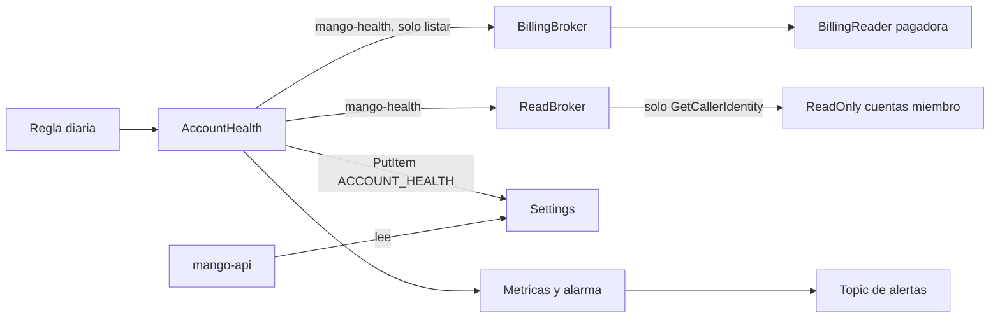

# Salud diaria de las cuentas miembro (`AccountHealth`, D84): modelo de amenazas (v0.1)

> Fecha: 2026-10-16 · Skill: `security-threat-model`. Decisión: [D84](../../architecture/decisions/D084-gobernanza-de-tools.md) (precisa D17). Arquitectura: §4.10.
> Amplía TM-A7 de `admin-v0-threat-model.md` y TM-O1 a TM-O4 de `member-access-threat-model.md`.
> Alcance: `functions/admin-probe/src/mango_admin_probe/health.py`, el actor reservado de `functions/admin-probe/src/mango_admin_probe/handler.py`, `infra/lib/constructs/account-health.ts`, los cambios de trust de `infra/lib/constructs/tools.ts` (broker de Billing) y `infra/lib/constructs/member-access.ts` (`ReadBroker`), la denegación de escritura de `mango-api` en `infra/lib/stacks/core-stack.ts`, `GET /api/admin/member-health` (`apps/api/src/mango_api/admin.py`) y la sección de la pantalla (`apps/web/src/components/admin/MemberHealth.tsx`).
> Comprobado en local (tests del probe con STS simulado, tests de infra sobre la plantilla sintetizada, tests de la API y de la web). **Nada está desplegado:** lo que falta ver en una instalación está en «Supuestos sin validar».

## Executive summary

Hasta D84 la cadena hacia las cuentas miembro solo se recorría en nombre de una persona: un administrador (AdminProbe) o el usuario de un pack. La comprobación diaria la recorre **sin persona**, como la identidad fija del sistema `mango-health`. El riesgo dominante es que esa identidad abra una puerta: que otro principal pueda presentarse como el sistema (y borrar la atribución de una persona), o que el rol de la comprobación lea datos sin nadie detrás.

Controles construidos:

- **Rol propio, no el del probe ni el del reconciliador.** `Mango-<ns>-AccountHealth` solo puede asumir los dos brokers y escribir un ítem. El reconciliador sigue de solo lectura en la cuenta Mango (D41, TM-M18) y el AdminProbe sigue actuando solo para un administrador.
- **La identidad del sistema es de un solo rol, y ese rol no tiene otra.** En el trust de cada broker, la sentencia nueva solo deja entrar a `Mango-<ns>-AccountHealth` con `sts:SourceIdentity = mango-health`; las sentencias de los demás llamadores (probe, conector, packs) ganan `StringNotEqualsIgnoreCase sts:SourceIdentity = mango-health` (sin distinguir mayúsculas). El AdminProbe además rechaza un `actor` igual a `mango-health`.
- **Solo comprueba la entrada.** La sesión en cada cuenta miembro lleva una session policy con `sts:GetCallerIdentity` y nada más. La lista de cuentas sale de la cadena de la pagadora con la misma session policy de Organizations que usa el probe.
- **El rol de las cuentas miembro no cambia** (StackSet): ya acepta cualquier `SourceIdentity` que el broker pase, y `mango-health` queda en su CloudTrail.
- **Estado escrito por una sola función.** El ítem `ACCOUNT_HEALTH`/`MEMBER` de `Settings` solo lo escribe la función (`dynamodb:LeadingKeys`); a `mango-api` IAM le niega escribir esa partición. `mango-api` lo lee como almacenamiento no confiable y responde valores cerrados.

## Scope and assumptions

- **Dentro:** la función diaria y su regla, su rol, su DLQ y sus alarmas; las sentencias nuevas y las condiciones añadidas en los trusts de `Mango-<ns>-BillingBroker` y `Mango-<ns>-ReadBroker`; el ítem de `Settings`; la ruta de lectura y la pantalla.
- **Fuera:** el rol `Mango-<ns>-ReadOnly` y el StackSet (sin cambios, `member-access-threat-model.md`); el rol `BillingReader` de la pagadora (sin cambios); las operaciones del AdminProbe salvo el actor reservado (TM-A7); el topic de alertas (TM-M20).
- **Supuestos:** la cuenta Mango la administra el cliente; quien puede cambiar trusts en ella ya controla todo (TM-O2). `sts:GetCallerIdentity` no requiere permiso y no lee datos de la cuenta.

## System model

### Primary components

| Componente | Cuenta | Qué es | Evidencia |
|---|---|---|---|
| `Mango-<ns>-AccountHealth` (función y rol) | `mango` | Lambda diaria, asíncrona, con DLQ | `infra/lib/constructs/account-health.ts`, `functions/admin-probe/src/mango_admin_probe/health.py` |
| Regla `Mango-<ns>-AccountHealth-daily` | `mango` | EventBridge, 06:30 UTC, 2 reintentos | `account-health.ts` |
| `Mango-<ns>-BillingBroker` | `mango` | Lista las cuentas por la pagadora | `infra/lib/constructs/tools.ts` |
| `Mango-<ns>-ReadBroker` | `mango` | Entra a cada cuenta miembro | `infra/lib/constructs/member-access.ts` |
| Ítem `ACCOUNT_HEALTH`/`MEMBER` | `mango` (`Settings`) | Último resultado: estado por cuenta, total, si el broker exige identidad | `health.py` (`item`) |
| `GET /api/admin/member-health` | `mango` (`mango-api`) | Lee el ítem para Ajustes › Conectividad | `apps/api/src/mango_api/admin.py` |

### Data flows and trust boundaries

- **EventBridge → función.** Sin datos de entrada (el evento se ignora). Solo la regla tiene permiso de invocación.
- **Función → `BillingBroker` → `BillingReader` (pagadora).** `SourceIdentity = mango-health`, tags `mango_user`/`mango_agent`, session policy de `organizations:ListAccounts`, `ListChildren` y `ListOrganizationalUnitsForParent`.
- **Función → `ReadBroker` → `ReadOnly` (cada cuenta).** Mismo `SourceIdentity`; session policy `sts:GetCallerIdentity`. Una prueba más: asumir `ReadBroker` **sin** `SourceIdentity` debe fallar (TM-O3).
- **Función → `Settings`.** `PutItem` del ítem, solo en su partición.
- **Administrador → `mango-api` → `Settings`.** `ViewAdmin` (Cedar) y `is_admin`; respuesta con modelo explícito y valores cerrados.
- **Métricas → alarma → topic.** `InvalidAccounts + IdentityNotRequired ≥ 1` y DLQ con mensajes.

## Assets and security objectives

| Asset | Why it matters | Security objective (C/I/A) |
|---|---|---|
| Atribución en CloudTrail (`SourceIdentity`) | Regla 5: una sesión de persona no puede pasar por el sistema, ni el sistema por una persona | I |
| Datos de las cuentas miembro | El rol `ReadOnly` lee métricas y alarmas; el sistema no debe leerlas | C |
| Trust de los brokers | Decide quién entra y con qué identidad | I |
| Ítem de salud | Lo que el administrador cree sobre la cobertura | I |
| Alertas | Avisan de una cuenta a la que Mango ya no entra | A |

## Attacker model

### Capabilities

- Ejecución de código dentro de la función (dependencia comprometida) o de otro principal de la cuenta `mango` que ya esté en el trust de un broker (probe, conector, rol de un pack).
- `mango-api` comprometido: invoca el AdminProbe con cualquier `actor` y escribe `Settings` salvo lo que IAM le niega.
- Administrador de una cuenta miembro: cambia o borra el rol de su cuenta.

### Non-capabilities

- Cambiar el trust de un broker sin ser administrador de la cuenta `mango` o el rol de CloudFormation (TM-O2).
- Invocar la función: solo la regla diaria tiene permiso.

## Entry points and attack surfaces

| Surface | How reached | Trust boundary | Notes | Evidence (repo path / symbol) |
|---|---|---|---|---|
| Invocación de la función | Regla de EventBridge | EventBridge → Lambda | El evento no se lee | `health.py` (`lambda_handler`) |
| `sts:AssumeRole` a los brokers con `mango-health` | Rol de la función | Lambda → broker | Sentencia propia por broker | `account-health.ts` (`trustAccountHealth`) |
| `sts:AssumeRole` a los brokers con otro `SourceIdentity` | Probe, conector, packs | Principal → broker | `StringNotEqualsIgnoreCase mango-health` | `NOT_THE_SYSTEM_IDENTITY` |
| `actor` del AdminProbe | `mango-api` | API → Lambda | Se rechaza `mango-health` | `handler.py` (`handle`) |
| Ítem `ACCOUNT_HEALTH` | DynamoDB | Función → tabla → API | Validado al leer | `admin.py` (`member_health`) |

## Top abuse paths

1. **Suplantar al sistema.** Un pack comprometido asume `ReadBroker` con `SourceIdentity = mango-health` para que su lectura en una cuenta miembro no quede a nombre de la persona. El trust lo rechaza (`StringNotEqualsIgnoreCase`) en `AssumeRole` y en `SetSourceIdentity`.
2. **Sistema que lee.** Código comprometido en la función asume `ReadOnly` sin session policy y lee métricas de todas las cuentas como `mango-health`. Posible: el rol de la cuenta miembro lo permite (TM-AH1).
3. **Ocultar una cuenta caída.** `mango-api` comprometido escribe un ítem con todo «válido». IAM le niega escribir la partición.
4. **Persona que pasa por sistema.** `mango-api` comprometido invoca el AdminProbe con `actor = mango-health`. El probe lo rechaza y, aunque no lo hiciera, el trust no acepta esa identidad del rol del probe.
5. **Silenciar el aviso.** La regla diaria se deshabilita o la función falla siempre. La DLQ alarma si falla; si la regla no corre, nada avisa (TM-AH5).

## Threat model table

| Threat ID | Threat source | Prerequisites | Threat action | Impact | Impacted assets | Existing controls (evidence) | Gaps | Recommended mitigations | Detection ideas | Likelihood | Impact severity | Priority |
|---|---|---|---|---|---|---|---|---|---|---|---|---|
| TM-AH1 | Código o dependencia comprometida en la función | Ejecutar con `Mango-<ns>-AccountHealth` | Asumir `ReadOnly` de cada cuenta, o `BillingReader` de la pagadora, sin session policy (o con una amplia) y leer hasta el tope del rol, como `mango-health` | Lectura de métricas, alarmas y metadatos de log groups de toda la organización, o de costos e inventario de la pagadora, sin persona detrás | Datos de cuentas miembro, atribución | El código pone `sts:GetCallerIdentity` como única acción (`health.py`, test `test_it_enters_only_as_the_system_identity_and_reads_nothing`); el rol solo puede asumir los dos brokers y escribir un ítem; la función solo depende de `boto3` y `mango-aws`; solo la invoca la regla | IAM no puede exigir la session policy en el trust: el tope real es el del rol `ReadOnly` (como TM-O1 con el probe) | Mantener la función sin dependencias nuevas. Alarma en CloudTrail de las cuentas miembro y de la pagadora sobre cualquier llamada de `mango-health` que no sea `AssumeRole`, `GetCallerIdentity` o el listado de Organizations | CloudTrail: eventos con `sourceIdentity = mango-health` distintos de `AssumeRole` y `GetCallerIdentity` | low | medium | **low** |
| TM-AH2 | Otro principal del trust de un broker | Código en el probe, el conector o el rol de un pack | Presentarse como `mango-health` para que una lectura no quede a nombre de la persona | Pérdida de atribución (regla 5) | Atribución | `StringNotEqualsIgnoreCase sts:SourceIdentity = mango-health` (sin distinguir mayúsculas) en `AssumeRole` y `SetSourceIdentity` de los demás llamadores; sentencia propia solo para el rol de la salud (`member-access.ts`, `tools.ts`, tests de infra); el probe rechaza `actor = mango-health` | — | — | CloudTrail: `AssumeRole` con `mango-health` cuyo `userIdentity` no es el rol de la salud | low | medium | **low** |
| TM-AH3 | Rol de la salud usado como persona | Código comprometido en la función | Asumir un broker con el `SourceIdentity` de una persona | Atribución falsa a un usuario | Atribución | La sentencia del rol exige `StringEquals sts:SourceIdentity = mango-health` (tests de infra) | — | — | CloudTrail | low | medium | **low** |
| TM-AH4 | `mango-api` comprometido u operador | Escritura en `Settings` | Escribir un ítem con todas las cuentas «válidas» o borrar el real | El administrador cree que hay cobertura que no hay | Ítem de salud | Deny a `mango-api` de `PutItem`, `UpdateItem`, `DeleteItem` y `BatchWriteItem` en `ACCOUNT_HEALTH` (`core-stack.ts`, test); la alarma no depende del ítem sino de las métricas de la función | Un administrador de la cuenta puede escribir la tabla | — | CloudTrail de datos sobre la partición | low | low | **low** |
| TM-AH5 | Operador o fallo | `events:DisableRule`, error permanente o cuota | La comprobación no corre o falla siempre | Una cuenta caída no avisa | Alertas | DLQ con alarma `AccountHealth-failed`; con datos ausentes la alarma de inválidas mantiene su estado; la pantalla muestra la fecha de la última comprobación | Nada avisa si la regla se deshabilita (igual que el reconciliador, TM-M20) | Alarma si `Runs` falta 48 h (pendiente también para el reconciliador) | CloudTrail `DisableRule`; fecha vieja en la pantalla | low | low | **low** |
| TM-AH6 | Contenido de AWS Organizations | Nombre de cuenta elegido por quien administra la organización | Marcado o instrucciones en el nombre | XSS en la pantalla | Pantalla de admin | Se guarda y se responde como texto (≤ 128 caracteres); React lo pinta como texto (test con ``); nunca llega a un LLM | — | — | — | low | low | **low** |
| TM-AH7 | Fallo transitorio | STS lento o con errores | Falsas alarmas o cuentas sin estado | Fatiga de alertas | Alertas | Un error que no es `AccessDenied` deja la cuenta `pending`, que no alarma; reintentos estándar de botocore (3); si el broker no responde (no `AccessDenied`) la ejecución falla y se reintenta | Una cuenta `pending` todos los días no avisa | Si hace falta, alarma por `PendingAccounts` en días seguidos | Métrica `PendingAccounts` | medium | low | **low** |

## Criticality calibration

- **High:** una identidad del sistema que cualquiera de la cuenta puede usar, o con permisos de datos o escritura. *(No aplica: un solo rol, solo `GetCallerIdentity` por política de sesión.)*
- **Medium:** pérdida de atribución de lecturas de personas.
- **Low:** ocultar la cobertura, fatiga de alertas, nombres de cuenta con marcado.

## Focus paths for security review

| Path | Why it matters | Related Threat IDs |
|---|---|---|
| `infra/lib/constructs/account-health.ts` | Rol, sentencias de trust y alarmas | TM-AH1–TM-AH5 |
| `infra/lib/constructs/member-access.ts`, `infra/lib/constructs/tools.ts` | Condiciones añadidas a los trusts | TM-AH2, TM-AH3 |
| `functions/admin-probe/src/mango_admin_probe/health.py` | Session policies e identidad | TM-AH1, TM-AH7 |
| `functions/admin-probe/src/mango_admin_probe/handler.py` | Actor reservado | TM-AH2 |
| `apps/api/src/mango_api/admin.py` (`member_health`) | Lectura del ítem | TM-AH4, TM-AH6 |
| `infra/test/account-health.test.ts` | Fija trusts, permisos y alarmas | Todos |

## Supuestos sin validar

1. **Condición `StringNotEqualsIgnoreCase` sobre `sts:SourceIdentity` en el trust** de un `AssumeRole` encadenado desde una sesión con identidad: la documentación de IAM dice que la llave está presente; no se probó en una cuenta real. Si no lo estuviera, los llamadores existentes dejarían de entrar (falla cerrado) y se vería en la prueba de Conectividad.
2. **`sts:GetCallerIdentity` con una session policy que lo nombra**: no requiere permiso; la session policy solo deja claro que no se pide nada más.
3. **Volumen:** 500 cuentas por ronda como máximo, 8 a la vez, dentro de 5 minutos. No se midió en una organización grande.
