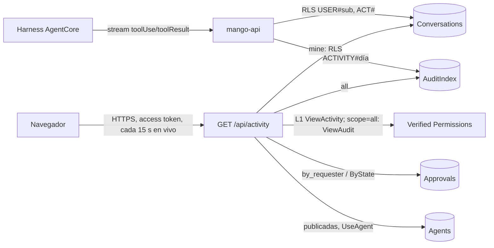

# Actividad: qué hacen los agentes: modelo de amenazas (v0.1)

> Fecha: 2026-10-24 (ajustado ese día a la ronda de diseño 19) · Skill: `security-threat-model`. Decisiones: D16, D23, D24, D56, D70, D73, D82, D83 y **D90** (esta, `propuesta`).
> Amplía `inbox-threat-model.md` (misma partición por persona) y `write-tools-approval-threat-model.md` (aprobaciones).
> Alcance: el registro de cada llamada a una tool en `harness.run` y su escritura (`activity_store.py`), `GET /api/activity` (`activity.py`), la política Cedar `policies/cedar/platform/activity-view.cedar` y la pantalla `apps/web/src/pages/activity/`.
> Se escribe **antes** de construir (regla de `AGENTS.md`), con las seis respuestas del 2026-10-24 (por menú): cada persona ve lo suyo y un administrador todo; sin parámetros de las tools; evento propio de `mango-api`; solo los bloqueos de presupuesto al 100 %; brief y construir; 30 días. Nada está desplegado.

## Executive summary

La Actividad dice qué hicieron los agentes: qué tool llamó cada uno, con qué resultado y en cuánto tiempo, qué aprobaciones pidió, cuándo un agente se quedó sin presupuesto y cuándo se publicó una versión. El dato nuevo es el **uso**: quién usó qué agente y cuándo es dato personal y, para un administrador, una forma de vigilar a las personas. El riesgo dominante es **enseñar el uso de una persona a otra**, o enseñar a un administrador más que metadatos. Le siguen el **contenido que se cuela** (argumentos o resultados de tools en el registro o en logs, contra D16) y el **nombre de tool escrito por el modelo** mostrado como si fuera cierto.

Riesgos dominantes:

1. **Ver la actividad de otra persona** (TM-AC1).
2. **Un administrador ve contenido** (TM-AC2): argumentos, resultados o la conversación de otra persona (D23).
3. **Contenido en el registro o en los logs** (TM-AC3).
4. **Nombre de tool falso o inyección en pantalla** (TM-AC4).
5. **Abuso de la ruta y del «En vivo»** (TM-AC5).
6. **El registro rompe o retrasa el turno** (TM-AC6).

Controles que se construyen:

- **Lo de cada persona vive en su partición** de la tabla de conversaciones (`USER#`, prefijo `ACT#`), escrito y leído solo con el cliente de RLS (`dynamodb:LeadingKeys`), como la Bandeja (D83). `scope=mine` no puede leer otra partición.
- **Lo de todos** vive en particiones por día (`ACTIVITY#<día>`) de la tabla índice de auditoría, que `mango-api` ya escribe y lee, y se escribe al terminar cada turno (ronda de diseño 19); solo se lee con `scope=all`, que exige además L1 `ViewAudit` (administradores). Ninguna persona sin `ViewAudit` llega a esas particiones.
- **Solo metadatos:** agente, versión, tool, ok/error, milisegundos, hora e ids (conversación, tarea y ejecución). Nunca argumentos, resultados, texto del modelo ni prompts. La API nunca devuelve la persona de un evento ni la conversación, la tarea o la ejecución de un evento que no es de quien mira.
- **El nombre de la tool solo se guarda si es de la versión publicada** (TM-LP1): una llamada a una tool que el modelo inventó no se registra.
- **L1 `ViewActivity`** (Cedar, toda persona con sesión) en la ruta, auditada como lectura; parámetros validados por esquema; límite de tasa por persona compartido entre tareas; respuesta acotada (1.000 eventos, `truncated`).
- **Escribir nunca rompe el turno:** el fallo se registra en el log sin contenido y el turno sigue.

## Scope and assumptions

- **Dentro:** el registro de llamadas en el chat y en las tareas; el registro del bloqueo de un turno por el presupuesto del agente; `GET /api/activity`; las aprobaciones que la ruta lee de su tabla y los agentes del alcance; la pantalla.
- **Fuera:** tickets (sin backend, D24); parámetros de las tools (no se guardan, D90 (3)); trazas de AgentCore y logs del Gateway (no se leen ni se encienden).
- **Supuestos:**
  1. El rol de `mango-api` ya es de confianza para la tabla índice de auditoría y para asumir el rol de datos con RLS: no se añade IAM.
  2. Un administrador ya ve en Auditoría `agent.invoke`/`agent.completed` con la persona, el agente y los nombres de las tools de cada turno: la Actividad le enseña menos (sin persona).
  3. El nombre de una tool y su resultado los decide el harness; el nombre lo escribe el modelo.

## System model

- **`mango-api`**: `harness.run` (stream del harness) llama a `on_call` al llegar el `toolResult` de cada llamada; el chat y el worker de tareas escriben el evento. La ruta `/api/activity` (`activity.py`).
- **Tabla `Mango-<ns>-Conversations`** (CMK, PITR, `RETAIN`, TTL): `USER#` / `ACT#<ms><hex>`.
- **Tabla `Mango-<ns>-AuditIndex`** (TTL): `ACTIVITY#<día>` / `<ts>#<id>`. Las particiones `DAY#` de la auditoría no cambian.
- **Tablas de aprobaciones y de agentes** (solo lectura) y **Verified Permissions**.

## Assets and security objectives

| Activo | Por qué importa | Objetivo |
|---|---|---|
| Uso de agentes por persona | Dato personal; vigilancia | C |
| Metadatos de tools (nombre, error, latencia) | Revelan qué sistemas toca un agente | C (media) |
| Disponibilidad del turno | El registro va en el bucle del stream | A |
| Costo de lectura | «En vivo» consulta cada 15 s | A |

## Attacker model

- **Puede:** persona con sesión que manipula parámetros (`scope`, `range`, `since`) o automatiza consultas; contenido no confiable que hace al modelo escribir nombres de tools falsos (inyección indirecta).
- **No puede:** llegar sin sesión; elegir la partición (sale del token verificado); escribir eventos (solo `mango-api` desde el stream); ver `scope=all` sin `ViewAudit`.

## Entry points

| Superficie | Límite | Notas |
|---|---|---|
| `GET /api/activity?range=&scope=&since=` | L1 `ViewActivity`; `scope=all` + `ViewAudit`; RLS para `mine` | `range` y `scope` en lista cerrada; `since` fecha ISO acotada al periodo |
| Fin de cada llamada a tool (stream) | Interno | Nombre solo si es de la versión |
| Bloqueo por presupuesto del agente | Interno | Solo el ámbito `AGENT#` |

## Threat model table

| ID | Amenaza | Activo | Prob. | Impacto | Prioridad | Controles |
|---|---|---|---|---|---|---|
| TM-AC1 | Ver la actividad de otra persona (`scope=all` sin ser admin, partición ajena) | Uso | Baja | Media | **Media** | RLS `LeadingKeys` para `mine`; `scope=all` exige `ViewAudit` (Cedar) antes de leer; test por regla |
| TM-AC2 | Un admin ve contenido o la conversación de otra persona | Uso, contenido | Media | Media | **Media** | Solo metadatos guardados; la API no devuelve persona; conversación, tarea, ejecución y nombre de la tarea solo si el evento es de quien mira (D23; ronda de diseño 19) |
| TM-AC3 | Argumentos, resultados o texto del modelo en el registro o en logs | Contenido | Baja | Alta | **Media** | El registro solo recibe nombre, estado y tiempo; los logs de fallo no llevan datos del evento; D16 intacta (sin logs del Gateway) |
| TM-AC4 | Nombre de tool inventado, o HTML/enlaces en pantalla | Integridad, navegador | Media | Baja | **Baja** | Solo nombres de la versión publicada; texto plano en la SPA; CSV con escape de fórmulas |
| TM-AC5 | Consultas masivas, 7 días de todos en bucle | Disponibilidad, costo | Media | Baja | **Baja** | Límite de tasa por persona compartido (D70); 1.000 eventos por respuesta; «En vivo» cada 15 s con la pestaña visible; `since` acotado |
| TM-AC6 | Fallo o lentitud al escribir rompe el turno | Disponibilidad | Baja | Media | **Baja** | `on_call` nunca lanza; un fallo solo se loguea; escrituras de un ítem |
| TM-AC7 | Una aprobación que la pantalla de origen no enseñaría | Uso | Baja | Baja | **Baja** | Aprobaciones con la regla de Aprobaciones (D56): las propias y, para admins, las del nivel `approvers`. Sin publicaciones (no están en el modo «Disponible hoy» del diseño) |

## Focus paths for security review

- `apps/api/src/mango_api/harness.py`: `on_call` solo con nombres conocidos, nunca con argumentos.
- `apps/api/src/mango_api/activity_store.py`: el cliente RLS por persona; el contenido de los ítems.
- `apps/api/src/mango_api/activity.py`: `ViewAudit` antes de `scope=all`; qué campos salen; `conversation_id` solo propio.
- `apps/web/src/pages/activity/`: texto plano, CSV.

## Quality check

- Entradas cubiertas: la ruta, el registro de llamadas y el del bloqueo.
- Límites: navegador → API; API → STS/Conversations; API → AuditIndex; API → aprobaciones y agentes.
- Respuestas del dueño reflejadas (seis, 2026-10-24).

## Revisión `security-audit` del diff (2026-10-24, modo guía)

Revisión enfocada de la rama del servidor, sin IAM nuevo (la Actividad usa el rol de datos con RLS y la tabla índice que `mango-api` ya escribe) y con una política Cedar nueva (`ViewActivity`). Sin hallazgos que crucen una frontera:

- **Partición:** `ActivityStore.mine` y la escritura de la copia propia piden el cliente con el `sub` del token verificado (o, en una tarea, el de su dueño, que es el actor del turno); un test registra a quién se pidió cada cliente y que `scope=all` no toca ninguna partición de persona.
- **Lo de todos:** `views_all` (`ViewAudit`) se decide y se audita antes de leer nada; sin él, la ruta solo lee la partición propia (test). La decisión se audita como lectura (`read_only`, `purpose: "activity"`), también cuando se deniega: hasta el 2026-10-25 una denegación no contaba como lectura (ver la revisión de la release, abajo).
- **Forma de la respuesta:** de un evento ajeno salen agente, tool, resultado, latencia y hora; nunca la persona, la conversación, la tarea, la ejecución ni el nombre de la tarea (que además solo existe en la copia propia; test).
- **Contenido:** el registro solo recibe `ToolCall` (nombre de la versión, ok, ms); un test fija qué atributos existen en las dos copias.
- **Abuso:** 60 lecturas por minuto y persona; 1.000 eventos por respuesta; `since` exige zona horaria y se acota al periodo y a «ahora». Encontrado y corregido en esta revisión: un `since` futuro producía una consulta inválida a DynamoDB (límite inferior mayor que el superior) y un 503 con traza en el log; ahora responde vacío (test).
- **Turno:** `TurnActivity` nunca lanza; el log de un fallo no lleva datos del evento.

Queda **sin ver en una instalación**: que la política `ViewActivity` se cree con el change set, y que la política de sesión de `Mango-<ns>-ConversationData` deje escribir y leer los ítems `ACT#` (usa `PutItem` y `Query`, ya permitidos). Las dos cosas se vieron en la instalación el 2026-10-25: la política está en el almacén y un turno real escribió sus `ACT#`.

## Revisión `security-audit` de la release instalada (2026-10-25, modo guía)

La revisión de la release encontró un hallazgo de severidad baja: la decisión de `ViewAudit` que elige el alcance se auditaba como lectura solo si se permitía. Para quien no es administrador quedaba como una denegación, visible en Auditoría aunque se excluyeran las lecturas y contada en Gobernanza. Con «En vivo» eran unas 240 por hora y pestaña. Una persona con sesión podía así llenar el registro de denegaciones falsas y sacar de la «actividad reciente» de Gobernanza (2.000 eventos examinados) los eventos reales. No se perdía ningún evento.

- **Arreglo:** `audit.is_read` trata como lectura una `policy.decision` con `read_only` y un `purpose` de una lista cerrada (`SCOPE_PURPOSES`, hoy solo `activity`), se permita o no. Cualquier otra denegación sigue a la vista, también una con `read_only` pero sin propósito o con otro.
- **Tests:**
  - una lectura de la Actividad, de un administrador o de quien no lo es, solo deja lecturas en la auditoría;
  - la denegación de alcance no aparece con `exclude_reads` ni suma en `audit.count`, y las denegaciones reales sí.
