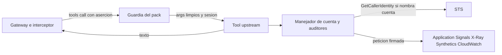

# Pack AWS Application Signals sobre cuentas miembro: modelo de amenazas (v0.1)

> Fecha: 2026-11-13 · Skill: `security-threat-model`; el punto de entrada se escribió con `security-best-practices` (modo generación). Decisiones: D16, D19, D36, D37, D51, D55 (3), D84; R6. Fuente: análisis SRE de los MCP de awslabs (REA sobre el wheel 0.2.1).
> Amplía `aws-cloudwatch-pack-threat-model.md`, que modela la cadena `member` (aserción, broker, rol de las cuentas miembro, `account_id`, `region`): todo lo que dice de ella vale aquí y no se repite. Este documento solo trata lo propio de este pack.
> Alcance: `packs/aws-application-signals/` (manifiesto, punto de entrada, lock y snapshot) y el código upstream que sirve (`awslabs.cloudwatch-applicationsignals-mcp-server` 0.2.1: `server.py`, `aws_clients.py`, `audit_utils.py`, `service_audit_utils.py`, `service_tools.py`, `slo_tools.py`, `trace_tools.py` (`list_slis`, `get_xray_trace`), `sli_report_client.py`, `change_tools.py`, `group_tools.py` y `check_canaries_for_service` de `canary_utils.py`).
> Comprobado en local: el pipeline completo del pack (`check`, `check-lock`, `build` dos veces idéntico, `pip-audit`, `snapshot` en el contenedor sin red, `statement`) y el punto de entrada con el servidor upstream real y AWS cortocircuitado antes de enviar (cuentas enlazadas, otra cuenta, auditor `log`, logs en disco, región). **Nada está desplegado.** Las acciones IAM nuevas del rol de las cuentas miembro y los endpoints nuevos de la red de packs son de otro cambio (plataforma); hasta que entren, el pack no se puede instalar.

## Executive summary

Segundo pack de la cadena `member`. Sirve 16 tools de solo lectura de CloudWatch Application Signals (servicios, operaciones, dependencias, SLO, cambios y auditorías), trazas de X-Ray **por id** y canarias de Synthetics, en la cuenta miembro que pide cada llamada. Lo propio de este pack:

1. **Observabilidad entre cuentas (R6).** Application Signals responde por las cuentas enlazadas a una cuenta de monitoreo: `IncludeLinkedAccounts` va a `true` por defecto en `list_slos` y fijo en las auditorías y en el informe de SLI, y varias operaciones aceptan una cuenta (`AwsAccountId` en `KeyAttributes`, en los objetivos de auditoría y en el filtro de `list_change_events`).
2. **Logs en disco.** El servidor abre al importarse un archivo de log de loguru en el directorio temporal y cada auditoría añade sus parámetros y la respuesta completa a otro archivo (`AUDITOR_LOG_PATH`).
3. **El auditor `log`** de `ListAuditFindings` lee logs del servicio auditado; D55 (3) dice que los packs no leen contenido de logs.
4. **El servidor crece rápido:** 46 tools, entre ellas instrumentación dinámica (escritura y borrado), PromQL firmado a mano fuera de botocore, Logs Insights sobre spans y RUM, descarga de código de canarias con `requests` y lectura de archivos del servidor.
5. **Contenido no confiable:** nombres de servicios y operaciones, atributos y anotaciones de trazas, nombres de SLO y canarias los escribe cualquiera que despliegue en una cuenta miembro.

Controles construidos (en el punto de entrada y el manifiesto firmado):

- **Solo la cuenta de la llamada.** Un manejador `before-parameter-build` en todos los clientes del servidor (y en la sesión por defecto, para los que cree después) pone `IncludeLinkedAccounts=false` en toda operación que lo tenga y rechaza, antes de firmar, una petición que nombre otra cuenta (`AwsAccountId`, `SloOwnerAwsAccountId`, `AccountId` en cualquier nivel). La cuenta de la sesión se pregunta a STS (`GetCallerIdentity`, sin permisos) solo cuando una petición nombra alguna. `include_linked_accounts` no se lista y la guardia lo quita.
- **Sin auditor `log`.** `ListAuditFindings` siempre lleva la lista de auditores, nunca `log`; pedir solo `log` se rechaza con un mensaje fijo.
- **Sin logs en disco ni de upstream.** `AUDITOR_LOG_PATH=/dev/null` antes de importar y durante toda la vida del proceso; se quitan todos los destinos de loguru (el de por defecto antes de importar y los del servidor después). Solo queda `pack.call` (D16).
- **Entorno limpio.** Se borran `MCP_*` (overrides de endpoints y el user agent), `FASTMCP_*`, `AWS_PROFILE` y cualquier `AUDITOR_LOG_PATH` heredado. `AWS_REGION` = `MANGO_PACK_REGION`: todos los clientes son de la región de la instalación.
- **`tools/list` independiente de la instalación:** el `region` de `list_canaries` y `list_change_events` no lista su valor por defecto (la región del proceso que lista), así que el `tools_hash` firmado vale en cualquier región.
- **16 tools, 18 acciones exactas de lectura** (session policy de cada llamada). Quedan fuera las 30 tools restantes, con motivo en el manifiesto.

## Scope and assumptions

- **Dentro:** qué tools y argumentos se sirven; a qué operaciones de AWS llaman y con qué parámetros; lo que el servidor escribe en disco y en logs; el listado de `tools/list`.
- **Fuera:** la cadena `member` y la identidad (`aws-cloudwatch-pack-threat-model.md`, `pack-identity-threat-model.md`); la red de packs (`pack-egress-threat-model.md`); el pipeline de build y firma (`mcp-pack-pipeline-threat-model.md`); el provisioner.
- **Supuestos:**
  1. Valen los de `aws-cloudwatch-pack-threat-model.md` (en particular: un usuario central puede ver los datos de lectura de todas las cuentas objetivo, D35, D37).
  2. Las tools upstream llaman a boto3 en la tarea de la petición o con `asyncio.to_thread` (comprobado por grep: ni `run_in_executor` ni hilos propios en el código de las tools servidas), así que heredan la identidad de la llamada.
  3. Los servicios no aceptan un id de cuenta fuera de los parámetros que nombra `ACCOUNT_KEYS` (comprobado contra el modelo de botocore 1.43.125 para Application Signals; CloudWatch solo en `MetricDataQueries[].AccountId`).

## System model

### Primary components

| Componente | Qué es | Evidencia |
|---|---|---|
| Manifiesto firmado | `chain: member`, 16 tools `read`, 18 acciones, `egress` `sts`, `application-signals`, `cloudwatch`, `xray`, `synthetics` | `packs/aws-application-signals/manifest.yaml` |
| Punto de entrada | Entorno, logs, manejador de cuentas y auditores, listado de `region` | `packs/aws-application-signals/entrypoint.py` (`only_the_call_account`, `without_log_auditor`, `unlisted_region_default`) |
| Clientes del servidor | Creados al importar `aws_clients.py`, en `AWS_REGION` | upstream `aws_clients.py` |
| Servidor upstream | `MCPServer` con 46 tools; se sirven 16 | upstream `server.py` |

### Data flows and trust boundaries

- **Guardia → tool upstream:** como en CloudWatch (argumentos sin `_mango_ctx`, `account_id` ni ocultos; sesión ya asumida).
- **Tool → botocore → manejador del pack → AWS de la cuenta miembro:** cada petición pasa por `only_the_call_account` antes de validarse y firmarse.
- **Manejador → STS (`GetCallerIdentity`):** solo si una petición nombra una cuenta; con las credenciales de la llamada, por el endpoint de STS de la red de packs.
- **Tool → modelo:** texto armado por upstream con lo que respondió AWS (no confiable).
- **Proceso → disco:** nada (`/dev/null`). **Proceso → stderr:** `pack.call`.

#### Diagram

## Assets and security objectives

| Asset | Why it matters | Objective |
|---|---|---|
| Servicios, dependencias, SLO, trazas y canarias de las cuentas objetivo | Revelan arquitectura, rutas y errores de las aplicaciones | C |
| Datos de cuentas que no son objetivo (enlazadas a una cuenta de monitoreo) | Excluidas a propósito (D51 (2)) | C |
| Contenido de logs de las aplicaciones | Fuera por D55 (3) | C |
| Disco y logs operativos del Runtime | No deben guardar argumentos ni respuestas (D16) | C |
| `tools_hash` firmado | La instalación compara el `tools/list` real con él | I, A |

## Attacker model

### Capabilities

- **Usuario central o el modelo:** cualquier argumento de las 16 tools, también JSON libre en `service_targets`, `slo_targets`, `operation_targets`, `key_attributes` y `service_key_attributes`.
- **Quien despliega en una cuenta miembro:** controla nombres de servicios, operaciones, entornos, anotaciones de trazas, nombres de canarias y SLO.
- **Código comprometido en el pack** (upstream o sus ~50 dependencias): como en TM-CW2.

### Non-capabilities

- No cambia el manifiesto, el punto de entrada ni el entorno (van firmados o los fija el provisioner).
- No tiene acciones de escritura en ninguna cuenta.

## Entry points and attack surfaces

| Surface | Trust boundary | Notes | Evidence |
|---|---|---|---|
| JSON de objetivos de auditoría y de atributos | Modelo → upstream → AWS | Pueden nombrar `AwsAccountId` | `service_audit_utils.py:74-96`, `change_tools.py:244` |
| `include_linked_accounts` | Modelo → guardia | Oculto y quitado | `slo_tools.py:283`, `entrypoint.py` |
| `IncludeLinkedAccounts=True` fijo | Upstream → AWS | Forzado a `false` | `audit_utils.py:671`, `sli_report_client.py:208` |
| `auditors` | Modelo → upstream → AWS | `all` = todos (incluido `log`) | `audit_utils.py:394-424` |
| `region` | Modelo → guardia → upstream | Acotado por la guardia; los clientes son de la región de la instalación de todos modos | `server.py:1625`, `change_tools.py:366` |
| `AUDITOR_LOG_PATH`, sumidero de loguru | Upstream → disco | `/dev/null`, sumideros quitados | `server.py:97-117`, `audit_utils.py:37-165` |
| `MCP_*_ENDPOINT` | Entorno → upstream | Borrados | `aws_clients.py:62-89` |
| Descripciones de las tools | Upstream → modelo | Mencionan tools que no se sirven (`get_service_health_overview`, `analyze_canary_failures`) | `tools.snapshot.json` |

## Top abuse paths

1. **Cuentas enlazadas por `list_slos`.** El modelo omite `include_linked_accounts` (upstream lo pone a `true`) en una cuenta de monitoreo → el manejador lo envía a `false` → solo SLO de la cuenta pedida.
2. **Otra cuenta en un objetivo de auditoría.** `service_targets` con `AwsAccountId` de una cuenta enlazada → el manejador compara con la cuenta de la sesión y rechaza antes de firmar; el modelo recibe el mensaje fijo.
3. **Logs por la auditoría.** `auditors: "all"` o `"log"` → el manejador quita `log` (o rechaza si era el único).
4. **Argumentos en disco.** Cada auditoría escribiría su payload en `aws_api.log` → va a `/dev/null`; el sumidero de loguru no queda.
5. **Endpoint ajeno por el entorno.** `MCP_APPLICATIONSIGNALS_ENDPOINT` → borrado antes de importar; además la red de packs solo alcanza los endpoints declarados.
6. **Tools fuera del manifiesto.** El modelo, guiado por una descripción, llama `get_service_health_overview` → el servidor no la tiene; la guardia la rechaza.
7. **Instrucciones en datos.** Una anotación de traza o un nombre de servicio con instrucciones → el agente solo tiene tools de lectura.

## Threat model table

| Threat ID | Threat source | Prerequisites | Threat action | Impact | Impacted assets | Existing controls (evidence) | Gaps | Recommended mitigations | Detection ideas | Likelihood | Impact severity | Priority |
|---|---|---|---|---|---|---|---|---|---|---|---|---|
| TM-AS1 | Usuario central o modelo | La cuenta pedida es cuenta de monitoreo de Application Signals | Leer servicios, SLO o estados de cuentas enlazadas (`IncludeLinkedAccounts`, `AwsAccountId`) | Datos de cuentas que no son objetivo | Datos de cuentas no objetivo | `IncludeLinkedAccounts=false` en toda operación que lo tiene; rechazo de cualquier cuenta distinta de la de la sesión antes de firmar; `include_linked_accounts` oculto (`entrypoint.py`, comprobación local) | Un parámetro nuevo de upstream o del servicio con otro nombre de cuenta no estaría en `ACCOUNT_KEYS` | Al actualizar: repetir la búsqueda en el modelo de botocore del lock nuevo (`AwsAccountId`, `AccountId`, `IncludeLinkedAccounts`) | `pack.call` con `error`; CloudTrail de la cuenta de monitoreo | low | medium | **low** |
| TM-AS2 | Usuario central o modelo | Auditor `log` disponible en el servicio | Auditoría con `log` | Contenido de logs en la conversación, contra D55 (3) | Logs de aplicaciones | El manejador nunca envía `log` y rechaza pedir solo `log` | Si AWS añade otro auditor que lea logs, entraría con `all` | Al actualizar, revisar la lista de auditores del modelo de botocore y de upstream | — | low | medium | **low** |
| TM-AS3 | Servidor upstream | — | Escribir argumentos y respuestas de auditorías en disco o en logs | Datos de cuentas en disco del Runtime o en logs operativos (D16) | Disco, logs | `AUDITOR_LOG_PATH=/dev/null` toda la vida del proceso; loguru sin destinos; comprobado que no aparece ningún archivo en el temporal | Una versión nueva puede leer otra variable o abrir otro archivo | Al actualizar: `grep -rn "open(\|logger.add\|tempfile"` | Revisar el log group del Runtime en el e2e | low | low | **low** |
| TM-AS4 | Instalación | Región distinta de la del build | `tools/list` con el `region` por defecto de la instalación no coincide con `tools_hash` | El pack no se instala (disponibilidad) | `tools_hash` | El listado quita el valor por defecto de `region` (`unlisted_region_default`); snapshot sin `us-east-1` | — | Que la guardia común quite siempre el valor por defecto de `region` del listado (P4) | Fallo `tools_hash` del provisioner | low | low | **low** |
| TM-AS5 | Contenido de una cuenta miembro | Desplegar o anotar servicios, trazas, SLO o canarias | Texto con instrucciones o datos sensibles en anotaciones y metadatos de trazas | Respuesta manipulada; datos sensibles en la conversación | Integridad, C | Tools de solo lectura; guardrail base; contenido a la conversación con su retención, nunca a logs | `BatchGetTraces` devuelve los segmentos completos (URLs con query, SQL saneado, anotaciones) | Guía del agente: no seguir instrucciones de datos leídos | — | medium | low | **low** |
| TM-AS6 | Código comprometido en el pack | Dependencia maliciosa | Lo mismo que TM-CW2, con el tope de las 18 acciones | Lecturas de Application Signals, X-Ray y Synthetics de toda la organización | Datos, atribución | Tope del rol de las cuentas miembro (solo lectura, ARN donde existe); red sin internet (R6); lock con hashes y cuarentena; `pip-audit` | `xray:BatchGetTraces` lee trazas completas de cualquier id | — | `AssumeRole` sin `Policy`; volumen por `sourceIdentity` | low | medium | **low** |
| TM-AS7 | Usuario central o modelo | — | Auditorías con comodines y lotes grandes; `GetMetricData` del informe de SLI | Costo y cuotas en la cuenta miembro | Disponibilidad, costo | Upstream acota `max_services` (≤ 10) y lotes de 5; límite de invocaciones del agente | `ListAuditFindings` y `GetMetricData` se cobran o consumen cuota en la cuenta miembro | Decidir si las APIs de datos entran en presupuestos (como TM-CW8) | `CallCount` por cuenta | low | low | **low** |
| TM-AS8 | Tools upstream fuera del manifiesto | — | Instrumentación dinámica (escribe y borra), PromQL con `requests`, Logs Insights, descarga de código de canarias, lectura de archivos del servidor | Escritura, contenido de logs, salida HTTP fuera de botocore | Datos, integridad | No se sirven (`restrict_tools`); sus acciones no están en la session policy ni en el rol; D84: un pack con tools no `read` no se instala | Las descripciones de las tools servidas las nombran | — | — | low | medium | **low** |

## Criticality calibration

- **Critical:** el pack escribe en una cuenta miembro (instrumentación dinámica). *(No aplica: no se sirve y el rol no tiene escritura.)*
- **High:** contenido de logs de aplicaciones en la conversación; datos de una cuenta que no es objetivo de forma sistemática.
- **Medium:** el pack comprometido lee trazas de toda la organización (TM-AS6).
- **Low:** datos de una cuenta enlazada por un parámetro nuevo de upstream; costo de las auditorías.

## Focus paths for security review

| Path | Why it matters | Related Threat IDs |
|---|---|---|
| `packs/aws-application-signals/entrypoint.py` | Cuentas, auditores, logs, entorno y listado | TM-AS1–TM-AS4 |
| `packs/aws-application-signals/manifest.yaml` | Tools, acciones y motivos de lo que queda fuera | TM-AS6, TM-AS8 |
| upstream `audit_utils.py`, `sli_report_client.py`, `slo_tools.py`, `service_audit_utils.py`, `change_tools.py` | Dónde se fija `IncludeLinkedAccounts` y se copia `AwsAccountId` | TM-AS1 |
| upstream `server.py:90-120`, `audit_utils.py:30-170` | Sumideros de log | TM-AS3 |

## Supuestos sin validar

1. **`GetCallerIdentity` desde la sesión de la cuenta miembro** por el endpoint de STS de la red de packs (su política exige `aws:PrincipalOrgID`; la sesión es de la organización).
2. **Si `ListServices` con `IncludeLinkedAccounts=false` devuelve `AwsAccountId` en `KeyAttributes`.** Si lo hace, el modelo lo copiará en las auditorías; el manejador lo deja pasar porque es la cuenta de la sesión (una consulta a STS por llamada).
3. **Qué permisos pide `ListAuditFindings` para sus auditores** (`trace`, `dependency_metric`, `top_contributor`): si AWS los ejecuta con los permisos del llamador, alguno podría responder `AccessDenied` con las 18 acciones.
4. **Las acciones y los endpoints de plataforma:** `application-signals`, `xray` y `synthetics` como endpoints de interfaz con política, en la región de la instalación.
