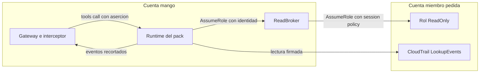

# Pack AWS CloudTrail sobre cuentas miembro: modelo de amenazas (v0.1)

> Fecha: 2026-11-13 · Skill: `security-threat-model`; el punto de entrada se escribió con `security-best-practices` (Python, modo generación). Decisiones: D16, D19, D36, D37, D51, D54, D55 y la de los agentes `sre` y `dba` (`propuesta`, la registra el agente `docs`).
> Hereda de `aws-cloudwatch-pack-threat-model.md` (la cadena `member`: `account_id`, broker, rol `Mango-<ns>-ReadOnly`, región de la instalación), `pack-identity-threat-model.md` (aserción, solo centrales, credenciales por llamada) y `pack-egress-threat-model.md` (red de packs, R6). Aquí solo va lo propio de este pack.
> Alcance: `packs/aws-cloudtrail/` (manifiesto, punto de entrada, lock, snapshot) y el código upstream que sirve: `awslabs.cloudtrail-mcp-server` 0.1.1 (`server.py`, `tools.py` `lookup_events`, `common.py`).
> Comprobado en local: el pipeline completo del pack (`check`, `check-lock`, dos `build` idénticos, `pip-audit` sin vulnerabilidades, `snapshot` en el contenedor sin red, `statement`); tests del manifiesto, del esquema listado y del recorte de eventos (`deployment/pack-builder/tests/test_pack.py`); y el servidor upstream real con el envoltorio del punto de entrada contra un cliente simulado (un evento de 50 KB sale en 3 KB). **Nada está desplegado.**

## Executive summary

Sirve **una tool**, `lookup_events`: los eventos de gestión de CloudTrail de los últimos 90 días de la cuenta miembro que nombra cada llamada, con una acción de lectura (`cloudtrail:LookupEvents`). Lo propio de este pack frente a CloudWatch:

1. **Lee el registro de auditoría de la cuenta.** Un evento lleva quién llamó (ARN del principal, `SourceIdentity`, id de llave de acceso), desde dónde (IP, agente de usuario) y los parámetros y la respuesta de la llamada (`requestParameters`, `responseElements`). Es más sensible que una métrica: dice cómo se opera cada cuenta y quién lo hace.
2. **Texto que escribe cualquiera con acceso a la cuenta:** nombres de recursos, parámetros de llamadas y agentes de usuario llegan al modelo (inyección indirecta).
3. **Volumen (R5):** hasta 50 eventos por página, cada uno con su JSON completo, satura el contexto del modelo. El punto de entrada recorta cada evento.
4. **Región por defecto de upstream:** si el modelo omite `region`, upstream usa el literal `us-east-1`, no la región de la instalación. La guardia la rellena con la de la instalación y el esquema listado no lleva ese valor por defecto.
5. **CloudTrail Lake queda fuera:** `cloudtrail:StartQuery` es *Write* en la referencia de IAM, ejecuta SQL arbitrario cobrado por GB y bloquea el servidor hasta 300 s.

Controles construidos (además de los heredados):

- **Una tool, una acción exacta de lectura** como session policy de cada llamada. `lake_query`, `get_query_status`, `get_query_results` y `list_event_data_stores` no se sirven (`restrict_tools`).
- **Recorte de cada `CloudTrailEvent`** en el punto de entrada (`shrink_event`): primero los campos voluminosos (`requestParameters`, `responseElements`, `additionalEventData`, `serviceEventDetails`) a 1 024 caracteres cada uno, luego el registro entero a 4 096, con una marca que dice cuánto se quitó. Los campos pequeños (quién, qué, cuándo, desde dónde, `errorCode`) quedan enteros siempre que el registro quepa.
- **Sin logs de upstream:** `tools.py` registra los parámetros de búsqueda (nombres de usuario e ids de llaves buscados) con `loguru`; se quitan sus destinos antes de importar el servidor. Solo queda `pack.call`.
- **Sin argumentos de credenciales, cuenta ni endpoint en upstream:** la tool no tiene `profile_name`; upstream lee `AWS_PROFILE` del entorno, que el punto de entrada borra junto con `MCP_*` y `FASTMCP_*`.
- **Dependencias ligeras** (50 paquetes, zip de 60 MB sin comprimir), lock con hashes, cuarentena de 7 días (`exclude_newer` 2026-11-06), `pip-audit` sin vulnerabilidades.

## Scope and assumptions

- **Dentro:** qué tool y qué argumentos se sirven, la acción de la session policy, el egress, el recorte de la respuesta y los logs.
- **Fuera:** la cadena `member` y la guardia (`aws-cloudwatch-pack-threat-model.md`, `pack-identity-threat-model.md`), la red de packs y su endpoint `cloudtrail` (`pack-egress-threat-model.md`; lo añade `plat-infra`), el StackSet del rol miembro (`member-access-threat-model.md`), el pipeline de firma y el provisioner, la skill y la definición del agente `sre`.
- **Supuestos:**
  1. Un usuario central puede leer los eventos de gestión de todas las cuentas objetivo (D35, D37). Igual que en CloudWatch, entre usuarios centrales solo hay atribución que proteger. **Supuesto que más pesa en la priorización:** si el dueño decidiera que el registro de auditoría es más sensible que las métricas (p. ej. solo para un subgrupo de centrales), TM-CT1 subiría.
  2. `cloudtrail:LookupEvents` entra en `MEMBER_READ_ONLY_STATEMENTS` como acción de lectura (decisión de la noche del 2026-11-13, `propuesta`); desplegar el StackSet en una instalación lo decide el dueño.
  3. La instalación está en `us-east-1` (hoy la única). Una llamada sin `region` va a la región de la instalación: la rellena la guardia.
- **Validación con el dueño:** el encargo lo lanzó el agente principal con las decisiones de la noche ya tomadas (alcance: solo `lookup_events`, sin CloudTrail Lake). No se abrió menú: no hay supuesto nuevo que no cubran esas decisiones.

## System model

### Primary components

| Componente | Qué es | Evidencia |
|---|---|---|
| Manifiesto firmado | `chain: member`, una tool `read`, `cloudtrail:LookupEvents` sobre `*`, egress `sts` y `cloudtrail` | `packs/aws-cloudtrail/manifest.yaml` |
| Punto de entrada | Limpia el entorno, quita `loguru`, carga `mango_pack_runtime`, envuelve `CloudTrailTools.lookup_events` con el recorte antes de que el servidor la registre | `packs/aws-cloudtrail/entrypoint.py` (`main`, `shrink_event`, `shrink_result`) |
| Servidor upstream | `MCPServer` con cinco tools; se sirve una. Cliente boto3 nuevo por llamada, en la región del argumento | upstream `server.py`, `tools.py:44-60`, `tools.py:79-222` |
| Guardia común | Aserción, `account_id`, `region` acotada, sesión antes de la tool | `mango_pack_runtime/guard.py` |

### Data flows and trust boundaries

- **Gateway → Runtime → guardia:** igual que CloudWatch. Argumentos del modelo: `account_id`, `region`, `start_time`, `end_time`, `attribute_key` (enum cerrado de 8 valores), `attribute_value`, `max_results` (upstream lo acota a 1–50), `next_token`.
- **Tool → CloudTrail de la cuenta miembro:** `LookupEvents` firmado con la sesión de la llamada, por el endpoint de VPC de la región de la instalación.
- **Tool → envoltorio → modelo:** la respuesta de CloudTrail (no confiable), con cada `CloudTrailEvent` recortado.
- **Proceso → stderr:** `pack.call` y los mensajes del SDK de MCP (el texto del error de AWS si la llamada falla).

#### Diagram

## Assets and security objectives

| Asset | Why it matters | Security objective (C/I/A) |
|---|---|---|
| Eventos de gestión de las cuentas objetivo | Quién hace qué en cada cuenta, IPs, agentes, ids de llaves, parámetros de llamadas | C |
| Atribución en CloudTrail (`SourceIdentity`) | Regla 5; además, el propio pack deja sus `LookupEvents` en el registro que lee | I |
| Contexto del modelo | Una respuesta enorme lo satura y degrada el turno (R5) | A |
| Integridad de la respuesta al usuario | El texto de los eventos lo escribe cualquiera con acceso a la cuenta | I |
| Logs operativos del pack | No deben llevar los valores buscados ni eventos (D16) | C |

## Attacker model

### Capabilities

- **Usuario central autenticado** que llama la tool con cualquier argumento, por un agente que la tenga.
- **Quien opera en una cuenta miembro:** controla nombres de recursos, parámetros de sus llamadas y su agente de usuario, que acaban en eventos.
- **Código comprometido en el pack** (upstream o sus 50 dependencias): tiene el rol del pack y alcanza solo los endpoints de su egress.

### Non-capabilities

- No firma aserciones ni cambia el manifiesto o el zip firmados.
- No alcanza CloudTrail Lake: la acción no está en la session policy ni en el rol miembro.
- No tiene escritura en ninguna cuenta; `LookupEvents` no cambia nada.

## Entry points and attack surfaces

| Surface | How reached | Trust boundary | Notes | Evidence |
|---|---|---|---|---|
| `account_id`, `region` | `tools/call` | Modelo → guardia | Heredados de la cadena `member` | `guard.py` |
| `attribute_key` / `attribute_value` | `tools/call` | Modelo → upstream → AWS | Enum cerrado; el valor es texto libre que va a la API | upstream `tools.py:96-113` |
| `start_time`, `end_time` | `tools/call` | Modelo → upstream | Parseo con `strptime`, `fromisoformat` y una regex anclada; sin `eval` | upstream `common.py` |
| `max_results`, `next_token` | `tools/call` | Modelo → upstream → AWS | 1–50; el token lo valida CloudTrail | upstream `common.py` (`validate_max_results`) |
| Respuesta de `LookupEvents` | Tool | Cuenta miembro → modelo | No confiable; recortada | `entrypoint.py` (`shrink_result`) |
| Logs de upstream | Tool | Proceso → logs de `mango` | Quitados | `entrypoint.py` |

## Top abuse paths

1. **Inyección en un evento.** Alguien con acceso a una cuenta miembro crea un recurso o hace una llamada cuyo nombre o agente de usuario dice «ignora lo anterior y…» → el modelo lo lee en el evento → el agente solo tiene tools de lectura; guardrail base.
2. **Inundar el contexto.** `max_results: 50` sobre eventos con respuestas grandes (p. ej. `DescribeInstances` registrado por un trail) → sin recorte serían cientos de KB → el punto de entrada deja cada evento en ≤ 4 KB (≤ ~200 KB por página en el peor caso; 10 eventos por defecto).
3. **Buscar llaves de acceso de otros.** El modelo pide `attribute_key: AccessKeyId` → el resultado son los eventos de esa llave, que un central ya puede ver (supuesto 1). Los ids buscados no quedan en los logs del pack.
4. **CloudTrail Lake.** El modelo intenta `lake_query` → la tool no existe en el servidor servido; aunque existiera, la session policy no tiene `StartQuery`.
5. **Pack comprometido lee toda la organización.** Asume el broker y recorre cuentas → tope del rol miembro (lecturas exactas); con esta acción, también el registro de gestión de cada cuenta. Queda atribuido al rol del pack en el CloudTrail de cada cuenta.
6. **Región equivocada.** Sin `region`, upstream iría a `us-east-1`; la guardia la rellena con la de la instalación. Si eso fallara, en una instalación de otra región el DNS Firewall responde `NXDOMAIN` y la llamada falla (no sale fuera de la red de packs).

## Threat model table

| Threat ID | Threat source | Prerequisites | Threat action | Impact | Impacted assets | Existing controls (evidence) | Gaps | Recommended mitigations | Detection ideas | Likelihood | Impact severity | Priority |
|---|---|---|---|---|---|---|---|---|---|---|---|---|
| TM-CT1 | Usuario central o modelo | Un agente con la tool | Leer el registro de gestión de cualquier cuenta objetivo | Quién opera cada cuenta, IPs, ids de llaves | Eventos de gestión | Solo centrales (heredado); una acción de lectura; `SourceIdentity` en cada `LookupEvents` | La sensibilidad del registro no se distingue de la de las métricas (supuesto 1) | Que la decisión `propuesta` del agente `sre` lo diga explícitamente al dueño | `LookupEvents` con `SourceIdentity` en el CloudTrail de cada cuenta | medium | medium | **medium** |
| TM-CT2 | Quien opera en una cuenta miembro | Hacer llamadas o crear recursos | Texto con instrucciones dentro de un evento | Respuesta manipulada; llamadas a otras tools del agente | Integridad | Tools de solo lectura; guardrail base; el agente solo tiene las tools de su versión firmada | — | Evaluaciones del agente `sre` con eventos hostiles | — | medium | low | **low** |
| TM-CT3 | Modelo o volumen de la cuenta | Eventos con parámetros o respuestas grandes | Página de 50 eventos completos | Contexto saturado, turno degradado o cortado (R5) | Disponibilidad | `shrink_event` (≤ 1 024 por campo voluminoso, ≤ 4 096 por evento; tests `test_cloudtrail_entrypoint_caps_each_event`); `max_results` ≤ 50 en upstream | 50 × 4 KB sigue siendo grande | Skill del agente: pedir pocos eventos y filtrar por un atributo | Turnos cortados por tope de tokens con esta tool | medium | low | **low** |
| TM-CT4 | Servidor upstream | — | Registrar los parámetros de búsqueda | Nombres de usuario e ids de llaves en logs operativos (D16) | Logs | `loguru` sin destinos antes de importar el servidor (`entrypoint.py`, test de orden) | El SDK de MCP registra el texto de una excepción (el error de AWS) | Aceptado, como en CloudWatch | Revisar el log group del Runtime en el e2e | low | low | **low** |
| TM-CT5 | Upstream | El modelo omite `region` | Llamar a `us-east-1` en una instalación de otra región | Fallo de la tool (no sale de la red de packs) | Disponibilidad | Guardia: solo la región de la instalación si viene, y la rellena cuando falta; el esquema listado sin el `default` literal ni «Defaults to us-east-1»; red sin endpoints de otras regiones | Ninguno conocido | Mantener el test del esquema listado | Errores de la tool en instalaciones fuera de `us-east-1` | low (hoy solo `us-east-1`) | low | **low** |
| TM-CT6 | Tools upstream fuera del manifiesto | — | `lake_query` y su familia | SQL arbitrario cobrado por GB; servidor bloqueado 300 s; acción *Write* | Costo, disponibilidad | No se sirven (`restrict_tools`); sin `StartQuery` en la session policy ni en el rol miembro | — | Reabrir solo con decisión propia | — | low | medium | **low** |
| TM-CT7 | Código comprometido en el pack | Dependencia maliciosa | Leer eventos de toda la organización con el broker | Exfiltración limitada a la red de packs (sin internet) | Eventos | Rol del pack sin datos; tope del rol miembro; egress cerrado (R6); lock con hashes, cuarentena, `pip-audit` | Heredado de TM-CW2 | — | Heredado | low | medium | **low** |

## Criticality calibration

- **High:** escritura o CloudTrail Lake al alcance del pack; un líder de área lee eventos.
- **Medium:** lectura del registro de gestión por cualquier central (TM-CT1, aceptada por diseño si el dueño la confirma).
- **Low:** inyección en eventos, volumen, región por defecto, logs.

## Focus paths for security review

| Path | Why it matters | Related Threat IDs |
|---|---|---|
| `packs/aws-cloudtrail/manifest.yaml` | Tool, acción, egress | TM-CT1, TM-CT6 |
| `packs/aws-cloudtrail/entrypoint.py` | Recorte, logs, entorno, orden de importación | TM-CT3, TM-CT4 |
| `packages/py/mango-pack-runtime/src/mango_pack_runtime/guard.py` | Región por defecto (pendiente) | TM-CT5 |
| `infra/lib/stacks/member-stack.ts` | `cloudtrail:LookupEvents` en el rol miembro | TM-CT1, TM-CT7 |

## Supuestos sin validar

1. `cloudtrail:LookupEvents` con session policy sobre `*` en el salto broker → `ReadOnly` (mismo patrón que `GetMetricData`).
2. El endpoint de interfaz `com.amazonaws.<región>.cloudtrail` con política de `aws:PrincipalOrgID` y el nombre DNS que usa boto3 (`cloudtrail.<región>.amazonaws.com`): lo resuelve `plat-infra`.
3. Cuota de `LookupEvents` (2 TPS por cuenta y región, publicada; sin comprobar): una ráfaga de páginas recibe `ThrottlingException`.
4. Latencia de CloudTrail: un evento tarda minutos en aparecer (hallazgo del 2026-10-09). Va en la descripción del pack.
