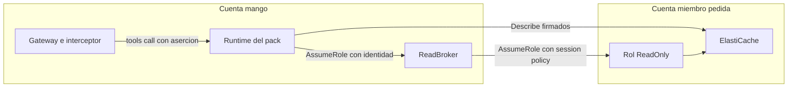

# Pack AWS ElastiCache sobre cuentas miembro: modelo de amenazas (v0.1)

> Fecha: 2026-11-13 · Skill: `security-threat-model`. Decisiones: D16, D19, D36, D37, D51, D54, D55 (3), D84; las de la noche del 2026-11-13 (agentes `sre` y `dba`), que quedan `propuesta` hasta que el dueño las acepte.
> Amplía `aws-cloudwatch-pack-threat-model.md` (primer pack de la cadena `member`), `pack-identity-threat-model.md` y `pack-egress-threat-model.md`. Lo que esos documentos dicen de la aserción, la guardia, el broker, el rol spoke y la red de packs vale aquí igual: este documento solo trata lo propio del pack.
> Alcance: `packs/aws-elasticache/` (manifiesto, punto de entrada, lock y snapshot) y el código upstream que sirve: `awslabs.elasticache-mcp-server` 0.2.2 (`common/connection.py`, `common/decorators.py`, `context.py`, y `describe.py` de `tools/cc`, `tools/rg`, `tools/serverless`, más `describe_events.py`, `describe_cache_engine_versions.py`, `describe_engine_default_parameters.py` y `describe_service_updates.py` de `tools/misc`).
> Comprobado en local: el pipeline completo (`check`, `check-lock`, dos `build` idénticos, `pip-audit`, `snapshot` en el contenedor sin red y `statement`), y el punto de entrada real con el servidor upstream real, dentro del mismo contenedor sin red y con el zip construido: sin archivo de configuración de AWS no hay `ProfileNotFound`, el cliente va a la región de la instalación, las variables `AWS_ENDPOINT_URL_*`, `AWS_PROFILE` y `ELASTICACHE_*` no cuentan, la llamada firma con las credenciales de la persona y, fuera de una llamada, falla cerrada sin enviar nada. **Nada está desplegado.**

## Executive summary

Pack de la cadena `member` con **siete tools de lectura** del plano de control de ElastiCache: clústeres, grupos de replicación, cachés serverless, eventos, versiones de motor, parámetros por defecto y actualizaciones de servicio. Siete acciones exactas de nivel *List*, todas `elasticache:Describe*`; tres con recurso ARN. No lee datos de las cachés ni logs, no conecta con los motores y no sale de botocore. Lo propio de este pack:

1. **La fábrica de clientes de upstream no sirve en el Runtime.** Crea cada cliente con `boto3.Session(profile_name=os.environ.get('AWS_PROFILE', 'default'))`: sin archivo de configuración falla con `ProfileNotFound`. Además, la región solo sale de `AWS_REGION` y cada servicio lee sus reintentos y tiempos de `ELASTICACHE_*`, `EC2_*`, etc.
2. **El modo de solo lectura de upstream es una lista de permitidos con un error:** `test-migration` está marcada `@readonly_safe` y llama a `elasticache:TestMigration`, que IAM clasifica *Write*.
3. **Upstream trae 39 tools**, entre ellas escrituras, *jump hosts* de EC2 (lanzan instancias y abren security groups) y lectura del contenido de **cualquier** log group (`filter-log-events`, `get-log-events`).
4. **Contenido no confiable:** mensajes de eventos, nombres, descripciones y etiquetas de recursos los escribe quien administra una cuenta miembro.
5. **Respuestas grandes:** un `describe-*` sin filtro en una cuenta con muchas cachés.

Controles construidos:

- **Fábrica propia** (`entrypoint.py`, `get_connection`): cliente sin perfil, en la región de la instalación (`MANGO_PACK_REGION`, la única que alcanza la red de packs), con `ignore_configured_endpoint_urls=True`, los reintentos y tiempos de upstream fijados, y **solo para ElastiCache**: pedir un cliente de otro servicio falla. Sin región (snapshot del build) no crea clientes.
- **Entorno limpio antes de importar:** se borran `AWS_PROFILE`, `AWS_DEFAULT_PROFILE`, `AWS_ENDPOINT_URL*`, `FASTMCP_*`, `MCP_*` y los prefijos que lee upstream (`ELASTICACHE_`, `EC2_`, `CLOUDWATCH_`, `FIREHOSE_`, `COST_EXPLORER_`).
- **La lista del manifiesto manda:** el punto de entrada solo importa los subpaquetes de las tools servidas (31 tools registradas), `pack.serve` quita las otras 24 y no arranca si falta una de las siete; las de logs, costo, métricas y Firehose ni se registran. Además, `Context.initialize(readonly=True)`: si una tool de escritura llegara a servirse, upstream la bloquearía (salvo `test-migration`, que la lista deja fuera).
- **Session policy de siete acciones** y el mismo tope en el rol spoke (`MEMBER_READ_ONLY_STATEMENTS`, lo añade `plat-infra`). Sin `TestMigration`, sin `logs:*`, sin `ec2:*`, sin `cloudwatch:GetMetricStatistics`.
- **Sin argumentos ocultos que hagan falta:** ninguna tool servida recibe credenciales, cuenta, región ni endpoint (lo fija un test sobre el snapshot). `account_id` lo añade y lo quita la guardia común.
- **Sin logs de upstream** (`loguru` sin destinos). Solo queda `pack.call`.
- **`egress: [sts, elasticache]`:** el security group del pack solo alcanza esos endpoints de VPC.

## Scope and assumptions

- **Dentro:** qué tools y argumentos se sirven, qué acciones pide cada llamada, cómo se crea el cliente de AWS, qué lee upstream del entorno, qué escribe en logs y qué devuelve al modelo.
- **Fuera:** la aserción, la guardia, el broker y el rol spoke (`pack-identity-threat-model.md`, `aws-cloudwatch-pack-threat-model.md`, `member-access-threat-model.md`); la red de packs y el endpoint `elasticache` (`pack-egress-threat-model.md`, cambio de `plat-infra`); el pipeline y la firma; los agentes `sre` y `dba` que usarán el pack.
- **Supuestos:**
  1. Valen los de `aws-cloudwatch-pack-threat-model.md`: un usuario central puede ver los metadatos de ElastiCache de todas las cuentas objetivo (D35, D37); el entorno del Runtime es la lista cerrada del provisioner.
  2. El endpoint de interfaz `com.amazonaws.<región>.elasticache` existe en la región de la instalación con DNS privado (a verificar por `plat-infra`).
  3. Las siete acciones entran en el rol `Mango-<ns>-ReadOnly` de las cuentas miembro (StackSet). Desplegarlo en una instalación lo decide el dueño.
- **Preguntas resueltas** (agente principal, por delegación del dueño, 2026-11-13; el pack es `propuesta` hasta que el dueño lo acepte):
  1. ¿Qué tools? Las siete de lectura. Fuera `test-migration` (*Write* en IAM) y toda tool que lea contenido de logs: los logs van por el pack de CloudWatch, con límites.
  2. ¿Métricas? Las lee el pack `aws-cloudwatch` (`GetMetricData`); `get-metric-statistics` no se sirve.

## System model

### Primary components

| Componente | Qué es | Evidencia |
|---|---|---|
| Manifiesto firmado | `identity.chain: member`, siete tools `read`, siete acciones, `egress: [sts, elasticache]` | `packs/aws-elasticache/manifest.yaml` |
| Punto de entrada | Limpia el entorno, quita `loguru`, `load()` antes de upstream, sustituye la fábrica de clientes, activa el modo de solo lectura | `packs/aws-elasticache/entrypoint.py` (`get_connection`, `SERVICES`, `CLIENT_CONFIG`) |
| Guardia común (cadena `member`) | Aserción, `account_id`, sesión asumida antes de la tool | `mango_pack_runtime/guard.py` |
| Servidor upstream | `MCPServer` con 39 tools; se sirven siete | `awslabs.elasticache-mcp-server` 0.2.2 |
| Gestores de conexión de upstream | Un cliente cacheado por clase y servicio | `common/connection.py` (`BaseConnectionManager`) |

### Data flows and trust boundaries

- **Gateway → Runtime → guardia → STS → `ReadOnly` de `account_id`:** como en CloudWatch.
- **Guardia → tool upstream:** argumentos sin `_mango_ctx` ni `account_id`. Las tools son `async def` y llaman a boto3 en la misma tarea: la llamada conserva el contexto de la persona (sin `run_in_executor` ni hilos propios en las siete tools).
- **Tool → ElastiCache de la cuenta miembro:** cliente creado por el punto de entrada, endpoint `elasticache.<región de la instalación>.amazonaws.com` (endpoint de VPC), firmado con la sesión de la llamada.
- **Tool → modelo:** la respuesta de la API tal cual (contenido no confiable) o `{'error': str(e)}` (upstream convierte toda excepción en ese diccionario).

## Assets and security objectives

| Asset | Why it matters | Security objective (C/I/A) |
|---|---|---|
| Metadatos de ElastiCache de las cuentas objetivo (nombres, endpoints, puertos, VPC y subnets, security groups, versiones, eventos) | Describen la red y los almacenes de datos de la organización | C |
| Datos de las cachés y logs de las cuentas | No deben ser alcanzables por este pack | C |
| Integridad de las cuentas miembro | El pack no debe poder escribir (migraciones, *jump hosts*, cambios de cachés) | I |
| Atribución en CloudTrail (`SourceIdentity`) | Regla 5 | I |
| Logs operativos del pack | Sin argumentos ni respuestas (D16) | C |

## Attacker model

### Capabilities

- **Usuario central o el modelo:** llama las siete tools con cualquier argumento que acepte su esquema.
- **Administrador de una cuenta miembro:** controla nombres, descripciones, etiquetas de recursos y, en parte, los mensajes de eventos que el modelo leerá.
- **Código comprometido en el pack** (upstream o sus ~50 dependencias): tiene el rol del pack.

### Non-capabilities

- No puede firmar aserciones ni cambiar el manifiesto o el zip firmados.
- No controla el entorno del Runtime (lista cerrada del provisioner).
- Ninguna tool servida acepta credenciales, región, endpoint ni rutas.

## Entry points and attack surfaces

| Surface | How reached | Trust boundary | Notes | Evidence |
|---|---|---|---|---|
| Argumentos de las siete tools | `tools/call` | Modelo → upstream → botocore | Ids, filtros, marcadores de paginación y fechas; botocore valida tipo y nombre antes de enviar | upstream `describe*.py`; `tools.snapshot.json` |
| `account_id` | `tools/call` | Modelo → guardia | Igual que CloudWatch | `guard.py` |
| Entorno del proceso | Arranque | Runtime → upstream | Perfil, región, endpoints y reintentos | `entrypoint.py` |
| Fábrica de clientes | Primera llamada de cada servicio | Upstream → botocore | Sustituida | `entrypoint.py` (`get_connection`) |
| Tools no servidas | — | — | Quitadas por `restrict_tools` | `mango_pack_runtime/server.py` |
| Respuestas de ElastiCache | Tool | Cuenta miembro → modelo | No confiables | — |
| Logs de upstream | Tool | Proceso → logs de `mango` | Quitados | `entrypoint.py` |

## Top abuse paths

1. **Escribir por `test-migration`.** El modelo la pide → no está en el manifiesto: `pack.serve` la quitó y la guardia rechaza cualquier tool fuera de la lista. Aunque llegara, `TestMigration` no está en la session policy ni en el rol spoke.
2. **Leer logs por las tools de logs de upstream.** `filter-log-events` y `get-log-events` leen cualquier log group → no se sirven y `logs:*` no está en la session policy de este pack.
3. **Desviar el cliente.** Una variable `AWS_ENDPOINT_URL_ELASTICACHE`, `AWS_PROFILE` o `ELASTICACHE_*` en el entorno → se borran antes de importar y el cliente ignora los endpoints configurados. Ningún argumento de las tools nombra región ni endpoint.
4. **Otro servicio desde código upstream.** Una tool llama a `EC2ConnectionManager` → la fábrica solo crea clientes de ElastiCache; además, la red no tiene endpoint de EC2 y la session policy no tiene `ec2:*`.
5. **Instrucciones en un evento o una etiqueta.** Texto hostil en la descripción de un grupo de replicación → el agente solo tiene tools de lectura; guardrail base.
6. **Respuesta enorme.** `describe-cache-clusters` con `show_cache_node_info` en una cuenta con cientos de clústeres → la API pagina (100 por página como máximo) y el Gateway limita la respuesta.

## Threat model table

| Threat ID | Threat source | Prerequisites | Threat action | Impact | Impacted assets | Existing controls (evidence) | Gaps | Recommended mitigations | Detection ideas | Likelihood | Impact severity | Priority |
|---|---|---|---|---|---|---|---|---|---|---|---|---|
| TM-EC1 | Servidor upstream | — | Marcar como de solo lectura una tool que escribe (`test-migration`, o una nueva en otra versión) | Escritura en una cuenta miembro | Integridad | La lista del manifiesto (`restrict_tools`, la guardia); session policy y rol spoke solo con `Describe*`; test de `test_pack.py` que fija tools y acciones | Una versión nueva puede marcar mal otra tool | Al actualizar, revisar cada `@readonly_safe` contra la referencia de servicios de IAM (`IsWrite`) | Diff de `tools.snapshot.json` | low | high | **low** |
| TM-EC2 | Entorno o upstream | Variable de entorno o cambio de upstream | Otro perfil, región o endpoint para el cliente | Credenciales a otro host; `ProfileNotFound` en todas las llamadas | Credenciales de la sesión, disponibilidad | Entorno limpio; fábrica propia sin perfil, región de la instalación, `ignore_configured_endpoint_urls`; verificación en el contenedor sin red | La fábrica sustituida es un detalle interno de upstream (`BaseConnectionManager.get_connection`) que una versión nueva puede cambiar | Al actualizar, `grep -rn "profile_name=\|Session(\|client(" ` sobre el wheel nuevo y repetir la verificación del punto de entrada | Errores de las tools en el e2e | low | medium | **low** |
| TM-EC3 | Tools no servidas | — | Logs de cualquier log group, *jump hosts* de EC2, costo, Firehose | Lectura de logs (D55 (3)), instancias y reglas de red nuevas | Datos, integridad | No se sirven; sus acciones no están en la session policy, en el rol spoke ni en la red | — | Reabrir solo con decisión propia | — | low | high | **low** |
| TM-EC4 | Contenido de una cuenta miembro | Administrar ElastiCache en una cuenta objetivo | Texto con instrucciones en nombres, descripciones, etiquetas o eventos | Respuesta manipulada | Integridad | Tools de solo lectura; guardrail base; el agente solo tiene las tools que su versión firma | — | Evaluaciones con contenido hostil | — | medium | low | **low** |
| TM-EC5 | Usuario central o modelo | — | Ver endpoints, puertos, subnets y security groups de las cachés | Mapa de red de la organización | Metadatos | Solo usuarios centrales, que ya ven estos datos por diseño (D35, D37); sin datos de las cachés ni credenciales de los motores (`AuthToken` no se devuelve) | — | — | CloudTrail `Describe*` por `sourceIdentity` | medium | low | **low** |
| TM-EC6 | Código comprometido en el pack | RCE o dependencia maliciosa | Asumir el broker sin session policy | Lectura hasta el tope del rol spoke | Datos | Como TM-CW2 (`aws-cloudwatch-pack-threat-model.md`); este pack añade al tope solo siete `Describe*` de ElastiCache | — | — | Como TM-CW2 | low | medium | **low** |
| TM-EC7 | Servidor upstream | — | Registrar argumentos o respuestas | Datos de cuentas en logs (D16) | Logs | `loguru` sin destinos; las siete tools no registran nada propio | El SDK de MCP registra el texto de una excepción de la tool | Aceptado (igual que TM-CW7) | — | low | low | **low** |

## Criticality calibration

- **Critical:** el pack escribe en una cuenta miembro o lee datos de una caché. *(No aplica: sin `TestMigration` ni acciones de escritura en ningún tope, y sin conexión a los motores.)*
- **High:** lectura de contenido de logs desde este pack; el cliente firma hacia un host que no es de AWS.
- **Medium:** el pack comprometido lee metadatos de ElastiCache de toda la organización.
- **Low:** texto hostil en eventos o etiquetas; respuestas grandes.

## Focus paths for security review

| Path | Why it matters | Related Threat IDs |
|---|---|---|
| `packs/aws-elasticache/manifest.yaml` | Tools, acciones y `egress` | TM-EC1, TM-EC3 |
| `packs/aws-elasticache/entrypoint.py` | Entorno, fábrica de clientes, modo de solo lectura, logs | TM-EC2, TM-EC7 |
| `packs/aws-elasticache/tools.snapshot.json` | Lo que ve el modelo | TM-EC1, TM-EC2 |
| `infra/lib/stacks/member-stack.ts` (`MEMBER_READ_ONLY_STATEMENTS`) | Tope en cada cuenta miembro | TM-EC1, TM-EC6 |
| `deployment/pack-builder/tests/test_pack.py` | Fija tools, acciones y el arreglo del punto de entrada | TM-EC1, TM-EC2 |

## Supuestos sin validar

1. Las siete acciones con la session policy del manifiesto funcionan en AWS: en particular, `DescribeCacheClusters`, `DescribeReplicationGroups` y `DescribeServerlessCaches` **sin id** (todos los recursos) con el recurso `arn:aws:elasticache:*:*:<tipo>:*`.
2. El endpoint de VPC de ElastiCache existe en la región de la instalación y resuelve el nombre público del SDK (DNS privado).
3. El tamaño de las respuestas grandes cabe en el límite del Gateway; sin medir.
