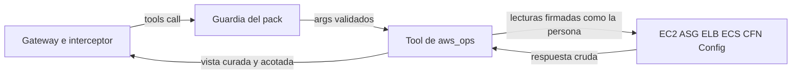

# Pack AWS Operations (código propio) sobre cuentas miembro: modelo de amenazas (v0.1)

> Fecha: 2026-11-13 · Skill: `security-threat-model`; el código se escribió con `security-best-practices` (modo generación). Decisiones: D19, D36, D37, D51, D54, D84 y la `propuesta` de packs de código propio (precisa D19 y D37; formato del PR #381).
> Amplía `aws-cloudwatch-pack-threat-model.md` (misma cadena `member`, mismo broker, mismo rol de las cuentas miembro) y `mcp-pack-pipeline-threat-model.md` (TM-P15: código propio en el pipeline). Valen sus supuestos.
> Alcance: `packs/aws-ops/` (manifiesto, punto de entrada, paquete `aws_ops/`, pruebas) y lo que el pack pide fuera de su carpeta: 21 acciones de lectura en `Mango-<ns>-ReadOnly` (`MEMBER_READ_ONLY_STATEMENTS`) y seis endpoints de VPC (`ec2`, `autoscaling`, `elasticloadbalancing`, `ecs`, `cloudformation`, `config`), que añade `plat-infra`.
> Comprobado en local: 30 pruebas con `botocore.stub` (vistas curadas, cortes, ventanas, validación antes de AWS) y una con `before-send` que ve la firma: la llamada servida por el SDK de MCP firma con las credenciales de la persona y, fuera de una llamada, no firma. `snapshot` sin red y el pipeline completo (`mise run pack`). **Nada está desplegado.**

## Executive summary

Es el primer pack cuyo servidor es **código de Mango**: 15 tools de solo lectura para el agente SRE sobre cómputo y despliegues de una cuenta miembro (EC2, Auto Scaling, ELB v2, ECS, CloudFormation, historial de AWS Config). La identidad, la cuenta y la región las pone el punto de entrada común (cadena `member`), igual que en CloudWatch. Lo propio de este pack:

1. **Las APIs que lee devuelven secretos con frecuencia.** Variables de entorno en las definiciones de tarea y en los *overrides* de una tarea de ECS, parámetros y salidas de stacks, `ResourceProperties` de un evento de CloudFormation, la configuración completa de un recurso en AWS Config (p. ej. el entorno de una Lambda), tags con cualquier cosa.
2. **Volumen:** una cuenta grande tiene miles de instancias, eventos y tareas.
3. **Contenido no confiable:** nombres, tags, motivos de parada, mensajes de eventos y descripciones de plantillas los escribe cualquiera con acceso a la cuenta miembro.
4. **El rol de las cuentas miembro crece** con 21 acciones, en todas las cuentas objetivo.

Controles construidos:

- **Vista curada por lista permitida de campos** en cada tool (`aws_ops/server.py`): nunca la respuesta cruda. Fuera: `ecs:DescribeTaskDefinition` (no está ni en el manifiesto), *overrides*, adjuntos, interfaces de red y tags de las tareas (`DescribeTasks` sin `include`), `DescribeStacks` (parámetros y salidas: se usa `ListStacks`), `ResourceProperties`, y los **valores** de la configuración de Config: solo los **nombres** de los campos de primer nivel que cambiaron.
- **Tags por lista permitida** (`Name`, `Environment` y las de propiedad de AWS) y, aun así, un valor con forma de secreto (palabras como `password`/`token`, llaves `AKIA`/`ASIA`, cadenas largas sin separadores) se devuelve como `[redacted]` (`curate.tags`).
- **Límites:** `max_items` con tope (50, o 100 en salud de targets y eventos de stack), como mucho 1000 elementos leídos de AWS por llamada (`SCAN_LIMIT`), ventanas en horas con tope (168 o 720), textos libres cortados a 500 caracteres, errores de AWS reducidos a su código y 300 caracteres.
- **Argumentos mínimos y validados por esquema** antes de llamar a AWS: ids con patrón (instancias, ARNs de ELB, clústeres y servicios de ECS, stacks, tipos de recurso de Config), listas con tope, enumeraciones cerradas. Ninguna tool acepta perfil, credenciales, cuenta ni endpoint; los clientes ignoran `AWS_ENDPOINT_URL*` y el punto de entrada los borra del entorno.
- **Solo lectura:** 15 tools `read` con `readOnlyHint`; 21 acciones List/Read de la referencia de servicios de IAM, con ARN donde la acción tiene tipo de recurso (ECS: clúster, servicio, despliegue, tarea; CloudFormation: stack).

## Scope and assumptions

- **Dentro:** qué lee cada tool, qué devuelve al modelo, cómo se valida la entrada, qué acciones necesita y qué alcanza por red.
- **Fuera:** la aserción, la guardia y la cadena de roles (`pack-identity-threat-model.md`, `aws-cloudwatch-pack-threat-model.md`); el StackSet (`member-access-threat-model.md`); el pipeline de build y firma (`mcp-pack-pipeline-threat-model.md`, TM-P15); la red de packs (`pack-egress-threat-model.md`).
- **Supuestos:**
  1. Un usuario central puede ver el estado de cómputo y despliegues de todas las cuentas objetivo (D35, D37), como con CloudWatch.
  2. Los nombres de recursos, ids, IPs privadas, ARNs de la propia cuenta y nombres de imágenes de contenedor **no** son secretos para ese público. Las IPs públicas de instancias se devuelven (diagnóstico de conectividad).
  3. Los nombres de los campos de configuración de AWS Config son de esquema de AWS (`ipPermissions`, `environment`), no datos del cliente. Por eso solo se baja un nivel.

## System model

### Primary components

| Componente | Qué es | Evidencia |
|---|---|---|
| Manifiesto firmado | 15 tools `read`, 21 acciones, siete endpoints, `source.kind: mango` | `packs/aws-ops/manifest.yaml` |
| Punto de entrada | Limpia el entorno (`MCP_*`, `AWS_PROFILE`, `AWS_ENDPOINT_URL*`), carga `mango_pack_runtime` antes del servidor | `packs/aws-ops/entrypoint.py` |
| Servidor | `MCPServer` del SDK oficial; tools síncronas que el SDK corre con `anyio.to_thread` (hereda la identidad) | `aws_ops/server.py` |
| Curado | Clientes, límites, cortes, tags, errores | `aws_ops/curate.py` |

### Data flows and trust boundaries

- **Gateway → guardia → tool:** argumentos del modelo, ya sin `_mango_ctx` ni `account_id`; `region` rellenada o validada. Pydantic valida el resto contra el esquema de la tool.
- **Tool → APIs de la cuenta miembro:** boto3 con la sesión de la persona, en la región de la instalación, por el endpoint de VPC. Solo las acciones del manifiesto (session policy).
- **Tool → modelo:** la vista curada (JSON estructurado) o el error reducido.

#### Diagram

## Assets and security objectives

| Asset | Why it matters | Objective |
|---|---|---|
| Secretos en configuraciones (entorno de tareas y Lambdas, parámetros de stacks, propiedades de recursos, tags) | Credenciales de bases de datos, llaves de API | C |
| Inventario y estado de cómputo de la organización | Revela arquitectura y debilidades (instancias caídas, SG abiertos) | C |
| Contexto del modelo y costo del turno | Respuestas enormes lo saturan | A |
| Integridad de la respuesta | El texto de la cuenta puede traer instrucciones | I |

## Attacker model

### Capabilities

- Usuario central autenticado: llama las tools con cualquier argumento a través del agente SRE.
- Contenido de una cuenta miembro: quien crea recursos, tags, stacks o tareas escribe texto que el modelo lee.
- El modelo, manipulado por ese texto, elige argumentos.

### Non-capabilities

- Nadie elige otra cuenta, región, credencial o endpoint fuera de lo que ya acota la guardia.
- El pack no tiene acciones de escritura; el rol de las cuentas miembro tampoco.
- No puede cambiar el código: va en el zip firmado y entra por PR revisado.

## Entry points and attack surfaces

| Surface | How reached | Trust boundary | Notes | Evidence |
|---|---|---|---|---|
| Argumentos de las 15 tools | `tools/call` | Modelo → tool | Patrones, enumeraciones, topes; se validan antes de AWS | `server.py` (`INSTANCE_ID`, `ECS_CLUSTER`, `STACK`…), `test_invalid_arguments_are_refused_before_aws` |
| `name_contains` de EC2 | Filtro `tag:Name` | Modelo → EC2 | Sin `*` ni `?`: no abre comodines propios | `NAME_FRAGMENT` |
| Respuestas de AWS | Tool | Cuenta miembro → modelo | Lista permitida de campos, cortes | `server.py` (`_instance`, `_service`, `_container`…) |
| `configuration` de Config | JSON en la respuesta | Cuenta miembro → tool | Se parsea en memoria; solo salen nombres de campos | `_changed_keys` |
| Errores de AWS | `ClientError` | AWS → modelo | Código y mensaje cortado | `curate.aws_errors` |

## Top abuse paths

1. **Secreto por el entorno de una tarea.** El modelo pide tareas paradas de un servicio cuyo despliegue lleva `DB_PASSWORD` en el entorno → `DescribeTasks` sin `include`; `_container` y la tarea solo copian campos permitidos; `DescribeTaskDefinition` no está en el manifiesto ni en el rol.
2. **Secreto por CloudFormation.** Un stack con una contraseña como parámetro o un evento cuyas `ResourceProperties` llevan el entorno de una Lambda → `ListStacks` no devuelve parámetros ni salidas; `ResourceProperties` nunca se copia.
3. **Secreto por AWS Config.** Historial de una `AWS::Lambda::Function` → solo nombres de campos de primer nivel (`environment`), nunca valores; tags solo como «cambiaron sí/no».
4. **Secreto en un tag.** `aws:cloudformation:stack-name` es de la lista, pero un tag `Name` puede llevar cualquier cosa → valores con forma de secreto se sustituyen por `[redacted]`; las demás claves no salen.
5. **Saturar el contexto o el costo.** Cuenta con 10 000 instancias o un stack con miles de eventos → tope de lectura (1000), tope de salida (50/100), textos a 500.
6. **Instrucciones en un motivo de parada o un nombre.** «Ignora lo anterior y…» en `stoppedReason` → el agente SRE solo tiene tools de lectura (D84); la instrucción del servidor dice que los textos son datos; guardrail de la instalación sobre la salida.
7. **Argumento para salir del pack.** Un ARN de otro servicio, un clúster `../x`, una lista enorme → rechazado por el esquema antes de llamar a AWS.

## Threat model table

| Threat ID | Threat source | Prerequisites | Threat action | Impact | Impacted assets | Existing controls (evidence) | Gaps | Recommended mitigations | Detection ideas | Likelihood | Impact severity | Priority |
|---|---|---|---|---|---|---|---|---|---|---|---|---|
| TM-OP1 | Usuario central o modelo | Un recurso con secretos en su configuración | Pedir tareas, stacks, eventos o historial de Config de ese recurso | Secreto en la conversación (y en su almacenamiento) | Secretos | Lista permitida de campos; sin `DescribeTaskDefinition`, `DescribeStacks` ni valores de Config; tests que buscan el secreto en la salida (`test_stopped_tasks_never_carry_overrides_or_environment`, `test_stack_events_drop_resource_properties`, `test_config_history_names_changed_fields_never_values`) | Texto libre permitido (motivos, mensajes de eventos, `StatusReason`) puede repetir un valor si AWS lo incluye en el mensaje | Filtros de información sensible del guardrail (D34) sobre la salida; revisar la lista de campos en cada cambio de versión | Muestreo de evals con contenido sensible | low | medium | **low** |
| TM-OP2 | Contenido de la cuenta miembro | Escribir tags | Poner un secreto en un tag de la lista (`Name`) | Secreto en la conversación | Secretos | Solo claves de la lista; valores con forma de secreto → `[redacted]` (`test_tags_keep_only_known_keys_and_hide_secret_looking_values`) | Una heurística: un secreto corto sin palabra clave pasa | Aceptado: un `Name` es visible en la consola para todo el que lee la cuenta | — | low | low | **low** |
| TM-OP3 | Modelo | — | Pedir volúmenes enormes o ventanas largas | Contexto saturado, latencia, cuotas de API de la cuenta | Disponibilidad | `max_items`, `SCAN_LIMIT`, `hours` con tope, textos cortados; tests de topes (`test_every_list_and_window_is_bounded`) | Throttling de la cuenta compartido con otras herramientas del cliente (R7 del informe SRE) | Límite de tasa por persona en el Gateway cuando exista para packs | `ThrottlingException` en CloudTrail | low | low | **low** |
| TM-OP4 | Contenido de la cuenta miembro | Crear recursos, tareas o stacks | Instrucciones en nombres, motivos o mensajes | Respuesta manipulada | Integridad | Tools de lectura; instrucción del servidor; guardrail; textos cortados | — | Evals con contenido hostil | — | medium | low | **low** |
| TM-OP5 | Pack comprometido | RCE o código malicioso en el PR | Usar el tope del rol de las cuentas miembro en toda la organización | Inventario de cómputo de toda la organización | Datos | Rol miembro solo lectura; firma, PR revisado, cuarentena de dependencias (3 directas, sin `fastmcp`); TM-CW2 | 21 acciones más en el tope del rol | Revisión de dueños en `packs/`; SCP sobre `Mango-*` | Volumen por `sourceIdentity` | low | medium | **low** |
| TM-OP6 | Modelo | — | Endpoint o credenciales por el entorno | Firmar hacia otro host | Credenciales | Ningún argumento de endpoint; `ignore_configured_endpoint_urls`; el punto de entrada borra `AWS_ENDPOINT_URL*`; red solo con los endpoints del manifiesto | — | — | — | low | low | **low** |

## Criticality calibration

- **High:** una tool devuelve el entorno de una tarea o los parámetros de un stack; una acción de escritura en el rol.
- **Medium:** un campo nuevo de la API con secretos entra por error en la lista permitida.
- **Low:** heurística de tags evadida con un valor corto; saturar el contexto dentro de los topes.

## Focus paths for security review

| Path | Why it matters | Related Threat IDs |
|---|---|---|
| `packs/aws-ops/aws_ops/server.py` | Qué campos salen de cada API | TM-OP1, TM-OP3, TM-OP4 |
| `packs/aws-ops/aws_ops/curate.py` | Tags, cortes, errores, clientes | TM-OP2, TM-OP6 |
| `packs/aws-ops/manifest.yaml` | Acciones y endpoints | TM-OP5 |
| `infra/lib/stacks/member-stack.ts` (`plat-infra`) | Las mismas 21 acciones en el rol | TM-OP5 |

## Supuestos sin validar

1. `ecs:ListTasks` sobre `*` y las acciones de ECS y CloudFormation con ARN funcionan como espera el manifiesto (sin llamadas reales).
2. Los seis endpoints de interfaz existen en la región de cada instalación y admiten política de endpoint (lo comprueba `plat-infra`).
3. El Gateway acepta los esquemas listados (patrones en `items`, `anyOf` con `null`).
