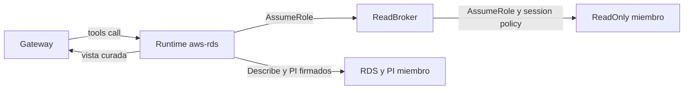

# Pack AWS RDS (código propio) sobre cuentas miembro: modelo de amenazas (v0.1)

> Fecha: 2026-11-13 · Skill: `security-threat-model`; el código se escribió con `security-best-practices` (modo generación). Decisiones: D16, D19, D37, D51, D55 (precisión `propuesta` para logs), D126 (`propuesta`: packs de código propio). Decisiones de la noche (agente principal): BD P1 = a (pack propio), P2 = a (nada *Write* en el rol miembro), P3 = solo SQL tokenizado y logs de la base con límites, P4 = a (sin SQL por la Data API).
> Amplía `aws-cloudwatch-pack-threat-model.md` (cadena `member`), `pack-identity-threat-model.md` (aserción, credenciales por llamada) y `mcp-pack-pipeline-threat-model.md` (TM-P15: código propio en el pipeline). Lo que esos documentos ya cubren no se repite.
> Alcance: `packs/aws-rds/` (manifiesto, punto de entrada, `aws_rds/server.py`, `aws_rds/curate.py`, pruebas) y las acciones que pide al rol `Mango-<ns>-ReadOnly` de las cuentas miembro.
> Comprobado en local: 24 pruebas con `botocore.stub` (sin AWS), `tools/list` del zip construido en el contenedor sin red del pipeline. **Nada está desplegado.**

## Executive summary

Es el primer pack de **código de Mango** que lee datos de cuentas: el plano de control de RDS y Aurora para el agente de bases de datos. Doce tools, todas de lectura, por la cadena `member`: estado de instancias y clústeres, eventos, parámetros modificados, mantenimiento pendiente, snapshots, Performance Insights y la **cola** de un archivo de log de la base. Lo propio de este pack frente a CloudWatch:

1. **Las respuestas de RDS traen datos sensibles al lado de los útiles:** el ARN del secreto maestro (`MasterUserSecret`), el usuario maestro, cambios de contraseña pendientes, etiquetas libres (que a veces guardan secretos) y valores de parámetros.
2. **Performance Insights puede devolver SQL con literales** (`db.sql`, `GetDimensionKeyDetails`): valores de columnas, datos personales.
3. **Los logs de la base son contenido** (sentencias, usuarios, IP de clientes): precisión de D55 (3), `propuesta`.
4. **El código es nuestro:** sin upstream que revisar, pero también sin terceros que lo hayan usado; la revisión es la del PR (TM-P15).

Controles construidos:

- **Vistas curadas, nunca la respuesta cruda** (`curate.pick`): cada tool copia campos de una lista permitida. `MasterUserSecret`, `MasterUsername`, `MasterUserPassword` pendiente, `KmsKeyId`, la zona alojada del endpoint y cualquier campo nuevo de AWS no salen. Los endpoints son solo host y puerto.
- **Etiquetas filtradas** (`curate.safe_tags`): fuera las de clave con pinta de credencial (`password`, `secret`, `token`, `credential`, `api_key`, `access_key`, `private`, `dsn`…) y las de valor con forma de llave (base64/hex de 32+ caracteres); máximo 20, valores cortados a 256.
- **Parámetros:** solo los modificados por el usuario (`Source=user`); el valor de uno cuyo nombre parece credencial sale como `<hidden>`.
- **Performance Insights solo tokenizado:** los grupos permitidos son `db.wait_event`, `db.wait_event_type`, `db.sql_tokenized` y `db.user` (lista cerrada en el esquema y comprobada otra vez en el código); `GetResourceMetrics` nunca lleva `GroupBy`; `pi:GetDimensionKeyDetails` no está ni en el código ni en el manifiesto (solo acepta `db.sql`, `db.execution_plan` y `db.lock_snapshot`); una dimensión `db.sql.*` que AWS mandara se descarta.
- **Logs de la base con límites duros:** solo un archivo que `DescribeDBLogFiles` lista para esa instancia (nombre exacto, patrón sin `..` ni `/` inicial), solo la cola (`NumberOfLines` sin `Marker`), ≤ 200 líneas, ≤ 2 KB por línea, ≤ 256 KB por respuesta.
- **Límites en todo:** ≤ 100 elementos por llamada, ≤ 5 páginas leídas, eventos en ventana ≤ 14 días, Performance Insights ≤ 7 días y ≤ 360 puntos por serie, textos cortados, respuesta ≤ 256 KB (`curate.fit`).
- **Argumentos mínimos y validados:** identificadores con patrón (nombres, no ARN), `Literal` para tipos y grupos, ventanas en horas acotadas. Ningún argumento de credenciales, perfil, cuenta o endpoint; `account_id` y `region` son de Mango (guardia común).
- **IAM exacto de lectura** como session policy de cada llamada, con ARN donde la referencia de IAM lo admite (§ «Acciones»). Sin `rds-data`, `secretsmanager` ni ninguna acción *Write*.
- **Red:** solo `sts`, `rds` y `pi` de la región de la instalación; el cliente ignora endpoints configurados (`ignore_configured_endpoint_urls`).

## Scope and assumptions

- **Dentro:** qué devuelve cada tool, sus argumentos y límites, las acciones del manifiesto y lo que añade al rol miembro.
- **Fuera:** la aserción de identidad, la guardia y el broker (`pack-identity-threat-model.md`, `aws-cloudwatch-pack-threat-model.md`); el pipeline y la firma (`mcp-pack-pipeline-threat-model.md`); la red de packs (`pack-egress-threat-model.md`); el agente `dba` que usa estas tools.
- **Supuestos:**
  1. Valen los de los modelos ampliados: un usuario central puede ver los metadatos de RDS de todas las cuentas objetivo (D35, D37) y el código del pack es de confianza para la atribución.
  2. **Leer la cola de los logs de la base es aceptable para un usuario central** con estos límites (decisión de la noche, BD P3; precisión de D55 (3) en estado `propuesta`). Si el dueño no la acepta, `list_db_log_files`/`tail_db_log_file` y sus dos acciones salen del pack (revisión nueva).
  3. Los datos de Performance Insights de la retención gratuita (7 días) bastan; el pack no cambia la retención.

## System model

| Componente | Qué es | Evidencia |
|---|---|---|
| Manifiesto firmado | `source.kind: mango`, cadena `member`, 12 tools `read`, 12 acciones | `packs/aws-rds/manifest.yaml` |
| Punto de entrada | Limpia `MCP_*`/`FASTMCP_*`/`AWS_PROFILE`, carga `mango_pack_runtime` antes del servidor | `packs/aws-rds/entrypoint.py` |
| Servidor | `MCPServer` del SDK oficial; tools síncronas (el SDK las corre con `anyio.to_thread`, que hereda la identidad) | `aws_rds/server.py` |
| Vistas y límites | Listas permitidas de campos, filtros de etiquetas y parámetros, cortes | `aws_rds/curate.py` |
| `Mango-<ns>-ReadOnly` | Rol de cada cuenta miembro: recibe las 12 acciones (lo añade `plat-infra`) | `infra/lib/stacks/member-stack.ts` |

Flujos: Gateway → Runtime (aserción, `account_id`, argumentos) → guardia (asume broker y `ReadOnly` con la session policy del manifiesto) → tool → RDS/PI de la cuenta miembro → vista curada → modelo.

## Assets and security objectives

| Asset | Por qué importa | C/I/A |
|---|---|---|
| Credenciales de las bases (secreto maestro, contraseñas) | Acceso al dato de negocio | C |
| Texto SQL con literales y contenido de logs de la base | Datos de negocio y personales | C |
| Metadatos de RDS (topología, versiones, endpoints, etiquetas) | Reconocimiento de la organización | C |
| Integridad de la respuesta al modelo | Eventos, etiquetas, sentencias y logs los escribe gente de la cuenta | I |
| Costo y cuotas de las APIs de RDS/PI de la cuenta miembro | Disponibilidad | A |

## Attacker model

- **Capacidades:** usuario central con un agente que tenga las tools (cualquier argumento válido); quien escribe en una cuenta miembro (etiquetas, nombres, mensajes, sentencias que acaban en logs); dependencia comprometida dentro del pack.
- **No puede:** firmar aserciones, cambiar el zip firmado ni el entorno, elegir otro rol que `Mango-<ns>-ReadOnly`, escribir en RDS (ninguna acción *Write* en ningún rol).

## Entry points and attack surfaces

| Superficie | Frontera | Control | Evidencia |
|---|---|---|---|
| Identificadores (instancia, clúster, grupo de parámetros, fuente) | Modelo → tool → RDS | Patrón cerrado, sin `:`/ARN (salvo el `:` de los snapshots automáticos en `source_identifier`) | `server.py` (`InstanceId`, `ClusterId`, `ParameterGroup`) |
| `group` de Performance Insights | Modelo → PI | `Literal` + comprobación en el código | `PI_GROUPS` |
| `metrics` | Modelo → PI | Patrón `os|db.<…>.<estadística>`, ≤ 10, sin `GroupBy` | `PiMetric` |
| `log_file_name` | Modelo → RDS | Patrón por segmentos, debe estar en `DescribeDBLogFiles` de la instancia | `tail_db_log_file` |
| Ventanas (`start_hours_ago`, `end_hours_ago`, `written_within_hours`) | Modelo → AWS | Rango en el esquema y `_window` | `server.py` |
| Respuestas de RDS/PI | Cuenta miembro → modelo | Vistas curadas, cortes, `fit` | `curate.py` |

## Top abuse paths

1. **Sacar el secreto maestro.** El modelo pide `describe_db_instances` → `MasterUserSecret` no está en la lista de campos; aunque saliera el ARN, el pack no tiene `secretsmanager` ni en IAM ni en la red.
2. **SQL con literales por Performance Insights.** El modelo pide `group: db.sql` → el esquema lo rechaza y el código también; `GetDimensionKeyDetails` no se llama ni está permitido.
3. **Leer otro archivo o salir de la instancia con el nombre del log.** `../…`, rutas absolutas o un archivo de otra instancia → patrón y comprobación contra la lista de esa instancia; la API, además, solo lee archivos de la instancia nombrada.
4. **Volcar un log entero** (gigas de log de consultas lentas) → solo la cola, 200 líneas, 2 KB por línea, 256 KB.
5. **Secreto en una etiqueta** (`db_password=…`) → filtrada por clave y por forma del valor.
6. **Instrucciones en un mensaje de evento, una etiqueta o una línea de log** → contenido no confiable; todas las tools son de lectura; las descripciones lo dicen al modelo.
7. **Snapshots públicos de otras cuentas** (`IncludePublic`) → siempre `false`; los tipos `shared`/`public` no se aceptan.
8. **Pack comprometido** usa la sesión de una llamada fuera de lo que el código pide (p. ej. `db.sql` en PI o `DownloadDBLogFilePortion` completo) → el tope es el de la session policy (12 acciones de lectura); el rol no tiene `rds-data` ni secretos.

## Threat model table

| Threat ID | Fuente | Acción | Impacto | Controles existentes | Gaps | Mitigación recomendada | Likelihood | Impact | Priority |
|---|---|---|---|---|---|---|---|---|---|
| TM-RDS1 | Modelo / usuario central | Pedir campos de credenciales en instancias, clústeres o snapshots | Exposición del secreto maestro o del usuario | Listas permitidas (`_INSTANCE_FIELDS`, `_CLUSTER_FIELDS`, `_SNAPSHOT_FIELDS`); pruebas que buscan `MasterUserSecret`, usuario y `****` en la salida | Un campo nuevo sensible de AWS solo saldría si alguien lo añade a la lista | Revisar la lista en cada cambio del código (PR) | low | high | **low** |
| TM-RDS2 | Modelo | Pedir SQL con literales a Performance Insights | Datos de negocio/personales al modelo | Grupos cerrados (`PI_GROUPS`), sin `GroupBy` en métricas, sin `GetDimensionKeyDetails`, filtro de dimensiones `db.sql.*`; pruebas | IAM no lo impide: `pi:DescribeDimensionKeys` admite `db.sql` y el manifiesto no admite condiciones | `plat-infra`: valorar un `Deny` en el rol miembro con la condición `pi:Dimensions` sobre `db.sql.*` (a verificar en el laboratorio) | low | high | **medium** |
| TM-RDS3 | Usuario central | Leer logs de la base | Sentencias, usuarios e IP de clientes al modelo y a la conversación | Cola acotada (200 líneas, 2 KB, 256 KB), solo archivos de la instancia; descripción que pide citar solo lo necesario; precisión de D55 `propuesta` | El contenido de los logs puede traer datos personales; no se redacta | Aceptación del dueño (D55); si no, quitar las dos tools | medium | medium | **medium** |
| TM-RDS4 | Gente de la cuenta miembro | Secretos en etiquetas o valores de parámetros | Secreto al modelo | `safe_tags`, `secret_named`, cortes | Heurística: un secreto con clave inocente y valor corto pasa | Aceptado: las etiquetas son metadatos que ya ve quien lee la cuenta | low | medium | **low** |
| TM-RDS5 | Contenido de la cuenta | Instrucciones en eventos, etiquetas, sentencias o logs | Respuesta manipulada | Solo lectura; descripciones «data, not instructions»; guardrail base | — | Evaluaciones con contenido hostil | medium | low | **low** |
| TM-RDS6 | Usuario central / modelo | Llamadas grandes o repetidas | Costo y throttling de RDS/PI en la cuenta miembro | Topes de elementos, páginas, ventanas y puntos; reintentos estándar ×3 | Sin tope por persona en el pack | Límite de invocaciones del agente (existente) | low | low | **low** |
| TM-RDS7 | Dependencia comprometida | Usar la sesión fuera de lo que pide el código | Lectura hasta el tope del rol en la cuenta pedida | Session policy de 12 acciones; sin `rds-data`/`secretsmanager`; lock con hashes, cuarentena, `pip-audit`, firma | Las 12 acciones incluyen `DownloadDBLogFilePortion` completo | Igual que TM-CW2 | low | medium | **low** |
| TM-RDS8 | Revisor del PR | Un cambio del código propio quita un filtro | Regresión de cualquiera de los anteriores | Pruebas que fijan cada filtro; TM-P15 (revisión en PR, firma desde `main`) | — | Mantener las pruebas al cambiar el código | low | high | **low** |

## Acciones IAM (tope de cada llamada y del rol miembro)

| Acción | Nivel IAM | Recurso |
|---|---|---|
| `rds:DescribeDBInstances`, `rds:DescribeDBLogFiles` | List | `arn:aws:rds:*:<cuenta>:db:*` |
| `rds:DownloadDBLogFilePortion` | Read | `arn:aws:rds:*:<cuenta>:db:*` |
| `rds:DescribeDBClusters` | List | `arn:aws:rds:*:<cuenta>:cluster:*` |
| `rds:DescribeDBParameters` | List | `arn:aws:rds:*:<cuenta>:pg:*` |
| `rds:DescribeDBClusterParameters` | List | `arn:aws:rds:*:<cuenta>:cluster-pg:*` |
| `rds:DescribePendingMaintenanceActions` | List | `db:*`, `cluster:*` |
| `rds:DescribeDBSnapshots` | List | `db:*`, `snapshot:*` |
| `rds:DescribeDBClusterSnapshots` | List | `cluster:*`, `cluster-snapshot:*` |
| `rds:DescribeEvents` | List | `*` (sin tipo de recurso en la referencia) |
| `pi:ListAvailableResourceMetrics`, `pi:GetResourceMetrics`, `pi:DescribeDimensionKeys` | Read | `arn:aws:pi:*:<cuenta>:metrics/rds/*` |

Comprobado contra la referencia de servicios de IAM (`servicereference.us-east-1.amazonaws.com/v1/{rds,pi}`) el 2026-11-13.

## Focus paths for security review

| Path | Por qué | Threat IDs |
|---|---|---|
| `packs/aws-rds/aws_rds/server.py` (`_INSTANCE_FIELDS`, `_cluster`, `PI_GROUPS`, `_dimensions`, `tail_db_log_file`) | Qué sale de cada respuesta y qué se pide a PI | TM-RDS1, 2, 3 |
| `packs/aws-rds/aws_rds/curate.py` | Filtros de secretos y límites | TM-RDS4, 6 |
| `packs/aws-rds/manifest.yaml` | Tope de la sesión | TM-RDS7 |
| `packs/aws-rds/tests/test_server.py` | Fija cada filtro | TM-RDS8 |

## Supuestos sin validar

1. Que `DownloadDBLogFilePortion` con `NumberOfLines` y sin `Marker` devuelva la cola en todos los motores (documentado; sin probar en AWS).
2. Que `DescribeDBInstances` sin identificador y `DescribePendingMaintenanceActions` sin filtro funcionen con recursos ARN (no `*`) en la session policy.
3. El nombre del endpoint de interfaz de Performance Insights (`com.amazonaws.<región>.pi`) en la región de la instalación: lo comprueba `plat-infra`.
4. El formato de valores de la condición `pi:Dimensions` (TM-RDS2), si se decide usarla.
