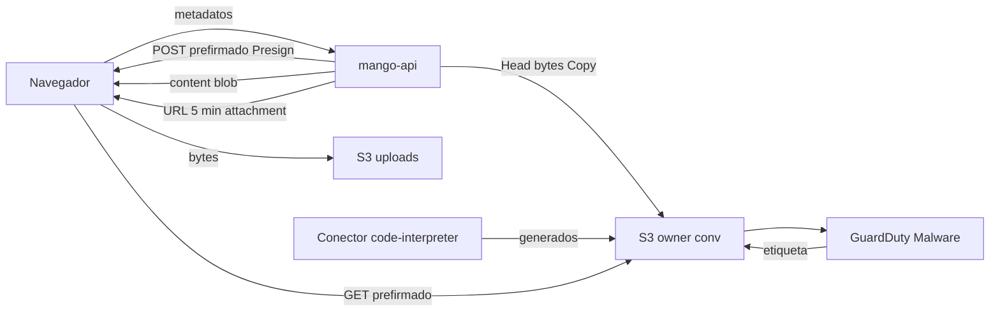

# Archivos del chat (subida, generados, escaneo y descarga): modelo de amenazas (v0.2)

> Fecha: 2026-11-07 · Skill: `security-threat-model`. Plan: [`docs/specs/chat-capacidades-plan.md`](../../specs/chat-capacidades-plan.md) (§5, PR C1, C5, W1 y U1, §7). Decisión que lo enmarca: [D116](../../architecture/decisions/D116-archivos-del-chat.md) (bucket propio, 20 × 100 MB, 90 días, escaneo de malware; vigente; su punto 9, el borrado, lo fijó este modelo); precisa D88 (25) (escaneo) y D86 (1), (5) y (10) (vía nueva, firma con `Mango-<ns>-Presign`). Además D16, D23, D24, D59, D63, D70 y la CSP de `infra/lib/constructs/edge.ts`.
> Amplía `knowledge-bases-threat-model.md` (TM-K11, firma con rol propio; el patrón de subida de D88 (9), (30) y (33)) y `task-reports-threat-model.md` (descarga prefirmada de 5 min). El sandbox que genera archivos está en [`code-interpreter-threat-model.md`](code-interpreter-threat-model.md).
> v0.1 se escribe **antes** de construir: no hay código ni recursos. Supuestos confirmados el 2026-11-07, por menú, por el agente que lanzó este trabajo.

## Executive summary

La persona podrá adjuntar hasta **20 archivos de hasta 100 MB** por mensaje, y el agente devolverá archivos generados en el Code Interpreter (CSV, XLSX, DOCX, PPTX, PDF, PNG). Todos viven en un bucket nuevo, `Mango-<ns>-chat-files`, con CMK propia y 90 días. Los subidos y los generados pasan por **GuardDuty Malware Protection for S3**; una política del bucket por etiqueta (TBAC) cierra la lectura hasta `NO_THREATS_FOUND`. Las imágenes se ven en el chat por `blob:` desde una ruta de `mango-api`; las descargas son URL prefirmadas de 5 minutos firmadas por `Mango-<ns>-Presign`, siempre `attachment`.

Riesgos dominantes:

1. **Acceso a archivos de otra persona** por una clave elegida por el cliente, un id que el modelo inventa o un enlace reenviado (TM-CF1, TM-CF2).
2. **Archivo hostil que llega a la persona o al sandbox** antes o a pesar del escaneo: carrera con el escaneo, estados distintos de `NO_THREATS_FOUND`, tipos que el navegador ejecuta (HTML, SVG) (TM-CF3, TM-CF4).
3. **Abuso de la subida**: tamaños, número, coste del escaneo y del almacenamiento (TM-CF6).
4. **Credenciales en el navegador**: la URL prefirmada lleva una sesión de STS; con la tarea de `mango-api` sería el hallazgo de GuardDuty de 2026-10-21 (TM-CF5).

Con las mitigaciones listadas y su PR, todos quedan en **medium** o **low**.

## Scope and assumptions

- **Dentro:** el bucket, su llave, su política y su ciclo de vida; el plan de GuardDuty y el TBAC (C1); la subida al chat, su guardado y los adjuntos del mensaje (U1); la ruta del contenido de imágenes y la de descarga, el validador de rutas `mango-file:` y la CSP `img-src blob:` (C5); la tarjeta y la figura en la web (W1); el borrado.
- **Fuera:** qué hace el código con los archivos (`code-interpreter-threat-model.md`); el stream (`turn-worker-threat-model.md`); la vista previa inline por el segundo origen (V0/V1).
- **Supuestos:**
  1. Se reutiliza el patrón ya construido y probado de D88 (subida: POST prefirmado de 15 min, clave del servidor, `content-length-range`, `Content-Type` exacto, `HeadObject` + firma de bytes + `CopyObject`) y de D86 (descarga de 5 min con `Mango-<ns>-Presign`, `s3:signatureAge`, `attachment`, 60 por persona y hora).
  2. Los ids públicos son ULID generados por el servidor (`AGENTS.md`).
  3. El navegador de la persona es de confianza para sus datos; el atacante es otra persona autenticada, un enlace filtrado o el autor de un archivo que el modelo lee o produce.
  4. GuardDuty Malware Protection for S3 escanea al crear el objeto, admite CMK si su rol puede usar la llave, deja la etiqueta `GuardDutyMalwareScanStatus` y entrega al menos una vez (documentación; prueba GD en C1).
  5. Los administradores no leen los archivos del chat (D23): son contenido de la conversación.

## System model

### Primary components

| Componente | Qué hace | Evidencia o PR |
|---|---|---|
| `POST /api/conversations/{id}/uploads` | Valida nombre, tamaño y tipo de hasta 20 archivos; devuelve un POST prefirmado por archivo con la clave `uploads//<subida>/<archivo>` | U1 (patrón `knowledge_uploads.py`) |
| Navegador → S3 | Sube directo con `XMLHttpRequest`; CORS solo `POST` desde el origen de la app; `connect-src` del host del bucket | U1, `edge.ts` |
| Guardado | `HeadObject`, primeros bytes, `CopyObject` a `owner//<conversación>/<archivo>` con ETag | U1 |
| Bucket `Mango-<ns>-chat-files` | CMK `alias/Mango-<ns>-chat-files`, `RETAIN`, TLS, `BUCKET_OWNER_ENFORCED`, versiones viejas a 1 día, `uploads/` a 1 día, 90 días, deny por `s3:signatureAge` | C1 |
| GuardDuty Malware Protection | Escanea cada objeto nuevo; etiqueta; eventos a EventBridge | C1 |
| TBAC | Deny de `s3:GetObject` y `s3:GetObjectVersion` a todo principal salvo el rol del escaneo sin `NO_THREATS_FOUND`; solo ese rol etiqueta (construido en C1, D116 (10)) | C1 |
| `GET …/files/{file}/content` | Bytes de una imagen para `blob:`, autenticado, L1 `OwnConversation` | C5 |
| `POST …/files/{file}/download` | URL prefirmada 5 min, `attachment`, tipo del servidor, auditada, 60 por persona y hora | C5 |
| `safeUrl.ts` / validador | Solo resuelve `mango-file:<id>` que el servidor anunció en ese mensaje | C5, W1 |

### Data flows and trust boundaries

- **Navegador → `mango-api`** (cookie de sesión D63 o access token; CloudFront + WAF): metadatos de la subida y peticiones de descarga.
- **Navegador → S3** (POST prefirmado, TLS): bytes no confiables. Las condiciones del POST fijan clave, tamaño y tipo.
- **S3 → GuardDuty** (servicio, rol propio con `kms:Decrypt`): escaneo y etiqueta.
- **`mango-api` / conector → S3** (roles de la tarea y del conector): lectura solo con etiqueta limpia.
- **`Mango-<ns>-Presign` → navegador** (URL prefirmada con sesión STS de la persona, `SourceIdentity`): bytes como descarga.
- **`mango-api` → navegador** (`content`): imagen como `blob:` en la SPA.

#### Diagram

## Assets and security objectives

| Activo | Por qué importa | Objetivo |
|---|---|---|
| Archivos subidos y generados | Datos de negocio de la persona | Confidencialidad, integridad |
| Credenciales de firma (sesión de `Mango-<ns>-Presign`) | Viajan en la URL | Confidencialidad, alcance mínimo |
| Equipo de la persona | Un archivo malicioso lo compromete | Integridad |
| Origen de la SPA | Una imagen o archivo interpretado como HTML/SVG sería XSS | Integridad |
| Presupuesto y almacenamiento | Escaneo por GB y por objeto, S3 | Disponibilidad |
| Auditoría | Quién subió y descargó qué | Integridad |

## Attacker model

### Capabilities

- Persona autenticada: subir lo que quiera dentro de los límites, pedir descargas de ids que adivine o vea.
- Quien recibe una URL prefirmada reenviada o la ve en un historial o un proxy.
- El autor de un archivo hostil (adjunto propio, documento que el modelo convierte, salida del código).
- El modelo (por inyección) puede escribir cualquier texto, incluidos enlaces `mango-file:` inventados.

### Non-capabilities

- No elige la clave de S3: la decide el servidor y la fija el POST.
- No firma: solo `mango-api` asume `Mango-<ns>-Presign`.
- No ve archivos sin `NO_THREATS_FOUND` (TBAC), salvo que el control falle.
- No pasa de 100 MB ni de 20 archivos por mensaje (condiciones del POST y validación del servidor).

## Entry points and attack surfaces

| Superficie | Cómo se alcanza | Frontera | Notas | PR |
|---|---|---|---|---|
| `POST …/uploads` | API autenticada | Navegador → `mango-api` | Nombre, tamaño, tipo declarados | U1 |
| POST a S3 | URL prefirmada | Navegador → S3 | Bytes no confiables | U1 |
| `ChatRequest.attachments` | API autenticada | Navegador → `mango-api` | Ids, no archivos | U1 |
| `GET …/content` | API autenticada | `mango-api` → navegador | Solo imágenes de la lista | C5 |
| `POST …/download` | API autenticada | `mango-api` → navegador | URL de 5 min | C5 |
| Enlace `mango-file:` en el texto del modelo | Render del mensaje | Modelo → navegador | Puede ser inventado | C5, W1 |
| Eventos de GuardDuty | EventBridge | Servicio → `mango-api` | Al menos una vez, duplicados | C1, U1 |

## Top abuse paths

1. **Id ajeno.** Una persona pide `download` de un id de otra conversación (visto en un pantallazo, adivinado) → si la ruta solo valida el id, recibe una URL del archivo ajeno.
2. **Enlace inventado.** El modelo escribe `[informe](mango-file:<id de otra persona>)` o una URL externa disfrazada → el cliente la resuelve o la abre.
3. **Carrera con el escaneo.** La persona sube un archivo y lo adjunta en el mismo segundo → el sandbox o la descarga lo lee antes de la etiqueta.
4. **HTML disfrazado.** Un `.png` que es HTML, o un `.svg` con script → se sirve `inline` o con su tipo declarado → ejecuta en el host del bucket o, por `blob:` mal tipado, en la SPA.
5. **Reenvío.** La persona reenvía la URL prefirmada → otro la usa mientras dura; si la firma fuera de la tarea, GuardDuty lo marca como exfiltración.
6. **Coste.** Subir 20 × 100 MB en bucle → escaneo y almacenamiento a cargo de la instalación.
7. **Archivo que nunca se escanea** (`UNSUPPORTED`, `FAILED`, `ACCESS_DENIED`, cifrado con zip con contraseña) → si se trata como limpio, llega a la persona.

## Threat model table

| ID | Origen | Requisito | Acción | Impacto | Activos | Controles existentes | Huecos | Mitigación (PR) | Detección | Prob. | Impacto | Prioridad |
|---|---|---|---|---|---|---|---|---|---|---|---|---|
| TM-CF1 | Persona autenticada | Un id de archivo ajeno | Leer contenido o pedir descarga de un archivo de otra conversación | Fuga entre personas | Archivos | Patrón de D86: dueño en la clave | No existe la ruta | **C5:** el archivo se resuelve por (sub del token, conversación, id) contra la clave `owner//<conversación>/…`; L1 `OwnConversation`; la sesión de Presign lleva `SourceIdentity` y una session policy con `s3:prefix`/recurso del dueño; ids ULID; 404 igual para ajeno e inexistente | Auditoría `chat.file_download` y denegaciones | Baja | Alta | **medium** |
| TM-CF2 | Modelo o inyección | Texto del mensaje | Enlace `mango-file:` inventado o URL externa con apariencia de archivo | Fuga o phishing | Archivos, la persona | `ChatMarkdown`: `skipHtml`, imágenes bloqueadas, diálogo al abrir enlaces | `mango-file:` no existe | **C5/W1:** el cliente solo resuelve ids que el servidor anunció en los metadatos de ese mensaje; cualquier otro se muestra como texto inerte; validador de rutas con las reglas del plan §2.3 (prefijo fijo, ≤ 4096, sin `.`/`..`, sin control, decodificación iterativa hasta punto fijo, 4 rondas) en servidor y cliente; la URL firmada nunca va en el texto | Test del validador | Media | Media | **low** |
| TM-CF3 | Autor del archivo | Subir o generar un archivo | Que llegue a la persona o al sandbox antes del escaneo o con estado distinto de limpio | Malware en el equipo de la persona o en la sesión | Equipo, sesión | D88 (25): «sin escaneo en v1» | — | **C1:** plan de GuardDuty sobre todo el bucket con la etiqueta activada antes de la primera subida; TBAC: deny de `s3:GetObject` y `s3:GetObjectVersion` para todo principal salvo el rol del escaneo (`Mango-<ns>-ChatFilesScan`) si `s3:ExistingObjectTag/GuardDutyMalwareScanStatus` ≠ `NO_THREATS_FOUND` (incluye la ausencia de etiqueta), y nadie más pone, cambia ni quita etiquetas ni sube un objeto con esa etiqueta (construido el 2026-11-07, D116 (10)); `THREATS_FOUND` se borra por ciclo de vida y se audita; `UNSUPPORTED`/`FAILED`/`ACCESS_DENIED` = no entregable, con mensaje a la persona. **U1:** nada se hidrata en la sesión hasta el evento; «Revisando el archivo» en el compositor; eventos idempotentes. Prueba GD en C1 (CMK + TBAC) | Eventos de GuardDuty; alarma de `THREATS_FOUND` y de escaneos fallidos | Media | Alta | **medium** |
| TM-CF4 | Autor del archivo | Archivo con tipo engañoso | Servirlo como HTML/SVG o con su tipo declarado | XSS en el host del bucket o en la SPA; phishing en un dominio de AWS | SPA, la persona | Patrón D86: `attachment` | — | **C5:** lista cerrada de tipos por extensión **y** por bytes (PDF, DOCX, XLSX, PPTX, CSV, TXT, MD, JSON, PNG, JPEG, ZIP según la lista de D116); sin HTML, SVG, macros ni ejecutables; `ResponseContentDisposition: attachment; filename*=UTF-8''…` (nombre saneado) y `ResponseContentType` del servidor; `content` solo para PNG/JPEG comprobados, con `X-Content-Type-Options: nosniff` y `Content-Type` fijo; CSP de la SPA solo gana `img-src blob:` (no `frame-src` ni el host del bucket en `img-src`) | Tests de tipos | Baja | Alta | **medium** |
| TM-CF5 | Quien ve la URL | URL prefirmada | Reusarla o usar su sesión de STS para más | Lectura del archivo; si fuera la tarea, todo lo de `mango-api` | Credenciales | D86 (10), D88 (33): firma con `Mango-<ns>-Presign`, sesión de la persona, `SourceIdentity`; deny por `s3:signatureAge` | — | **C1/C5:** el rol Presign gana solo `GetObject` en `owner/*` y `PutObject` en `uploads/*` de este bucket; session policy por persona; enlace de 5 min con `s3:signatureAge` en la política del bucket; 60 por persona y hora (límite compartido, D70); la URL no se guarda ni se loguea; test que impide firmar con la tarea | GuardDuty `ResourceCredentialExfiltration`; CloudTrail con `SourceIdentity` | Baja | Media | **low** |
| TM-CF6 | Persona o script | Sesión válida | Subidas masivas o archivos que se multiplican (zip bomb, muchas conversaciones) | Coste de escaneo y S3; disco del sandbox | Presupuesto | Límites por persona (D70) | — | **U1:** 20 × 100 MB por mensaje con `content-length-range`; límite de subidas por persona y hora y de bytes por día (compartido); `uploads/` a 1 día y multipart abandonado a 1 día; 90 días en `owner/`; GuardDuty limita archivos extraídos y anidamiento; la hidratación copia solo los adjuntos del mensaje, con tope total por sesión | Métricas de bytes por persona; alarma de coste | Media | Baja | **low** |
| TM-CF7 | Persona dada de baja o conversación borrada | Archivos que sobreviven | Datos que siguen descargables o en una sesión viva | Retención no deseada | Archivos | 90 días | No hay ruta de borrado de conversaciones hoy | **U1/C5:** al dar de baja a una persona, y al borrar una conversación cuando exista la ruta, se borran sus objetos de `owner//<conversación>/`, se para la sesión del Code Interpreter y se borra su registro; auditado sin contenido. Decidido por el dueño el 2026-11-07, por menú, vía el agente que lanzó este trabajo («Borrar con la conversación») | Auditoría del borrado | Baja | Media | **low** |
| TM-CF8 | Lector de logs | Logs de `mango-api`, acceso de S3 o CloudFront | Ver nombres de archivo, claves o URL firmadas | Fuga de metadatos o del enlace | Archivos | D16; logs de CloudFront v2 sin query (excepción de `AGENTS.md`) | Logs de acceso de S3 llevan la clave y la query | **C1/C5:** claves hechas de ids (sin nombres de archivo); nombres solo en `Conversations`; auditoría con id, tipo, tamaño y SHA-256, nunca el nombre; los logs de acceso del bucket quedan en el bucket de logs con su retención (90 días) | — | Baja | Baja | **low** |
| TM-CF9 | Persona | `ChatRequest.attachments` | Adjuntar ids de otra persona o aún no guardados | Hidratar la sesión con archivos ajenos | Archivos | — | — | **U1:** el servidor resuelve cada id contra el prefijo del dueño y la conversación; solo ids guardados y limpios; máximo 20 | Denegaciones auditadas | Baja | Alta | **medium** |

## Criticality calibration

- **high:** lectura de archivos de otra persona; malware entregado de forma sistemática; credenciales de la tarea en el navegador.
- **medium:** un control único (TBAC, resolución por dueño) del que depende evitar lo anterior.
- **low:** abuso de coste acotado por límites, metadatos en logs con retención propia, enlaces inertes.

## Focus paths for security review

| Ruta | Por qué | Amenazas |
|---|---|---|
| `infra/lib/constructs/` del bucket de archivos | Política, TBAC, ciclo de vida, plan de GuardDuty, llave | TM-CF3, CF5, CF6 |
| `apps/api/src/mango_api/chat_files.py` y `chat_files_store.py` | Resolución por dueño, estados, tipos, firma, contenido | TM-CF1, CF3, CF4, CF9 |
| `functions/chat-files-scan/`, `infra/lib/constructs/chat-files-scan.ts` | El registro del escaneo y su rol | TM-CF3 |
| `packages/py/mango-core/src/mango_core/chat_files.py` | Tipos, firma de bytes, claves | TM-CF4, CF8 |
| `apps/api/src/mango_api/presign.py` | Permisos del rol y session policy | TM-CF5 |
| `infra/lib/constructs/edge.ts` | `img-src blob:`, `connect-src` | TM-CF4 |
| `apps/web/src/security/safeUrl.ts`, `ChatMarkdown.tsx` | `mango-file:` | TM-CF2 |

## Estado tras U1 (v0.2, 2026-11-08)

Construido en `mango-api` con tests (moto), sin web y sin ver en una instalación ([D116](../../architecture/decisions/D116-archivos-del-chat.md) (11)). Skill aplicada: `security-best-practices` (FastAPI) en modo generación; `security-audit` (guía) sobre IAM.

| ID | Qué quedó construido | Lo que falta |
|---|---|---|
| TM-CF1 | `chat_files.py`: cada archivo se lee en la partición de quien llama (sesión de seguridad por fila) y Cedar decide `OwnConversation` con el dueño de su registro; ajeno e inexistente responden el mismo 404; la clave sale del registro; la descarga y la subida, firmadas por `Mango-<ns>-Presign` con la sesión del dueño | La session policy por persona de la sesión de Presign (defensa en profundidad): sigue pendiente; la prioridad no cambia (**medium**) |
| TM-CF3 | Nada se lee ni se copia antes del registro del escaneo (`CSCAN#<clave>`, que escribe `Mango-<ns>-ChatFilesScanResults`); solo `NO_THREATS_FOUND` abre un archivo y cualquier otro valor lo bloquea; la copia a `owner/` va sin etiquetas, toma solo el objeto que el escaneo limpió (ETag) y se escanea otra vez; un escaneo que no llega en 30 minutos falla el archivo; alarmas `ChatFiles-blocked` y `ChatFilesScanResults-failed` | La prueba GD en una instalación (CMK, etiqueta, TBAC y el evento) |
| TM-CF4 | Lista cerrada por extensión y por bytes (PDF, CSV, TXT, JSON, XLSX, DOCX, PPTX, PNG, JPEG); la descarga siempre `attachment` con el nombre en RFC 5987 y el tipo del servidor; `…/content` solo PNG y JPEG, con sus primeros bytes comprobados otra vez, `nosniff`, `Cache-Control: private, no-store` y `Content-Security-Policy: default-src 'none'; sandbox` | `img-src blob:` en la CSP de la SPA (W1) |
| TM-CF5 | Enlaces de 5 minutos, 60 por persona y hora (compartido), auditados antes de emitirse; nunca se loguean ni se guardan | — |
| TM-CF6 | 20 × 100 MB con `content-length-range`; 200 archivos por hora y 5 GB por día por persona; 120 confirmaciones e imágenes por minuto; todo compartido entre tareas (D70) | — |
| TM-CF7 | `delete_conversation_files`: borra los objetos de `uploads/` y `owner/` y marca los registros, que vencen con el TTL; auditado con conteos | No existe la ruta de borrar una conversación ni la baja de una persona que lo llamen; la sesión del Code Interpreter es de C2 |
| TM-CF8 | Claves de ids; la auditoría lleva ids, tipo, tamaño y SHA-256, nunca el nombre; la función del escaneo loguea ids y el resultado | — |
| TM-CF9 | `ChatRequest.attachments` (hasta 20 ids): solo subidas `ready`, no vencidas, de esa conversación y de esa persona, comprobadas por `mango-api` y otra vez por el trabajador antes de reservar; una conversación que aún no existe solo se admite si trae adjuntos suyos | Hecho en C2 (D114 (13)): el conector los escribe en la sesión con `writeFiles`, leyendo él mismo los registros `ready` de la conversación y el bucket (TBAC); el nombre se limpia. Falta que el servidor solo los acepte en agentes con «Ejecutar código» |

Nuevo: el rol de `Mango-<ns>-ChatFilesScanResults` solo actualiza los atributos del escaneo (`dynamodb:Attributes`) en particiones `USER#*` de `Conversations` y no lee nada; un evento falso en el bus por defecto no puede abrir un archivo, porque además de su registro la política del bucket sigue negando la lectura sin la etiqueta limpia.

## Estado tras U1-web (2026-11-08)

El compositor de la SPA (D116 (12)) no cambia ninguna frontera: el navegador sube cada archivo solo a la URL `https` firmada que devuelve `mango-api` (o al propio origen del mock), sin credenciales ni la cabecera `Authorization`, y `connect-src` solo nombra el bucket. Los nombres de archivo se pintan como texto; no hay vista previa de ningún archivo en el compositor ni en el historial (las imágenes por `blob:` son de W1). El tipo, el tamaño y el escaneo los decide el servidor: la web solo corta en 20 archivos por mensaje. `AgentOut.capabilities` es una pista para la interfaz: el turno vuelve a comprobar cada archivo (TM-CF9).

## Supuestos validados

Confirmados el 2026-11-07, por menú, por el agente que lanzó este trabajo: al dar de baja a una persona o borrar una conversación (cuando exista esa ruta) se borran sus archivos y su sesión del Code Interpreter («Borrar con la conversación (Recomendada)»). El tamaño (20 × 100 MB, 90 días) y el escaneo de subidas y generados los decidió el dueño el 2026-11-07 (decisiones 6 y 7 del plan).

## Riesgos residuales

Siete residuales de los tres modelos (TM-CI1, CI3 y CI8; TM-CF3 y CF5; TM-TW1 y TW5) los aceptó el dueño el 2026-11-07, por menú, con la opción «Aceptar los siete (Recomendada)». Cada uno lo dice abajo.

- **Escaneo como control único** (TM-CF3): GuardDuty detecta malware conocido; un documento con un exploit nuevo o un enlace de phishing dentro de un PDF limpio llega igual. Lo acotan `attachment`, la lista de tipos y que no haya macros. **Aceptado por el dueño el 2026-11-07, por menú: «Aceptar los siete (Recomendada)».**
- **Estados no escaneables** (TM-CF3): un archivo cifrado o `UNSUPPORTED` no se entrega; si la persona necesita esos tipos, es una decisión aparte. **Aceptado por el dueño el 2026-11-07, por menú: «Aceptar los siete (Recomendada)».**
- **Reenvío de la URL** (TM-CF5): durante 5 minutos, quien la tenga descarga el archivo; es el mismo residual aceptado en D86. **Aceptado por el dueño el 2026-11-07, por menú: «Aceptar los siete (Recomendada)».**

## Quality check

- Entradas cubiertas: subida, guardado, adjuntos del mensaje, contenido, descarga, enlaces del modelo, eventos de GuardDuty.
- Fronteras: navegador → API (CF1, CF9), navegador → S3 (CF6), S3 → GuardDuty (CF3), Presign → navegador (CF5), API → SPA (CF4), modelo → navegador (CF2).
- Runtime frente a CI: todo es runtime; el plan de GuardDuty y el bucket van en la plantilla (D25).
