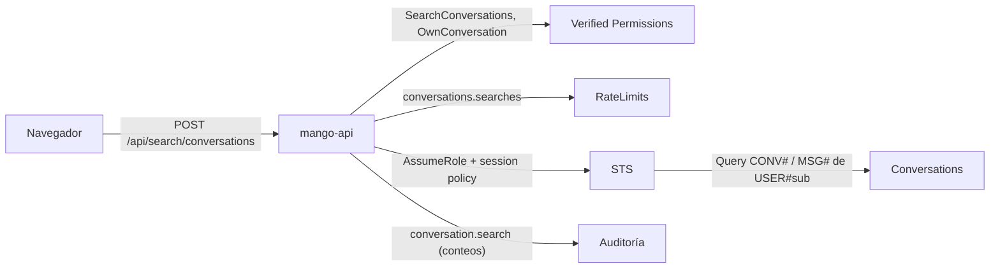

# Buscar conversaciones: modelo de amenazas (v0.1)

> Fecha: 2026-11-03 · Skill: `security-threat-model`. Decisiones: D23, D24, D70 y **D103** (esta, vigente desde 2026-11-03).
> Amplía el patrón de seguridad por fila de `Conversations` (§4.6) y `home-threat-model.md` (la misma forma de ruta: acción L1 para toda persona, lectura con la sesión de STS de la persona, límite y caché).
> Alcance: `apps/api/src/mango_api/conversation_search.py` (nuevo), `ConversationRepository.search_corpus` (`conversations.py`), la política `policies/cedar/platform/conversation-search.cedar`, el límite `conversations.searches` (`limits.py`), los eventos de auditoría (`audit.py`) y la pantalla `apps/web/src/pages/search/` con su mock.
> Se escribe con lo elegido por menú el 2026-11-03: motor en `mango-api` sin copia del contenido y búsquedas recientes solo en memoria (el dueño); la línea del tope, «Prueba con» oculto, errores comunes y abrir como el diseño (el agente que lanzó el trabajo). Nada está desplegado.

## Executive summary

La búsqueda no crea datos nuevos: lee lo que la persona ya puede leer en su historial. El riesgo que domina es **leer conversaciones de otra persona**, por un parámetro, por un error del servidor o por la caché. El segundo es **filtrar el contenido por un canal lateral**: los términos que alguien busca dicen de qué hablaron sus conversaciones, y no deben llegar a logs, auditoría ni almacenamiento del navegador. El tercero, el **costo**: cada búsqueda puede leer miles de mensajes.

Riesgos dominantes:

1. **Leer conversaciones ajenas** (TM-CS1): parámetro, error del servidor o entrada de caché servida a otra persona.
2. **Fuga de la consulta o del contenido** (TM-CS2): query string en los logs del ALB o de CloudFront, evento de auditoría, logs de la aplicación, `localStorage`.
3. **XSS almacenado** (TM-CS3): títulos, respuestas del agente o nombres de tools con HTML, pintados en los fragmentos.
4. **Abuso de costo** (TM-CS4): búsquedas en bucle sobre una partición grande.

Controles que se construyen:

- **L1 `SearchConversations`** para toda persona de Mango, deny por defecto, auditada como lectura; ninguna entrada nombra a una persona (el cuerpo es `extra="forbid"`).
- **L1 `OwnConversation`** sobre los resultados (desde el 2026-11-07, siguiente paso de TM-TW3, D121): en lote, con el dueño de la partición leída (`USER#`); lo que Cedar no permite se quita, y una sola decisión auditada por búsqueda (`scope: "search"`). Segundo control de TM-CS1 además de la sesión limitada a la partición.
- **Lectura con la sesión de STS de la persona** (`dynamodb:LeadingKeys` = `USER#`): un error que pidiera otra partición falla en STS. La caché solo se guarda y se devuelve bajo la persona que la leyó.
- **`POST` con cuerpo JSON:** los términos no viajan en la URL. Auditoría con conteos solamente; logs con el tipo del error, nunca contenido. Búsquedas recientes solo en memoria de la pestaña.
- **Fragmentos en partes de texto plano** (`{text, hit}`) que la web pinta como texto y `<mark>`; nunca HTML.
- **Topes** (200 conversaciones, 4.000 mensajes, 4 MiB), **límite compartido** de 60 por minuto y persona, caché de 30 s.

## Scope and assumptions

- **Dentro:** `POST /api/search/conversations`; la lectura `search_corpus`; la caché por persona; la política Cedar; los eventos de auditoría; la pantalla y sus búsquedas recientes.
- **Fuera:** buscar conversaciones de otras personas (D23: no existe; no se construye para administradores); índices o copias del contenido (descartados por el dueño).
- **Supuestos:** la instalación es de un solo cliente (D1); `mango-api` valida access tokens de Cognito (JWKS, `iss`, `client_id`, `token_use`) y la API se autentica con la cabecera `Authorization`, no con cookie (la cookie de D63 solo renueva), así que un `POST` no abre CSRF; los logs de acceso del ALB guardan la línea de la petición (`network.ts`, `logAccessLogs`) y los de CloudFront v2 no guardan `cs-uri-query`.

## System model

### Primary components

- **SPA** (`apps/web/src/pages/search/`): pide `POST /api/search/conversations` una vez por pausa al escribir, con el token en memoria; guarda las búsquedas recientes en un `Map` de módulo por persona (se pierde al cerrar o recargar la pestaña). Desde la ronda de diseño 35 abre una coincidencia en su mensaje: el id va en el estado de navegación hacia el chat, no en la URL (D103 (8)).
- **`mango-api`** (`conversation_search.py`): autoriza, limita, lee con la sesión de la persona, filtra en memoria, audita con conteos.
- **Tabla `Conversations`** (DynamoDB, KMS de datos, PITR): `CONV#<id>` y `MSG#<id>#…` en la partición `USER#`.
- **Rol de datos** (`Mango-<ns>-ConversationData`) asumido con una session policy por persona (sin cambios).
- **Tabla `RateLimits`**: el contador compartido.

### Data flows and trust boundaries

- **Navegador → CloudFront → ALB → `mango-api`**: HTTPS hasta CloudFront (tramo interno HTTP en PoC, excepción registrada); WAF con límite por IP; la consulta en el cuerpo.
- **`mango-api` → Verified Permissions**: `SearchConversations` (auditada como lectura) y, desde el 2026-11-07, `OwnConversation` sobre los resultados, en lote.
- **`mango-api` → `RateLimits`**: `GetItem` y `PutItem` condicional por persona.
- **`mango-api` → STS → `Conversations`**: `Query` de `CONV#` y de `MSG#<id>#` con la sesión de la persona.
- **`mango-api` → Firehose (auditoría)**: `conversation.search` con conteos.

#### Diagram

## Assets and security objectives

| Activo | Por qué importa | Objetivo |
|---|---|---|
| Contenido de las conversaciones de una persona | Datos de negocio y personales, a veces sensibles | C |
| Lo que una persona busca | Revela de qué trataron sus conversaciones | C |
| Navegador de la persona | Un fragmento con HTML ejecutado roba la sesión en memoria | I |
| Disponibilidad de `mango-api` y costo de DynamoDB | Una búsqueda lee hasta 4 MiB | A |

## Attacker model

### Capabilities

- Una persona autenticada cualquiera que manipula la petición: campos añadidos, otros agentes, consultas largas, bucles.
- Contenido no confiable dentro de sus propias conversaciones: respuestas del agente influidas por documentos o por tools (inyección indirecta), títulos generados por el modelo.
- Alguien con acceso de lectura a los logs de acceso o a la auditoría (operación, auditores).

### Non-capabilities

- No falsifica tokens ni claims; no llama a DynamoDB ni a STS directamente.
- No escribe en la partición de otra persona.

## Entry points and attack surfaces

| Superficie | Cómo se llega | Frontera | Notas |
|---|---|---|---|
| `POST /api/search/conversations` | SPA, cualquier persona con sesión | Navegador → `mango-api` | Cuerpo validado: `q` 1–200, `agent` con patrón, listas cerradas, desfase ±840; campo desconocido = 422 |
| Texto guardado en `Conversations` | Turnos del chat y de tareas | Modelo/tools → `Conversations` → web | Se devuelve en fragmentos de texto plano |
| Búsquedas recientes | Memoria de la pestaña | Navegador | Nada en Web Storage |

## Top abuse paths

1. **Pedir las conversaciones de otro:** añadir `user`, `owner` o `sub` al cuerpo. → 422 (`extra="forbid"`); la partición sale del token; la sesión de STS solo alcanza `USER#`.
2. **Caché envenenada o cruzada:** dos personas buscan a la vez en la misma tarea. → La clave es el `sub` del token verificado; se guarda tras leer con la sesión de esa persona; test que comprueba que otra persona recibe su propia lectura.
3. **Términos en los logs:** la búsqueda en la URL quedaría en los logs de acceso del ALB 90 días. → `POST` con cuerpo; la auditoría guarda solo conteos; el único log de la ruta es el tipo de un error de DynamoDB.
4. **XSS por un título o una respuesta del agente** con ``. → La API devuelve partes de texto; la web las pinta con nodos de texto de React (sin `dangerouslySetInnerHTML`); test con un título y un fragmento con HTML.
5. **Bucle de búsquedas** sobre una partición con miles de mensajes. → 60 por minuto y persona compartido entre tareas; caché de 30 s; topes de lectura; WAF por IP.
6. **Una consulta que agota la CPU** (200 caracteres, muchas palabras). → Como mucho 8 términos sin repetir y búsqueda de subcadenas sin expresiones regulares en el servidor; peor caso medido 0,3 s sobre el tope completo.

## Threat model table

| ID | Amenaza | Activo | Probabilidad | Impacto | Prioridad | Controles |
|---|---|---|---|---|---|---|
| TM-CS1 | Leer conversaciones de otra persona | Contenido | Baja | Alta | **Media** | Sin parámetros de persona (`extra="forbid"`); partición desde el token; sesión de STS limitada a `USER#` (test con un doble que niega otras particiones); caché por `sub` (test); desde el 2026-11-07, L1 `OwnConversation` en lote sobre los resultados, con el dueño de la partición leída (test) |
| TM-CS2 | La consulta o el contenido llegan a logs, auditoría o Web Storage | Lo que se busca, contenido | Media | Media | **Media** | `POST` con cuerpo (los logs del ALB no guardan cuerpos); auditoría con conteos (test que busca los términos en los detalles); log con el tipo del error; recientes en memoria (test y e2e que leen Web Storage) |
| TM-CS3 | XSS almacenado en un fragmento | Navegador | Baja | Alta | **Media** | Partes de texto plano en la API; React las pinta como texto; CSP `script-src 'self'` y Trusted Types en CloudFront; tests con HTML en título y fragmento |
| TM-CS4 | Abuso de costo o de CPU | Disponibilidad | Media | Baja | **Baja** | `conversations.searches` 60/min compartido; caché 30 s y 16 entradas; 200 conversaciones, 4.000 mensajes, 4 MiB; 8 términos; respuesta de 100 conversaciones y 20 coincidencias cada una |
| TM-CS5 | Resultados viejos tras un mensaje nuevo o un cambio de permisos | Integridad de la respuesta | Media | Baja | **Baja** | Aceptado: la caché dura 30 s y solo guarda lo propio; Cedar decide cada búsqueda antes de usarla |
| TM-CS6 | Inferir que existe algo de otra persona | Contenido | Baja | Baja | **Baja** | Nada de otra partición entra en la lectura: no hay conteos ni tiempos que dependan de datos ajenos |
| TM-CS7 | El id del mensaje de una coincidencia queda en la URL o se usa para inyectar en el DOM (ronda de diseño 35, D103 (8)) | Lo que se buscó (qué mensaje coincidió), navegador | Baja | Baja | **Baja** | El id viaja en el estado de navegación del router, nunca en la URL ni en Web Storage, y se descarta tras usarlo; el estado del historial se trata como no confiable: solo un id bien formado, comparado como dato y nunca dentro de un selector (tests con un id malformado y que la URL no lo lleva) |

## Criticality calibration

- **Alta** sería leer conversaciones de otra persona: lo impiden dos capas independientes (partición desde el token y sesión de STS), como en el historial del chat.
- **Media** quedan TM-CS1 por su impacto si las dos capas fallaran a la vez, TM-CS2 porque el contenido sensible pasa por la petición, y TM-CS3 porque el texto lo escribe el modelo con contenido externo.
- Lo que más mueve la calificación: que la sesión de STS se use siempre para la lectura (no el rol de `mango-api`) y que la consulta no viaje en la URL.

## Focus paths for security review

- `apps/api/src/mango_api/conversation_search.py`: `ConversationSearchParams`, `SearchDeps.corpus` (clave de la caché), `run` (detalle del evento), `limited_run`.
- `apps/api/src/mango_api/conversations.py`: `search_corpus` (claves de la consulta, topes).
- `apps/web/src/pages/search/SearchPage.tsx`: `Snippet` (solo texto) y `model.ts` (recientes en memoria).

## Quality check

- Entradas cubiertas: la ruta, el texto guardado que vuelve en los fragmentos y las búsquedas recientes.
- Fronteras: navegador → API, API → Verified Permissions, API → `RateLimits`, API → STS → `Conversations`, API → auditoría.
- Supuestos explícitos: autenticación por cabecera (sin CSRF), logs del ALB con la línea de la petición, un solo cliente. Las elecciones del 2026-11-03 están reflejadas; ninguna pregunta abierta cambia la prioridad.
- Separación runtime/CI: los tests usan moto y dobles; nada llama a AWS real.

## Revisión `security-audit` del diff (2026-11-03, modo guía)

- **IAM:** ningún cambio. La lectura usa la session policy existente (`GetItem`, `PutItem`, `UpdateItem`, `Query` sobre `USER#`); la búsqueda solo hace `Query`.
- **Cedar:** una política de una sentencia sobre `Mango::Platform::"mango"`, con la misma condición que `ViewHome`; sin `forbid` necesario porque nada más permite la acción. Un fallo de Verified Permissions niega (`authz.py`).
- **Auth:** la ruta declara su dependencia (`searcher` → `current_user` + `authorize`); sin acceso por objeto: no hay ids de otras personas.
- **Validación y respuesta:** modelos `extra="forbid"`; la respuesta solo lleva campos de la conversación propia.
- **Hallazgo corregido en el trabajo:** la primera versión era `GET` con la consulta en la query string, que el ALB guarda en sus logs de acceso. Se pasó a `POST` con cuerpo antes de subir la rama.
- **Hallazgos abiertos:** ninguno que bloquee.
