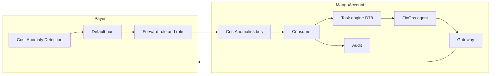

# Investigación de anomalías de costo por evento: modelo de amenazas (v0.1)

> Fecha: 2026-10-15 · Skill: `security-threat-model`. Decisión que lo enmarca: D79 (precisa D26 en lo que toca a un disparador por evento; se apoya en D52, D56 y D73). Componente nuevo: se modeló antes de construirlo y se ajustó con lo construido.
> Alcance: la regla y el rol que reenvían el evento en la cuenta pagadora (`infra/lib/stacks/payer-stack.ts`), el bus, la regla y el consumidor en la cuenta de Mango (`infra/lib/constructs/cost-anomaly-events.ts`, `functions/cost-anomaly-consumer/`), la instrucción de la investigación en el agente FinOps (`agents/finops/agent.json`) y lo que su tool de anomalías devuelve (`connectors/cost-explorer/`).
> Fuera de alcance (lo modela m3-tareas, D78): el almacén de automatizaciones y ejecuciones, el motor que invoca al agente con la identidad del dueño, la reserva de presupuesto de cada ejecución y la pausa cuando el dueño pierde el acceso. Este modelo depende de esas piezas y lo dice donde importa (TM-CA5).
> Comprobado solo con tests locales. **Sin ver en AWS:** que Cost Anomaly Detection publique el evento cuando la organización solo tiene suscripciones diarias por correo, y que EventBridge rechace eventos propios con fuente `aws.*` (supuesto 2).
> Supuestos validados el 2026-10-15 en el menú del agente (elegida la opción recomendada): los administradores de la cuenta de gestión son de confianza; un evento `aws.ce` de la cuenta pagadora solo puede venir de AWS; al modelo solo llegan el id de la anomalía, el monitor y las fechas; solo personas centrales suscriben automatizaciones a anomalías.

## Executive summary

Cost Anomaly Detection publica cada anomalía como un evento `aws.ce` / `Anomaly Detected` en el bus por defecto de la cuenta pagadora (región de origen `us-east-1`). Una regla del stack `Payer` lo reenvía, con un rol propio, a un bus de la cuenta de Mango; allí una regla invoca a un consumidor que valida el evento y arranca una ejecución del agente FinOps por cada automatización suscrita, con la identidad de su dueño. Es **la primera entrada de la instalación que no viene de una persona con sesión**: el riesgo que domina es que un evento (falso, repetido o con contenido hostil) haga trabajar al agente y gastar presupuesto sin que nadie lo pida, o le meta instrucciones.

Controles que lo acotan:

- **Quién puede publicar.** El bus solo acepta `PutEvents` de la cuenta pagadora, desde el rol de reenvío y dentro de la organización. La regla de Mango exige fuente `aws.ce`, tipo `Anomaly Detected` y cuenta pagadora; EventBridge reserva las fuentes `aws.*` a AWS. El consumidor vuelve a comprobar la forma, la cuenta y el ARN del monitor.
- **Lo que entra al modelo.** Solo el id de la anomalía, el ARN del monitor y las fechas, con formato validado. Ningún texto libre del evento (nombres de cuenta, valores de tags, nombres de monitor, tipos de uso) llega a la ejecución. El agente lee importes y causas con su tool, con el alcance del dueño, y los trata como salida de tool no confiable.
- **Cuánto puede costar.** Una ejecución por anomalía y automatización (clave de idempotencia por id de anomalía), como mucho 5 por automatización y día, y la reserva de presupuesto de cada ejecución antes de invocar (D73).
- **Qué puede hacer.** Las tareas solo leen (A3): el agente FinOps no tiene tools de escritura y una escritura propuesta espera la aprobación de su dueño (D56).

Riesgo residual principal: que la tormenta de anomalías o una suscripción mal planteada gaste el tope diario y el presupuesto del dueño (TM-CA2, medio), y que el contenido que el agente sí lee con su tool (nombres de cuenta y tipos de uso) lleve instrucciones (TM-CA3, medio).

## Scope and assumptions

- **Dentro:** la regla `Mango-<ns>-CostAnomalies-forward` y el rol `Mango-<ns>-CostAnomalyForwarder` de `Payer`; el bus `Mango-<ns>-CostAnomalies`, su política, su regla y el consumidor `Mango-<ns>-CostAnomalyConsumer` con su cola de errores y sus alarmas en `Core`; el adaptador con el que el consumidor arranca ejecuciones; la instrucción de investigación de FinOps; el campo `anomaly_id` de `get_anomalies`.
- **Fuera:** el motor de tareas (D78); los monitores y suscripciones de Cost Anomaly Detection del cliente (Mango no los crea ni los cambia); el resto del agente FinOps (`cost-explorer-connector-threat-model.md`).
- **Supuestos:**
  1. Los administradores de la cuenta de gestión son de confianza: pueden cambiar `Payer` y mandar eventos propios al bus de Mango (validado).
  2. EventBridge no deja publicar con `PutEvents` eventos cuya fuente empiece por `aws.` (validado como supuesto; lo afirman fuentes secundarias y el error `NotAuthorizedForSourceException`, no una frase de la documentación primaria).
  3. AWS conserva en el evento reenviado la cuenta de origen (`account`): es la de la pagadora.
  4. Cost Anomaly Detection vuelve a avisar de una anomalía mientras dura (documentación de AWS): el mismo `anomalyId` llega varias veces.
  5. `Payer` y `Core` están en la misma región, `us-east-1` (`docs/runbooks/install.md`), que es la región de origen de Cost Anomaly Detection.
  6. El motor de tareas (D78) corre cada ejecución con la identidad del dueño, reserva presupuesto antes de invocar, honra la clave de idempotencia y el tope diario, y pausa la automatización si el dueño pierde el acceso o deja de ser central.
- **Preguntas abiertas:** si el evento sale sin suscripción inmediata (supuesto que decide si el camino funciona, no su seguridad); cómo expone el motor de D78 el tope y la idempotencia (TM-CA2, TM-CA5).

## System model

### Primary components

| Componente | Qué hace | Evidencia |
|---|---|---|
| Regla `Mango-<ns>-CostAnomalies-forward` (pagadora) | En el bus por defecto: fuente `aws.ce`, tipo `Anomaly Detected`, cuenta pagadora. Destino: el bus de Mango, con un rol | `infra/lib/stacks/payer-stack.ts` (`costAnomalyForwarding`) |
| Rol `Mango-<ns>-CostAnomalyForwarder` (pagadora) | Solo `events:PutEvents` sobre el bus de Mango. Lo asume `events.amazonaws.com`, con `aws:SourceAccount` y `aws:SourceArn` de la regla | `payer-stack.ts` |
| Bus `Mango-<ns>-CostAnomalies` (Mango) | Política: `PutEvents` de la cuenta pagadora, con `aws:PrincipalArn` del rol de reenvío y `aws:PrincipalOrgID` | `infra/lib/constructs/cost-anomaly-events.ts` |
| Regla de Mango y consumidor `Mango-<ns>-CostAnomalyConsumer` | Mismo patrón y cuenta pagadora; invocación asíncrona, 2 reintentos, cola de errores con alarma | `cost-anomaly-events.ts`; `functions/cost-anomaly-consumer/src/mango_cost_anomaly_consumer/handler.py` |
| Validación del evento | Fuente, tipo, cuenta, `resources` igual al monitor, ARN del monitor de la pagadora, id con forma de UUID, fechas | `event.py` (`parse_anomaly_event`) |
| Arranque de ejecuciones | Interfaz mínima (`RunStarter`): automatizaciones suscritas a `cost_anomaly` y arranque con clave de idempotencia y tope diario. Hasta integrar D78, un adaptador sin motor que no arranca nada | `runs.py` |
| Auditoría | `cost_anomaly.received` y `cost_anomaly.rejected`, con ids y conteos, nunca contenido | `audit.py` |
| Investigación | Instrucción del agente FinOps; tools de solo lectura | `agents/finops/agent.json` |

### Data flows and trust boundaries

- **Cost Anomaly Detection → bus por defecto de la pagadora.** Evento de AWS. Dentro de la cuenta del cliente; nadie más publica `aws.ce` (supuesto 2).
- **Bus por defecto → bus de Mango (cruza cuentas).** El evento entero, por EventBridge, firmado con el rol de reenvío. Garantías: el rol solo puede `PutEvents` sobre ese bus; el bus solo acepta a ese rol de la cuenta pagadora dentro de la organización. Sin cifrado propio: lleva importes y nombres de cuentas, no secretos (clave de AWS).
- **Bus de Mango → consumidor.** Invocación asíncrona de Lambda. La regla filtra por fuente, tipo y cuenta; el consumidor valida la forma y descarta todo texto libre.
- **Consumidor → motor de tareas (D78).** Id de la anomalía, ARN del monitor y fechas; clave `cost_anomaly:<id>`; tope 5 por automatización y día.
- **Motor → agente FinOps → Gateway → pagadora.** Lo de siempre: identidad del dueño hasta el destino (`BillingBroker` + `SourceIdentity`), autorización y presupuesto antes de invocar.
- **Consumidor → auditoría.** Firehose (S3 Object Lock) y el índice de auditoría, con ids y conteos.

#### Diagram

## Assets and security objectives

| Asset | Why it matters | Security objective (C/I/A) |
|---|---|---|
| Presupuesto de modelo del dueño y del agente | Cada ejecución lo consume; agotarlo deja sin chat al dueño | A, I |
| Consultas de Cost Explorer | USD 0,01 cada una, en la cuenta pagadora | A |
| Resultado de la investigación | Lo lee una persona central para decidir; cifras o conclusiones falsas engañan | I |
| Datos de costo de cuentas fuera del alcance del dueño | El evento trae importes y cuentas de toda la organización | C |
| Identidad del dueño en las ejecuciones | Atribución en CloudTrail; nada debe correr como él sin que él lo haya pedido | I |
| Rol de reenvío en la cuenta de gestión | Cuenta más sensible de la organización | I |

## Attacker model

### Capabilities

- Cualquiera con permisos de etiquetado o de nombrar cuentas en la organización escribe valores de tags (`dimensionValue`), nombres de cuenta y, a través de lo que despliega, tipos de uso: textos que viajan en el evento y en lo que devuelve la tool.
- Cualquiera que haga crecer el gasto en una cuenta miembro puede provocar anomalías reales, muchas a la vez.
- Una cuenta de la organización distinta de la pagadora puede intentar `PutEvents` contra el bus de Mango.
- Un administrador de la cuenta de gestión puede mandar eventos propios al bus (supuesto 1: es de confianza).

### Non-capabilities

- Nadie fuera de AWS publica un evento con fuente `aws.ce` (supuesto 2).
- Una cuenta fuera de la organización, o un principal de la pagadora distinto del rol de reenvío, no puede publicar en el bus.
- El evento no elige el agente, la instrucción ni la identidad de la ejecución: los fija la automatización.
- Ninguna ejecución escribe en AWS (A3, D56).

## Entry points and attack surfaces

| Surface | How reached | Trust boundary | Notes | Evidence |
|---|---|---|---|---|
| Bus `Mango-<ns>-CostAnomalies` | `PutEvents` desde la pagadora | Pagadora → Mango | Política con `aws:PrincipalArn` y `aws:PrincipalOrgID` | `cost-anomaly-events.ts` |
| Regla y consumidor | Evento que pasa el patrón | Bus → Lambda | Validación estricta; los rechazos se cuentan, se auditan y alarman | `event.py`, `handler.py` |
| Invocación directa del consumidor | `lambda:InvokeFunction` | Administrador de Mango → Lambda | Misma validación | `handler.py` |
| Salida de `get_anomalies` | Tool del agente | Cost Explorer → modelo | Ya tratada como no confiable; nombres truncados | `connectors/cost-explorer/src/mango_cost_explorer/tools.py` |

## Top abuse paths

1. **Gasto por eventos falsos.** Publicar anomalías inventadas en el bus → la política solo acepta al rol de reenvío de la pagadora; la regla exige `aws.ce` y la cuenta pagadora; el consumidor rechaza lo que no tenga la forma de AWS. Un evento falso que pasara todo aun así arranca como mucho 5 ejecuciones por automatización y día.
2. **Tormenta real.** Subir el gasto de muchas cuentas a la vez → muchas anomalías → una ejecución por anomalía y automatización, como mucho 5 por día; las demás quedan omitidas con su motivo; cada ejecución reserva presupuesto antes de invocar.
3. **Repetición.** AWS reenvía la misma anomalía mientras dura, o Lambda reintenta → la clave `cost_anomaly:<id>` hace que el motor no arranque dos veces.
4. **Inyección por el evento.** Poner instrucciones en un valor de tag o un nombre de cuenta → no llegan al modelo desde el evento: el consumidor solo pasa id, monitor y fechas.
5. **Inyección por la tool.** Las mismas instrucciones llegan cuando el agente lee la anomalía con `get_anomalies` (tipos de uso, servicios) → salida de tool no confiable por instrucción del agente; solo lectura; nada se ejecuta sin aprobación.
6. **Fuga de alcance.** Una automatización de una persona de área recibe la anomalía de otra cuenta → solo personas centrales suscriben; el evento no pasa importes ni cuentas; la tool filtra por alcance.
7. **Correr como alguien que ya no debería.** El dueño pierde el acceso o deja de ser central → el motor pausa la automatización (D26) y no arranca ejecuciones (D78).
8. **Usar el rol de la cuenta de gestión.** Solo `events:PutEvents` sobre el bus de Mango, asumible solo por EventBridge para esa regla.

## Threat model table

| Threat ID | Threat source | Prerequisites | Threat action | Impact | Impacted assets | Existing controls (evidence) | Gaps | Recommended mitigations | Detection ideas | Likelihood | Impact severity | Priority |
|---|---|---|---|---|---|---|---|---|---|---|---|---|
| TM-CA1 | Cuenta de la organización o administrador de la pagadora | Poder llamar `PutEvents` | Publicar anomalías falsas para arrancar investigaciones | Gasto de modelo y de Cost Explorer; resultado engañoso | Presupuesto; resultado | Política del bus (`cost-anomaly-events.ts`); patrón con fuente, tipo y cuenta; validación (`event.py`); el agente relee la anomalía por API; idempotencia y tope | Supuesto 2 sin probar en AWS | Probarlo en la primera instalación con laboratorio; mantener la relectura por API en la instrucción | Métrica y alarma `Rejected`; `cost_anomaly.rejected` en auditoría | Baja | Media | low |
| TM-CA2 | Cualquiera que mueva el gasto; AWS | Muchas anomalías reales | Tormenta que agota presupuesto y tope | El dueño se queda sin chat; investigaciones omitidas | Presupuesto; consultas de CE | Una ejecución por anomalía y automatización; tope 5 por día; reserva antes de invocar (D73) | El tope y la idempotencia los aplica el motor (D78), sin integrar todavía | Integración: test de extremo a extremo con 10 anomalías; la omisión visible en el historial | Conteos `started`/`capped`/`duplicate` en `cost_anomaly.received` | Media | Media | medium |
| TM-CA3 | Quien escribe tags, nombres de cuenta o despliega recursos | Acceso a una cuenta de la organización | Instrucciones en textos que el agente lee | El agente resume mal o intenta seguir instrucciones | Resultado | Del evento solo pasan id, monitor y fechas (`runs.py`, `trigger_input`); reglas de seguridad de FinOps; solo lectura (A3, D56) | Los textos de la tool siguen llegando al modelo | Mantener las preguntas de inyección de la evaluación de FinOps; truncar textos en la tool | Revisión de resultados con instrucciones citadas | Media | Baja | medium |
| TM-CA4 | Persona de área con una automatización | Poder suscribirse | Ver importes o cuentas fuera de su alcance | Exposición parcial de datos de costo | Datos fuera de alcance | Solo centrales suscriben (D79); el evento no pasa importes ni cuentas; la tool filtra por alcance | La regla «solo centrales» la aplica el motor (D78) | Test de la API de D78 que rechaza el disparador a no centrales | Auditoría de altas de automatizaciones | Baja | Media | low |
| TM-CA5 | Persona que perdió el acceso | Automatización activa | Que sigan corriendo ejecuciones con su identidad | Acceso sin autorización vigente; atribución falsa | Identidad del dueño | D26 (pausa); identidad del dueño hasta el destino (regla 5); el consumidor no tiene credenciales de lectura | Depende del motor (D78) | Comprobar en la integración que el motor revalida acceso y rol central en cada arranque | Ejecuciones de automatizaciones pausadas | Baja | Alta | medium |
| TM-CA6 | Quien controle la regla de la pagadora | Administrador de la pagadora | Usar el rol de reenvío para otra cosa | Eventos al bus de Mango (ya cubiertos por TM-CA1) | Rol de reenvío | Solo `events:PutEvents` sobre un bus; trust con `aws:SourceAccount` y `aws:SourceArn` (`payer-stack.ts`) | — | — | CloudTrail del rol | Baja | Baja | low |
| TM-CA7 | AWS o la instalación | Evento no publicado, bus inexistente o consumidor caído | Perder anomalías sin que nadie lo sepa | Ninguna investigación | Disponibilidad | Reintentos de EventBridge (24 h) y de Lambda; cola de errores con alarma | Si AWS no publica con suscripciones diarias, nada lo avisa | Comprobarlo con la primera anomalía real; si no llega, decidir una suscripción inmediata (D79) | Alarma de la cola; comparar «Detected anomalies» con `cost_anomaly.received` | Media | Media | medium |
| TM-CA8 | Lector de logs | Acceso a CloudWatch Logs | Leer contenido del evento | Exposición menor de costos | Datos de costo | El consumidor registra ids, conteos y códigos de rechazo, nunca el evento crudo (`handler.py`) | — | — | — | Baja | Baja | low |

## Criticality calibration

- **critical:** una ejecución que escribe en AWS sin aprobación; un evento que elige la identidad con la que corre.
- **high:** ejecuciones con la identidad de alguien que perdió el acceso; datos de toda la organización a una persona de área.
- **medium:** agotar el presupuesto de un dueño con una tormenta; perder anomalías sin aviso; un resumen manipulado por textos de la organización.
- **low:** eventos falsos frenados por política y validación; tags o importes en un log.

## Focus paths for security review

| Path | Why it matters | Related Threat IDs |
|---|---|---|
| `infra/lib/stacks/payer-stack.ts` | Rol de reenvío en la cuenta de gestión y su trust | TM-CA1, TM-CA6 |
| `infra/lib/constructs/cost-anomaly-events.ts` | Política del bus, patrón, cola de errores y alarmas | TM-CA1, TM-CA7 |
| `functions/cost-anomaly-consumer/src/mango_cost_anomaly_consumer/event.py` | Validación del evento | TM-CA1, TM-CA3 |
| `functions/cost-anomaly-consumer/src/mango_cost_anomaly_consumer/runs.py` | Qué entra a la ejecución; idempotencia y tope | TM-CA2, TM-CA3, TM-CA4 |
| `functions/cost-anomaly-consumer/src/mango_cost_anomaly_consumer/handler.py` | Rechazos, auditoría y logs | TM-CA1, TM-CA8 |
| `agents/finops/agent.json` | Instrucción de la investigación y reglas de seguridad | TM-CA3 |

## Quality check

- Entradas cubiertas: bus, regla y consumidor, invocación directa, salida de la tool.
- Cada frontera aparece en una amenaza: pagadora → Mango (TM-CA1, TM-CA6), bus → consumidor (TM-CA1, TM-CA8), consumidor → motor (TM-CA2, TM-CA4, TM-CA5), tool → modelo (TM-CA3).
- Solo ejecución; CI y build fuera.
- Supuestos validados en el menú del 2026-10-15; los abiertos están en «Scope and assumptions».
