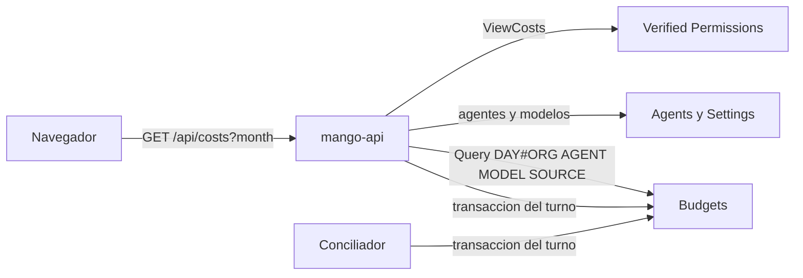

# Costos: gasto de Bedrock por agente, modelo y origen: modelo de amenazas (v0.1)

> Fecha: 2026-11-05 · Skill: `security-threat-model`. Decisiones: D17, D73, D89, D102, D104 y **D105, D106 y D107** (acordadas por el dueño por menú el 2026-11-05).
> Amplía `home-threat-model.md` (los contadores por día y su transacción), `budget-reconciliation-threat-model.md` (el conciliador que cierra turnos) y `cur-reconciliation-threat-model.md` (`DAY#AGENT#`).
> Alcance: `apps/api/src/mango_api/costs.py` (nuevo), los contadores nuevos `DAY#MODEL#<model_id>` y `DAY#SOURCE#<origen>` en `packages/py/mango-core/src/mango_core/usage_days.py` y su escritura en `budget_turns.settle/hold/close` (mango-api y el conciliador de presupuesto), la política `policies/cedar/platform/costs-view.cedar` y su acción en el schema. La pantalla (`apps/web/src/pages/costs/`) y su CSV esperan a la ronda de Claude Design (D24): aquí solo se fija lo que la web debe cumplir.
> Sin infraestructura nueva: `mango-api` ya lee y escribe `Budgets`, y el conciliador ya puede escribir `DAY#*`. Nada está desplegado.

## Executive summary

Costos junta en una lectura lo que la organización gasta en Amazon Bedrock: por día, por agente, por modelo y por origen (conversaciones, tareas, Playground y evals), con el mes anterior, la proyección y el presupuesto de cada agente. El riesgo que domina es **que alguien fuera de administración y FinOps central vea esos números**: el gasto por agente dice qué equipos usan qué y cuánto, y los presupuestos son configuración de gobierno. El segundo es la **integridad de los contadores nuevos**, que van en la transacción que mueve el presupuesto de cada turno: un error ahí puede romper la transacción entera y dejar turnos sin cerrar. El tercero, el **costo de la lectura**: un mes por agente son N consultas.

Riesgos dominantes:

1. **Ver Costos sin rol** (TM-C1): una persona, un creador o un `bu-lead` lee el gasto de la organización o los presupuestos.
2. **Contadores que rompen la transacción del turno** (TM-C2): una clave inválida, demasiados ítems o un origen que no es uno de los cuatro.
3. **Lectura cara en bucle** (TM-C3): meses arbitrarios, muchos agentes o modelos.
4. **Números que mienten** (TM-C4): turnos contados dos veces, o un mes parcial presentado como completo.
5. **Inyección de fórmulas en el CSV** (TM-C5): el nombre de un agente lo escribe un creador y acaba en una hoja de cálculo de FinOps.

Controles que se construyen:

- **L1 `ViewCosts`** solo para administradores y `finops-central`, auditada como lectura; **los dos ven lo mismo, presupuestos por agente incluidos** (D105 (c), que amplía D17 y D89 (1) para esta vista). Deny por defecto: sin la acción, 403.
- **Una sola entrada, `month`**, validada (`yyyy-mm`) y acotada a los meses que los contadores conservan (el actual y los once anteriores). Ningún parámetro elige agentes, modelos ni personas.
- **Ni personas ni conversaciones** en la respuesta: el desglose es por agente, modelo y origen. Nunca se lee `DAY#USER#` ni `DAY#AREA#`.
- **Lectura sin `Scan`:** una `Query` por contador y rango (días del mes y del anterior) y `BatchGetItem` para los acumulados mensuales de presupuesto. Los agentes salen del catálogo (índice por estado) y los modelos del catálogo de modelos, de los agentes y del modelo auxiliar: la lista de claves la arma el servidor. Topes de agentes y de modelos.
- **Límite de 30 lecturas por minuto y persona** (en cada tarea) y **caché de 30 s** por persona, permisos y mes, como Inicio y Gobernanza.
- **Contadores exactamente una vez,** en la misma transacción condicionada que ya escribe `DAY#ORG` y `DAY#AGENT#`; solo los escribe un registro de turno que trae su origen (escrito por esta versión), con el origen de una lista cerrada y el modelo validado con `MODEL_ID_PATTERN`. Como mucho nueve ítems por transacción (tope de DynamoDB: 100).

## Scope and assumptions

- **Dentro:** `GET /api/costs?month=`; la escritura de `DAY#MODEL#` y `DAY#SOURCE#`; la acción Cedar; las reglas para el CSV de la web.
- **Fuera:** «Por equipo», «Asignado a equipos» y «Oportunidades de ahorro» (D107: «Próximamente», sin fuente ni datos). El gasto según la factura (CUR, D104) tiene su propio modelo. La pantalla.
- **Supuestos:** la instalación es de un solo cliente (D1); el rol (`finops-central`) y `is_admin` llegan en el access token verificado, los escribe el trigger pre-token desde los grupos de Cognito (D14, D60) y solo un administrador cambia grupos. El origen de un turno lo pone `mango-api` según la ruta que lo crea (chat, ejecución de una tarea D78, Playground D91; `eval`, preparado para el runner de evals), nunca la petición.

## System model

### Primary components

- **`mango-api`** (`costs.py`): autoriza `ViewCosts`, valida el mes, arma las claves desde el catálogo y lee los contadores; responde con modelos Pydantic explícitos.
- **Tabla `Budgets`** (DynamoDB, KMS de datos, PITR): `DAY#ORG`, `DAY#AGENT#<id>` (D104), y nuevos `DAY#MODEL#<model_id>` y `DAY#SOURCE#<origen>`, con el mismo TTL de 400 días; `AGENT#<id>` / `yyyy-mm` (acumulado mensual del presupuesto).
- **Catálogo de agentes** (tabla `Agents`, índice por estado) y **catálogo de modelos** (tabla `Settings`): de dónde salen las claves a leer y los nombres.
- **Conciliador de presupuesto** (Lambda): cierra turnos con la misma transacción (`budget_turns.close`), que ahora incluye los contadores nuevos.

### Data flows and trust boundaries

- **Navegador → CloudFront → ALB → `mango-api`**: HTTPS hasta CloudFront (tramo interno HTTP en PoC, excepción registrada); access token de Cognito; WAF con límite por IP.
- **`mango-api` → Verified Permissions**: `ViewCosts` (auditada como lectura).
- **`mango-api` → `Budgets` con su rol**: `Query` acotadas por clave y rango; `BatchGetItem` de `AGENT#<id>` del mes. Ninguna con la sesión de una persona: no se lee nada de personas.
- **`mango-api` / conciliador → `Budgets` (escritura)**: la `TransactWriteItems` que cierra el turno, con dos ítems más.

#### Diagram

## Assets and security objectives

| Activo | Por qué importa | Objetivo |
|---|---|---|
| Gasto por agente, modelo y origen | Uso de la IA por equipos y casos de uso, dato de FinOps de la empresa | C |
| Presupuestos por agente | Configuración de gobierno (D17) | C |
| Contadores `DAY#` y presupuestos `USER#`/`AGENT#` | Los presupuestos deciden turnos (regla 4); la transacción no puede fallar por un contador | I, A |
| Disponibilidad de `mango-api` y costo de DynamoDB | La lectura hace N consultas | A |
| Hoja de cálculo de quien exporta el CSV | Un nombre de agente se abre en Excel | I |

## Attacker model

### Capabilities

- Una persona autenticada cualquiera (sin rol, creador de agentes, `bu-lead`, `finops-central`) que manipula la petición: otros meses, parámetros añadidos, bucles.
- Un creador de agentes que escribe el nombre de un agente (texto libre validado por longitud), que acaba en la respuesta y en el CSV.
- Un error futuro en `mango-api` que arme una clave o un origen equivocados.

### Non-capabilities

- No falsifica tokens ni claims; no cambia sus grupos.
- No elige el origen ni el modelo de un turno fuera de lo que ya permite el chat (un modelo de `allowed_models` del agente, validado contra el catálogo).
- No añade modelos al catálogo (solo administradores, Brains, D38) ni llama a DynamoDB directamente.

## Entry points and attack surfaces

| Superficie | Cómo se llega | Frontera | Notas |
|---|---|---|---|
| `GET /api/costs?month=` | SPA, administradores y `finops-central` | Navegador → `mango-api` | `month` con patrón y rango; nada más cambia la respuesta |
| Escritura de `DAY#MODEL#`/`DAY#SOURCE#` | Cerrar un turno (chat, tarea, Playground; eval cuando exista) | `mango-api`/conciliador → `Budgets` | Dentro de la transacción condicionada del turno |
| CSV de la web | «Exportar CSV» (cuando exista la pantalla) | Navegador → hoja de cálculo | Se genera en el cliente con la respuesta |

## Top abuse paths

1. **Una persona sin rol abre Costos o llama a la ruta.** → `ViewCosts` niega (403, auditado). La web la esconde, pero el servidor decide.
2. **Un `bu-lead` pide su área por parámetro.** → La ruta no tiene parámetros de alcance; tampoco devuelve áreas ni personas.
3. **Bucle con meses distintos para esquivar la caché.** → 30 por minuto y persona; meses fuera del rango, 422 sin leer nada; cada mes son consultas acotadas a 62 días.
4. **Un nombre de agente `=HYPERLINK(...)`** exportado por FinOps. → La web debe prefijar `'` a toda celda que empiece por `=`, `+`, `-`, `@`, tabulador o retorno de carro, además de escapar comillas (requisito del brief de la pantalla).
5. **Un registro de turno escrito por una versión anterior** se cierra después de instalar esta. → Sin origen, no suma a `DAY#MODEL#` ni `DAY#SOURCE#`: el desglose cuenta desde que se instala (`counted_since`) y lo no atribuido se muestra aparte, nunca se reparte.
6. **Un modelo con un id extraño en el catálogo** rompe la transacción. → El modelo se valida con `MODEL_ID_PATTERN` al armar la clave; si no lo cumple, el turno no suma a ningún modelo (lo mismo que un área inválida, D102) y su transacción sigue.

## Threat model table

| ID | Amenaza | Activo | Probabilidad | Impacto | Prioridad | Controles |
|---|---|---|---|---|---|---|
| TM-C1 | Ver el gasto o los presupuestos sin ser administrador ni `finops-central` | Gasto por agente, presupuestos | Baja | Media | **Baja** | `ViewCosts` en Cedar, deny por defecto (tests con las políticas reales y por rol en la API); sin parámetros de alcance; los presupuestos van a quien tiene `ViewCosts` (D105 (c)), sin otra puerta |
| TM-C2 | Un contador rompe o duplica la transacción que cierra el turno | Integridad y disponibilidad de los presupuestos | Baja | Media | **Baja** | Claves validadas (origen de una lista cerrada, modelo con `MODEL_ID_PATTERN`); como mucho nueve ítems por transacción (test); la transacción sigue condicionada al registro, así que cerrar dos veces no suma dos veces; tests por cada fila del ciclo de vida (D73 (6)) en `settle`, `hold` y `close` |
| TM-C3 | Bucle o mes caro (costo, latencia) | Disponibilidad, costo | Media | Baja | **Baja** | `costs.reads`, 30 por minuto y persona en cada tarea; caché de 30 s (256 entradas); meses limitados al actual y los once anteriores; topes de 500 agentes y 100 modelos por lectura; una `Query` por clave (≤ 62 ítems) |
| TM-C4 | Números engañosos: mes parcial como completo, gasto atribuido de más | Confianza en el dato de FinOps | Media | Baja | **Baja** | `counted_since` por desglose; lo no atribuido (`unattributed_usd`) aparte; la proyección solo con 5 días o más y solo del mes en curso; consultas reales (`turns`), no estimadas |
| TM-C5 | Inyección de fórmulas al abrir el CSV | Equipo de quien exporta | Baja | Media | **Baja** | Requisito para la web: escapar comillas y prefijar `'` a celdas que empiecen por `=`, `+`, `-`, `@`, `\t` o `\r`; la API devuelve importes como cadenas decimales y nombres tal cual, nunca HTML |
| TM-C6 | Datos de más en la respuesta o en los logs | Datos personales | Baja | Baja | **Baja** | Modelos explícitos (`extra="forbid"`); ni correos ni personas ni conversaciones; un solo log sin contenido («costs unavailable»); la auditoría es la decisión `ViewCosts` como lectura |

## Criticality calibration

- **Alta** sería ver gasto de personas o conversaciones: la ruta no lee ninguna clave de personas (`DAY#USER#`, `USER#`), así que no puede darlos aunque falle la autorización.
- **Media** sería que un fallo en los contadores dejara turnos sin cerrar: la reserva seguiría retenida y el conciliador la cerraría con la misma transacción, por eso las claves se validan antes de escribir.
- Lo que más mueve la calificación: que `finops-central` siga siendo un rol que solo da un administrador (D60) y que el origen lo ponga el servidor.

## Focus paths for security review

- `apps/api/src/mango_api/costs.py`: validación de `month`, armado de claves, topes y la respuesta.
- `packages/py/mango-core/src/mango_core/usage_days.py`: `model_key`, `source_key` y sus patrones.
- `packages/py/mango-core/src/mango_core/budget_turns.py`: `cost_counters` y el `origin` del registro.
- `policies/cedar/platform/costs-view.cedar`.

## Quality check

- Entradas cubiertas: la ruta, la escritura de los contadores (cierre del turno) y el CSV futuro.
- Fronteras: navegador → API, API → Verified Permissions, API → `Budgets` y catálogos, conciliador → `Budgets`.
- Supuestos explícitos y confirmados por los menús del dueño del 2026-11-05 (D105, D106 y D107); ninguna pregunta abierta cambia la prioridad.
- Separación runtime/CI: los tests usan moto y dobles; nada llama a AWS real.
