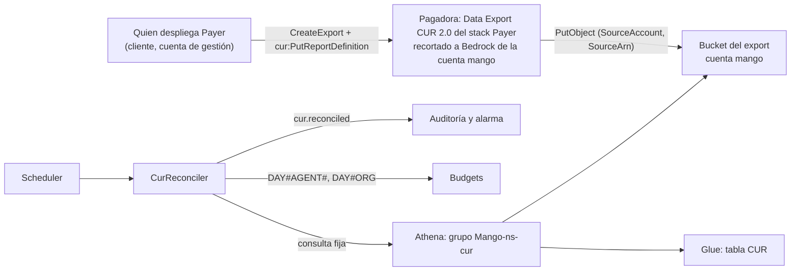

# Gasto de Bedrock por agente y conciliación contra CUR 2.0: modelo de amenazas (v0.4)

> Fecha: 2026-11-03 · Skill: `security-threat-model`; revisión de IAM del diseño con `security-audit` (modo guía), que dejó dos ajustes: el ARN de origen en `us-east-1` y una llave KMS propia del bucket. Decisión: **D104** (vigente desde 2026-11-03, aceptada por el dueño por menú).
> **v0.2, 2026-11-04: construido** (código y documentos, sin instalar), con `security-threat-model` y `security-audit` (modo guía) sobre el diff. Cambios frente al diseño: el bucket va con SSE-S3, porque Data Exports no entrega con una llave KMS (AWS: «encrypt with KMS after the export has been delivered»); la consulta de un export sí se puede editar después de crearlo (solo la configuración de la tabla es fija), así que TM-CUR1 sube de probabilidad y la comprobación de cada pasada es la defensa que queda; el guardrail, aunque lo facture el rol de un agente, no se compara (solo se comparan los tokens de modelo). Lo construido está en «Controles construidos».
> **v0.3, 2026-11-04: bajo Lake Formation** (D104 (9)), con `security-threat-model` y `security-audit` (modo guía) sobre el diff. La primera instalación en un cliente se revirtió porque Lake Formation gobernaba su catálogo. Con el parámetro `CatalogGovernedByLakeFormation` = `true`, la plantilla concede a la función `SELECT` y `DESCRIBE` sobre su tabla, tras un `CREATE_DATABASE` sobre el catálogo que un administrador de Lake Formation del cliente da a mano al rol que despliega. El log group de la función pasa a `RetainExceptOnCreate`, y la consulta lleva el contexto de su base. Amenaza nueva: TM-CUR9.
> **v0.4, 2026-11-05: el export lo crea el stack `Payer`** (D104 (10)), con `security-threat-model` y `security-audit` (modo guía) sobre el diff. La consola de Data Exports no deja escribir el `WHERE`; el export pasa a ser un `AWS::BCMDataExports::Export` de `Payer`, con la consulta y la tabla de la versión, el dueño del bucket fijado a la cuenta de Mango y el bucket por un parámetro (`CurExportBucket`, vacío = sin export). Las etiquetas siguen a mano, del tipo «IAM principal». Ningún rol de Mango cambia; el permiso nuevo es del principal del cliente que despliega `Payer` en la cuenta de gestión (Data Exports y `cur:PutReportDefinition`). TM-CUR1 baja de probabilidad; amenazas nuevas: TM-CUR10 y TM-CUR11.
> Amplía `budget-reconciliation-threat-model.md` (D73: conciliar con las trazas) y TM-006 (gasto descontrolado) de `mango-architecture-threat-model.md`.
> Alcance: el bucket del export CUR 2.0 en la cuenta de la instalación, la base y la tabla de Glue, el grupo de trabajo de Athena `Mango-<ns>-cur`, la función `Mango-<ns>-CurReconciler` con su rol, su DLQ y su alarma, el contador `DAY#AGENT#<id>` de `Budgets` y el paso manual del runbook en la pagadora (activar dos etiquetas y crear el export).
> Se escribe con lo elegido por menú el 2026-11-03. El dueño eligió la atribución por el rol de cada agente, las etiquetas `mango:agent` y `mango:namespace`, la conciliación contra CUR en D104, los ajustes de la pagadora a mano y el destino del export en la cuenta de Mango. El agente que lanzó el trabajo eligió el grano agente × día. Construido el 2026-11-04; nada desplegado.

## Executive summary

D104 no crea recursos de Bedrock ni toca el harness. El gasto de Bedrock se atribuye al rol que ya tiene cada agente, y lo nuevo es la lectura de la factura. Lo que cambia la superficie es que **datos de facturación de la organización entran en la cuenta de Mango** por una frontera nueva: la escritura del servicio de exports de la pagadora en un bucket de Mango.

Riesgos dominantes:

1. **Que llegue más factura de la necesaria** (TM-CUR1): un export sin recorte trae el gasto de todas las cuentas de la organización a la cuenta de Mango, donde lo leen sus roles y quien administre esa cuenta.
2. **Que alguien escriba datos falsos en el bucket** (TM-CUR2): una conciliación envenenada esconde un sobregasto o dispara alarmas falsas.
3. **Que el rol de la función lea de más** (TM-CUR3): `Budgets` entero, otros buckets o consultas de Athena sin tope.
4. **Que las etiquetas filtren datos** (TM-CUR4): un tag con una persona viaja a Cost Explorer de la pagadora.

Controles del diseño:

- **El export se recorta en su propia consulta** a la cuenta de la instalación y a Bedrock, con las columnas mínimas. Desde v0.4 lo crea el stack `Payer` con la consulta de la plantilla firmada de la versión (antes, el cliente a mano), con la aprobación del dueño.
- **Solo escribe el servicio de exports,** limitado por `aws:SourceAccount` = la cuenta de gestión y `aws:SourceArn` = sus exports. Ningún rol de Mango escribe en el prefijo del export. No hay rol nuevo entre cuentas; `Payer` gana el export (un recurso, sin IAM).
- **Un rol de solo lectura** con ARNs concretos: un grupo de trabajo con tope de bytes, una tabla y dos claves de `Budgets` con `LeadingKeys` y la clave exigida.
- **Las etiquetas son ids** (`mango:agent`, `mango:namespace`), nunca personas.

## Scope and assumptions

- **Dentro:** lo listado en el alcance y el paso manual del runbook.
- **Fuera:**
  - los *application inference profiles*, previstos y sin diseño: si se retoman, necesitan su propia pasada, porque añaden un permiso de IAM sobre un ARN nuevo;
  - el export CUR 2.0 de toda la organización previsto en §4.10 para las preguntas de costos, que es otro;
  - la atribución en Bedrock, que no añade nada: usa roles y tags que ya existen (D10, D76).
- **Supuestos:**
  - la instalación es de un solo cliente (D1);
  - la cuenta de la instalación es una cuenta miembro dedicada a Mango;
  - la pagadora es la cuenta de gestión de la configuración (`managementAccountId`);
  - la consulta de Data Exports admite `WHERE` por cuenta de uso y por producto (documentado);
  - la lista exacta de códigos de producto de Bedrock se fija al construir;
  - Data Exports no escribe con una llave KMS propia (comprobado en la documentación el 2026-11-04): SSE-S3.

## System model

### Primary components

- **Pagadora (cuenta de gestión del cliente):** el Data Export CUR 2.0 `mango-<ns>-bedrock`, recurso del stack `Payer` desde v0.4 (`infra/lib/stacks/payer-stack.ts`, `curExport`), con la consulta recortada y la opción de identidad del que llama; lo crea el principal del cliente que despliega `Payer`. Las etiquetas `mango:agent` y `mango:namespace`, del tipo «IAM principal», activadas a mano.
- **Servicio de exports** (`bcm-data-exports.amazonaws.com`): escribe Parquet en el bucket de destino.
- **Bucket del export** (cuenta de la instalación): su política solo deja escribir a ese servicio en nombre de la pagadora.
- **Glue y Athena:** una tabla declarada en la plantilla y el grupo de trabajo `Mango-<ns>-cur`, con resultados cifrados y tope de bytes.
- **`Mango-<ns>-CurReconciler`:** Lambda diaria (Scheduler), asíncrona, con DLQ y alarma.
- **`Budgets`:** contadores `DAY#AGENT#<id>` (nuevo) y `DAY#ORG`, escritos por `mango-api` y por el conciliador de presupuesto en la transacción que cierra un turno.
- **Auditoría y alarmas:** el evento `cur.reconciled` y la alarma `Cur-reconciler-findings`.
- **Lake Formation (solo si gobierna el catálogo de la cuenta, D104 (9)):** el permiso `CREATE_DATABASE` del rol que despliega `Core`, que da a mano un administrador de Lake Formation del cliente, y la concesión `AWS::LakeFormation::PrincipalPermissions` de la plantilla (`SELECT` y `DESCRIBE` sobre `mango_<ns>_cur.bedrock` al rol de la función, sin opción de concesión). El bucket no se registra en Lake Formation.

### Data flows and trust boundaries

- **Quien despliega `Payer` → Data Exports (administración de la pagadora):** `bcm-data-exports:CreateExport`/`UpdateExport`/`DeleteExport`/`TagResource` y `cur:PutReportDefinition`, con las credenciales del cliente, al crear, actualizar o borrar el stack. La consulta y el destino son los de la plantilla; lo único que da quien despliega es el nombre del bucket (`CurExportBucket`, con patrón) y la cuenta de Mango (`MangoAccountId`, el mismo parámetro de los roles de `Payer`).
- **Pagadora → servicio de exports → bucket de Mango (frontera nueva entre cuentas):** `s3:PutObject` del servicio, acotado por `aws:SourceAccount` y `aws:SourceArn`. Solo TLS; sin ACL (el dueño del bucket es dueño de los objetos).
- **Scheduler → función:** una invocación diaria sin datos de entrada que cuenten.
- **Función → Athena → Glue y S3:** consultas fijas del código, sin texto de nadie, en su grupo de trabajo y en el contexto de su base. Bajo Lake Formation, Glue además exige el permiso de Lake Formation sobre la tabla. S3 se lee con IAM, porque la ubicación no está registrada.
- **Administrador de Lake Formation del cliente → rol que despliega (frontera de administración, manual):** `CREATE_DATABASE` sobre el catálogo. Con eso, CloudFormation, como ese rol, crea la base y la tabla y concede sobre la tabla.
- **Función → `Budgets`:** `GetItem` y `Query` sobre `DAY#AGENT#*` y `DAY#ORG`.
- **Función → auditoría y CloudWatch:** conteos e importes.
- **Bedrock → facturación:** el ARN del rol que llama y sus tags. Lo hace AWS, sin cambios en Mango.

#### Diagram

## Assets and security objectives

| Activo | Por qué importa | Objetivo |
|---|---|---|
| Datos de facturación en el bucket | Gasto y principales de IAM de la cuenta de Mango; sin recorte, de toda la organización | C |
| Integridad del export | De él sale la conclusión «Mango cobra lo que factura AWS» | I |
| Contadores de `Budgets` | Presupuestos e Inicio (D102) | I, C |
| Etiquetas de asignación de costos | Llegan a Cost Explorer de la pagadora, que ven otros equipos del cliente | C |
| Alarmas y auditoría de la conciliación | Detectan un desvío o un sobregasto | I, A |

## Attacker model

### Capabilities

- Alguien con permisos de escritura en la cuenta de la instalación que no es el dueño de Mango (un administrador del cliente, un rol mal acotado).
- Otra cuenta de AWS que intenta entregar un export en el bucket.
- Un creador de agentes que elige el nombre de un agente (no su id).
- Un cambio posterior del export en la pagadora (quitar el recorte) hecho por error.
- Un administrador de Lake Formation del cliente que, para destrabar la instalación, concede de más: hace administrador del data lake al rol que despliega, o vuelve a dar `CREATE_DATABASE` a `IAM_ALLOWED_PRINCIPALS`.

### Non-capabilities

- Los usuarios de Mango no llegan a nada de esto: no hay ruta HTTP, pantalla ni tool.
- El LLM no participa: la conciliación no pasa por ningún agente.
- ~~La configuración de un export no se puede editar después de crearlo~~ (corregido el 2026-11-04): la consulta sí se edita (`UpdateExport`); solo la configuración de la tabla, que trae la identidad del que llama, es fija. Quitar el recorte es editar la consulta en la pagadora: lo puede hacer quien administre la facturación del cliente.

## Entry points and attack surfaces

| Superficie | Cómo se alcanza | Frontera | Notas |
|---|---|---|---|
| Política del bucket del export | `s3:PutObject` del servicio de exports | Pagadora → cuenta Mango | Única escritura permitida |
| Stack `Payer` (`CurExport`, parámetro `CurExportBucket`) | `CreateStack`/`UpdateStack` en la cuenta de gestión | Persona del cliente → facturación | Crea, cambia o borra el export (v0.4) |
| Paso manual del runbook | Consola de la pagadora | Persona del cliente → facturación | Activa las etiquetas; la alternativa por API crea el export a mano |
| Invocación de la función | Scheduler | Interna | Sin entrada de usuario |
| Consultas de Athena | Código de la función | Interna | Texto fijo, la fecha como parámetro |
| Permisos de Lake Formation | Paso previo del runbook (manual) y la concesión de la plantilla | Administración del catálogo del cliente → Mango | Solo con `CatalogGovernedByLakeFormation` = `true` |

## Top abuse paths

1. **Factura entera en la cuenta de Mango:** el export se crea sin el `WHERE`, o con otro creado más tarde. La organización entera queda legible para quien lea el bucket.
2. **Export falso:** otra cuenta, o un rol de la cuenta de Mango, escribe Parquet con costos bajos. La conciliación dice «cuadra» mientras Bedrock cobra más.
3. **Lectura amplia desde el rol de la función:** una sentencia de `Budgets` sin `LeadingKeys`, o un `ForAllValues` sin la clave exigida, deja leer `USER#…` (presupuesto de cada persona).
4. **Consulta cara:** un error en la consulta lee años de CUR cada día.
5. **Tag con persona:** alguien añade a los roles un tag con un correo, que el cliente activa y queda en Cost Explorer.
6. **Destino cambiado al desplegar `Payer`:** quien despliega da otro bucket en `CurExportBucket`, o una plantilla `Payer` alterada con otra consulta u otro dueño del bucket. La factura recortada (o entera) acaba en un bucket que no es el de `Core`.
7. **Export manual que choca:** una instalación con el export hecho a mano actualiza `Payer` sin borrarlo antes: el `Add` falla y `Payer` se revierte; o se borra y queda un hueco de entregas.
8. **Lake Formation abierto para instalar:** el cliente, siguiendo un paso vago, hace administrador del data lake al rol que despliega o abre el catálogo a IAM. Ese rol, o la plantilla, alcanza entonces datos de otras bases del data lake del cliente.

## Threat model table

| ID | Amenaza | Activo | Probabilidad | Impacto | Prioridad | Control del diseño | Recomendado al construir |
|---|---|---|---|---|---|---|---|
| TM-CUR1 | El export trae el gasto de toda la organización | Datos de facturación | Baja desde v0.4 (la consulta sale de la plantilla firmada; se puede editar fuera de CloudFormation, y la alternativa por API sigue siendo manual). Antes, media | Alto | **Media** (antes, alta) | `WHERE` por cuenta de uso de la instalación y producto de Bedrock en la consulta del export; columnas mínimas; el runbook trae la consulta tal cual y la aprobación del dueño | La función comprueba en cada pasada que todas las filas son de la cuenta de la instalación y de Bedrock. Si no lo son, no concilia, audita `unexpected_rows` y alarma. Un test de la consulta del runbook |
| TM-CUR2 | Se escriben datos falsos en el bucket | Integridad del export | Baja | Medio | Media | Solo `bcm-data-exports.amazonaws.com` con `aws:SourceAccount` = `managementAccountId` y `aws:SourceArn` = sus exports (región `us-east-1`); `BucketOwnerEnforced`; SSE-S3 (Data Exports no escribe con KMS), nunca la llave de datos; ningún rol de Mango con escritura en el prefijo del export; versionado y logs de acceso | Test de la política del bucket. Un deny explícito de `s3:PutObject` en el prefijo del export para todo principal que no sea el servicio |
| TM-CUR3 | El rol de la función lee de más | Contadores y datos | Baja | Medio | Media | ARNs concretos; `LeadingKeys` con `ForAllValues` sobre `DAY#AGENT#*` y `DAY#ORG`, más `Null` = `false` para exigir la clave (hallazgo del 2026-10-19); Athena solo en su grupo de trabajo; S3 solo en dos prefijos | Tests de IAM que fijen cada sentencia; `cdk-nag` sin supresiones nuevas salvo la que exija Athena |
| TM-CUR4 | Una etiqueta de costo lleva datos de una persona | Etiquetas | Baja | Medio | Baja | Solo `mango:agent` (id) y `mango:namespace`; el provisioner pone los tags `mango:` y no copia los `mango:` del stack (D76 (2)) | El runbook nombra solo esas dos etiquetas para activar |
| TM-CUR5 | La conciliación calla un sobregasto (sin datos, o datos tarde) | Alarmas | Media | Medio | Media | Sin export, `no_data` auditado; días cerrados hasta D-2; desvíos con umbral y alarma | Alarma aparte si pasan 3 días con `no_data` después de haberse visto datos |
| TM-CUR6 | Consulta cara o sin fin | Disponibilidad y costo | Baja | Bajo | Baja | Tope de bytes por consulta en el grupo de trabajo; proyección de particiones; 35 días | Tiempo máximo de la función y una sola consulta por pasada |
| TM-CUR9 | Los permisos de Lake Formation que pide la instalación alcanzan más que la tabla de Mango | Datos del data lake del cliente | Baja (el paso del runbook es exacto) | Alto | Media | El runbook pide solo `CREATE_DATABASE` sobre el catálogo, y para el rol que despliega: dice que no se haga administrador del data lake, que no se cambien los ajustes y que no se registre el bucket. La plantilla concede solo `SELECT` y `DESCRIBE` sobre su tabla, sin opción de concesión, y no tiene `DataLakeSettings`, ni permisos sobre el catálogo, la base o ubicaciones. La función no gana `lakeformation:*` en IAM. Lo fijan tests. Un creador solo tiene permisos implícitos sobre lo que crea | `CREATE_DATABASE` deja al rol que despliega crear otras bases: el runbook dice que se puede revocar después de instalar |
| TM-CUR10 | El export de `Payer` entrega en otro destino o con otra consulta | Datos de facturación | Baja | Alto | Media | La consulta, la tabla, el prefijo y el formato salen de la versión (plantilla firmada, `verify-release.py`); `S3BucketOwner` = `MangoAccountId`; `CurExportBucket` solo admite vacío o `mango-<ns>-core-curexportbucket…`; solo el bucket de `Core` deja escribir al servicio; el change set de la actualización trae 1 `Add` y ningún IAM (runbook: si trae otra cosa, parar); los códigos de producto se validan antes de entrar entre comillas en la consulta | — |
| TM-CUR11 | La instalación de `Payer` exige permisos de facturación de escritura, o los da a Mango | Facturación de la pagadora | Baja | Medio | Baja | Los permisos (Data Exports y `cur:PutReportDefinition`) son del principal del cliente que despliega, no de un rol de Mango; `Payer` no tiene IAM nuevo, ni `ce:UpdateCostAllocationTagsStatus`, ni custom resource; las etiquetas siguen a mano. El export se borra con el stack (los archivos entregados quedan en `Core`) | — |
| TM-CUR7 | La función asíncrona falla en silencio | Alarmas | Baja | Bajo | Baja | DLQ y alarma (regla de Checkov `CKV_AWS_116`: las asíncronas la llevan) | — |

## Controles construidos (2026-11-04)

| ID | Qué se construyó | Dónde | Test |
|---|---|---|---|
| TM-CUR1 | Cada pasada mira la cuenta de uso y el producto de cada fila (la consulta de Athena no filtra por ellos, a propósito). Una fila de otra cuenta o de un producto que no está en `curReconciliation.bedrockProductCodes` → no concilia, audita `unexpected_rows` solo con conteos (ni la cuenta ni el importe de la fila ajena) y la métrica `Findings` dispara `Cur-reconciler-findings`. El runbook trae la consulta del export tal cual, y un test exige que nombre las columnas de la tabla y los códigos de producto de la configuración | `functions/cur-reconciler/src/mango_cur_reconciler/compare.py` (`sort`), `handler.py`; `docs/runbooks/install.md` | `test_a_row_of_another_account_or_product_stops_the_run`; `cur-reconciler.test.ts` («lists in the runbook…») |
| TM-CUR2 | Política del bucket: `EnableAWSDataExportsToWriteToS3` (la de AWS, tal cual: `bcm-data-exports.amazonaws.com`, `s3:PutObject`, `aws:SourceArn` = `arn:aws:bcm-data-exports:us-east-1:<gestión>:export/*`, `aws:SourceAccount` = `<gestión>`) y `OnlyDataExportsWritesTheExport`: `Deny s3:PutObject` en `cur/*` a todo principal con `ArnNotLike aws:SourceArn` (una petición de un principal de IAM no lleva `aws:SourceArn`). `BucketOwnerEnforced`, bloqueo de acceso público, solo TLS, versionado (las versiones sobrescritas, 30 días), logs de acceso. SSE-S3. Ningún rol de Mango escribe en `cur/`: el conciliador solo escribe `athena-results/` | `infra/lib/constructs/cur-export.ts` | `cur-reconciler.test.ts` («the bucket of the CUR 2.0 export») |
| TM-CUR3 | Rol `Mango-<ns>-CurReconciler`: Athena solo en `workgroup/Mango-<ns>-cur`; Glue solo su catálogo, su base y su tabla; S3 `GetObject` en `cur/*`, lectura y escritura en `athena-results/*`, `ListBucket` con `s3:prefix` de esos dos; `dynamodb:Query` en `Budgets` con `ForAllValues:StringLike` `DAY#AGENT#*` y `DAY#ORG` más `Null dynamodb:LeadingKeys = false`; auditoría y su cola. Sin KMS para S3 (SSE-S3). cdk-nag sin supresiones nuevas fuera de la de X-Ray | `infra/lib/constructs/cur-reconciler.ts` | `cur-reconciler.test.ts` («CurReconciler role») |
| TM-CUR4 | El runbook nombra solo `mango:agent` y `mango:namespace` para activar | `docs/runbooks/install.md` | — |
| TM-CUR5 | `no_data` auditado sin alarma; días cerrados hasta D-2; umbral de configuración (10 % y USD 1, ambos). El total se compara con `DAY#ORG` desde el día siguiente a su primer día (D102): un agente cuyo contador no se escribiera aparece como desvío del total. No se construyó la alarma aparte de «3 días con `no_data` después de haber visto datos»: un hueco del export con gasto en Mango ya sale como desvío del total | `compare.py`, `handler.py` | `test_agents_and_the_organization_are_compared…`, `test_an_agent_the_bill_charges_and_mango_never_counted_deviates` |
| TM-CUR6 | Tope de 1 GiB por consulta, configuración impuesta en el grupo de trabajo, proyección de particiones (`billing_period BETWEEN ? AND ?`), una sola consulta por pasada, texto fijo con las fechas como parámetros de ejecución; la función para la consulta si se acerca a su tiempo límite | `cur-reconciler.ts`, `query.py` | `test_one_fixed_query…`, `test_a_query_that_fails_or_runs_too_long_fails_the_run` |
| TM-CUR7 | Scheduler (grupo `Mango-<ns>-cur`, rol con `aws:SourceArn` = el ARN del grupo) → función asíncrona con DLQ `Mango-<ns>-CurReconciler-dlq` y alarma `Cur-reconciler-failed`; Checkov `CKV_AWS_116` sin suprimir | `cur-reconciler.ts` | `cur-reconciler.test.ts` («is asynchronous with a dead-letter queue…») |

**Controles de TM-CUR9 (2026-11-04):** la concesión `LakeFormationTableGrant`, con la condición `CatalogGovernedByLakeFormation`, y la consulta con `QueryExecutionContext` en su base (`infra/lib/constructs/cur-reconciler.ts`, `query.py`); el paso previo, la verificación y la recuperación del runbook (`install.md`, «Lake Formation y el catálogo de Glue»). Los tests, en `infra/test/cur-reconciler.test.ts` y `release.test.ts`, fijan la concesión exacta y que no haya otro recurso de Lake Formation ni acciones `lakeformation:` en el rol. Disponibilidad: el log group de nombre fijo es `RetainExceptOnCreate`, así que un primer create fallido no bloquea el reintento.

**Controles de TM-CUR10 y TM-CUR11 (2026-11-05):** `PayerStack.curExport` (`infra/lib/stacks/payer-stack.ts`) y `curExportQuery`, `CUR_TABLE_CONFIGURATION` (`infra/lib/constructs/cur-export.ts`); la condición `HasCurExport`, la regla `CurExportInDataExportsRegion` y `DeletionPolicy` `Delete`. Tests en `infra/test/payer-cur-export.test.ts`: el `WHERE` exacto con la cuenta y los códigos de la versión, la tabla con la identidad del que llama, el destino (dueño, prefijo, formato), el patrón del parámetro, que un código con comillas se rechaza, que `Payer` no gana acciones `bcm-data-exports:`, `cur:` ni `ce:UpdateCostAllocationTagsStatus`, y que el runbook trae la misma consulta para la alternativa por API. La migración del export manual (borrarlo antes de actualizar `Payer`) está en el runbook; su hueco de un día sale como `no_data` (TM-CUR5).

**Amenaza nueva al construir, TM-CUR8 (baja):** el contador `DAY#AGENT#<id>` lo escriben `mango-api` y el conciliador de presupuesto con los permisos que ya tenían; un error que lo infle o lo omita no cambia ningún presupuesto (el conciliador solo lee), pero haría saltar o callar la alarma. Control: el contador va en la misma transacción que el presupuesto, con la misma condición sobre el turno pendiente (se escribe una sola vez), y un test por cada cierre (`settle`, `hold`, `close`, Playground, turno anterior al contador).

## Criticality calibration

- **Media, por su impacto alto:** que llegue la factura de la organización entera (TM-CUR1) o a otro destino (TM-CUR10). Es el único camino a datos que hoy no están en la cuenta de Mango. Con el export en la plantilla firmada, TM-CUR1 baja de alta a media.
- **Media:** integridad de la conciliación y alcance del rol (TM-CUR2, TM-CUR3, TM-CUR5), y el alcance de los permisos de Lake Formation que pide la instalación (TM-CUR9).
- **Baja:** costo de las consultas, etiquetas y fallos de la función.

## Focus paths for security review

| Ruta | Por qué importa | Amenazas |
|---|---|---|
| `infra/lib/constructs/cur-export.ts` | Frontera nueva entre cuentas | TM-CUR1, TM-CUR2 |
| `infra/lib/constructs/cur-reconciler.ts` | Permiso de IAM nuevo y la concesión de Lake Formation | TM-CUR3, TM-CUR6, TM-CUR7, TM-CUR9 |
| `docs/runbooks/install.md` («Lake Formation y el catálogo de Glue») | El permiso manual del cliente | TM-CUR9 |
| `infra/lib/stacks/payer-stack.ts` (`curExport`) | El export y su destino (v0.4) | TM-CUR1, TM-CUR10, TM-CUR11 |
| `docs/runbooks/install.md` («Gasto de Bedrock por agente en la factura») | La actualización de `Payer`, la migración y la alternativa por API | TM-CUR1, TM-CUR4, TM-CUR10 |
| `functions/cur-reconciler/src/mango_cur_reconciler/compare.py` | Defensa si el recorte falta | TM-CUR1, TM-CUR5 |
| `packages/py/mango-core/src/mango_core/budget_turns.py` (`cost_counters`) | Integridad de los contadores | TM-CUR5, TM-CUR8 |

## Quality check

- Las seis superficies tienen amenaza (v0.4: el stack `Payer` en TM-CUR1, TM-CUR10 y TM-CUR11).
- La frontera nueva (pagadora → bucket) está en TM-CUR1 y TM-CUR2.
- Nada de esto es de CI ni de desarrollo.
- Lo elegido por menú está reflejado.
- Lo que falta comprobar en una instalación (no se puede sin el export real):
  - el export creado por `Payer`, y el reemplazo del export manual en la instalación que ya lo tiene;
  - que las etiquetas activadas son las del tipo «IAM principal» (la columna `tags` trae `iamPrincipal/…`);
  - la lista de códigos de producto de Bedrock (`AmazonBedrock`, `AmazonBedrockService`, de las consultas de ejemplo de AWS);
  - el tipo de las columnas en el Parquet (`CUR_COLUMNS`);
  - que `line_item_iam_principal` trae el rol del agente o su sesión cuando llama el harness;
  - que Data Exports entrega en el bucket de otra cuenta con esta política (la del documento de AWS) y que el `Deny` por `aws:SourceArn` no la frena;
  - bajo Lake Formation: la concesión de la plantilla, la primera consulta, y que Lake Formation acepte el ARN de un rol de IAM Identity Center, que lleva ruta;
  - un catálogo cifrado con una llave KMS propia: no está cubierto (la función no tiene permiso sobre esa llave), y el runbook manda comprobarlo antes de instalar.
