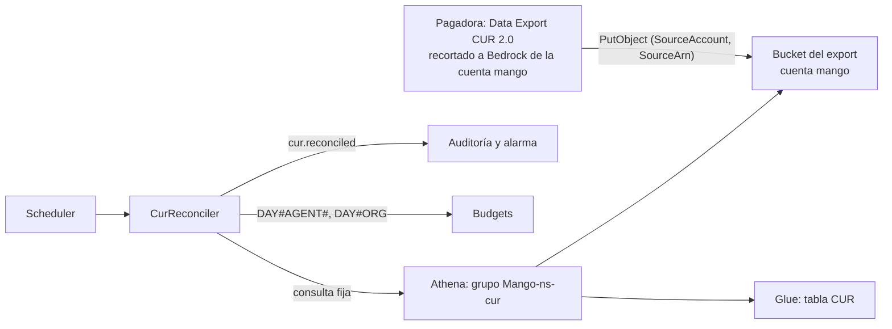

# Gasto de Bedrock por agente y conciliación contra CUR 2.0: modelo de amenazas (v0.1)

> Fecha: 2026-11-03 · Skill: `security-threat-model`; revisión de IAM del diseño con `security-audit` (modo guía), que dejó dos ajustes: el ARN de origen en `us-east-1` y una llave KMS propia del bucket. Decisión: **D104** (vigente desde 2026-11-03, aceptada por el dueño por menú; sin construir).
> Amplía `budget-reconciliation-threat-model.md` (D73: conciliar con las trazas) y TM-006 (gasto descontrolado) de `mango-architecture-threat-model.md`.
> Alcance, todo por construir: el bucket del export CUR 2.0 en la cuenta de la instalación, la base y la tabla de Glue, el grupo de trabajo de Athena `Mango-<ns>-cur`, la función `Mango-<ns>-CurReconciler` con su rol, su DLQ y su alarma, el contador `DAY#AGENT#<id>` de `Budgets` y el paso manual del runbook en la pagadora (activar dos etiquetas y crear el export).
> Se escribe con lo elegido por menú el 2026-11-03. El dueño eligió la atribución por el rol de cada agente, las etiquetas `mango:agent` y `mango:namespace`, la conciliación contra CUR en D104, los ajustes de la pagadora a mano y el destino del export en la cuenta de Mango. El agente que lanzó el trabajo eligió el grano agente × día. Nada está construido ni desplegado.

## Executive summary

D104 no crea recursos de Bedrock ni toca el harness. El gasto de Bedrock se atribuye al rol que ya tiene cada agente, y lo nuevo es la lectura de la factura. Lo que cambia la superficie es que **datos de facturación de la organización entran en la cuenta de Mango** por una frontera nueva: la escritura del servicio de exports de la pagadora en un bucket de Mango.

Riesgos dominantes:

1. **Que llegue más factura de la necesaria** (TM-CUR1): un export sin recorte trae el gasto de todas las cuentas de la organización a la cuenta de Mango, donde lo leen sus roles y quien administre esa cuenta.
2. **Que alguien escriba datos falsos en el bucket** (TM-CUR2): una conciliación envenenada esconde un sobregasto o dispara alarmas falsas.
3. **Que el rol de la función lea de más** (TM-CUR3): `Budgets` entero, otros buckets o consultas de Athena sin tope.
4. **Que las etiquetas filtren datos** (TM-CUR4): un tag con una persona viaja a Cost Explorer de la pagadora.

Controles del diseño:

- **El export se recorta en su propia consulta** a la cuenta de la instalación y a Bedrock, con las columnas mínimas. Lo crea el cliente a mano en su pagadora, con la consulta del runbook y la aprobación del dueño.
- **Solo escribe el servicio de exports,** limitado por `aws:SourceAccount` = la cuenta de gestión y `aws:SourceArn` = sus exports. Ningún rol de Mango escribe en el prefijo del export. No hay rol nuevo entre cuentas ni cambios en `Payer`.
- **Un rol de solo lectura** con ARNs concretos: un grupo de trabajo con tope de bytes, una tabla y dos claves de `Budgets` con `LeadingKeys` y la clave exigida.
- **Las etiquetas son ids** (`mango:agent`, `mango:namespace`), nunca personas.

## Scope and assumptions

- **Dentro:** lo listado en el alcance y el paso manual del runbook.
- **Fuera:**
  - los *application inference profiles*, previstos y sin diseño: si se retoman, necesitan su propia pasada, porque añaden un permiso de IAM sobre un ARN nuevo;
  - el export CUR 2.0 de toda la organización previsto en §4.10 para las preguntas de costos, que es otro;
  - la atribución en Bedrock, que no añade nada: usa roles y tags que ya existen (D10, D76).
- **Supuestos:**
  - la instalación es de un solo cliente (D1);
  - la cuenta de la instalación es una cuenta miembro dedicada a Mango;
  - la pagadora es la cuenta de gestión de la configuración (`managementAccountId`);
  - la consulta de Data Exports admite `WHERE` por cuenta de uso y por producto (documentado);
  - la lista exacta de códigos de producto de Bedrock se fija al construir;
  - Data Exports quizá no escriba con una llave KMS propia (por comprobar); si la usa, la llave es solo de este bucket.

## System model

### Primary components

- **Pagadora (cuenta de gestión del cliente):** un Data Export CUR 2.0 creado a mano, con la consulta recortada y la opción de identidad del que llama, y las etiquetas `mango:agent` y `mango:namespace` activadas.
- **Servicio de exports** (`bcm-data-exports.amazonaws.com`): escribe Parquet en el bucket de destino.
- **Bucket del export** (cuenta de la instalación): su política solo deja escribir a ese servicio en nombre de la pagadora.
- **Glue y Athena:** una tabla declarada en la plantilla y el grupo de trabajo `Mango-<ns>-cur`, con resultados cifrados y tope de bytes.
- **`Mango-<ns>-CurReconciler`:** Lambda diaria (Scheduler), asíncrona, con DLQ y alarma.
- **`Budgets`:** contadores `DAY#AGENT#<id>` (nuevo) y `DAY#ORG`, escritos por `mango-api` y por el conciliador de presupuesto en la transacción que cierra un turno.
- **Auditoría y alarmas:** el evento `cur.reconciled` y la alarma `Cur-reconciler-findings`.

### Data flows and trust boundaries

- **Pagadora → servicio de exports → bucket de Mango (frontera nueva entre cuentas):** `s3:PutObject` del servicio, acotado por `aws:SourceAccount` y `aws:SourceArn`. Solo TLS; sin ACL (el dueño del bucket es dueño de los objetos).
- **Scheduler → función:** una invocación diaria sin datos de entrada que cuenten.
- **Función → Athena → Glue y S3:** consultas fijas del código, sin texto de nadie, en su grupo de trabajo.
- **Función → `Budgets`:** `GetItem` y `Query` sobre `DAY#AGENT#*` y `DAY#ORG`.
- **Función → auditoría y CloudWatch:** conteos e importes.
- **Bedrock → facturación:** el ARN del rol que llama y sus tags. Lo hace AWS, sin cambios en Mango.

#### Diagram

## Assets and security objectives

| Activo | Por qué importa | Objetivo |
|---|---|---|
| Datos de facturación en el bucket | Gasto y principales de IAM de la cuenta de Mango; sin recorte, de toda la organización | C |
| Integridad del export | De él sale la conclusión «Mango cobra lo que factura AWS» | I |
| Contadores de `Budgets` | Presupuestos e Inicio (D102) | I, C |
| Etiquetas de asignación de costos | Llegan a Cost Explorer de la pagadora, que ven otros equipos del cliente | C |
| Alarmas y auditoría de la conciliación | Detectan un desvío o un sobregasto | I, A |

## Attacker model

### Capabilities

- Alguien con permisos de escritura en la cuenta de la instalación que no es el dueño de Mango (un administrador del cliente, un rol mal acotado).
- Otra cuenta de AWS que intenta entregar un export en el bucket.
- Un creador de agentes que elige el nombre de un agente (no su id).
- Un cambio posterior del export en la pagadora (quitar el recorte) hecho por error.

### Non-capabilities

- Los usuarios de Mango no llegan a nada de esto: no hay ruta HTTP, pantalla ni tool.
- El LLM no participa: la conciliación no pasa por ningún agente.
- La configuración de un export no se puede editar después de crearlo: quitar el recorte exige crear otro export.

## Entry points and attack surfaces

| Superficie | Cómo se alcanza | Frontera | Notas |
|---|---|---|---|
| Política del bucket del export | `s3:PutObject` del servicio de exports | Pagadora → cuenta Mango | Única escritura permitida |
| Paso manual del runbook | Consola de la pagadora | Persona del cliente → facturación | Crea el export y activa las etiquetas |
| Invocación de la función | Scheduler | Interna | Sin entrada de usuario |
| Consultas de Athena | Código de la función | Interna | Texto fijo, la fecha como parámetro |

## Top abuse paths

1. **Factura entera en la cuenta de Mango:** el export se crea sin el `WHERE`, o con otro creado más tarde. La organización entera queda legible para quien lea el bucket.
2. **Export falso:** otra cuenta, o un rol de la cuenta de Mango, escribe Parquet con costos bajos. La conciliación dice «cuadra» mientras Bedrock cobra más.
3. **Lectura amplia desde el rol de la función:** una sentencia de `Budgets` sin `LeadingKeys`, o un `ForAllValues` sin la clave exigida, deja leer `USER#…` (presupuesto de cada persona).
4. **Consulta cara:** un error en la consulta lee años de CUR cada día.
5. **Tag con persona:** alguien añade a los roles un tag con un correo, que el cliente activa y queda en Cost Explorer.

## Threat model table

| ID | Amenaza | Activo | Probabilidad | Impacto | Prioridad | Control del diseño | Recomendado al construir |
|---|---|---|---|---|---|---|---|
| TM-CUR1 | El export trae el gasto de toda la organización | Datos de facturación | Media (paso manual) | Alto | **Alta** | `WHERE` por cuenta de uso de la instalación y producto de Bedrock en la consulta del export; columnas mínimas; el runbook trae la consulta tal cual y la aprobación del dueño | La función comprueba en cada pasada que todas las filas son de la cuenta de la instalación y de Bedrock. Si no lo son, no concilia, audita `unexpected_rows` y alarma. Un test de la consulta del runbook |
| TM-CUR2 | Se escriben datos falsos en el bucket | Integridad del export | Baja | Medio | Media | Solo `bcm-data-exports.amazonaws.com` con `aws:SourceAccount` = `managementAccountId` y `aws:SourceArn` = sus exports (región `us-east-1`); `BucketOwnerEnforced`; llave KMS propia del bucket, no la de datos (si el servicio la usa, la frontera no alcanza otros datos); ningún rol de Mango con escritura en el prefijo del export; versionado y logs de acceso | Test de la política del bucket. Un deny explícito de `s3:PutObject` en el prefijo del export para todo principal que no sea el servicio |
| TM-CUR3 | El rol de la función lee de más | Contadores y datos | Baja | Medio | Media | ARNs concretos; `LeadingKeys` con `ForAllValues` sobre `DAY#AGENT#*` y `DAY#ORG`, más `Null` = `false` para exigir la clave (hallazgo del 2026-10-19); Athena solo en su grupo de trabajo; S3 solo en dos prefijos | Tests de IAM que fijen cada sentencia; `cdk-nag` sin supresiones nuevas salvo la que exija Athena |
| TM-CUR4 | Una etiqueta de costo lleva datos de una persona | Etiquetas | Baja | Medio | Baja | Solo `mango:agent` (id) y `mango:namespace`; el provisioner pone los tags `mango:` y no copia los `mango:` del stack (D76 (2)) | El runbook nombra solo esas dos etiquetas para activar |
| TM-CUR5 | La conciliación calla un sobregasto (sin datos, o datos tarde) | Alarmas | Media | Medio | Media | Sin export, `no_data` auditado; días cerrados hasta D-2; desvíos con umbral y alarma | Alarma aparte si pasan 3 días con `no_data` después de haberse visto datos |
| TM-CUR6 | Consulta cara o sin fin | Disponibilidad y costo | Baja | Bajo | Baja | Tope de bytes por consulta en el grupo de trabajo; proyección de particiones; 35 días | Tiempo máximo de la función y una sola consulta por pasada |
| TM-CUR7 | La función asíncrona falla en silencio | Alarmas | Baja | Bajo | Baja | DLQ y alarma (regla de Checkov `CKV_AWS_116`: las asíncronas la llevan) | — |

## Criticality calibration

- **Alta:** que llegue la factura de la organización entera (TM-CUR1). Es el único camino a datos que hoy no están en la cuenta de Mango.
- **Media:** integridad de la conciliación y alcance del rol (TM-CUR2, TM-CUR3, TM-CUR5).
- **Baja:** costo de las consultas, etiquetas y fallos de la función.

## Focus paths for security review

| Ruta (por construir) | Por qué importa | Amenazas |
|---|---|---|
| El construct del bucket del export y su política | Frontera nueva entre cuentas | TM-CUR1, TM-CUR2 |
| El rol de `Mango-<ns>-CurReconciler` | Permiso de IAM nuevo | TM-CUR3, TM-CUR6 |
| La consulta del export en el runbook | El recorte vive ahí | TM-CUR1 |
| La comprobación de filas en la función | Defensa si el recorte falta | TM-CUR1 |
| La transacción que suma `DAY#AGENT#` | Integridad de los contadores | TM-CUR5 |

## Quality check

- Las cuatro superficies tienen amenaza.
- La frontera nueva (pagadora → bucket) está en TM-CUR1 y TM-CUR2.
- Nada de esto es de CI ni de desarrollo.
- Lo elegido por menú está reflejado.
- Lo que falta comprobar al construir:
  - la lista de códigos de producto de Bedrock;
  - si Data Exports escribe con la llave KMS de la instalación;
  - el nombre exacto de la columna del principal en CUR 2.0;
  - que el harness llama a Bedrock como su rol de ejecución (lo dice la documentación de AgentCore, sin ver en una factura).
