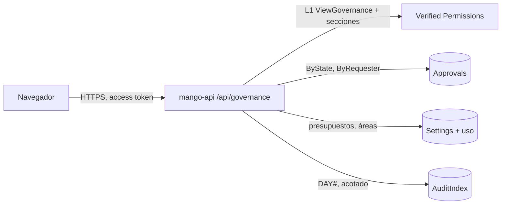

# Gobernanza: resumen de controles: modelo de amenazas (v0.1)

> Fecha: 2026-10-24 · Skill: `security-threat-model`. Decisiones: D17, D24, D27, D44, D70 y **D89** (esta, `propuesta`).
> Amplía `admin-v0-threat-model.md` (presupuestos y áreas), `write-tools-approval-threat-model.md` (aprobaciones) e `inbox-threat-model.md` (la misma regla de «no enseñar más que la pantalla de origen»).
> Alcance: `apps/api/src/mango_api/governance.py` (nuevo), el filtro de varios eventos y el conteo acotado de `audit.py`, la política Cedar `policies/cedar/platform/governance-view.cedar` y la acción `ViewGovernance` del schema. La pantalla `apps/web/src/pages/governance/` llega en otro PR, tras la ronda de diseño.
> v0.1 se escribe **antes** de construir (regla de `AGENTS.md`), con las respuestas por menú del 2026-10-24 (propuesta de la fase 1): admins y `finops-central`, cada sección con su permiso de hoy; un resumen en el servidor; conteo de 24 h sin lecturas y con tope; políticas por tool; lista cerrada de eventos de gobernanza. Nada está desplegado.

## Executive summary

La vista Gobernanza junta en una lectura lo que ya está repartido en Aprobaciones, Presupuestos, Ajustes › Áreas y Auditoría: conteos, vencimientos, presupuestos sobre su umbral y los últimos eventos de gobernanza. No crea datos nuevos. El riesgo que domina es el mismo de la Bandeja: **que el resumen enseñe a alguien lo que su pantalla de origen no le enseña**, sobre todo a `finops-central`, que entra en la vista pero no ve presupuestos, áreas ni auditoría. El segundo es el **costo**: el conteo de 24 h lee la auditoría de dos días.

Riesgos dominantes:

1. **Escalada de lectura** (TM-G1): `finops-central` (o cualquiera con sesión) recibe presupuestos, cambios de áreas o eventos de auditoría.
2. **Ver aprobaciones que no se podrían ver** (TM-G2): conteos o tools de solicitudes ajenas, o detalles (argumentos, conversación) que el resumen no necesita.
3. **Abuso de costo** (TM-G3): recargas que recorren la auditoría una y otra vez.
4. **Datos personales de más** (TM-G4): correos o argumentos en la respuesta o en logs.

Controles que se construyen:

- **L1 `ViewGovernance`** (Cedar): `isAdmin || role == "finops-central"`, la misma condición que `ApproveToolCall`. La decisión se audita como lectura.
- **Cada sección con el permiso de su pantalla**, decidido en proceso por Verified Permissions en cada lectura: aprobaciones con `ApproveToolCall`; presupuestos y áreas con `ViewAdmin`; auditoría con `ViewAudit`. Sin permiso, la sección es `null`. Un test por sección y rol.
- **Aprobaciones solo en conteos:** del tramo de aprobadores (lo que ve quien firma en Aprobaciones), sin argumentos, sin `conversation_id`, sin correos; de cada tool, su nombre y su regla (dato de la release y de `Settings`, que ya ve cualquiera con `ViewApprovals`). Las propuestas de bucket se cuentan con la misma función que Aprobaciones y la Bandeja (`queued_sources`): solo las que Aprobaciones le enseña a quien mira.
- **Auditoría acotada:** el conteo examina como mucho 5.000 eventos de las últimas 24 h y dice si llegó al tope; la actividad reciente lee como mucho 2.000 eventos de los últimos 7 días, filtra por una lista cerrada de nombres en el servidor y devuelve 7, con la salida ya validada de Auditoría.
- **Límite de tasa por persona** (30 por minuto, contado en cada tarea: no sostiene ninguna excepción, D89 (6)) y **caché de 30 s** por persona y permisos.

## Scope and assumptions

- **Dentro:** `GET /api/governance`; la acción y la política Cedar; el filtro de varios eventos y el conteo de `audit.py`.
- **Fuera:** salud de los agentes y gasto de equipos (sin fuente: «Próximamente», D24); cualquier escritura (la vista solo enlaza a las pantallas que deciden).
- **Supuestos:**
  1. `mango-api` ya lee aprobaciones, `Settings`, uso de presupuesto y el índice de auditoría con su rol de tarea: el resumen no añade permisos de IAM.
  2. Un admin ya ve en Auditoría el correo del actor de cada evento: repetirlo en la actividad reciente no amplía nada.
  3. Los nombres de tool y sus reglas no son secretos: los ve cualquiera con sesión en Aprobaciones › Políticas.

## System model

### Primary components

- **`mango-api`**: la ruta `GET /api/governance` (`governance.py`), que reutiliza los casos de uso de `approvals.py`, `admin.py` y `audit.py`.
- **Verified Permissions**: L1 `ViewGovernance` y las decisiones por sección.
- **Tablas** (solo lectura): aprobaciones (índices `ByState` y `ByRequester`), `Settings` (presupuestos, mapeo de áreas), uso del presupuesto y `AuditIndex` (partición por día, 30 días).

### Data flows and trust boundaries

- Navegador → CloudFront → ALB → `mango-api`: token de acceso validado, L1 `ViewGovernance`, sin cuerpo ni parámetros (la ruta no declara ninguno; lo que llegue en la query no se lee).
- `mango-api` → Verified Permissions: decisiones por sección, en proceso.
- `mango-api` → DynamoDB: lecturas con el rol de la tarea, acotadas.

#### Diagram

## Assets and security objectives

| Activo | Por qué importa | Objetivo |
|---|---|---|
| Presupuestos y gasto por agente | Solo admins (D17) | C |
| Cambios de áreas pendientes | Deciden el aislamiento entre áreas (D17) | C |
| Eventos de auditoría | Actores, objetivos y decisiones; solo admins | C |
| Aprobaciones | Argumentos de escrituras y quién las pidió | C |
| Disponibilidad y costo de la API | El conteo lee hasta dos particiones de auditoría | A |

## Attacker model

### Capabilities

- Persona con sesión válida (cualquier rol) que llama la ruta directamente o la automatiza.
- `finops-central` sin admin que intenta ver las secciones de admins.

### Non-capabilities

- Sin sesión no se llega a la ruta.
- La ruta no recibe parámetros: no hay ids, cursores ni filtros que manipular.
- No decide nada: firmar, editar presupuestos o aprobar áreas sigue en sus rutas, con sus controles.

## Entry points and attack surfaces

| Superficie | Cómo se llega | Límite | Notas |
|---|---|---|---|
| `GET /api/governance` | SPA | L1 `ViewGovernance` + permiso por sección | Sin parámetros; límite de tasa por persona; caché de 30 s |

## Top abuse paths

1. Un usuario sin rol llama la ruta: L1 deniega (403) y queda en Auditoría.
2. `finops-central` llama la ruta para leer presupuestos: `ViewAdmin` deniega en proceso; `budgets`, `areas` y `audit` vienen `null`.
3. Un admin pierde el grupo mientras la caché vale: la clave de la caché incluye la persona y sus permisos; con el token nuevo cambian los permisos y no se sirve lo anterior. Con el token viejo, 30 s más de lo mismo que ya veía.
4. Un script recarga la ruta: el límite de tasa la frena y la caché evita releer la auditoría.
5. La auditoría tiene un pico de eventos: el conteo se detiene en 5.000 y lo dice («más de»).

## Threat model table

| ID | Amenaza | Activo | Probabilidad | Impacto | Prioridad | Controles |
|---|---|---|---|---|---|---|
| TM-G1 | `finops-central` u otra persona recibe presupuestos, áreas o auditoría | Presupuestos, áreas, auditoría | Media | Media | **Media** | L1 `ViewGovernance`; cada sección con la acción de su pantalla (`ViewAdmin`, `ViewAudit`); `null` sin permiso; tests por rol y sección |
| TM-G2 | Conteos o detalles de aprobaciones que la persona no vería en Aprobaciones | Aprobaciones | Baja | Media | **Baja** | Solo con `ApproveToolCall`; la misma regla de `list_view` (tramo de aprobadores y las propias); solo conteos, tool y regla; nada de argumentos, conversación ni correos |
| TM-G3 | Recargas que recorren la auditoría (costo, latencia) | Disponibilidad | Media | Baja | **Baja** | Topes de 5.000 y 2.000 examinados; ventanas de 24 h y 7 días; límite de 30 por minuto y persona en cada tarea (D89 (6)); caché de 30 s |
| TM-G4 | Correos, argumentos o eventos crudos en la respuesta o en logs | Datos personales | Baja | Baja | **Baja** | Esquema de respuesta explícito (`extra="forbid"`); la actividad reutiliza la salida validada de Auditoría; un solo log, sin contenido («governance unavailable») |
| TM-G5 | Un número falso de tranquilidad (conteos truncados mostrados como exactos) | Integridad de lo mostrado | Media | Baja | **Baja** | `capped` en aprobaciones (más de 100 por índice) y en el conteo de auditoría; la SPA dice «más de» |

## Criticality calibration

- **Media:** que `finops-central` lea presupuestos, áreas o auditoría (dato interno de la empresa, solo admins por D17).
- **Baja:** conteos de aprobaciones de más, costo acotado, números truncados.

## Focus paths for security review

- `apps/api/src/mango_api/governance.py`: la decisión por sección y su `null`, la clave de la caché, el límite.
- `apps/api/src/mango_api/audit.py`: el conteo con tope, el filtro de varios eventos y su ventana.
- `policies/cedar/platform/governance-view.cedar`: la condición.

## Quality check

- Entradas cubiertas: la única ruta.
- Límites cubiertos: navegador → API, API → Verified Permissions, API → tablas.
- Lo de desarrollo (mock de la SPA, tests) queda fuera.
- Decisiones del menú del 2026-10-24 reflejadas (quién ve qué, resumen, conteo, políticas, actividad).
- Supuestos explícitos arriba; el dueño pidió seguir con las opciones recomendadas.

## Revisión `security-audit` del diff (2026-10-24, modo guía)

Revisión enfocada de la rama, sin cambios de IAM (el resumen lee con el rol de tarea lo que `mango-api` ya leía) y con una política Cedar nueva. Sin hallazgos que crucen una frontera:

- **Secciones:** `access()` decide cada una con la acción de su pantalla; presupuestos, áreas y auditoría exigen además `is_admin`, como sus rutas. Sin permiso, `null` (tests por rol: `finops-central` recibe solo `approvals`; un líder de área y una cuenta sin grupos, 403).
- **Aprobaciones:** solo del tramo de aprobadores y en conteos; ningún argumento, conversación ni correo llega a la respuesta (test que busca los tres en el cuerpo). Las propuestas de bucket se cuentan con `queued_sources`, la misma regla de Aprobaciones; si su tabla no responde, se cuentan cero y el resto sigue (como la Bandeja).
- **Auditoría:** el conteo y la actividad reutilizan el recorrido de `page()` (el mismo `_scan`, con la ventana del índice) y sus topes; la salida es la validada de Auditoría (`audit_event_out`).
- **Abuso:** límite por persona antes de cualquier lectura; caché por persona y permisos; un fallo de almacén es 503 `governance_unavailable` con un solo log sin contenido.
- **Riesgo residual aceptado:** la caché sirve hasta 30 s lo que la persona ya veía aunque sus grupos cambien sin cambiar sus permisos de sección (por ejemplo, las KBs que puede firmar).

Queda **sin ver en una instalación**: que la política `ViewGovernance` se cree en el almacén de políticas con el change set y que la ruta responda con datos reales.
