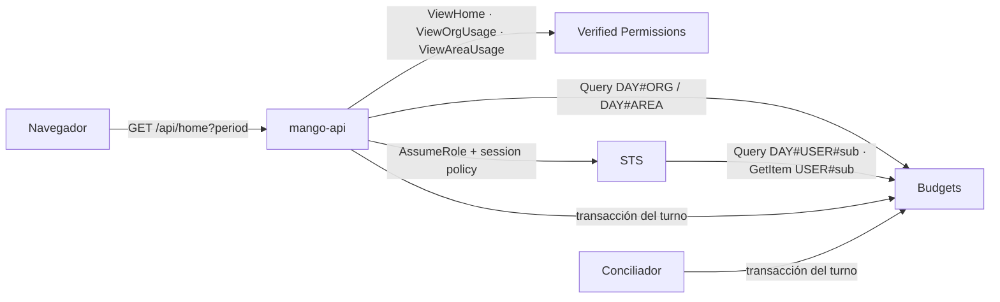

# Inicio: gasto e invocaciones por día según el rol: modelo de amenazas (v0.1)

> Fecha: 2026-10-29 · Skill: `security-threat-model`. Decisiones: D17, D24, D70, D73, D89 y **D102** (esta, `vigente`).
> Amplía `governance-threat-model.md` (la misma regla de «no enseñar más que la pantalla de origen»), `budget-reconciler-threat-model.md` (la transacción que cierra un turno) y el patrón de seguridad por fila de `Conversations` (§4.5).
> Alcance: `apps/api/src/mango_api/home.py` (nuevo), `packages/py/mango-core/src/mango_core/usage_days.py` (nuevo) y su escritura en `budget_turns.settle/hold/close`, la session policy de `RlsClientFactory` (`conversations.py`), el IAM del rol de datos (`OwnBudgetRead`, `infra/lib/constructs/governance.ts`) y del conciliador (`DAY#*`, `budget-reconciler.ts`), las políticas `policies/cedar/platform/home-*.cedar` y la pantalla `apps/web/src/pages/home/`.
> Se escribe con las respuestas por menú del 2026-10-29: contador en `Budgets` en la transacción del turno, área del turno, presupuestos por rol sin ampliar permisos, lo propio con RLS, la web solo para administradores y `finops-central`. Nada está desplegado.

## Executive summary

Inicio crea un dato nuevo: **cuánto se gastó y cuántos turnos hubo cada día**, para la organización, para cada área y para cada persona. El riesgo que domina es que **alguien vea los números de otra área o de otra persona**: el gasto diario de una persona dice cuándo trabaja con los agentes, y el de un área, cuánto la usa. El segundo es la **integridad del contador**, que vive en la misma tabla que los presupuestos y que escribe también el conciliador. El tercero, el **costo** de las lecturas.

Riesgos dominantes:

1. **Leer el contador de otra persona o de otra área** (TM-H1): por un parámetro, por un error del servidor o por la sesión de seguridad por fila.
2. **Escalada de alcance** (TM-H2): una persona o un `bu-lead` recibe la organización, o los presupuestos de agentes.
3. **Abuso de costo** (TM-H3): recargas o periodos largos en bucle.
4. **Integridad** (TM-H4): contadores inflados o dobles, o un conciliador que escribe fuera de sus claves.
5. **Inferencia por agregados** (TM-H5): deducir la actividad de una persona restando agregados.

Controles que se construyen:

- **L1 `ViewHome`** para toda persona de Mango (auditada como lectura) y el **alcance decidido en el servidor con Cedar, deny por defecto**: `ViewOrgUsage` (administradores y `finops-central`), `ViewAreaUsage` (`bu-lead` con área); sin ninguno, lo propio. El área sale siempre del token verificado, nunca de la petición. La única entrada es `period`, una lista cerrada.
- **Lo propio con seguridad por fila:** la session policy de cada persona alcanza en `Budgets` solo `GetItem`/`Query` de `USER#` y `DAY#USER#`; el rol de datos tiene esa misma lectura acotada a `USER#*`/`DAY#USER#*` (sin escritura). Un error del servidor que pidiera otra clave con esa sesión falla en STS.
- **Presupuestos sin ampliar permisos:** agentes solo con `ViewAdmin` y `is_admin` (como Presupuestos); el resto, solo el suyo.
- **Contadores exactamente una vez,** en la misma transacción condicionada que mueve el `spent` del turno; el conciliador gana `DAY#*` y nada más.
- **Lecturas acotadas:** una `Query` por contador (como mucho 360 días) y la del primer día; límite de 30 por minuto y persona (en cada tarea) y caché de 30 s por persona, permisos y periodo.

## Scope and assumptions

- **Dentro:** `GET /api/home`; los contadores `DAY#…` y su escritura; la session policy y el IAM nuevos; las tres políticas Cedar; la página.
- **Fuera:** estado de agentes, tickets y latencia (sin fuente: no se muestran, D102 (10)).
- **Desde el 2026-10-30 (D102 (10)):** la web muestra Inicio a todas las cuentas, con el alcance que responde el servidor. No cambia ninguna amenaza: la API ya les respondía, y lo que el servidor no da no llega a la página. El rol en la web solo elige el subtítulo mientras carga. La persona ya no ve su correo en la tarjeta de presupuesto ni en el saludo.
- **Desde el 2026-10-30 (D102 (11)):** `GET /api/admin/budgets` añade `discarded` por agente. No es dato nuevo (el id ya se respondía, a los mismos administradores) y no cambia ninguna amenaza. Es falso si la lectura de nombres falla: la pantalla no afirma lo que no sabe.
- **Supuestos:** la instalación es de un solo cliente (D1); las personas autenticadas son empleados del cliente; el área (`mango_business_unit`) y el rol los escribe el trigger pre-token desde los grupos de Cognito (D14, D60) y `mango-api` valida el access token (JWKS, `iss`, `client_id`, `token_use`). Una persona en un grupo `bu-<área>` sin ser `bu-lead` tiene área en el token pero **no** `ViewAreaUsage`.

## System model

### Primary components

- **SPA** (`apps/web/src/pages/home/`): pide `GET /api/home?period=…` con el token en memoria; guarda solo el periodo como preferencia de UI (`mango-dash-period`, `preferences/storage.ts`).
- **`mango-api`** (`home.py`): autoriza, decide el alcance, lee los contadores y el presupuesto, cuenta las aprobaciones (`governance.approvals_summary`, `queued_sources`).
- **Tabla `Budgets`** (DynamoDB, KMS de datos, PITR): `USER#`, `AGENT#` (mes), `TURN#` (pendientes) y, nuevos, `DAY#ORG`, `DAY#AREA#<área>`, `DAY#USER#` (día).
- **Conciliador de presupuesto** (Lambda): cierra turnos y, en la misma transacción, suma al día.
- **Rol de datos** (`Mango-<ns>-ConversationData`), asumido por `mango-api` con una session policy por persona.

### Data flows and trust boundaries

- **Navegador → CloudFront → ALB → `mango-api`**: HTTPS hasta CloudFront (tramo interno HTTP en PoC, excepción registrada); access token de Cognito; WAF con límite por IP.
- **`mango-api` → Verified Permissions**: `ViewHome` (auditada), `ViewOrgUsage`, `ViewAreaUsage`, `ApproveToolCall`, `ViewAdmin` (no auditadas: forman la respuesta de una petición ya decidida).
- **`mango-api` → `Budgets` con su rol**: `Query` de `DAY#ORG` o `DAY#AREA#<área del token>`; el scan acotado de Presupuestos solo para administradores.
- **`mango-api` → STS → `Budgets` con la sesión de la persona**: `Query` de `DAY#USER#`, `GetItem` de `USER#`.
- **`mango-api` / conciliador → `Budgets` (escritura)**: `TransactWriteItems` que cierra el turno: registro `TURN#`, `USER#`/`AGENT#` del mes y los `DAY#` del día.

#### Diagram

## Assets and security objectives

| Activo | Por qué importa | Objetivo |
|---|---|---|
| Gasto y turnos por día de una persona | Dice cuándo y cuánto trabaja alguien con los agentes | C |
| Gasto y turnos por día de un área | Uso de un área, sensible frente a otras | C |
| Totales de la organización | Datos de FinOps de la empresa | C |
| Contadores `DAY#` y presupuestos `USER#`/`AGENT#` | Los presupuestos deciden turnos; el contador informa | I |
| Disponibilidad de `mango-api` y costo de DynamoDB | Un bucle de lecturas consume RRU y CPU | A |

## Attacker model

### Capabilities

- Una persona autenticada cualquiera (sin rol, con un grupo de área, `bu-lead` de otra área, `finops-central`) que manipula la petición: otros periodos, parámetros añadidos, bucles.
- Una persona que conoce los ids (`sub`) de otras o el nombre de otra área.
- Un error futuro en `home.py` que arme la clave equivocada.

### Non-capabilities

- No falsifica tokens ni claims (firma y JWKS de Cognito); no cambia sus grupos (solo un administrador, con doble aprobación para los sensibles, D44/D60).
- No llama a DynamoDB ni a STS directamente.
- No escribe contadores: solo un turno real escribe, a través de la reserva de presupuesto.

## Entry points and attack surfaces

| Superficie | Cómo se llega | Frontera | Notas |
|---|---|---|---|
| `GET /api/home?period=` | SPA, cualquier persona con sesión | Navegador → `mango-api` | `period` es `Literal` (422 si no); ningún otro parámetro cambia el alcance |
| Escritura de `DAY#` | Cerrar un turno (chat, tarea, Playground, título) | `mango-api`/conciliador → `Budgets` | Dentro de la transacción condicionada del turno |
| Preferencia `mango-dash-period` | `localStorage` | Navegador | Solo UI; se valida contra la lista cerrada al leer |

## Top abuse paths

1. **Pedir el área de otro:** un `bu-lead` de ventas añade `?area=finanzas` o cambia su perfil. → La API no acepta área; la toma del token. Su grupo lo da un administrador.
2. **Pedir a otra persona:** alguien añade `?user=`. → No hay parámetro; la clave sale del `sub` del token y la sesión de STS solo alcanza esas dos claves.
3. **Un error del servidor** arma `DAY#USER#<otro>` o `DAY#ORG` para una persona. → Lo propio se lee siempre con la sesión de esa persona: STS niega cualquier otra clave (test `OwnKeys`). `DAY#ORG` para una persona solo se lee para `counted_since` (una fecha).
4. **Persona con grupo de área** espera ver el área. → Sin `bu-lead` no tiene `ViewAreaUsage` (test de Cedar y de API).
5. **`finops-central` pide los presupuestos de agentes.** → Solo con `ViewAdmin` + `is_admin`; recibe el suyo.
6. **Bucle de recargas con 180 días.** → 30 por minuto y persona; caché de 30 s; dos `Query` acotadas por lectura.
7. **Inferir a una persona restando agregados:** un `bu-lead` ve su área y, si el área tiene una sola persona activa, su número es el de esa persona. → Aceptado: el líder de área ya puede conocer el uso de su área (D14); los agregados nunca nombran personas ni agentes.

## Threat model table

| ID | Amenaza | Activo | Probabilidad | Impacto | Prioridad | Controles |
|---|---|---|---|---|---|---|
| TM-H1 | Leer el contador o el presupuesto de otra persona u otra área | Gasto por día de personas y áreas | Baja | Alta | **Media** | Sin parámetros de alcance; clave desde el token; lo propio con la sesión de STS limitada a `USER#`/`DAY#USER#` (solo lectura); el rol de datos limitado a `USER#*`/`DAY#USER#*` (test de infra); tests de API por rol con un doble de RLS que niega otras claves |
| TM-H2 | Una persona o un `bu-lead` recibe la organización, o `finops-central` los presupuestos de agentes | Totales, presupuestos | Baja | Media | **Baja** | `ViewOrgUsage`/`ViewAreaUsage` en Cedar, deny por defecto (tests con las políticas reales); presupuestos de agentes con `ViewAdmin` y `is_admin`; la caché lleva los permisos en su clave |
| TM-H3 | Bucle de lecturas (costo, latencia) | Disponibilidad | Media | Baja | **Baja** | `home.reads`, 30 por minuto y persona en cada tarea (D102 (7)); caché de 30 s (256 entradas); una `Query` de ≤360 ítems pequeños por lectura más la del primer día; WAF por IP |
| TM-H4 | Contadores dobles o fuera de sus claves | Integridad de `Budgets` | Baja | Baja | **Baja** | Escritura en la transacción condicionada del turno (un cierre repetido no escribe nada); el conciliador solo con `ForAllValues:StringLike` `USER#*`, `AGENT#*`, `DAY#*`; el área del turno se valida (`[a-z0-9-]{2,32}`) al crear y al leer el registro |
| TM-H5 | Inferir la actividad de una persona desde un agregado | Gasto por día de personas | Media | Baja | **Baja** | Solo sumas por día, nunca personas, agentes ni conversaciones; un área la ve solo su líder (aceptado: es su ámbito) |
| TM-H6 | Datos de más en la respuesta, en logs o en el CSV | Datos personales | Baja | Baja | **Baja** | Modelos explícitos (`extra="forbid"`); el único correo es el propio, en su presupuesto; un solo log sin contenido («home unavailable»); el CSV lleva fechas y números de la respuesta, nada que una hoja ejecute |

## Criticality calibration

- **Alta** sería leer el gasto diario de otra persona sin ser su líder ni administrador: hoy lo impiden dos capas independientes (clave desde el token y sesión de STS).
- **Media** queda TM-H1 por su impacto si las dos capas fallaran a la vez.
- Lo que más mueve la calificación: que el área del token sea fiable (D60: un `bu-lead` sin exactamente un área no entra) y que la sesión de STS se use siempre para lo propio.

## Focus paths for security review

- `apps/api/src/mango_api/home.py`: `decide`, `_counter` y la elección del cliente en `summary`.
- `apps/api/src/mango_api/conversations.py`: `_budget_statements` (claves y acciones de la session policy).
- `infra/lib/constructs/governance.ts` (`OwnBudgetRead`) y `budget-reconciler.ts` (`BUDGET_RECONCILER_KEYS`).
- `packages/py/mango-core/src/mango_core/budget_turns.py`: los `_day_updates` en `settle`, `hold` y `close`.

## Quality check

- Entradas cubiertas: la ruta, la escritura de contadores y la preferencia del navegador.
- Fronteras: navegador → API, API → Verified Permissions, API → `Budgets` (rol propio y sesión de STS), conciliador → `Budgets`.
- Supuestos explícitos: área desde el token; un solo cliente; grupos solo por administradores. Confirmados por las decisiones registradas (D14, D60) y por los menús del 2026-10-29; ninguna pregunta abierta cambia la prioridad.
- Separación runtime/CI: los tests usan moto y dobles; nada llama a AWS real.

## Revisión `security-audit` del diff (2026-10-29, modo guía)

Cambios de IAM y de autorización revisados en el diff:

- **Rol de datos `Mango-<ns>-ConversationData`:** gana `dynamodb:GetItem`/`Query` sobre el ARN concreto de `Budgets`, con `ForAllValues:StringLike` en `dynamodb:LeadingKeys` (`USER#*`, `DAY#USER#*`). Sin escritura, sin `Scan`, sin `*`. Su trust no cambia (solo el rol de tarea de `mango-api`). La session policy de cada persona lo estrecha a sus dos claves con `StringEquals`. Correcto.
- **Conciliador:** `SettleBudgets` pasa de `USER#*`, `AGENT#*` a también `DAY#*`, solo `UpdateItem`. Correcto: `DAY#*` incluye las tres formas de contador y nada más de la tabla.
- **Cedar:** tres políticas de una sentencia cada una sobre `Mango::Platform::"mango"`; sin `forbid` necesario porque nada más permite esas acciones. `ViewAreaUsage` exige `role == "bu-lead"` y `businessUnit`, y la API usa el área del token, nunca la de la petición.
- **Fallo de Verified Permissions:** `Authorizer.is_allowed` niega ante cualquier error (`authz.py`), así que un fallo al decidir `ViewOrgUsage` o `ViewAreaUsage` reduce el alcance a lo propio, nunca lo amplía.
- **`ForAllValues` en `OwnBudgetRead`:** `GetItem` y `Query` siempre llevan `dynamodb:LeadingKeys`, así que la condición no queda vacía (el caso en que `ForAllValues` daría verdadero sin clave).
- **Hallazgos:** ninguno que bloquee. Nota: `counted_since` se lee con el rol de `mango-api` también para una persona (una fecha de la organización, sin datos de nadie); se acepta y queda en TM-H1.
