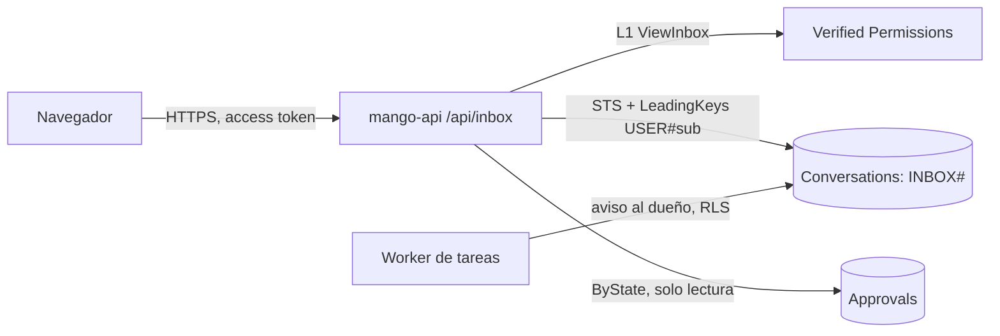

# La Bandeja: avisos por persona: modelo de amenazas (v0.2)

> Fecha: 2026-10-16 · Skill: `security-threat-model`. Decisiones: D23, D24, D27, D56, D70, D78, D82 y **D83** (esta).
> Amplía `write-tools-approval-threat-model.md` (aprobaciones) y `tasks-threat-model.md` (ejecuciones de tareas).
> Alcance: `apps/api/src/mango_api/inbox.py` e `inbox_store.py`; el aviso que deja `task_worker.py` al terminar una ejecución; la política Cedar `policies/cedar/platform/inbox-view.cedar`; la pantalla `apps/web/src/pages/inbox/`, el contador de la barra lateral y los textos de Schedules que nombran la Bandeja.
> v0.1 se escribe **antes** de construir (regla de `AGENTS.md`), con las tres decisiones del dueño del 2026-10-16 (por menú): retención de 90 días, avisos en la tabla de conversaciones y la pantalla angosta como el diseño. Nada está desplegado.

## Executive summary

La Bandeja junta, para cada persona, lo que le toca mirar: las aprobaciones que puede firmar y un aviso por cada ejecución terminada de sus tareas. No crea datos nuevos de valor: repite, en otro sitio, cosas que la persona ya puede ver. El riesgo que domina es justamente ese: **que el sitio nuevo enseñe a alguien algo que en la pantalla de origen no vería**, o que lo enseñe más tiempo del debido. Lo demás es menor: estado de leído manipulado (solo el propio), costo de un contador que se consulta cada minuto, y el texto del modelo (la primera línea del informe) mostrado fuera de su pantalla.

Riesgos dominantes:

1. **Ver los avisos de otra persona** (TM-I1): leer, marcar o archivar avisos ajenos.
2. **Ver más que en la pantalla de origen** (TM-I2): una aprobación que la persona no puede firmar, o el resultado de una tarea ajena (D78 (18), D82).
3. **Un aviso de aprobación que no caduca** (TM-I3): seguir viendo como «pendiente» lo que ya se decidió, se firmó o venció.
4. **El texto del informe como vector** (TM-I4): inyección de HTML o enlaces desde la primera línea del informe.
5. **Abuso de las rutas** (TM-I5): consultas masivas, cursores manipulados, cuerpos grandes.

Controles que se construyen:

- **Los avisos guardados viven en la partición de su destinatario** (`USER#`, prefijo `INBOX#`) de la tabla de conversaciones y se leen y escriben solo con el cliente de RLS: rol de datos con política de sesión `dynamodb:LeadingKeys = USER#`. Ni un error de `mango-api` lee la partición de otro.
- **Las aprobaciones no se copian:** se derivan en cada lectura con la regla de la pantalla de Aprobaciones (D56): solo las del nivel `approvers`, pendientes, sin vencer, no pedidas por quien mira, no firmadas ya por quien mira, y solo si tiene `ApproveToolCall`. Al decidirse dejan de aparecer. De cada una solo se guarda, en la partición de quien mira, si la leyó o la archivó.
- **El aviso de una ejecución lo escribe el worker de tareas en la partición del dueño** (el `owner_id` de la tarea, nunca un dato del mensaje), una sola vez: solo si el cambio a «Completada» o «Fallida» se aplicó. Lleva el nombre de la tarea, el agente, el estado, el código del motivo y la primera línea del informe (≤ 200 caracteres). Nunca el informe, los pasos ni la instrucción.
- **Toda ruta declara L1 `ViewInbox`** (Cedar, para cualquier persona con sesión) y la autorización por objeto es la partición: un id que no está en la del llamador es 404.
- **Retención de 90 días** (TTL), igual que la ejecución a la que apunta el aviso; el estado de leído de una aprobación caduca con ella.
- **La SPA muestra todo como texto plano** (sin Markdown ni HTML) y los enlaces son rutas internas construidas con ids validados.

## Scope and assumptions

- **Dentro:** `GET /api/inbox`, `GET /api/inbox/unread`, `PUT /api/inbox/{kind}/{id}`, `POST /api/inbox/read-all`; el aviso al terminar una ejecución; la pantalla y el contador.
- **Fuera:** menciones, tickets, presupuesto y sistema (el diseño los muestra, pero el producto no tiene esas señales: «Próximamente», D24); notificaciones fuera de Mango (correo, Slack); la firma de una aprobación (la hace la ruta de Aprobaciones de siempre, con sus controles).
- **Supuestos:**
  1. El rol de tarea de `mango-api` ya es de confianza para leer las aprobaciones y escribir en la tabla de conversaciones (por el rol de datos con RLS); la Bandeja no le da ningún permiso nuevo de IAM.
  2. Quien firma ya ve los argumentos de la llamada en Aprobaciones (D27): mostrarlos en la Bandeja no amplía nada.
  3. La primera línea del informe es texto del modelo, no confiable (puede venir de una inyección indirecta, TM-T6); su destinatario ya lee el informe entero en el detalle de su tarea.

## System model

### Primary components

- **`mango-api`**: rutas `/api/inbox*` (`inbox.py`) y el worker de tareas (`task_worker.py`), que al terminar una ejecución deja el aviso.
- **Tabla `Mango-<ns>-Conversations`** (DynamoDB, CMK, PITR, `RETAIN`, TTL `ttl`): partición `USER#`; avisos `INBOX#<id>` y estado de aprobaciones `INBOXSTATE#APPROVAL#<id>`.
- **Rol `Mango-<ns>-ConversationData`**: lo asume `mango-api` por persona con la política de sesión `LeadingKeys`.
- **Tabla de aprobaciones** (solo lectura desde la Bandeja) y **Verified Permissions** (L1).
- **SPA**: página `inbox`, contador en la barra lateral (consulta cada 60 s y al volver a la pestaña). Desde D83 (7) (2026-10-25) la misma respuesta trae `to_sign`, cuántas aprobaciones y propuestas de bucket puede firmar quien mira (el punto de Gobernanza de la barra colapsada): sale de la misma lectura y solo cuenta lo que esa persona ya ve en la Bandeja, así que no enseña nada nuevo ni añade consultas.

### Data flows and trust boundaries

- Navegador → CloudFront → ALB → `mango-api`: HTTPS hasta CloudFront (tramo interno HTTP solo en PoC, excepción ya acordada); token de acceso validado; L1 `ViewInbox`; cuerpos con esquema estricto (`extra="forbid"`) y límite de tamaño de la app.
- `mango-api` → STS → tabla de conversaciones: credenciales de 15 min por persona, política de sesión `LeadingKeys`.
- `mango-api` → tabla de aprobaciones: lectura por el índice `ByState` (como la pantalla de Aprobaciones).
- Worker de tareas → tabla de conversaciones (partición del dueño): mismo cliente de RLS, con el `owner_id` leído de la tabla de tareas.

#### Diagram

## Assets and security objectives

| Activo | Por qué importa | Objetivo |
|---|---|---|
| Avisos de ejecución | Nombran tareas y llevan la primera línea de su informe (datos de la persona) | C |
| Aprobaciones pendientes | Argumentos de una escritura | C, I |
| Estado de leído y archivado | Solo afecta a su dueño | I (baja) |
| Disponibilidad de la API | Un contador que se consulta cada minuto por persona | A |

## Attacker model

### Capabilities

- Persona con sesión válida que manipula peticiones (ids, cursores, cuerpos) o automatiza consultas.
- Contenido no confiable en el informe de una tarea (inyección indirecta por una tool o un evento).

### Non-capabilities

- Sin sesión no se llega a ninguna ruta.
- No controla el `owner_id` de una tarea ni el destinatario de un aviso (los pone el servidor).
- No firma desde la Bandeja sin pasar por las rutas de Aprobaciones y su separación de funciones.

## Entry points and attack surfaces

| Superficie | Cómo se llega | Límite | Notas |
|---|---|---|---|
| `GET /api/inbox?view=&cursor=` | SPA | L1 + RLS | `view` en lista cerrada; `cursor` = id de aviso validado por patrón |
| `GET /api/inbox/unread` | SPA, cada 60 s | L1 + RLS | Cuenta acotada (≤ 99 y lectura acotada) |
| `PUT /api/inbox/{kind}/{id}` | SPA | L1 + RLS; para aprobaciones, la regla de visibilidad | `kind` en lista cerrada; id por patrón |
| `POST /api/inbox/read-all` | SPA | L1 + RLS | Acotado a las 200 más recientes |
| Fin de una ejecución | Worker | Interno | Destinatario = `owner_id` de la tabla |

## Top abuse paths

1. Cambiar el id en `PUT /api/inbox/run/{id}` por el de otro: el ítem no está en mi partición → 404; con RLS, la escritura ni siquiera puede tocar otra partición.
2. Forjar `cursor` para leer más allá de mi partición: el cursor solo fija el `SK` dentro de `USER#<mío>`; un cursor mal formado es 422.
3. Marcar como leída una aprobación que no puedo firmar para saber si existe: la regla de visibilidad responde 404 igual que si no existiera.
4. Un administrador intenta ver avisos de una tarea ajena: los avisos solo están en la partición del dueño; ninguna ruta lee otra partición.
5. Un informe con `` o un enlace en la primera línea: se muestra como texto plano.
6. Un script consulta `/api/inbox/unread` sin parar: cada consulta pasa L1 y lee una página acotada; el WAF limita la tasa.

## Threat model table

| ID | Amenaza | Activo | Probabilidad | Impacto | Prioridad | Controles |
|---|---|---|---|---|---|---|
| TM-I1 | Leer, marcar o archivar avisos de otra persona | Avisos | Baja | Media | **Media** | Partición `USER#` del token verificado; RLS `LeadingKeys` en la sesión; 404 para lo ajeno; ids por patrón |
| TM-I2 | Ver en la Bandeja algo que la pantalla de origen no enseña (aprobación sin poder firmar, resultado de una tarea ajena) | Aprobaciones, resultados | Media | Media | **Media** | Aprobaciones derivadas con la misma regla que Aprobaciones (`can_sign`); el aviso de ejecución solo al dueño y sin el informe ni los pasos; un test por regla |
| TM-I3 | Aviso de aprobación «pendiente» tras decidirse, firmarse o vencer | Integridad de lo mostrado | Media | Baja | **Baja** | Derivado en cada lectura; vencidas fuera; firmar sigue pasando por la ruta de Aprobaciones, que vuelve a decidir |
| TM-I4 | Inyección por la primera línea del informe | Navegador | Media | Baja | **Baja** | Texto plano en la SPA (sin `dangerouslySetInnerHTML` ni Markdown); ≤ 200 caracteres; CSP de CloudFront |
| TM-I5 | Abuso de las rutas (consultas masivas, cuerpos grandes) | Disponibilidad, costo | Media | Baja | **Baja** | L1 en cada ruta; páginas de 20; contador y «marcar todo» acotados; cuerpo estricto y pequeño; WAF por tasa |
| TM-I6 | Contenido sensible en logs o auditoría | Avisos | Baja | Media | **Baja** | Ningún log lleva el texto del aviso; la decisión L1 se audita como lectura (`ViewInbox` en `READ_ACTIONS`) |
| TM-I7 | Aviso duplicado o en la partición equivocada al reintentar una ejecución | Integridad | Baja | Baja | **Baja** | Se escribe solo si el cambio de estado condicionado se aplicó; el destinatario es el `owner_id` de la tabla, nunca del mensaje |

## Criticality calibration

- **Alta:** leer avisos de otra persona de forma general (exigiría romper la RLS de STS y el código a la vez).
- **Media:** ver una aprobación o el texto de una tarea que la pantalla de origen no enseña.
- **Baja:** estado de leído incorrecto, avisos que quedan de más, consultas costosas acotadas.

## Focus paths for security review

- `apps/api/src/mango_api/inbox.py`: `_signable`, la regla de visibilidad, el 404 de lo ajeno, el cursor.
- `apps/api/src/mango_api/inbox_store.py`: todas las llamadas usan el cliente de la persona; condiciones de las escrituras.
- `apps/api/src/mango_api/task_worker.py`: el aviso solo tras el cambio de estado aplicado y al `owner_id`.
- `apps/web/src/pages/inbox/`: texto plano, enlaces internos.

## Quality check

- Entradas cubiertas: las cuatro rutas y el aviso del worker.
- Límites cubiertos: navegador → API, API → STS/tabla, API → aprobaciones, worker → tabla.
- Lo de desarrollo (mock de la SPA, tests) queda fuera del modelo de ejecución.
- Decisiones del dueño reflejadas: 90 días, tabla de conversaciones, pantalla angosta como el diseño.

## Revisión `security-audit` del diff (2026-10-16, modo guía)

Revisión enfocada de la rama, sin cambios de IAM (la Bandeja usa el rol de datos y la política de sesión que ya existían) y con una política Cedar nueva. Sin hallazgos que crucen una frontera:

- **Partición:** todas las llamadas de `inbox_store.py` piden el cliente con el `sub` del token verificado (o, en el worker, con el `owner_id` de la tabla de tareas); un test registra a quién se pidió cada cliente. El cursor y los ids se validan por patrón y `ExclusiveStartKey` lleva siempre la partición del llamador.
- **Aprobaciones:** salen de `approval_out(..., can_decide=True)` solo si L1 `ApproveToolCall` lo permite, y se filtran por `can_sign`: lo mismo que ve quien firma en Aprobaciones, sin `conversation_id` (no es suyo). Marcar una que no puede firmar es 404 y no escribe nada (test).
- **Ejecuciones:** el aviso solo existe en la partición del dueño, se escribe tras el cambio de estado condicionado y lleva la primera línea del informe acotada a 200 caracteres; el informe y los pasos siguen solo en la tabla de tareas.
- **Abuso:** páginas de 20, como mucho seis lecturas por página, el contador lee 200 avisos y «marcar todo» escribe como mucho 200, solo en la partición propia. Sin límite de tasa propio: las rutas pasan L1 y el WAF por tasa, como Aprobaciones.
- **Logs:** el único log es «inbox unavailable» o «an inbox notice could not be written», sin contenido del aviso.
- **SPA:** texto plano en filas y detalle; los enlaces son rutas internas construidas con ids validados otra vez en el cliente.

Queda **sin ver en una instalación**: que la política de sesión de `Mango-<ns>-ConversationData` deje al worker escribir en la partición del dueño (usa `PutItem`, ya permitido) y que la nueva política `ViewInbox` se cree en el almacén de políticas con el change set.

## v0.2 (2026-10-23): las propuestas de bucket (D88 (49))

Un tipo de aviso nuevo, `kbsource`: las propuestas de bucket de las knowledge bases que la persona puede firmar.
- Se derivan en cada lectura con la regla de Aprobaciones (D88 (48)): `ApproveKbSource` sobre la KB y no haberla propuesto. Nunca se copian.
- Contra TM-I1: solo se guarda lo leído y lo archivado, en la partición propia con la misma RLS. Marcar o archivar una que no se puede firmar responde 404, y el id se valida por patrón (ULID).
- La nota y los correos siguen la regla de la KB.
- Si la tabla de knowledge bases no responde, la Bandeja sigue con lo demás y el log no lleva contenido.
