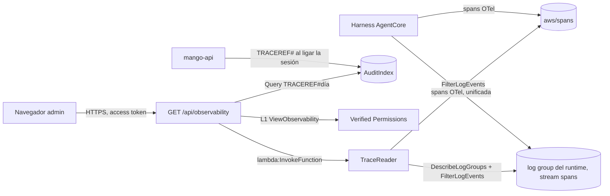

# Observabilidad: trazas de los agentes: modelo de amenazas (v0.1)

> Fecha: 2026-11-05 · Skill: `security-threat-model`. Decisiones: D16, D23, D73, D90, D99, **D108** (b) y **D109** (b), acordadas por el dueño por menú el 2026-11-05.
> Amplía `budget-reconciliation-threat-model.md` (la otra lectora de `aws/spans`) y `activity-threat-model.md` (metadatos de tools sin contenido).
> Alcance: la función `Mango-<ns>-TraceReader` (`functions/trace-reader`, en el stack anidado `Observability` de `Core`), la referencia de turno `TRACEREF#<día>` que `mango-api` escribe en `AuditIndex`, la ruta `GET /api/observability` (`apps/api/src/mango_api/observability.py`) y la política Cedar `policies/cedar/platform/observability-view.cedar`. La pantalla espera a Claude Design (D24).
> Se escribe **antes** de construir (regla de `AGENTS.md`), con las precisiones del 2026-11-05 (por menú, vía el agente principal): leer **los dos destinos** posibles de los spans (`aws/spans` y el stream `spans` del log group de cada runtime) y asociar cada traza a su persona con una **referencia de turno** escrita por `mango-api`. Nada está desplegado.

## Executive summary

La Observabilidad enseña a los administradores cada respuesta de un agente como una traza: llamadas al modelo y a tools, con duración, tokens, estado y costo. La fuente son los spans que el harness gestionado escribe en CloudWatch Logs (D108 (b)). El riesgo dominante es que **esa fuente es de toda la cuenta y no es de confianza**: cualquier principal de la cuenta con permiso de X-Ray puede escribir spans con los atributos que quiera, y los spans traen atributos que no deben salir (URLs, la access key del rol, el esquema y la descripción de las tools, y el contenido si alguien encendiera su captura). Le siguen **enseñar el uso a quien no es administrador**, **exponer `session.id`** (se deriva de persona, agente y conversación, D73 (5)) y el **costo o la latencia** de leer 24 h de spans de una cuenta con mucho tráfico.

Riesgos dominantes:

1. **Contenido o secretos de un span en la respuesta** (TM-OB1).
2. **Spans falsos o manipulados** que inventan trazas, agentes o personas (TM-OB2).
3. **La vista a quien no es administrador** (TM-OB3).
4. **`session.id` expuesto** (TM-OB4).
5. **Permisos de lectura de más** en la función (TM-OB5).
6. **Abuso, costo y latencia** de la lectura (TM-OB6).
7. **La referencia de turno rompe el turno o guarda contenido** (TM-OB7).

Controles que se construyen:

- **Lista cerrada de atributos.** La función lee de cada span solo su nombre, ids (`traceId`, `spanId`, `parentSpanId`), inicio, fin, `status.code`, `session.id`, `harness.id`, el modelo (`gen_ai.request.model`), el nombre de la tool (`gen_ai.tool.name`), el estado de la tool (`gen_ai.tool.status`) y cuatro contadores de tokens, cada uno validado por tipo, forma y rango. Lo demás no se lee, no se devuelve y no se loguea. Un test fija la lista y que un span con contenido, URL o clave no deja nada de eso en la salida.
- **Solo los harness de la instalación:** el patrón de filtro exige `harness.id` con el prefijo `Mango_<ns>_a_` y la salida vuelve a comprobarlo con una expresión regular.
- **Nunca el harness de evals** (`Mango_<ns>_a_evals`, D110 (3)), el único con captura de contenido: la función descarta sus log groups y sus spans (también si alguno llegara a `aws/spans`), la ruta rechaza `agent=evals` y el rol de la función lleva un `Deny` explícito sobre `harness_Mango_<ns>_a_evals-*`. Así el permiso por prefijo no alcanza el log group que D110 reserva al rol del evaluador.
- **La persona solo sale de Mango, nunca del span:** la referencia de turno (`TRACEREF#<día>`, escrita por `mango-api` con la identidad verificada del turno) da persona, conversación, versión y precio. Una traza sin referencia se muestra «Sin turno de Mango» y sin persona.
- **L1 `ViewObservability`** solo para administradores (D109 (b)), con `is_admin` otra vez en proceso; auditada como lectura; límite de tasa por administrador compartido entre tareas (D70); caché corta; tope de trazas con `capped`.
- **`session.id` nunca sale de `mango-api`,** ni el `traceId` del harness: la respuesta lleva un id propio y aleatorio (D108 (3)), la clave aleatoria que guarda la referencia de cada turno más el orden de la traza en el turno; una traza sin turno recibe uno nuevo en cada lectura.
- **IAM mínimo:** `logs:FilterLogEvents` sobre `aws/spans` y sobre los log groups `/aws/bedrock-agentcore/runtimes/harness_Mango_<ns>_a_*`; `logs:DescribeLogGroups` (no admite recurso, documentado); nada más. Solo el rol de `mango-api` puede invocarla.

## Scope and assumptions

- **Dentro:** la función y su rol; la invocación síncrona desde `mango-api` (`lambda:InvokeFunction` sobre su ARN); la referencia de turno en el chat, las tareas y el Playground; la ruta y sus agregados (p50/p95, error, por agente, tools más lentas o fallidas).
- **Fuera:** la pantalla (D24); el texto de la pregunta y «Abrir conversación» (D23 pendiente: siempre «Solo metadatos»); los logs vendidos del Gateway (no se encienden, hallazgo del 2026-10-24); las métricas `AWS/Bedrock-AgentCore`.
- **Supuestos:**
  1. Los harness se despliegan con la captura de contenido apagada (D16, `REDACT_GENAI_CONTENT` del provisioner): prompts, respuestas y resultados de tools quedan `[REDACTED]`. La lista cerrada no depende de ello.
  2. Destino de los spans: en la instalación del cliente están en `aws/spans` (lectura de solo nombres y conteos del 2026-11-05; los streams `spans` de los runtimes existen y no tuvieron eventos en 7 días). La documentación de AgentCore (consultada el 2026-11-05) dice que los agentes creados desde el 2026-07-20 usan telemetría unificada (stream `spans` del log group del runtime). Se leen los dos, `aws/spans` como principal, y se deduplican por `traceId`/`spanId`. Esa lectura confirmó también que los spans `execute_tool` traen `gen_ai.tool.description` y `gen_ai.tool.json_schema`: de ahí la lista cerrada.
  3. Un administrador ya ve en Auditoría quién hizo cada turno (`agent.completed` con el actor): ver la persona en la traza no le amplía nada (D109 (b)).
  4. Los nombres de los atributos los decide AgentCore y pueden cambiar: un span que no se puede leer cuenta como ilegible, no como cero.

## System model

- **`mango-api`**: al ligar la sesión de un turno (`bind_session`, chat, tarea y Playground) escribe la referencia; `GET /api/observability` invoca la función, lee las referencias del rango, une por `session.id` y calcula los agregados.
- **`Mango-<ns>-TraceReader`** (Lambda síncrona, sin DLQ por la excepción `CKV_AWS_116`): `FilterLogEvents` con patrón por prefijo de `harness.id` y nombres `invoke_agent*`, `chat*`, `execute_tool*`; agrupa por `traceId`.
- **`aws/spans`** (Transaction Search, D16) y los log groups de los runtimes (KMS propio, 30 días, D16).
- **Tabla `Mango-<ns>-AuditIndex`** (TTL 30 días): `TRACEREF#<día>` / `<session.id>#<inicio>#<turno>`.

## Assets and security objectives

| Activo | Por qué importa | Objetivo |
|---|---|---|
| Uso de agentes por persona | Dato personal; vigilancia | C |
| Contenido de conversaciones y de tools | Puede estar en un span si alguien enciende la captura | C |
| Atributos sensibles del span (`aws.auth.account.access_key`, `http.url`, esquemas de tools) | Revelan credenciales o sistemas | C |
| `session.id` | Se deriva de persona, agente y conversación; es la clave de la sesión del runtime | C |
| Integridad de la vista | Un admin decide con ella | I |
| Disponibilidad y costo | 24 h de spans de toda la cuenta | A |

## Attacker model

- **Puede:** un administrador curioso o una sesión de administrador robada (ve lo que la vista enseña); una persona con sesión que llama la ruta sin ser administrador; un principal de la cuenta con `xray:PutTraceSegments` o `logs:PutLogEvents` en `aws/spans` (otra aplicación de la cuenta, un pack, un rol mal acotado) que escribe spans con `harness.id` de Mango; contenido no confiable que hace al modelo llamar tools con nombres raros.
- **No puede:** invocar la función (solo el rol de `mango-api`); escribir referencias de turno (solo `mango-api`, desde la identidad verificada); llegar a la ruta sin sesión ni sin `ViewObservability`.

## Entry points

| Superficie | Límite | Notas |
|---|---|---|
| `GET /api/observability?range=&agent=&status=&offset=&limit=` | L1 `ViewObservability` + `is_admin`; límite de tasa | `range` y `status` en lista cerrada; `agent` con la forma de un id; `limit` ≤ 200 |
| Invocación de `TraceReader` | `lambda:InvokeFunction` solo del rol de `mango-api` | Evento con claves cerradas: `start`, `end`, `agent`; ventana ≤ 24 h |
| Spans de `aws/spans` y de los runtimes | No confiables | Lista cerrada de atributos y formas |
| `bind_session` (chat, tarea, Playground) | Interno | Una escritura más por turno, sin contenido |

## Threat model table

| ID | Amenaza | Activo | Prob. | Impacto | Prioridad | Controles |
|---|---|---|---|---|---|---|
| TM-OB1 | Un span con contenido, URL, access key o esquema de tool llega a la respuesta o a un log | Contenido, credenciales | Media | Alta | **Alta** | Lista cerrada de atributos en la función; cada valor validado por forma (modelo, tool, ids hex, enteros acotados); el log de la función solo lleva conteos y nombres de error; test con un span cargado de contenido. D16 apaga la captura en los harness |
| TM-OB2 | Spans falsos de otro principal de la cuenta inventan trazas, errores o latencias de un agente de Mango | Integridad | Baja | Media | **Media** | Prefijo `Mango_<ns>_a_` en el filtro y en la salida; la persona y la conversación solo salen de la referencia de turno de `mango-api` (una traza sin referencia no tiene persona y se marca); agente desconocido se muestra por su id, no por un nombre que el span diga |
| TM-OB3 | Quien no es administrador lee las trazas (uso de cada persona) | Uso | Baja | Media | **Media** | L1 `ViewObservability` solo con `isAdmin` (deny por defecto) y `is_admin` en proceso; test por regla con `cedarpy` |
| TM-OB4 | `session.id` sale en la respuesta, en un log o en la auditoría | `session.id` | Baja | Media | **Media** | El modelo de respuesta no tiene el campo; el id de traza es propio y aleatorio (D108 (3)), nunca el `traceId` del harness; tests que buscan el `session.id` y el `traceId` en la salida serializada |
| TM-OB5 | La función lee más de lo necesario (otros log groups, el del harness de evals) o otro principal la invoca | Contenido | Baja | Alta | **Media** | `FilterLogEvents` solo sobre `aws/spans` y `harness_Mango_<ns>_a_*`, con `Deny` sobre `harness_Mango_<ns>_a_evals-*` (D110 (3)), que la función además descarta; `DescribeLogGroups` (`*`, sin recurso posible, solo nombres); `logStreamNamePrefix: spans` en los runtimes; `InvokeFunction` solo en la política de `mango-api` con el ARN concreto; tests de IAM. Residual: el permiso alcanza también los streams de stdout y `otel-rt-logs` del runtime (contenido `[REDACTED]` por D16) |
| TM-OB6 | Lecturas repetidas de 24 h agotan tiempo, costo o el límite de la API de Logs | Disponibilidad | Media | Baja | **Baja** | 30 lecturas por minuto por administrador (compartido); caché de 60 s por consulta; tope de páginas, de tiempo (20 s) y de trazas (1.000) con `capped`; `FilterLogEvents` no cobra por consulta |
| TM-OB7 | La referencia de turno rompe o retrasa el turno, o guarda contenido | Disponibilidad, contenido | Baja | Media | **Baja** | Escritura de un ítem tras `bind_session`; un fallo solo se loguea sin datos y el turno sigue; atributos fijos (sub, agente, versión, modelo, conversación o ejecución, origen del turno de D106, precio por token y una clave aleatoria para el id de sus trazas); TTL 30 días como `ACTIVITY#` (D90 (6)) |

## Focus paths for security review

- `functions/trace-reader/src/mango_trace_reader/spans.py`: la lista cerrada y las formas.
- `functions/trace-reader/src/mango_trace_reader/handler.py`: validación del evento, topes y logs.
- `infra/lib/constructs/trace-reader.ts`: el rol, los ARNs y la política de `mango-api`.
- `apps/api/src/mango_api/observability.py`: `ViewObservability`, unión por `session.id`, campos de salida.
- `apps/api/src/mango_api/observability_store.py`: la referencia de turno.

## Quality check

- Entradas cubiertas: la ruta, la invocación de la función, los dos destinos de spans y la escritura de la referencia.
- Límites: navegador → API; API → Verified Permissions; API → Lambda; Lambda → CloudWatch Logs; API → AuditIndex.
- Precisiones del 2026-11-05 reflejadas (dos destinos; referencia de turno). El destino real en la instalación del cliente quedó confirmado el 2026-11-05 (supuesto 2).

## Revisión `security-audit` del diff (2026-11-05, modo guía)

Revisión enfocada de la rama: el rol y la función `Mango-<ns>-TraceReader`, la política `Mango-<ns>-ApiObservability`, la referencia de turno y `GET /api/observability` con L1 `ViewObservability`. No se encontró ningún hallazgo que cruce una frontera:

- **Quién invoca:** solo la política administrada de `mango-api`, sobre el ARN de la función; la función no tiene política de recursos (`AWS::Lambda::Permission`), y un test lo fija. El evento tiene las claves cerradas y la ventana acotada (≤ 24 h, no futura, dentro de los 30 días), y el agente tiene la forma de un id: el patrón de filtro de CloudWatch solo se arma con valores validados, y un test intenta inyectar uno.
- **Qué lee:** `FilterLogEvents` sobre `aws/spans` y `harness_Mango_<ns>_a_*`, y `DescribeLogGroups` (`*`: la API no admite recurso; solo devuelve nombres). Tests de IAM con la lista exacta de acciones y ARNs.
- **Qué devuelve:** la lista cerrada de `spans.py`. Un test pone en los spans contenido, una access key, una URL, la descripción y el esquema de la tool y el id de la llamada, y comprueba que nada de eso sale. `mango-api` valida otra vez la respuesta con un modelo estricto (`extra="forbid"`) y responde 503 ante cualquier forma inesperada, sin loguearla.
- **Qué ve quien llama:** solo administradores (Cedar y `is_admin` en proceso, con tests de las dos capas). La respuesta no tiene campo para `session.id`, el `traceId` del harness ni la conversación, y el id de cada traza es propio y aleatorio (tests). La caché es una por rango y agente para todos los administradores: todos ven lo mismo (D109 (b)).
- **Límites:** 30 lecturas por minuto por administrador, compartidas entre tareas; caché de 60 s; tope de la función (20 s, 200 páginas, 1.000 trazas) con `capped`.

Riesgos residuales, aceptados por el diseño de D108 (b) y sin cambio de código:

1. **Spans falsificados con un `session.id` real (TM-OB2).** Un principal de la cuenta que pueda leer `aws/spans` y escribir trazas puede copiar el `session.id` de un turno real y escribir una traza falsa que se una a esa persona. Su efecto se limita a la integridad de una vista de administradores. La unión exige que el agente del span sea el del turno y que la traza empiece después de la reserva.
2. **El permiso sobre los log groups de los runtimes alcanza todos sus streams (TM-OB5).** IAM no acota `FilterLogEvents` por stream: la función pide solo `spans` (`logStreamNamePrefix`), pero su rol podría leer también stdout y `otel-rt-logs`, con el contenido `[REDACTED]` por D16.
