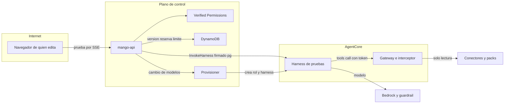

# Playground: probar un borrador antes de enviarlo (modelo de amenazas, v0.1)

> Fecha: 2026-10-25 · Skill: `security-threat-model`. Decisiones: D13, D18, D25, D27, D32, D33, D39, D40, D41, D56, D70, D73, D74, D84, D88 y **D91** (esta, `propuesta`).
> Amplía `identity-propagation-threat-model.md`, `write-tools-approval-threat-model.md` y `budget-reconciliation-threat-model.md`.
> Alcance: el harness de pruebas `Mango_<ns>_a_playground` y su rol (provisioner, `functions/provisioner/`), la marca `pg` de la firma de invocación (`packages/py/mango-core/src/mango_core/invocation.py`) y su regla en el interceptor (`functions/gateway-interceptor/`), el reconocimiento en el conciliador diario (`functions/reconciler/`), la ruta `POST /api/playground/runs` de `mango-api` (`apps/api/src/mango_api/playground.py`, nueva) y la infraestructura que lo arranca (`infra/lib/`).
> v0.1 se escribe **antes** de construir (regla de `AGENTS.md`), con las decisiones de la fase 1 ya tomadas por menú el 2026-10-25 (todas con la opción recomendada). Esas respuestas son los supuestos confirmados. Nada está desplegado: lo que solo se ve en una instalación está en «Supuestos sin validar».

## Executive summary

Hasta hoy una versión de un agente no corría antes de que otro administrador la aprobara (D18, `not_usable_before_approval`). El Playground rompe esa regla a propósito para quien edita el agente: ejecuta su borrador, con su prompt, su modelo y sus tools, en un harness de pruebas compartido. El riesgo que domina es que el Playground se convierta en **un camino para saltarse la aprobación**: usar un agente que nadie aprobó como si estuviera publicado, para sí o para otros, o lograr con él lo que la aprobación existe para impedir (una escritura, datos fuera del alcance de la persona). Le siguen el gasto, los secretos que lleguen al modelo y la ampliación de lo que puede hacer el rol del harness.

Riesgos dominantes:

1. **Ejecutar una escritura sin aprobación** desde una prueba (TM-PG1).
2. **Probar como otra persona, o un agente ajeno** (TM-PG2): elegir el agente, la versión o la identidad de la prueba desde el cliente.
3. **Usar el Playground como un chat sin aprobar** (TM-PG3): para sí mismo de forma sostenida, o para servir a otros.
4. **Datos fuera del alcance de quien prueba** (TM-PG4): tools o knowledge bases que la persona no podría usar en el chat.
5. **Gasto sin control** (TM-PG5).
6. **Secretos en el contexto del modelo** (TM-PG6).
7. **Rol del harness más amplio que el de un agente** (TM-PG7).

Controles que se construyen:

- **Autorización por objeto:** `EditAgent` sobre el agente en Verified Permissions (deny por defecto), más la comprobación en el código de que es su creador con el rol de creador o un administrador. Igual que guardar un borrador.
- **Lo que se ejecuta lo arma el servidor:** el cliente solo nombra agente, versión, `revision` del borrador, pregunta y tres cambios (prompt, modelo y temperatura). Tools, knowledge bases y límites se leen de la versión guardada.
- **La identidad es la de la persona:** su access token verificado viaja al Gateway (regla 5) y la firma `X-Mango-Invocation` nombra a esa persona, el agente, la versión, sus tools y la marca `pg`.
- **Ninguna escritura:** `mango-api` no crea solicitudes desde el Playground y corta la prueba en la llamada; el interceptor rechaza toda tool de escritura con una firma `pg`, antes de mirar la aprobación.
- **Sin persistencia ni audiencia:** la respuesta solo va por el SSE de quien pidió; no hay conversación, historial ni enlace; una sesión de runtime nueva por prueba con id calculado en el servidor (D39).
- **Gasto acotado:** reserva previa en los presupuestos de la persona y del agente (regla 4, D73), límites de la versión (D74), y límite de tasa por persona contado entre tareas (2 a la vez, 60 por hora; D70).
- **Secretos:** la detección de secretos del servidor corre sobre el prompt probado; con un posible secreto, 422 sin invocar.
- **Rol del harness:** bajo el boundary de agentes, con los modelos habilitados del catálogo (ARNs concretos); trust solo de AgentCore con `aws:SourceArn` de su harness y su runtime.
- **Auditoría sin contenido:** `playground.run` con agente, versión, hash, modelo, tools, tokens, costo y resultado.

## Scope and assumptions

- **Dentro:** la ruta de prueba y su streaming, la firma `pg` y el interceptor, el harness y el rol de pruebas (crear, actualizar al cambiar el catálogo, desinstalar), el conciliador diario y la reserva y conciliación del presupuesto de una prueba.
- **Fuera:** la pantalla (espera al diseño; cubierta por `security-best-practices` cuando se construya), guardar y enviar borradores (rutas existentes, sin cambios), evals («Guardar como caso», «Próximamente»).
- **Supuestos confirmados (menús del 2026-10-25, D91 (1) a (10)):**
  1. Prueba quien edita el agente (`EditAgent`); un revisor no prueba.
  2. Las tools de lectura se ejecutan de verdad como la persona; las de escritura nunca.
  3. La prueba cobra a la persona y al agente, con reserva previa.
  4. El rol del harness lleva los modelos habilitados y el provisioner lo crea.
  5. Un prompt con un posible secreto no se ejecuta.
  6. Solo auditoría: la Actividad (D90) no ve las pruebas.
- **Otros supuestos:**
  7. `InvokeHarness` aplica en cada llamada el prompt, el modelo, las tools, `allowedTools` y los límites que se le pasan, y el harness no añade tools propias si `allowedTools` no las nombra (verificado para el chat: `harness.py`, D33).
  8. El rol de tarea de `mango-api` ya es de confianza para autorizar, reservar y firmar invocaciones; el Playground no le da permisos de IAM nuevos (`InvokeHarness` sobre `Mango_<ns>_a_*` ya existe, `infra/lib/stacks/core-stack.ts` `InvokeAgentHarnesses`).
  9. Un creador de agentes ya puede poner en un borrador cualquier tool de un pack habilitado y cualquier modelo habilitado; el Playground solo le deja ejecutarlo como sí mismo.

## System model

### Primary components

- **`mango-api`**: ruta nueva `POST /api/playground/runs` (SSE). Lee la versión (`agents_store`), autoriza (`authz`), valida, reserva (`budget`), firma (`mango_core.invocation`) e invoca el harness de pruebas (`harness.build_request`/`run`).
- **Harness `Mango_<ns>_a_playground`** (AgentCore, endpoint `live`) con rol `Mango-<ns>-agent-playground`, boundary `Mango-<ns>-agent-boundary`.
- **Provisioner** (Step Functions + Lambda): crea y actualiza el rol y el harness; lo arranca la plantilla al instalar y al actualizar, y `mango-api` cuando cambian los modelos habilitados.
- **Gateway + interceptor**: verifica la firma; con `pg`, rechaza toda tool de escritura.
- **Conciliador diario** (D41): el harness y el rol de pruebas son esperados; avisa si faltan.
- **BudgetReconciler** (D73): concilia una prueba por su id de sesión, como un turno.
- **UninstallGuard** (D58): lo borra por el prefijo `Mango_<ns>_a_`.

### Data flows and trust boundaries

- **Navegador → `mango-api`** (`POST /api/playground/runs`, HTTPS hasta CloudFront y luego el tramo de la PoC). Cruza: access token, agente, versión, `revision`, pregunta, prompt, modelo, temperatura. Garantías: token de Cognito validado (`iss`, `aud`/`client_id`, `exp`, `token_use`), CORS explícito, tope de tamaño del cuerpo, esquema Pydantic estricto (`extra="forbid"`), límite de tasa por persona.
- **`mango-api` → Verified Permissions** (`IsAuthorized`, `EditAgent` con la entidad del agente). Deny por defecto.
- **`mango-api` → DynamoDB** (`Agents`, `Budgets`, `RateLimits`): lectura de la versión; reserva y turno pendiente en una transacción.
- **`mango-api` → AgentCore** (`InvokeHarness`, SigV4 del rol de tarea). Cruza: prompt, modelo, tools, la pregunta, el token de la persona en la cabecera del MCP remoto y la firma. Sesión nueva, id calculado.
- **Harness → Gateway** (`tools/call`, con el token y la firma). Garantías: JWT validado por el Gateway, firma HMAC v2, `allowedTools`, Cedar L2, clase `read` de las tools de pack (D84), y la regla `pg`.
- **Harness → Bedrock** (rol del harness, modelos habilitados, guardrail base síncrono).
- **`mango-api` → Step Functions** (arranca el provisioner con una acción fija; sin datos del cliente).
- **`mango-api` → Firehose** (auditoría sin contenido).

#### Diagram

## Assets and security objectives

| Asset | Why it matters | Security objective (C/I/A) |
|---|---|---|
| La regla de aprobación de agentes (D18) | Es el control que separa lo que un creador escribe de lo que otros usan | I |
| Sistemas de destino (pagadora, cuentas miembro, presupuestos de AWS) | Una escritura sin aprobación cambia la cuenta del cliente | I |
| Datos de cuentas y documentos de knowledge bases | Confidenciales por área y por grupo | C |
| Presupuestos de personas y agentes | Gasto real en modelos; el de un agente lo comparten sus usuarios | A, I |
| Prompt y definición de un borrador | Propiedad de su creador; pueden tener datos internos | C |
| Access token de la persona | Viaja al Gateway en cada prueba | C |
| Llave de firma de invocaciones | Quien la tenga llama al Gateway como cualquier persona | C |
| Rol `Mango-<ns>-agent-playground` | Invoca modelos; amplía lo que un rol de agente puede | I |
| Auditoría | Prueba de quién probó qué | I |

## Attacker model

### Capabilities

- **Un creador de agentes malicioso o descuidado** (`mango-agent-creator`): edita sus borradores, elige prompt, modelo y tools de packs habilitados, y llama a la ruta con cualquier cuerpo. Es el actor principal.
- **Una persona con sesión sin rol de creador** que llama a la ruta directamente.
- **Contenido no confiable**: salidas de tools, documentos de knowledge bases y la propia pregunta (inyección de prompt directa o indirecta).
- **Un administrador** de Mango (tiene `EditAgent` sobre todo agente).

### Non-capabilities

- No controla el rol de tarea de `mango-api`, la llave de firma de invocaciones ni la de aprobaciones (si las controla, ya rompe el chat y las aprobaciones; ver los modelos de identidad y de escritura).
- No invoca el harness directamente: solo el rol de `mango-api` tiene `InvokeHarness` (D33).
- No cambia el catálogo de modelos ni habilita packs sin ser administrador y sin la doble aprobación de D19/D46.
- No tiene acceso a la cuenta de AWS.

## Entry points and attack surfaces

| Surface | How reached | Trust boundary | Notes | Evidence (repo path / symbol) |
|---|---|---|---|---|
| `POST /api/playground/runs` | Navegador, sesión | Navegador → `mango-api` | Nueva. SSE | `apps/api/src/mango_api/playground.py` (nuevo) |
| Overrides de la prueba (prompt, modelo, temperatura) | Cuerpo de la ruta | Navegador → `mango-api` | Lo único editable sin guardar | `PlaygroundRunIn` (nuevo) |
| Firma `X-Mango-Invocation` con `pg` | Cabecera del MCP remoto | Harness → Gateway | Nueva marca | `mango_core/invocation.py` `sign`/`verify` |
| `tools/call` de una prueba | Modelo del harness | Harness → Gateway | Lo escribe el modelo: no confiable | `functions/gateway-interceptor/.../handler.py` `handle` |
| Arranque del provisioner del Playground | Plantilla y `mango-api` | `mango-api` → Step Functions | Acción fija, sin datos | `functions/provisioner/src/mango_provisioner/handler.py` |
| Stream del harness | Respuesta de `InvokeHarness` | AgentCore → `mango-api` | Texto y nombres de tools del modelo | `apps/api/src/mango_api/harness.py` `run` |

## Top abuse paths

1. **Escribir sin aprobación.** El creador pone `aws-budgets.create_budget` en su borrador → prueba «crea un presupuesto de 5.000» → el modelo llama a la tool → sin barreras, el Gateway la pasaría con una aprobación que no existe → cambio en la pagadora. Lo cortan: `mango-api` no pide aprobación desde el Playground y el interceptor rechaza toda escritura `pg`.
2. **Reutilizar una aprobación.** La persona tiene un approval token legítimo de otra conversación → intenta que la prueba lo lleve → el interceptor rechaza la escritura `pg` antes de leer la aprobación; además el token está ligado al agente y a los argumentos.
3. **Probar el agente de otro.** Un creador llama a la ruta con el `agent_id` de un agente ajeno → `EditAgent` deniega (no es su creador ni admin) → 403.
4. **Chat paralelo sin aprobar.** El creador escribe un agente que nadie aprobaría y lo usa a diario desde el Playground → cada pregunta es una sesión nueva sin historial, se cobra, cuenta en el límite de 60 por hora y se audita. Riesgo residual aceptado: lo hace solo como sí mismo, con lo que ya puede leer.
5. **Servir a otros.** El creador intenta compartir el resultado → no hay conversación, enlace ni lectura de una prueba ajena; el SSE solo va a quien la pidió.
6. **Leer más de lo que puede.** Un creador de área pone en su borrador una tool de datos de cuentas (solo centrales) → la prueba llega al Gateway con su token → Cedar L2 y el interceptor (`account_data_for_non_central_user`) la rechazan, como en el chat. Igual con una knowledge base fuera de sus grupos: `knowledge-retrieve` solo busca en las de sus grupos.
7. **Agotar presupuestos.** Un script lanza pruebas sin parar → límite de tasa (2 a la vez, 60/h), reserva previa en la persona y el agente; el del agente lo comparten sus usuarios, así que el creador podría agotarlo para ellos dentro de su límite horario.
8. **Secreto al modelo.** El creador pega una clave en el prompt y prueba → 422 antes de invocar; nada llega al modelo ni a los logs.
9. **Inyección.** Una salida de tool o la «Prueba de seguridad» intenta que el agente ignore sus instrucciones → guardrail base síncrono; el efecto se limita a la propia persona y a sus tools de lectura.
10. **Modelo no habilitado.** El cliente pide un modelo deshabilitado o inventado → el servidor lo valida contra el catálogo; aunque pasara, el rol del harness no puede invocarlo.

## Threat model table

| Threat ID | Threat source | Prerequisites | Threat action | Impact | Impacted assets | Existing controls (evidence) | Gaps | Recommended mitigations | Detection ideas | Likelihood | Impact severity | Priority |
|---|---|---|---|---|---|---|---|---|---|---|---|---|
| TM-PG1 | Creador; inyección | Una tool de escritura en el borrador | Hacer que una prueba ejecute una escritura | Cambio no aprobado en una cuenta del cliente | Sistemas de destino, D18 | El interceptor exige un approval token de un solo uso para las tools de escritura de la release (`handler.py` `_approved`); `mango-api` crea las solicitudes (`app.py` `_request_approval`) | Sin marca, una firma de prueba es igual a la de un turno | Marca `pg` en la firma; el interceptor rechaza toda tool de `APPROVAL_TOOLS` con `pg` antes de `_approved`; `mango-api` corta la prueba en `WRITE_CALL` y no llama a `_request_approval` | Motivo `playground_write` en el log del interceptor; auditoría `playground.run` con `simulated_writes` | Medium | High | high |
| TM-PG2 | Persona con sesión; creador | Sesión válida | Probar un agente ajeno, otra versión o como otra persona | Lectura del prompt ajeno por su comportamiento; gasto ajeno | Prompt de borradores, presupuestos | `EditAgent` por objeto en las rutas del Builder (`agents.py` `agent_action`) | Ruta nueva | La ruta usa la misma dependencia `EditAgent`; el `sub` sale del token verificado; la versión y su `revision` se leen del servidor; la versión debe ser del agente y estar en borrador o publicada | Auditoría de denegaciones (`authz`) | Medium | Medium | medium |
| TM-PG3 | Creador | Rol de creador | Usar un agente sin aprobar como chat, o para otros | Se diluye la aprobación (D18) | D18 | Ninguno (ruta nueva) | — | Sin historial ni conversación guardada; sesión nueva por prueba; respuesta solo por el SSE de quien pide; límite 60/h; auditoría | Picos de `playground.run` por persona | Medium | Low | low |
| TM-PG4 | Creador de área | Tool de datos de cuentas o KB ajena en el borrador | Leer datos fuera de su alcance | Fuga de datos de otra área | Datos de cuentas, documentos | Token de la persona en el Gateway (regla 5), Cedar L2, `account_data_for_non_central_user`, filtro de grupos de `knowledge-retrieve` (D88 (14)) | Ninguno nuevo si la firma sigue nombrando a la persona | La firma de la prueba nombra el `sub` del token verificado y nunca uno del cliente; las KBs firmadas son las de la versión guardada | Las mismas denegaciones del chat | Low | High | medium |
| TM-PG5 | Creador; script con su sesión | Sesión con rol de creador | Lanzar muchas pruebas o pruebas caras | Gasto; agotar el presupuesto del agente para sus usuarios | Presupuestos | Reserva previa y conciliación (`budget.py`, D73); límites de la versión (D74) | Sin límite de tasa en el chat | Límite en `RateLimits`: 2 a la vez y 60 por hora por persona, fallo cerrado si la tabla no responde (D70) | `budget.exceeded` con origen `playground`; alarma de límites | Medium | Medium | medium |
| TM-PG6 | Creador | Un secreto en el prompt | Mandar un secreto al modelo y a sus trazas | Secreto expuesto al proveedor del modelo y a quien vea la prueba | Secretos del cliente | Detección de secretos al enviar (`agent_rules._secrets`) | Solo al enviar | Correr la misma detección sobre el prompt probado y responder 422 sin invocar; nunca registrar el prompt | Conteo de 422 `secret_in_prompt` en la auditoría | Medium | Medium | medium |
| TM-PG7 | Provisioner comprometido; error de código | — | Dar al rol del harness más que a un agente | Invocar modelos no habilitados u otros servicios | Rol del harness | Boundary de agentes (`agent-platform.ts`), creación de roles solo con boundary (D40 (7)) | Rol nuevo con más modelos | Política con ARNs concretos de los modelos habilitados; nombre fijo `Mango-<ns>-agent-playground`; trust con `aws:SourceArn` del harness; test de la plantilla y del provisioner | El conciliador diario compara la política con el catálogo | Low | Medium | low |
| TM-PG8 | Persona con sesión | Una prueba en curso | Dejar reservas abiertas o sesiones vivas | Presupuesto retenido; costo de memoria | Presupuestos | Turno pendiente y conciliación (D73) | — | `PendingTurn` sin conversación pero con sesión ligada; el conciliador cierra lo que `mango-api` no cerró | Alarma de reservas cobradas enteras | Low | Low | low |

## Criticality calibration

- **critical:** ejecutar una escritura en una cuenta del cliente sin aprobación; obtener una firma de invocación válida para otra persona.
- **high:** una prueba que lea datos de cuentas o documentos fuera del alcance de quien prueba; una vía para que otras personas usen un agente no aprobado.
- **medium:** gastar el presupuesto de un agente ajeno; mandar un secreto al modelo; probar el borrador de otro creador.
- **low:** usar el Playground como chat propio sin aprobar; ampliar el rol del harness dentro del boundary; reservas retenidas hasta la conciliación.

## Focus paths for security review

| Path | Why it matters | Related Threat IDs |
|---|---|---|
| `apps/api/src/mango_api/playground.py` | Autorización, validación de overrides, reserva, firma y corte en escrituras | TM-PG1, TM-PG2, TM-PG5, TM-PG6 |
| `packages/py/mango-core/src/mango_core/invocation.py` | La marca `pg` debe ir dentro del MAC y leerse siempre | TM-PG1, TM-PG4 |
| `functions/gateway-interceptor/src/mango_gateway_interceptor/handler.py` | Regla `pg` antes de la aprobación | TM-PG1 |
| `functions/provisioner/src/mango_provisioner/` | Rol y harness de pruebas, modelos del catálogo | TM-PG7 |
| `functions/reconciler/src/mango_reconciler/checks.py` | Que el harness de pruebas no sea huérfano y que su ausencia avise | TM-PG7 |
| `infra/lib/` | Arranque del provisioner y permisos de `mango-api` para arrancarlo | TM-PG7 |

## Supuestos sin validar (solo en una instalación)

- V1: `InvokeHarness` sobre un harness sin tools por defecto acepta las tools de la invocación (el chat lo hace con harnesses que sí tienen el MCP por defecto).
- V2: crear el harness de pruebas en una instalación existente desde una actualización, y actualizar su política al cambiar el catálogo.
- V3: que el conciliador de presupuesto encuentre las trazas de una prueba en `aws/spans` por su id de sesión.

## Quality check

- Entradas cubiertas: la ruta, los overrides, la firma, el `tools/call`, el arranque del provisioner y el stream.
- Cada frontera aparece en al menos una amenaza.
- Solo runtime: CI y pruebas fuera de alcance.
- Supuestos confirmados por los menús del 2026-10-25; los abiertos, en «Supuestos sin validar».

## Revisión `security-audit` del diff de la plataforma (2026-10-25, modo guía)

Diff de `feat/playground-platform` contra `main`: marca `pg` de la firma, regla del interceptor, pasos del provisioner para el harness de pruebas, la sentencia `WritePlaygroundHarness`, el `Deny` de `mango-api` sobre la partición `PLAYGROUND`, el recurso que arranca el provisioner y el conciliador. La ruta de `mango-api` llega en el PR siguiente y tendrá su propia revisión.

- **Firma (`mango_core/invocation.py`).** `pg` va dentro del MAC; quitarlo rompe la firma (test). Un valor que no es booleano se rechaza. Sin la marca, las firmas del chat y de las tareas no cambian. Sin hallazgos.
- **Interceptor.** Con `pg`, toda tool de `APPROVAL_TOOLS` se rechaza antes de leer o gastar una aprobación (tests: con aprobación válida, sin ella, y lectura normal). Riesgo residual sin cambio: una tool de escritura de un conector que no esté en `APPROVAL_TOOLS` pasaría con cualquier firma, `pg` o no. No es alcanzable hoy: el provisioner no publica una escritura sin `approval_tools` (`write_tools_unsupported`) y la única tool de escritura de la release está en la lista. TM-PG1 sigue cubierto.
- **Provisioner.** Entrada exacta (`playground`, `release`) con patrón; ninguna configuración llega por la entrada. Corregido en la revisión: el evento `playground.harness` de una entrada rechazada copiaba `release` sin validar; ahora va vacío (test). La concurrencia de dos ejecuciones solo puede dejar el rol con el catálogo de la que termina última; `publish` relee el catálogo para acortar esa ventana. Aceptado: `mango-api` valida el modelo antes de invocar.
- **IAM.** `WritePlaygroundHarness`: solo `PutItem`, solo la partición `PLAYGROUND` (`ForAllValues:StringEquals`) y sin devolver valores. `mango-api` recibe un `Deny` de escritura en esa partición, en la misma sentencia que protege lo instalado de los packs (para no desbordar su política en línea). El rol de pruebas se crea con el mismo código, boundary y trust que el de un agente. Sin permisos nuevos para `mango-api`: ya podía arrancar el provisioner e invocar `Mango_<ns>_a_*`.
- **Recurso que arranca el provisioner.** Usa el rol del proveedor de CDK que ya arrancaba la publicación de los agentes de la release; solo `states:StartExecution` sobre esa máquina (test).
- **Conciliador.** Sin IAM nuevo. El harness y el rol de pruebas ya no son huérfanos; su ausencia, un `live` que no sirve la última versión o otro rol de ejecución alarman (tests).

## D91 (12): las skills de la versión probada, en la invocación del harness de pruebas (2026-10-25)

Precisa D92 (4) solo para el harness de pruebas, que no tiene skills propias (`skills: []`): las de la invocación se suman a ninguna.

- **TM-PG7 se amplía.** El rol de pruebas lee todas las versiones aprobadas de skills (`skills/` del bucket, la llave por S3), no solo las de un agente. Lo que gana es poco: son instrucciones aprobadas por un administrador, que ya ven administradores y creadores en Skills, y el boundary de agentes ya era ese techo. Sin bucket en la instalación, el rol no lee nada.
- **Nueva amenaza TM-PG9: que una prueba cargue algo que no es una skill aprobada.** Control: `mango-api` arma las fuentes en el servidor desde la versión guardada, solo para referencias `<id>@<N>` aprobadas en el registro de skills, con el URI del bucket de la instalación; el cliente no manda skills (cuerpo estricto). Aunque el URI cambiara, el rol solo lee `skills/` de ese bucket. Prioridad: baja.
- **Inyección por una skill.** El harness trata su texto como confiable (D92). Aquí no cambia nada: es una skill que un administrador aprobó, y la prueba la usa quien edita el agente, sobre sí mismo.

## Revisión `security-audit` del diff de la ruta (2026-10-25, modo guía)

Diff de `feat/playground-api` sobre la plataforma: `POST /api/playground/runs` (`apps/api/src/mango_api/playground.py`), `PublishedAgents.for_test`, los leases compartidos (`mango_core.rate_limits.SharedLeases`), los dos límites nuevos y el arranque del provisioner al cambiar los modelos habilitados. Aplicada también `security-best-practices` (FastAPI) en modo generación.

- **Autenticación y autorización (TM-PG2).** La ruta depende de la sesión (`current_user`) y de `EditAgent` sobre el agente en Verified Permissions, con la entidad del agente leída de la tabla, más la comprobación en el código (administrador, o creador con el rol de creador). Un agente que no existe se deniega como cualquier otro (test). La versión se lee con el `agent_id` del cuerpo ya autorizado: no se puede probar la versión de otro agente.
- **Validación (FASTAPI-VALID-001).** Cuerpo Pydantic estricto (`extra="forbid"`): pregunta de hasta 4.000 caracteres, prompt de hasta 32.000, temperatura de 0 a 1, modelo con el patrón de ids. Tools, knowledge bases y límites no se pueden mandar (test). La definición con los cambios se vuelve a validar entera como `AgentDefinition`.
- **Lo que se ejecuta (TM-PG1, TM-PG4).** Las tools salen de la versión guardada y pasan por la misma comprobación que el chat (`_tools`: del catálogo, escrituras solo de conectores y con `approval_tools`). La firma nombra el `sub` del token verificado y lleva `pg`. Una llamada de escritura corta la prueba y se muestra como simulada; `mango-api` no llama a `_request_approval` (test: ningún evento `approval`).
- **Secretos (TM-PG6).** La detección corre sobre el prompt que se enviaría (el cambio o el guardado) antes de reservar nada; 422 sin decir qué tipo encontró ni repetir el texto (test).
- **Gasto (TM-PG5, TM-PG8).** Reserva en la persona y el agente antes de invocar; un fallo después de reservar (firma, sesión, harness) se liquida con lo conocido, y lo desconocido queda retenido para el conciliador. Concesión de 2 a la vez por persona en `RateLimits` (se suelta en `finally`; caduca a los 720 s si la tarea muere) y 60 por hora, los dos con fallo cerrado. Riesgo residual aceptado: si el navegador se va antes de que empiece el stream, la concesión espera a caducar.
- **Datos expuestos (FASTAPI-RESP-001).** El SSE solo lleva texto de la respuesta, tools de la versión, la escritura simulada por su nombre, uso, costo, duración y marcas. La auditoría (`playground.invoke`, `playground.run`) no lleva prompt, pregunta, respuesta ni argumentos (test).
- **CSRF (FASTAPI-CSRF-001).** No aplica: la ruta se autentica con el access token en `Authorization`, no con la cookie de sesión (D63).
- **El harness que se invoca.** Solo el que nombra `PLAYGROUND/HARNESS` y con el nombre de esta instalación (test con otro espacio de nombres); `mango-api` no puede escribir ese ítem (IAM, PR anterior).
- **Skills (D91 (12), TM-PG9).** Las fuentes salen de `definition.skills` de la versión guardada, solo si cada referencia es una versión aprobada en el registro de skills (422 si no), con el URI del bucket de la instalación; el cuerpo no las admite. Sin registro, sin bucket o sin un rol que las lea, 503 (tests). Solo `build_request` del Playground manda `skills` en la invocación (test: una invocación de agente nunca las lleva). Sus cargas no se muestran ni se cuentan como ejecuciones; la auditoría lleva las referencias, nunca el texto.
- **Cambio de modelos.** Arranca el provisioner con una entrada fija (`models-<epoch>`); si no arranca, el cambio de modelo se aplica igual y las pruebas con el modelo nuevo responden 503 hasta la siguiente puesta al día (test).

Sin hallazgos que corregir en este diff.
