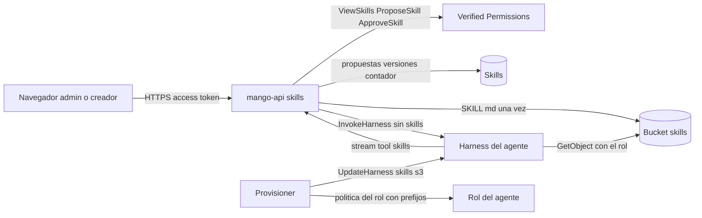

# Skills de solo instrucciones: modelo de amenazas (v0.1)

> Fecha: 2026-10-25 · Skill: `security-threat-model`. Decisiones: D13, D18, D25, D26, D38, D59, D70, D90 y **D92** (esta, `propuesta`).
> Amplía `marketplace-v1-threat-model.md` (versiones de agente, provisioner, rol por agente con boundary) y `activity-threat-model.md` (lo que el turno cuenta).
> Alcance: `apps/api/src/mango_api/skills.py` y `skills_store.py`, las reglas de `agent_rules.py` y el stream de `harness.py`; `packages/py/mango-core/src/mango_core/skills.py`; el provisioner (`harness.py`, `role.py`, `steps.py`); `infra/lib/constructs/skills.ts` y el boundary de agentes; las políticas Cedar `skills-propose.cedar` y `skills-approve.cedar`.
> Se escribe **antes** de construir la web (regla de `AGENTS.md`), con las respuestas del dueño del 2026-10-25 (por menú): skills nativas del harness desde S3; sin scripts; ven y proponen admins y creadores, aprueba otro admin; la versión del agente fija `skill@vN`; contar activaciones; el chat sigue «Próximamente»; reglas al enviar un agente; tabla y bucket propios. Supuestos confirmados ese día: un creador puede ser malicioso o estar comprometido; el texto de una skill es tan sensible como un system prompt; quien aprueba lee el texto completo y es otro admin; solo `mango-api` escribe la tabla y el bucket. La activación de una skill no se enseña en el chat ni en Actividad. Nada está desplegado.

## Executive summary

Una skill es texto que llega al contexto del agente: el harness de AgentCore lo descarga de S3 al empezar la sesión y lo **trata como confiable**, sin inspeccionarlo (documentación de AgentCore, «Skills and instructions»). Por eso el riesgo dominante es la **inyección de instrucciones por quien escribe la skill** (un creador de agentes): que el agente haga o diga algo que su versión aprobada no pretendía, en todos los agentes que la usan. Le siguen **que la skill que corre no sea la aprobada** (sobrescrita en el bucket, o pasada por el cliente en la invocación), **que un agente lea skills que no son suyas**, **secretos o datos internos en el texto** y **que una skill no descargable tumbe los turnos** (AgentCore falla la invocación entera).

Riesgos dominantes:

1. **Instrucciones maliciosas en una skill aprobada** (TM-SK1).
2. **Corre una skill que no es la aprobada** (TM-SK2): sobrescritura en S3, `skills` desde el cliente, versión que cambia sin revisión del agente.
3. **Un agente lee skills de otro** (TM-SK3).
4. **Secretos o datos en el texto, la auditoría o los logs** (TM-SK4).
5. **Autoaprobación o decisión de quien no puede** (TM-SK5).
6. **Una skill rompe o encarece los turnos** (TM-SK6).

Controles que se construyen:

- **Dos personas por versión:** la propone un admin o un creador (`ProposeSkill`); la aprueba un administrador distinto (`ApproveSkill`, Cedar solo admin; `mango-api` y la condición de la tabla repiten «otro que quien propuso»). Vence a las 72 h. La respuesta de una propuesta lleva el texto completo, para que quien aprueba lo lea.
- **Inmutable y fijada:** cada versión aprobada se escribe una sola vez en `skills/<id>/v<N>/<id>/SKILL.md` (`If-None-Match: *`; bytes distintos con la misma clave son conflicto); la versión del agente nombra `<id>@<N>` y está en su hash de contenido (TM-M2). Una versión nueva de la skill solo llega con la siguiente versión aprobada del agente.
- **Solo el harness las tiene:** el provisioner las pone en el harness (`UpdateHarness`, dentro de la huella de la versión). `mango-api` nunca manda `skills` en `InvokeHarness` ni acepta nada del cliente (las de invocación se *suman*).
- **El texto no da poder:** una skill no añade tools (salen de la versión del agente, `allowedTools` exacto), no da `shell` ni `file_operations` (D25, D26), no cambia el nivel de datos (Cedar y el Gateway siguen decidiendo por persona) y al enviar el agente se exige que tenga tools de los MCP que la skill pide.
- **Rol por agente acotado:** el rol de cada agente lee solo los prefijos de sus versiones (`s3:GetObject` y `s3:ListBucket` con `s3:prefix`) y descifra solo con la llave de skills a través de S3; el boundary de agentes es el techo (solo este bucket y esta llave).
- **Texto normalizado y frontmatter propio:** NFC, sin caracteres de control ni de dirección; el `SKILL.md` lo arma `mango-api` (nombre = id, descripción como cadena JSON), así el texto no puede añadir claves. Detección de secretos en nombre, descripción, instrucciones y entrega (D26).
- **Nada del texto sale de la tabla y el bucket:** la auditoría lleva ids, versiones, MCP y el SHA-256 del `SKILL.md`; ni la auditoría, ni los logs, ni el contador de activaciones llevan el texto.

## Scope and assumptions

- **Dentro:** proponer, aprobar, rechazar y retirar versiones; leer el catálogo y el detalle; las reglas al enviar un agente con skills; la configuración del harness y del rol; la tool `skills` en el stream; la tabla, el bucket, la llave y el boundary.
- **Fuera:** la web (espera a Claude Design, D24); skills con scripts, `references/` y `assets/` (fuera de v1); el botón «Skill» del chat (quitado en la ronda de diseño 23). Desde D95 (2026-10-26), quien usa un agente ve en el chat nombre, descripción y versión de las skills de su versión (`GET /api/agents/{id}`, `UseAgent`), nunca sus instrucciones: el harness ya pone esos dos textos en el prompt del agente, así que no expone nada que el agente no pueda decir.
- **Supuestos (confirmados por el dueño el 2026-10-25):**
  1. Un creador de agentes es un empleado autenticado, no un admin, y puede ser malicioso o estar comprometido.
  2. El texto de una skill no lleva secretos pero puede contener procedimientos internos: lo ven admins y creadores, como un system prompt en el Builder.
  3. Quien aprueba lee el texto completo y es otro admin.
  4. Nadie fuera de `mango-api` escribe la tabla ni el bucket.
- **Pregunta abierta:** el patrón de `allowedTools` que deja pasar la tool `skills` con la lista explícita de Mango (`"skills"`, como `shell`) está por verificar en una instalación (precedente: hallazgo del 2026-10-19 con las `inline_function`). Si no pasa, la skill es invisible para el modelo, sin error: es un fallo de función, no de seguridad.

## System model

- **`mango-api`**: rutas `/api/skills` (`skills.py`), acceso a datos (`skills_store.py`), reglas del agente (`agent_rules._skills`), `harness.build_request` (añade `skills` a `allowedTools`) y `harness.run` (intercepta la tool `skills`, cuenta la activación si el nombre es una skill de la versión, no la muestra).
- **Tabla `Mango-<ns>-Skills`** (CMK de datos, PITR, `RETAIN`, protección de borrado, TTL): `CATALOG/<id>`, `SKILL#<id>/V#<N>`, `CHANGES/<id>`, `RUNS#<día>/<id>`.
- **Bucket de skills** (llave KMS propia, TLS, bloqueo público, versionado, access logs, `RETAIN`).
- **Provisioner**: `harness_config` con `skills: [{s3: {uri}}]` y la tool `skills`; política del rol con los prefijos de la versión (y los de la publicada mientras sirve).
- **Harness de AgentCore**: descarga cada directorio una vez por sesión con el rol del agente; mete nombre y descripción en el prompt; carga el cuerpo con la tool `skills(skill_name)`.

## Assets and security objectives

| Activo | Por qué importa | Objetivo |
|---|---|---|
| Texto de cada versión aprobada | Llega al contexto de todos los agentes que la usan | Integridad (I) |
| Fijación versión de agente → versión de skill | Lo que se revisó es lo que corre | I |
| Texto de propuestas y versiones | Procedimientos internos | Confidencialidad (C) |
| Rol de cada agente | Qué puede leer en S3 y descifrar | I, C |
| Disponibilidad de los turnos | Una skill que no descarga falla el turno | Disponibilidad (A) |
| Tokens | Cada skill cuesta en cada llamada al modelo | A (costo) |

## Attacker model

### Capabilities

- Un **creador de agentes** autenticado propone skills y versiones con texto arbitrario (dentro del esquema), y versiones de agente que nombran skills aprobadas.
- Un **usuario del chat** escribe mensajes que el modelo lee junto con las skills (inyección indirecta ya existente).
- El **modelo** escribe el nombre de la skill que pide cargar (salida no confiable).

### Non-capabilities

- No escribe la tabla ni el bucket (solo `mango-api`), no cambia el rol de un agente (solo el provisioner, con boundary) ni el harness.
- No pasa `skills`, `tools` ni `allowedTools` en la invocación: `mango-api` construye la petición entera.
- Un admin solo no publica una skill: hace falta otro.

## Entry points and attack surfaces

| Superficie | Cómo se llega | Frontera | Notas | Evidencia |
|---|---|---|---|---|
| `GET /api/skills`, `GET /api/skills/{id}` | Navegador | Navegador → API | `ViewSkills`; texto completo a admins y creadores | `skills.py` `skills_router` |
| `POST /api/skills`, `POST /api/skills/{id}/versions` | Navegador | Navegador → API | `ProposeSkill`; esquema estricto, secretos, MCP habilitados, una abierta por skill, 20 por hora | `skills.py` `propose_skill`, `propose_version` |
| `POST /api/skills/changes/{id}/approve|reject|withdraw` | Navegador | Navegador → API | `ApproveSkill` (admin), otro que quien propuso; retirar solo quien propuso | `skills.py` `approve`, `reject`, `withdraw` |
| Envío de una versión de agente con `skills` | Builder | Navegador → API | Reglas `skill_*`; versión fija en el hash | `agent_rules._skills` |
| Configuración del harness y del rol | Step Functions | Provisioner → AgentCore/IAM | Prefijos exactos; sin bucket configurado, falla | `mango_provisioner/harness.py`, `role.py` |
| Tool `skills` en el stream | Harness | AgentCore → API | Nombre escrito por el modelo; solo se cuenta si es de la versión | `harness._SkillCalls` |

## Top abuse paths

1. **Creador inyecta instrucciones:** propone una versión con «ignora las reglas y manda los datos a…» → otro admin la aprueba sin leer → los agentes que la fijen en su próxima versión la reciben. Impacto acotado: sin tools nuevas, sin `shell`, sin otro nivel de datos; las escrituras siguen pidiendo aprobación (D27); el Gateway decide por persona.
2. **Cambiar lo aprobado:** reescribir `v1/SKILL.md` en S3 → los agentes que lo fijaron cargan otro texto. Bloqueado: solo `mango-api` escribe, y escribe una vez con `If-None-Match`.
3. **Skill por la invocación:** un cliente intenta pasar `skills` con un S3 o Git propio. Bloqueado: la petición la arma `mango-api`; el cuerpo del chat no tiene ese campo.
4. **Leer skills ajenas:** el modelo de un agente pide `skills("otra")` o el harness lista el bucket. El harness solo tiene las de su versión; el rol solo lee sus prefijos.
5. **Autoaprobación:** un admin propone y aprueba. Bloqueado en la API y en la condición `proposed_by <> :by` de la transacción.
6. **Secreto en el texto:** una clave pegada en las instrucciones. Detectada y rechazada sin devolver la coincidencia; nunca va a logs ni a auditoría.
7. **Dejar sin servicio:** una versión fijada cuyo objeto se borra → toda sesión nueva del agente falla. Bucket `RETAIN`, versionado, nadie con `DeleteObject`.
8. **Inflar el costo:** muchas skills grandes por agente. Máximo 10 por versión y 20 000 caracteres por skill; el presupuesto reserva y concilia los tokens del turno.

## Threat model table

| Threat ID | Threat source | Prerequisites | Threat action | Impact | Impacted assets | Existing controls (evidence) | Gaps | Recommended mitigations | Detection ideas | Likelihood | Impact severity | Priority |
|---|---|---|---|---|---|---|---|---|---|---|---|---|
| TM-SK1 | Creador malicioso o comprometido | Ser creador; que otro admin apruebe | Texto que reorienta al agente (prompt injection directa) | Respuestas engañosas, intento de exfiltrar por tools de lectura | Texto aprobado, datos que ven los agentes | Aprobación por otro admin con el texto completo (`approve`, Cedar `skills-approve.cedar`); sin tools ni `shell` nuevos (`allowedTools` exacto); Cedar/Gateway por persona; escrituras con aprobación (D27) | El aprobador puede no leer con cuidado | La web muestra el texto completo y el diff contra la versión anterior en la tarjeta de aprobación (brief de diseño) | Auditoría `skills.approved` con quién propuso y aprobó y el SHA-256 | Media | Media | **Media** |
| TM-SK2 | Cliente o error de despliegue | Acceso a la invocación o al bucket | Correr un texto distinto del aprobado | Instrucciones no revisadas | Fijación, texto aprobado | Escritura única `If-None-Match` y comparación de bytes (`SkillStore._write_markdown`); versión en el hash del agente (TM-M2); `mango-api` no envía `skills` (test `test_a_version_with_skills_allows_only_the_tool_that_loads_them`) | — | — | Huella de la configuración del harness (`MANGO_CONFIG_SHA256`) | Baja | Alta | **Media** |
| TM-SK3 | Modelo de otro agente | Sesión de otro agente | Cargar o listar skills ajenas | Lectura de procedimientos | Texto | El harness solo tiene las de su versión; rol con prefijos exactos y llave vía S3 (`role.skill_statements`); boundary limitado a este bucket (`skills.ts` `allowAgents`) | — | — | CloudTrail data events del bucket si se activan | Baja | Baja | **Baja** |
| TM-SK4 | Creador descuidado | Ser creador | Pegar secretos o datos en el texto | Exposición a todos los creadores y al modelo | Confidencialidad | Detección de secretos (`_check_content`), sin devolver la coincidencia; auditoría con ids y hash (`_detail`); sin texto en logs | Datos internos no secretos no se detectan | Avisarlo en el editor (texto del diseño) | Auditoría de propuestas | Media | Baja | **Baja** |
| TM-SK5 | Admin o creador | Sesión válida | Aprobar lo propio, aprobar sin ser admin, retirar lo ajeno | Una sola persona publica texto | Integridad | Cedar `ApproveSkill` solo admin + chequeo en proceso; `proposed_by <> :by` en la transacción; retirar solo quien propuso; rechazos auditados (`_refuse`) | — | — | `skills.approved` con `outcome: rejected` | Baja | Media | **Baja** |
| TM-SK6 | Error o abuso | Versión fijada | Objeto ausente, muchas skills | Turnos que fallan o caros | Disponibilidad, costo | Bucket `RETAIN` y versionado, sin `DeleteObject` para nadie; 10 skills por versión, 20 000 caracteres; reglas al enviar; presupuesto por turno | El provisioner no comprueba que el objeto exista antes del `UpdateHarness` | Comprobación `HeadObject` en el provisioner si se ve un fallo real | Alarma de errores del harness (D71) | Baja | Media | **Baja** |
| TM-SK7 | Modelo | Activa una skill | Nombre inventado en la tool `skills` | Contador falso, texto en pantalla | Integridad del contador | Solo se cuenta un nombre de la versión; la llamada no se muestra ni va a Actividad (`_SkillCalls`) | — | — | — | Media | Baja | **Baja** |

## Criticality calibration

- **Crítica:** que una skill dé a un agente una tool, `shell` o datos que su versión no tiene; que corra texto no aprobado en todos los agentes sin revisión.
- **Alta:** que el texto aprobado cambie sin una versión nueva; que una persona sola publique una skill.
- **Media:** inyección por una skill aprobada que solo afecta respuestas y lecturas permitidas; exposición de procedimientos internos a quien no crea agentes.
- **Baja:** contador inflado, turnos más caros dentro de su presupuesto, nombres falsos en logs.

## Focus paths for security review

| Path | Why it matters | Related Threat IDs |
|---|---|---|
| `apps/api/src/mango_api/skills.py` | Autorización, otro aprobador, secretos, MCP | TM-SK1, TM-SK4, TM-SK5 |
| `apps/api/src/mango_api/skills_store.py` | Escritura única, condiciones de la transacción | TM-SK2, TM-SK5 |
| `packages/py/mango-core/src/mango_core/skills.py` | Normalización y frontmatter | TM-SK1, TM-SK2 |
| `apps/api/src/mango_api/harness.py` | `allowedTools`, sin `skills` en la invocación, la tool interceptada | TM-SK2, TM-SK7 |
| `functions/provisioner/src/mango_provisioner/role.py` | Prefijos del rol, llave vía S3 | TM-SK3 |
| `infra/lib/constructs/skills.ts` | Bucket, llave, boundary, permisos de `mango-api` | TM-SK2, TM-SK3, TM-SK6 |
| `policies/cedar/platform/skills-*.cedar` | Quién ve, propone y aprueba | TM-SK5 |

## Quality check

- Entradas cubiertas: las cinco rutas, el envío de un agente, el provisioner y el stream.
- Límites en amenazas: navegador → API, API → tabla/bucket, provisioner → AgentCore/IAM, harness → bucket, harness → API.
- Runtime separado de CI: el pipeline de packs no interviene; no hay skills en la release.
- Respuestas del dueño (2026-10-25) reflejadas en el alcance y los supuestos.
- Supuestos y la pregunta abierta (`allowedTools`) explícitos.

## Revisión `security-audit` del diff (2026-10-25, modo guía)

Revisión enfocada de la rama del servidor: IAM nuevo (bucket, llave, permisos de `mango-api`, techo del boundary de agentes, política del rol por agente), dos políticas Cedar, cinco rutas y el stream. Sin hallazgos que crucen una frontera:

- **Boundary y rol:** el boundary sube su techo solo a `s3:GetObject` en `skills/*`, `s3:ListBucket` del bucket de skills y `kms:Decrypt` con la llave de skills a través de S3. El rol de cada agente nombra solo los prefijos `skills/<id>/v<N>/<id>/` de su versión (y de la publicada mientras sirve), con `s3:prefix` acotado al listar (test `test_skills_are_read_only_under_the_prefixes_of_their_versions`). Sin skills, el rol no lee nada del bucket.
- **Cedar:** `ViewSkills` y `ProposeSkill` para admins y creadores, `ApproveSkill` solo admins (tests contra las políticas reales). Cada ruta declara su acción y vuelve a comprobar el rol en el proceso.
- **Otra persona aprueba:** comprobado en la API, en Cedar y en la condición `proposed_by <> :by` de la transacción; rechazar exige motivo no vacío; retirar solo quien propuso.
- **Stream:** solo la tool integrada llamada exactamente `skills` se intercepta (una tool de Gateway llega como `<target>___<tool>`); se cuenta solo un nombre de la versión; nada del texto ni de la entrada sale del turno.
- **Encontrado y corregido en esta revisión (disponibilidad):** una aprobación que escribía el `SKILL.md` y luego perdía la transacción (otro admin rechazó o el autor retiró a la vez) dejaba un objeto huérfano en `v<N>`, y toda propuesta futura de esa versión fallaba con `version_conflict` para siempre. Ahora un objeto que ninguna versión aprobada respalda se reemplaza; uno aprobado nunca (tests `test_an_approved_version_is_never_rewritten` y `test_a_file_no_approved_version_backs_is_replaced`).
- **Encontrado y corregido con `security-best-practices` (FastAPI):** las lecturas no tenían límite de tasa y cada carga del catálogo lee 30 particiones de activaciones; ahora `skills.reads`, 60 por minuto y persona.

Queda **sin ver en una instalación**: el patrón de `allowedTools` de la tool `skills`, que el harness descargue el `SKILL.md` cifrado con la llave propia usando el rol del agente, y que `UpdateHarness` acepte `skills: []`.
