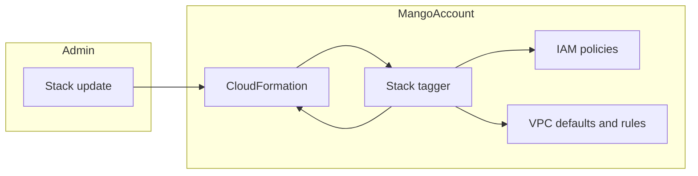

# Etiquetador del stack: modelo de amenazas (v0.1)

> Fecha: 2026-10-14 · Skill: `security-threat-model`. Decisión que lo enmarca: D77 (precisa D76). Componente nuevo con permisos de escritura: se modeló antes de construirlo y se ajustó con lo construido.
> Alcance: `functions/provisioner/src/mango_provisioner/stack_tagger.py`, la lectura de tags compartida con D76 (`stack_tags.py`), `infra/lib/constructs/stack-tagger.ts`, su conexión en `infra/lib/stacks/core-stack.ts` y la salida `VpcId` de `infra/lib/stacks/pack-network-stack.ts`.
> Comprobado con tests locales (`functions/provisioner/tests/test_stack_tagger.py`, `infra/test/stack-tagger.test.ts`) y en la actualización de una instalación el 2026-10-14 (D77, punto 10): etiquetó lo previsto con la condición `ec2:Vpc` y sin reintentos. Que el rol no pueda etiquetar fuera de las dos VPC no se probó en una instalación.
> Supuestos validados con el dueño el 2026-10-14: el cliente no usa tags para autorizar (ABAC) sobre reglas de security groups, ACL, tablas de rutas ni políticas de IAM en la cuenta de Mango; y se acepta que el permiso sobre reglas no se pueda limitar a una VPC, con la condición de namespace en cada petición.

## Executive summary

CloudFormation da los tags de un stack a todo lo que la plantilla declara y admite tags. Tres clases de recurso de una instalación admiten tags en AWS y no en CloudFormation: las políticas administradas de IAM, lo que AWS crea con cada VPC (security group, ACL y tabla de rutas por defecto) y las reglas de los security groups. El etiquetador es un custom resource de `Core` que, al instalar y en cada versión, les pone los tags de su stack y los de Mango. Es el primer rol de la instalación que escribe sobre recursos de red y políticas de IAM sin crearlos, así que el riesgo que domina es **que ese rol sirva para etiquetar recursos ajenos a Mango**.

Controles que lo acotan:

- **Solo escribe tags.** Sin `DeleteTags`, `UntagPolicy` ni ninguna otra escritura sobre los recursos de la cuenta (aparte de su propio log y sus trazas de X-Ray, como toda función): un tag no cambia lo que una política permite ni el tráfico que una regla deja pasar.
- **Políticas:** solo `Mango-<ns>-*`, y la función se niega si un stack declara una fuera de ese prefijo.
- **Defaults de red:** solo en las dos VPC de la instalación (condición `ec2:Vpc`).
- **Reglas:** el tipo `security-group-rule` no admite condición de VPC ni de grupo. El rol podría etiquetar cualquier regla de la cuenta, pero **cada petición tiene que llevar `mango:namespace` del namespace** (`aws:RequestTag`), así que no puede poner tags sin dejar la marca de la instalación. La función solo pide reglas de los grupos de sus dos VPC y descarta cualquier otra que el filtro devuelva.
- **Cada VPC se comprueba antes de tocarla:** lleva el `mango:namespace` de la instalación y CloudFormation la marca como de `Mango-<ns>-Core` o `Mango-<ns>-PackNetwork`.

Riesgo residual principal: el permiso sobre reglas de toda la cuenta. Queda en prioridad baja porque el cliente no usa tags para autorizar en esos recursos, el rol solo lo asume la función y la función solo la invoca quien ya administra la cuenta.

## Scope and assumptions

- **Dentro:** la función, su rol, el custom resource, su momento de ejecución (al crear y en cada actualización de `Core`), sus respuestas a CloudFormation y sus logs.
- **Fuera:** lo que CloudFormation etiqueta por su cuenta; lo que los provisioners crean en ejecución (D76, `marketplace-v1-threat-model.md` y `mcp-pack-provisioner-threat-model.md`); lo que AWS crea por su cuenta (interfaces de red, roles vinculados a servicios, log groups de toda la cuenta).
- **Supuestos:**
  1. Los tags de un stack los pone quien puede crearlo o actualizarlo: un administrador de la cuenta de Mango. Las personas de la aplicación no pueden.
  2. Las dos VPC son de la instalación: las crean sus plantillas y nada más las usa (`infra/lib/constructs/network.ts`, `pack-network.ts`).
  3. CloudFormation marca cada VPC que crea con `aws:cloudformation:stack-id`, y nadie puede poner a mano un tag `aws:`.
  4. Solo administradores de la cuenta tienen `lambda:InvokeFunction` sobre funciones de la instalación.
  5. El cliente no usa tags para autorizar sobre esos recursos (validado con el dueño).
- **Preguntas abiertas:** si el cliente adopta más adelante ABAC sobre reglas de security groups, TM-ST1 sube de prioridad.

## System model

### Primary components

| Componente | Qué hace | Evidencia |
|---|---|---|
| `Custom::MangoStackTags` | Recurso de `Core`; propiedades `Release` (cambia en cada versión) y `VpcIds` (la de `Core` y la importada de `PackNetwork`). Depende de las políticas, VPC, grupos y reglas del stack | `infra/lib/constructs/stack-tagger.ts` (`runsAfterWhatItTags`) |
| Función `Mango-<ns>-StackTagger` | Lee tags y recursos, escribe tags, responde a CloudFormation | `stack_tagger.py` (`handle`, `Tagger.run`) |
| Rol `Mango-<ns>-StackTagger` | Siete sentencias: cinco suyas (leer los dos stacks, etiquetar políticas, defaults de red y reglas, y leer la red) y las dos de toda función (su log y X-Ray) | `stack-tagger.ts` |
| Lectura de tags del stack | Las mismas reglas que D76: nunca `aws:` ni `mango:`; ASCII que AgentCore acepta; como mucho 50 | `stack_tags.py` (`custom_tags`, `merge`) |

### Data flows and trust boundaries

- **CloudFormation → función.** Evento del custom resource (`Create`, `Update`, `Delete`) con `StackId`, `VpcIds` y la URL firmada de respuesta. La función solo actúa si `StackId` es el `Core` de su instalación (región, cuenta y namespace) y `VpcIds` tiene forma de id de VPC.
- **Función → CloudFormation (lectura).** `DescribeStacks` y `ListStackResources` sobre `Core` y `Mango-<ns>-PackNetwork`: estado, tags y políticas administradas. Los parámetros que también devuelve `DescribeStacks` no se usan ni se registran.
- **Función → EC2 (lectura).** `DescribeVpcs`, grupos, reglas, ACL y tablas de rutas. Sin alcance por recurso: la API no lo admite.
- **Función → IAM y EC2 (escritura).** `TagPolicy` y `CreateTags`, solo tags, con `mango:namespace` en cada petición.
- **Función → CloudFormation (respuesta).** `SUCCESS` o `FAILED` con la operación y el código de error, nunca un tag ni un mensaje de AWS.

#### Diagram

## Assets and security objectives

| Asset | Why it matters | Security objective (C/I/A) |
|---|---|---|
| Tags de recursos ajenos a Mango en la cuenta | Otros equipos los usan para costos, inventario o, si los usaran, para autorizar | I |
| Tags `mango:*` de la instalación | Las condiciones de IAM de los provisioners los leen (TM-M1) | I |
| Las políticas de permissions boundary | Acotan todo lo que hacen agentes y packs | I (el etiquetador no puede cambiar su documento) |
| Instalar y actualizar | Un fallo del etiquetador revierte el stack | A |
| Parámetros del stack (correos de los administradores) | `DescribeStacks` los devuelve | C |

## Attacker model

### Capabilities

- Un administrador de la cuenta de Mango que ponga tags al stack (es de confianza; también puede borrar el stack).
- Alguien con `lambda:InvokeFunction` en la cuenta que invoque la función con un evento a mano.
- Un tag de stack mal formado, puesto por error.

### Non-capabilities

- Las personas de la aplicación no tocan los stacks ni invocan funciones.
- Nadie puede poner a mano un tag `aws:cloudformation:stack-id` en una VPC.
- El rol no puede borrar tags, cambiar documentos de política ni reglas, ni crear nada.

## Entry points and attack surfaces

| Surface | How reached | Trust boundary | Notes | Evidence |
|---|---|---|---|---|
| Evento del custom resource | CloudFormation al crear o actualizar `Core` | CloudFormation → función | `StackId` y `VpcIds` validados | `stack_tagger.py` (`handle`, `_vpc_ids`) |
| Invocación directa | `lambda:InvokeFunction` | Administrador → función | Misma validación; solo responde a la URL que trae el evento, y solo `https` | `uninstall.py` (`respond`) |
| Tags del stack | Al desplegar o actualizar | Administrador → stack | Reglas de D76 | `stack_tags.py` |

## Top abuse paths

1. **Etiquetar reglas ajenas.** Invocar la función a mano con la VPC de otra carga → la VPC no lleva el `mango:namespace` de la instalación o no es de sus stacks → `FAILED`, nada etiquetado.
2. **Usar el rol para poner tags en cualquier regla.** Solo lo asume la función, y cada `CreateTags` tiene que llevar `mango:namespace` del namespace: no puede escribir tags sin la marca de la instalación.
3. **Pisar `mango:namespace` de la instalación con un tag del stack** → los `mango:` del stack no se copian, sin distinguir mayúsculas; los de Mango se ponen con su valor.
4. **Etiquetar una política ajena** declarándola en el stack → la función se niega si una política administrada del stack no lleva el prefijo `Mango-<ns>-`, y el rol solo puede sobre ese prefijo.
5. **Dejar el stack atascado** haciendo fallar al etiquetador durante un rollback → no actúa mientras el stack está en `ROLLBACK`: responde `SUCCESS` sin tocar nada.
6. **Filtrar datos por la respuesta o el log** → la respuesta lleva la operación y el código; el log, cuántos recursos etiquetó.

## Threat model table

| Threat ID | Threat source | Prerequisites | Threat action | Impact | Impacted assets | Existing controls (evidence) | Gaps | Recommended mitigations | Detection ideas | Likelihood | Impact severity | Priority |
|---|---|---|---|---|---|---|---|---|---|---|---|---|
| TM-ST1 | Quien invoque la función o use su rol | `lambda:InvokeFunction` o el rol | Etiquetar reglas de security groups que no son de Mango | Tags ajenos cambiados; con ABAC sobre reglas, una decisión de acceso podría cambiar | Tags ajenos | Rol solo de la función; `aws:RequestTag/mango:namespace` obligatorio; la función comprueba cada VPC y filtra las reglas por grupo (`stack-tagger.ts`, `stack_tagger.py`) | El tipo `security-group-rule` no admite condición de VPC | Si el cliente adopta ABAC sobre reglas, revisar; mantener el rol sin otras acciones | CloudTrail: `CreateTags` del rol sobre reglas de otra VPC | Baja | Media | low |
| TM-ST2 | Administrador o error | Tag mal formado en el stack | Hacer fallar la instalación o la actualización | El stack se revierte | Instalar y actualizar | Validación de D76 antes de escribir nada; nada de tags a medias; motivo claro en el evento (`stack_tagger.py`) | Revertir una creación cuesta el tiempo de instalar | Ninguna más: es lo que el dueño eligió (D77 (3)) | Eventos del stack | Media | Baja | low |
| TM-ST3 | Administrador | Tag `mango:*` en el stack | Cambiar los tags que leen las condiciones de IAM | Un provisioner crearía con otro namespace | Tags `mango:*` | Nunca se copian `aws:` ni `mango:`, sin distinguir mayúsculas (`stack_tags.py`) | — | — | — | Baja | Media | low |
| TM-ST4 | Quien invoque la función | `lambda:InvokeFunction` | Etiquetar una política IAM ajena | Tags ajenos en IAM | Tags ajenos | Recurso del rol `policy/Mango-<ns>-*`; la función rechaza políticas fuera del prefijo | — | — | CloudTrail: `TagPolicy` del rol | Baja | Baja | low |
| TM-ST5 | Fallo de AWS | Rollback en curso, o un rol recién creado que IAM aún no aplica | Que el etiquetador falle durante el rollback, o al estrenar su rol | `UPDATE_ROLLBACK_FAILED`, o una instalación revertida sin motivo real | Instalar y actualizar | No actúa durante un rollback; `Delete` no hace nada; una denegación se reintenta unos 80 s; siempre responde a CloudFormation (`stack_tagger.py`, `_run_with_patience`) | — | — | Eventos del stack | Baja | Media | low |
| TM-ST6 | Lector de logs | Acceso a CloudWatch Logs o a los eventos | Leer tags, ARN o mensajes de AWS | Exposición menor | Parámetros y tags | Respuesta y log solo con códigos y cuentas | — | — | — | Baja | Baja | low |

## Criticality calibration

- **critical:** que el rol pudiera cambiar un documento de política o una regla de red (no tiene esas acciones).
- **high:** etiquetar recursos ajenos en una cuenta donde esos tags deciden accesos.
- **medium:** dejar la instalación sin poder actualizarse (rollback atascado).
- **low:** tags ajenos sin efecto en accesos; un fallo que revierte una creación; datos de configuración en un log.

## Focus paths for security review

| Path | Why it matters | Related Threat IDs |
|---|---|---|
| `infra/lib/constructs/stack-tagger.ts` | Las cinco sentencias propias y sus condiciones | TM-ST1, TM-ST4 |
| `functions/provisioner/src/mango_provisioner/stack_tagger.py` | Comprobación de VPC y políticas, filtro de reglas, rollback, respuestas | TM-ST1, TM-ST2, TM-ST4, TM-ST5, TM-ST6 |
| `functions/provisioner/src/mango_provisioner/stack_tags.py` | Qué tags se copian | TM-ST2, TM-ST3 |
| `infra/test/stack-tagger.test.ts`, `functions/provisioner/tests/test_stack_tagger.py` | Fijan permisos y comportamiento | Todas |
