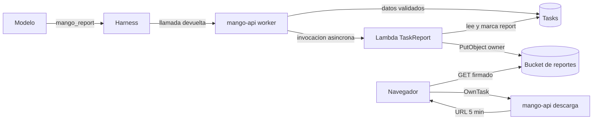

# Reportes descargables de las tareas: modelo de amenazas (v0.1)

> Fecha: 2026-10-19 · Skill: `security-threat-model`. Decisiones: D23, D25, D56, D58, D70, D78, D79, D82, D83, **D86** y **D87**.
> Amplía `tasks-threat-model.md` (ejecuciones de tareas) e `inbox-threat-model.md` (Bandeja).
> Alcance: la tool interna `mango_report` (`inline_function` del harness) y su validación en `mango-api` (`mango_core.task_reports`, `task_worker.py`, `app.py`); la Lambda `Mango-<ns>-TaskReport` (`functions/task-report/`) y su renderizador; el bucket de reportes y su llave; las rutas de descarga y de «Generar de nuevo» (`tasks.py`); la casilla del editor y los estados de la pantalla (`apps/web/src/pages/schedules/`); la infraestructura (`infra/lib/constructs/task-reports.ts`).
> v0.1 se escribe **antes** de construir (D86 (9)). Supuestos confirmados por el dueño el 2026-10-19, por menú («Sí, las cuatro (Recomendada)»), junto con las decisiones de D87. Nada está desplegado.

## Executive summary

Un reporte es un PDF que Mango arma con los datos que un agente entrega al final de una ejecución, con una plantilla fija, y que solo descarga el dueño de la tarea. Junta tres cosas que hasta hoy no existían juntas: **datos estructurados escritos por un modelo** (no confiables: pueden venir de una inyección indirecta por una tool o un evento), **un renderizador** que los convierte en un documento, y **un enlace de descarga** que funciona fuera de la sesión de Mango durante 5 minutos. El riesgo que domina es que el renderizador se convierta en un camino de ejecución o de lectura (marcado, fuentes, imágenes, tamaños) y, en segundo lugar, que el PDF o su enlace llegue a quien no es el dueño. La integridad de las cifras se acota, no se garantiza: el servidor valida, recalcula y, cuando puede, toma la serie diaria de la respuesta de la consulta.

Riesgos dominantes:

1. **El renderizador como superficie de ataque** (TM-R1): marcado del motor de PDF (``, `<a href>`, fuentes), tamaños que agotan memoria o tiempo, caracteres de control.
2. **Descarga por quien no es el dueño** (TM-R2): pedir el enlace de una ejecución ajena, o que un administrador descargue (D82).
3. **Enlace prefirmado filtrado** (TM-R3): es un portador durante 5 minutos (supuesto 3, aceptado).
4. **Cifras manipuladas por inyección** (TM-R4): el agente copia cifras falsas que llegan a un documento que se reenvía a finanzas.
5. **Lectura o escritura fuera de su ejecución por la Lambda** (TM-R5): rol amplio o datos del evento que eligen qué ítem o qué objeto se toca.
6. **Contenido en logs, auditoría o la URL** (TM-R6).
7. **Abuso de costo** (TM-R7): «Generar de nuevo» o descargas en bucle, PDFs enormes.

Controles que se construyen:

- **Sin HTML:** el PDF se dibuja por código con ReportLab (D87 (2)); el texto del modelo nunca pasa por un motor HTML ni CSS. Todo texto entra al renderizador escapado (`&`, `<`, `>`), así que el marcado de párrafos de ReportLab solo tiene las etiquetas que pone Mango (`<b>`), nunca ``, `<a>` ni ``. Las fuentes (IBM Plex, OFL) vienen en el zip de la release (D25); ninguna ruta, URL ni nombre de fuente sale de los datos.
- **Esquema estricto en dos sitios:** `mango-api` valida la entrada de la tool con `mango_core.task_reports` (sin campos de más, tipos, longitudes, límites de D86 (8)) y la Lambda la valida otra vez antes de dibujar. Caracteres de control fuera. Si no pasa: `data`, sin PDF.
- **El servidor calcula** variaciones, partes, totales y «Otros», y toma la serie diaria de la respuesta de `get_cost_and_usage` cuando la consulta lo permite (D87 (4)); el bloque dice de dónde salió.
- **Solo el dueño descarga:** `POST …/report/download` exige L1 `OwnTask` (Cedar, solo el dueño), responde 404 a quien no ve la tarea y 409 si no hay PDF listo. El enlace vence a los 5 minutos, va con `Content-Disposition: attachment`, se audita (`schedule.report_download`) y nunca se registra en logs. Un administrador ve el estado («PDF listo · solo {dueño} lo descarga») sin botón ni nombre de archivo.
- **La Lambda no decide qué toca:** su evento solo nombra una tarea y una ejecución con ids validados por patrón; la clave del objeto y el nombre del archivo los calculó `mango-api` y vienen del ítem de la ejecución. Su rol lee solo la tabla de tareas, actualiza solo los atributos `report*` de un ítem y escribe solo en el prefijo `owner/` del bucket.
- **Bucket propio:** CMK propia, `RETAIN`, bloqueo de acceso público, solo TLS, sin ACL, prefijo por dueño, ciclo de vida de 90 días, y una denegación de URLs firmadas con más de 5 minutos de antigüedad (`s3:signatureAge`).
- **Asíncrona con DLQ:** reintentos de Lambda acotados, cola de errores con alarma; una generación que quedó «Generando» más de 15 minutos se muestra como «No se pudo armar el PDF» y se puede generar de nuevo.

## Scope and assumptions

- **Dentro:** la tool interna y su captura en el stream; los datos guardados en la ejecución; la Lambda y su renderizador; el bucket y su llave; las rutas de descarga y de volver a generar; lo que ve el dueño y lo que ve un administrador; la casilla del editor.
- **Fuera:** el chat (D86 (5): por ahora no pide reportes); otros formatos (D86 (1)); el contenido del informe en Markdown de la ejecución (ya cubierto en `tasks-threat-model.md`); la Bandeja (no cambia de reglas, solo enlaza a la misma descarga).
- **Supuestos (confirmados por el dueño el 2026-10-19, por menú):**
  1. Los datos que entrega el modelo son no confiables (pueden venir de una inyección): el servidor valida esquema y límites y recalcula, pero no puede probar las cifras que el agente copió.
  2. El PDF es del dueño, como el resultado (D78 (18)): un administrador solo ve el estado.
  3. Una URL prefirmada filtrada dentro de sus 5 minutos la puede usar cualquiera (es un portador): se acepta, con descarga como adjunto, nunca mostrada ni en los logs de la app.
  4. Los access logs de S3 del bucket de reportes guardan la URL firmada de cada descarga (ya vencida): se acepta, ese bucket de logs ya es restringido.
- **Preguntas abiertas:** ninguna que cambie la prioridad. Se verá en una instalación que el harness devuelve la llamada a la `inline_function` y su consumo como se espera (D87 (3)).

## System model

### Primary components

- **Harness de AgentCore:** recibe, solo en las ejecuciones con reporte, la tool `mango_report` (`inline_function`): cuando el agente la llama, el harness devuelve la llamada a quien invoca y no toca ningún sistema.
- **`mango-api` (worker de tareas):** captura la entrada de `mango_report` y las respuestas de `get_cost_and_usage` por id de llamada, valida, calcula y guarda los datos del reporte en la ejecución; invoca la Lambda de forma asíncrona.
- **Tabla `Mango-<ns>-Tasks`** (CMK, PITR, `RETAIN`, TTL de 90 días): el ítem de la ejecución lleva `report` (estado, tipo, archivo, clave, páginas, tamaño) y `report_data` (los datos validados).
- **Lambda `Mango-<ns>-TaskReport`** (ReportLab y fuentes en el zip, sin VPC, asíncrona con DLQ): lee el ítem, dibuja el PDF, lo escribe en el bucket y actualiza `report`.
- **Bucket de reportes** (`mango-<ns>-task-reports-…`, CMK propia `alias/Mango-<ns>-task-reports`): un objeto por ejecución en `owner//<tarea>/<ejecución>/<archivo>.pdf`.
- **Rutas de `mango-api`:** descarga (URL prefirmada de 5 min) y «Generar de nuevo».
- **SPA:** casilla del editor, estados en la fila y en el resultado, botón de descarga, auditoría.

### Data flows and trust boundaries

- Modelo → harness → `mango-api`: entrada de `mango_report` (JSON del modelo, no confiable) y respuestas de las tools (no confiables, ya filtradas por el alcance del dueño en el conector). Validación estricta en `mango_core.task_reports`; tamaño máximo de la entrada capturada.
- `mango-api` → tabla de tareas: datos validados en el ítem de la ejecución (escritura condicionada al estado).
- `mango-api` → Lambda: `InvokeFunction` asíncrona con `{task_id, run_id}`; el rol de `mango-api` solo puede invocar esa función.
- Lambda → tabla: `GetItem` y `UpdateItem` solo de atributos `report*`. Lambda → bucket: `PutObject` en `owner/*` con la CMK.
- Navegador → CloudFront → `mango-api`: token de acceso validado, L1 `OwnTask`, límite de tasa, auditoría que falla cerrada.
- Navegador → S3: `GET` con la URL prefirmada (TLS, firma SigV4 de las credenciales del rol de `mango-api`, 5 minutos, `attachment`).

#### Diagram

## Assets and security objectives

| Activo | Por qué importa | Objetivo |
|---|---|---|
| PDF del reporte | Datos de costo obtenidos con el acceso del dueño; se reenvía fuera de Mango | C, I |
| Datos del reporte en la ejecución | Lo que dibuja el PDF; mismo dueño y retención que el resultado | C, I |
| Enlace prefirmado | Portador durante 5 minutos | C |
| Rol de la Lambda y de `mango-api` | Lectura de la tabla de tareas, escritura en el bucket, firma de enlaces | C, I |
| Disponibilidad y costo | Lambda, S3 y la cuota de las ejecuciones | A |
| Auditoría | Quién descargó qué | I |

## Attacker model

### Capabilities

- Contenido no confiable que llega al modelo (respuesta de una tool, datos del evento) y le hace llamar `mango_report` con datos elegidos: textos largos, marcado, caracteres de control, cifras falsas, números enormes o negativos, nombres de fuentes o rutas.
- Persona con sesión que manipula peticiones (ids de otra tarea o ejecución, cuerpos de más) o repite descargas.
- Un administrador que intenta descargar el PDF de otra persona.
- Quien obtiene un enlace prefirmado ajeno dentro de sus 5 minutos (historial compartido, captura, extensión del navegador).

### Non-capabilities

- No controla el evento de la Lambda (solo lo invoca `mango-api`), la clave del objeto ni el nombre del archivo (los calcula `mango-api` de la tarea y la ejecución).
- No sube contenido al bucket ni lo lee sin el rol de `mango-api` o una URL firmada.
- No elige plantilla, fuentes ni imágenes: son fijas y vienen en la release.

## Entry points and attack surfaces

| Superficie | Cómo se llega | Límite | Notas | Evidencia |
|---|---|---|---|---|
| Entrada de `mango_report` | El modelo la escribe | Modelo → `mango-api` | Esquema estricto; tamaño acotado; solo en ejecuciones con reporte | `mango_core/task_reports.py`, `harness.py` |
| Respuestas de `get_cost_and_usage` | Stream del harness | Tool → `mango-api` | Solo se leen para la serie diaria, con forma validada | `task_reports.series_from_query` |
| Evento de la Lambda | `mango-api` | Interno | `{task_id, run_id}` por patrón; nada más | `functions/task-report/` |
| `POST /api/tasks/{id}/runs/{run}/report/download` | SPA | Navegador → API | `OwnTask`, 404 a lo ajeno, límite de tasa, auditoría fail-closed | `tasks.py` |
| `POST /api/tasks/{id}/runs/{run}/report/retry` | SPA | Navegador → API | `OwnTask`, solo tras `render`, límite de cambios | `tasks.py` |
| `PUT/POST /api/tasks` con `report` | SPA | Navegador → API | Solo con agentes que leen costos; el tipo lo fija el disparador | `tasks.py` |
| `GET` firmado al bucket | Navegador | Internet → S3 | 5 min, TLS, `attachment`, deny por `signatureAge` | `task-reports.ts` |

## Top abuse paths

1. Inyección en una respuesta de tool → el agente pone `` o `<a href="javascript:…">` en las notas → el renderizador lo escapa y lo dibuja como texto; el marcado de ReportLab solo ve `&lt;img…`.
2. El agente entrega 10.000 días de serie o notas de 1 MB → `mango-api` corta la entrada capturada y el esquema rechaza: `data`, sin invocar la Lambda.
3. Números enormes, `NaN` o fechas fuera de orden → el esquema exige decimales finitos acotados y fechas en orden y dentro del periodo; el servidor recalcula.
4. Una persona pide `…/report/download` de una ejecución de otra tarea → `OwnTask` niega (404 si ni la ve); la clave del objeto viene del ítem, nunca de la petición.
5. Un administrador pide la descarga → `OwnTask` solo permite al dueño: 403; la pantalla no le da botón.
6. Un enlace filtrado → vence a los 5 min; la política del bucket rechaza firmas más viejas aunque la credencial siga viva; es solo un objeto; cada emisión queda en la auditoría.
7. «Generar de nuevo» en bucle → solo cuando el estado es `render`, límite de cambios por persona (D70), sin volver a ejecutar al agente.
8. Un PDF de más de 10 MB → la Lambda lo mide antes de subirlo: `size`, sin objeto.
9. La Lambda recibe un evento manipulado (si alguien con IAM la invoca) → solo ids por patrón; escribe en la clave guardada en el ítem; la condición de la actualización exige estado `generating`.

## Threat model table

| Threat ID | Threat source | Prerequisites | Threat action | Impact | Impacted assets | Existing controls (evidence) | Gaps | Recommended mitigations | Detection ideas | Likelihood | Impact severity | Priority |
|---|---|---|---|---|---|---|---|---|---|---|---|---|
| TM-R1 | Contenido no confiable vía el modelo | Una tarea con reporte y contenido inyectado en una tool | Marcado del motor, fuentes, tamaños o caracteres que hagan leer archivos, colgar o romper el renderizador | Lectura de archivos de la Lambda, DoS de la generación | Lambda, PDF | Sin HTML (ReportLab por código); escape de todo texto; esquema con longitudes; fuentes fijas del zip; memoria y tiempo de la Lambda acotados | — | Tests con marcado y control chars; tope de páginas | Errores `render` y alarma de la DLQ | Media | Media | **medium** |
| TM-R2 | Persona con sesión o administrador | Conoce ids de una tarea ajena | Pide el enlace de otro | Fuga del PDF | PDF | L1 `OwnTask` (solo dueño), 404 a lo ajeno, clave desde el ítem | — | Tests por rol | Auditoría `schedule.report_download` y `policy.decision` | Baja | Alta | **medium** |
| TM-R3 | Quien obtiene un enlace | Enlace filtrado en ≤ 5 min | Descarga sin sesión | Fuga de un PDF | PDF | 5 min, `attachment`, deny `s3:signatureAge` > 5 min, no se muestra ni se registra | Portador por diseño (supuesto 3) | — | Access logs de S3 contra eventos de auditoría | Baja | Media | **low** |
| TM-R4 | Contenido no confiable vía el modelo | Inyección que cambie lo que el agente copia | Cifras falsas en el PDF | Decisiones sobre datos falsos | Integridad del PDF | Variaciones y totales del servidor; serie diaria de la consulta cuando se puede; «Fuente» por bloque; «Sobre este reporte» dice que las cifras las copió el agente | Tablas y totales siguen siendo copiados | Ampliar la toma desde las consultas (por agrupación) | — | Media | Media | **medium** |
| TM-R5 | Error o abuso del rol de la Lambda | Evento manipulado o código con error | Leer o escribir otra cosa que su ejecución | Fuga o corrupción | Tabla, bucket | Rol: `GetItem` de la tabla; `UpdateItem` solo atributos `report*`; `PutObject` en `owner/*`; condición `generating`; evento por patrón | — | Test de IAM de la plantilla | Alarma de errores | Baja | Media | **low** |
| TM-R6 | Operadores o lectores de logs | Acceso a logs | Leer contenido o la URL | Fuga | PDF, enlace | Nunca se registran URL, datos ni texto; auditoría con ids y archivo | Access logs de S3 (supuesto 4) | — | — | Baja | Baja | **low** |
| TM-R7 | Persona con sesión | Sesión | Descargas o regeneraciones en bucle; PDFs gigantes | Costo | Disponibilidad | Límite de descargas por persona (`RateLimits`), «Generar de nuevo» solo tras `render` y con el límite de cambios, 10 MB por PDF, tope de páginas | — | — | Métricas de invocaciones | Baja | Baja | **low** |
| TM-R8 | Ejecución que reporta datos de otra ejecución | Mensajes repetidos | Mezclar datos de dos ejecuciones | PDF incorrecto | Integridad | Los datos se escriben en el mismo `update_run` que cierra la ejecución, condicionado a `running`; la Lambda lee el ítem por su clave | — | — | — | Baja | Baja | **low** |

## Criticality calibration

- **Critical:** ejecutar código o leer secretos desde el renderizador; que cualquiera con sesión descargue PDFs ajenos.
- **High:** un administrador o un tercero descarga de forma general PDFs de otras personas; la Lambda puede escribir fuera de su prefijo.
- **Medium:** un PDF con cifras falsas por inyección; colgar la generación con datos del modelo; descargar el PDF de otro conociendo ids si un control fallara.
- **Low:** un enlace filtrado dentro de sus 5 minutos; regeneraciones en bucle acotadas; la URL vencida en los access logs de S3.

## Focus paths for security review

| Path | Why it matters | Related Threat IDs |
|---|---|---|
| `packages/py/mango-core/src/mango_core/task_reports.py` | Esquema, límites, cálculo y serie desde la consulta | TM-R1, TM-R4 |
| `apps/api/src/mango_api/harness.py` | Captura de la `inline_function` y de las respuestas por id | TM-R1, TM-R8 |
| `apps/api/src/mango_api/tasks.py` | Rutas de descarga y regeneración, `OwnTask`, auditoría | TM-R2, TM-R3, TM-R7 |
| `functions/task-report/` | Renderizador: escape, fuentes, tamaños, condición `generating` | TM-R1, TM-R5 |
| `infra/lib/constructs/task-reports.ts` | Rol de la Lambda, política del bucket, llave, DLQ | TM-R3, TM-R5 |
| `apps/web/src/pages/schedules/` | El enlace no se muestra ni se copia; el admin no tiene botón | TM-R2, TM-R3 |

## Quality check

- Entradas cubiertas: la tool interna, las respuestas capturadas, el evento de la Lambda, las dos rutas nuevas, el cambio de las rutas de tareas y el `GET` firmado.
- Límites cubiertos: modelo → `mango-api`, `mango-api` → Lambda, Lambda → tabla y bucket, navegador → API, navegador → S3.
- Lo de desarrollo (mock de la SPA, tests) queda fuera del modelo de ejecución.
- Supuestos confirmados por el dueño (2026-10-19) y reflejados en las prioridades (TM-R3 y TM-R6 en baja por los supuestos 3 y 4).

## Revisión `security-audit` del diff (2026-10-19, modo guía)

Sobre el IAM de la función `Mango-<ns>-TaskReport` y de la política `Mango-<ns>-ApiTaskReports`, la política del bucket y su llave, y el camino de la URL prefirmada.

- **Corregido (TM-R5):** las condiciones `ForAllValues:StringEquals` sobre `dynamodb:Attributes` son verdaderas cuando la petición no nombra ningún atributo: un `GetItem` sin proyección habría leído el ítem entero, con el resultado de la ejecución. Las dos sentencias de la tabla exigen ahora la clave (`Null: {"dynamodb:Attributes": "false"}`); lo fija `infra/test/task-reports.test.ts`.
- **Sin hallazgos:**
  - La función solo escribe en `owner/*` y su evento solo lleva ids validados por patrón; la clave del objeto la calculan `mango-api` y la función desde el ítem, con el mismo patrón.
  - `mango-api` solo invoca esa función, solo lee `owner/*` (para firmar) y descifra con la llave de reportes solo a través de S3.
  - El bucket rechaza firmas de más de 5 minutos en `GetObject`, solo acepta TLS, no admite ACL y bloquea el acceso público.
  - La ruta de descarga exige `OwnTask`, audita antes de emitir el enlace (fail-closed), limita por persona y nunca registra la URL.
  - La SPA solo abre enlaces `https`.
- **Riesgos aceptados (supuestos 3 y 4):** el enlace es un portador durante 5 minutos; los access logs de S3 guardan su firma ya vencida.

