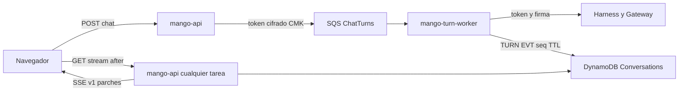

# Trabajador de turnos del chat y stream reanudable (v1): modelo de amenazas (v0.1)

> Fecha: 2026-11-07 · Skill: `security-threat-model`. Plan: [`docs/specs/chat-capacidades-plan.md`](../../specs/chat-capacidades-plan.md) (§5, fase 1: R0–R5, §7). Decisiones que lo enmarcan: [D120](../../architecture/decisions/D120-stream-del-chat-en-parches-json.md) (stream de parches JSON `v1`, numerado y reanudable) y [D121](../../architecture/decisions/D121-trabajador-de-turnos.md) (el turno corre en un trabajador fuera de `mango-api`; su punto 4, cómo llega el token, lo fijó este modelo), vigentes; precisan D57, D70 (6) y D78 (2). Además D16, D23, D39, D63, D70, D73 y las reglas 4 y 5 de `AGENTS.md`.
> Amplía `identity-propagation-threat-model.md` (TM-I5, token que debe sobrevivir al turno), `chat-live-progress-threat-model.md` (TM-LP1–LP4, qué texto del modelo sale del stream) y `tasks-threat-model.md` (cola, DLQ y una ejecución fuera de la petición, D78).
> v0.1 se escribe **antes** de construir: no hay código ni recursos. Supuestos confirmados el 2026-11-07, por menú, por el agente que lanzó este trabajo.

## Executive summary

Hoy el turno vive dentro de `POST /api/chat`: un despliegue que drena 120 s (D70 (6)) corta los turnos largos, y el stream no se reanuda. Con D121, `mango-api` autoriza, valida y **encola** el turno en `Mango-<ns>-ChatTurns`; un servicio nuevo, `mango-turn-worker` (misma imagen, otro punto de entrada, sin balanceador), lo toma, reserva presupuesto, invoca al harness y escribe cada delta como un ítem `TURN#<turn>#EVT#<seq>` con TTL en `Conversations`, y al final el mensaje. El navegador lee `GET /api/chat/turns/{turn}/stream?after=<offset>` desde **cualquier** tarea de `mango-api` y reanuda tras un corte. Con D120, el stream pasa a parches JSON (`{c, p, o, v}`) que el cliente aplica a un modelo de mensajes.

Riesgos dominantes:

1. **La identidad de la persona fuera de la petición.** El trabajador necesita el access token de la persona para el harness y el Gateway (regla 5). **Decidido:** viaja cifrado en el mensaje SQS con una CMK propia de la cola, nunca se guarda ni se loguea, y el turno no empieza si no le queda vida suficiente (TM-TW1, TM-TW2).
2. **Leer el stream de otra persona** con un `turn_id` ajeno, desde cualquier tarea (TM-TW3).
3. **Parches hostiles en el cliente.** El aplicador recibe rutas y operaciones: una ruta `__proto__` o un parche enorme contamina el estado o bloquea la pestaña (TM-TW4, TM-TW6).
4. **Turnos duplicados o perdidos.** SQS entrega al menos una vez: un turno puede correr dos veces (doble gasto, doble acción) o quedarse a medias si el trabajador cae (TM-TW5).
5. **Contenido en sitios nuevos.** Los eventos del turno son contenido de la conversación en DynamoDB, con TTL; la cola lleva el mensaje de la persona (TM-TW7).

Con las mitigaciones listadas y su PR, ninguno queda en **high**. El residual más alto es TM-TW1 (**medium**): un portador de la persona en una cola.

## Scope and assumptions

- **Dentro:** la cola y su DLQ, el servicio `mango-turn-worker` y sus permisos (R1); el camino del turno y la escritura de eventos (R2); el protocolo v1 en el servidor y la ruta de stream (R3); el aplicador de parches, la reanudación y el mock (R4); la retirada del formato antiguo (R5); las ejecuciones de tareas (D78) que pasan por el mismo camino.
- **Fuera:** lo que el sandbox de código produce (`code-interpreter-threat-model.md`); archivos (`chat-files-threat-model.md`); el guardrail y la sesión del runtime (D39, sin cambios salvo que entregue trozos).
- **Supuestos:**
  1. `mango-api` sigue siendo quien autoriza: Cedar `UseAgent`, comprobación del modelo, filtros de tools remotas por persona y la firma `X-Mango-Invocation` (`app.py`, `chat`). El trabajador **vuelve a autorizar** antes de invocar, porque entre encolar y empezar pueden cambiar grupos o presupuesto.
  2. El trabajador es tan de confianza como `mango-api` (misma imagen, roles del mismo stack); su rol tiene los permisos del turno que hoy tiene `mango-api` y no las rutas HTTP.
  3. La cookie de sesión (D63) y el access token autentican la ruta de stream como cualquier otra; no hay afinidad en el balanceador (D70).
  4. El access token de Cognito dura 60 min; el turno de un agente, de 10 a 600 s. El margen de hoy (TM-I5, `exp − ahora ≥ timeout + 60 s`) se comprueba al encolar y otra vez al empezar.
  5. El atacante es otra persona autenticada, contenido que el modelo lee (inyección) o un cambio futuro descuidado. No controla `mango-api` ni el trabajador.
- **Preguntas abiertas:** R0 (protección de tarea de ECS frente a un despliegue; si la sesión del harness sigue tras cortar el stream de `InvokeHarness`).

## System model

### Primary components

| Componente | Qué hace | Evidencia o PR |
|---|---|---|
| `POST /api/chat` | Autoriza, valida, comprueba el margen del token, firma la invocación, crea el turno y encola; devuelve `{conversation_id, turn_id}` | `apps/api/src/mango_api/app.py` (hoy, sin cola); R2 |
| `Mango-<ns>-ChatTurns` (SQS) | Mensaje del turno cifrado con CMK propia; DLQ con alarma | R1 |
| `mango-turn-worker` (ECS) | Reautoriza, reserva (D73), invoca al harness, traduce a parches v1, escribe eventos y el mensaje final, liquida; protección de tarea mientras corre | R1, R2, R3 |
| Eventos del turno | `TURN#<turn>#EVT#<seq>` en `Conversations`, bajo la partición de la persona, TTL 4 h | R2 |
| `GET /api/chat/turns/{turn}/stream?after=` | Lee eventos desde `after`, espera los nuevos, `id:` por evento, heartbeat | R3 |
| Aplicador de parches (web) | Aplica `{c,p,o,v}` con herencia, bloqueo de claves peligrosas e inmutabilidad; reanuda con backoff | R4 |

### Data flows and trust boundaries

- **Navegador → `mango-api`** (TLS por CloudFront + WAF; cookie o access token verificado): el mensaje y el agente.
- **`mango-api` → SQS** (SigV4, rol de la tarea): mensaje del turno con el token de la persona, cifrado por la cola (SSE-KMS con CMK propia).
- **SQS → trabajador** (SigV4, rol del trabajador, único consumidor con `kms:Decrypt` de esa llave).
- **Trabajador → harness → Gateway** (como hoy: token de la persona y firma).
- **Trabajador → DynamoDB** (eventos y mensaje bajo `USER#`).
- **DynamoDB → `mango-api` → navegador** (stream SSE por la ruta nueva; RLS por `LeadingKeys` como el resto del chat).

#### Diagram

## Assets and security objectives

| Activo | Por qué importa | Objetivo |
|---|---|---|
| Access token de la persona en la cola | Portador que actúa como ella ante el Gateway | Confidencialidad, vida mínima |
| Eventos y mensaje del turno | Contenido de la conversación | Confidencialidad (D16, D23) |
| Presupuesto | Reserva y liquidación por turno | Integridad (regla 4, D73) |
| Estado del cliente | Un parche hostil cambia lo que la persona ve | Integridad |
| Disponibilidad del chat | Un trabajador atascado deja a todos esperando | Disponibilidad |
| Garantía de D39 | El trabajador solo emite lo que el guardrail entregó | Integridad del control |

## Attacker model

### Capabilities

- Persona autenticada: enviar turnos, pedir el stream de cualquier `turn_id`, reconectar muchas veces.
- Inyección de prompt: hacer que el modelo produzca texto o llamadas que acaban en parches.
- Quien lea logs operativos o la consola de SQS con permisos de lectura de la cuenta, sin la llave de la cola.

### Non-capabilities

- No escribe en la cola: solo el rol de `mango-api` tiene `SendMessage`.
- No elige las rutas de los parches: las construye el trabajador; el modelo solo pone texto en `v`.
- No descifra el mensaje sin `kms:Decrypt` sobre la CMK de la cola, que solo tienen el trabajador (y SQS para el servicio).

## Entry points and attack surfaces

| Superficie | Cómo se alcanza | Frontera | Notas | PR |
|---|---|---|---|---|
| `POST /api/chat` | API autenticada | Navegador → `mango-api` | Igual que hoy, más encolar | R2 |
| Mensaje SQS | Rol de `mango-api` | `mango-api` → trabajador | Lleva token y mensaje | R1, R2 |
| `GET …/turns/{turn}/stream?after=` | API autenticada | `mango-api` → navegador | Cualquier tarea | R3 |
| Parches `{c,p,o,v}` | SSE | Servidor → aplicador | Rutas, operaciones | R3, R4 |
| DLQ | Reintentos agotados | Cola → operación | Mensaje con token | R1 |

## Top abuse paths

1. **Token en reposo.** El turno queda en la DLQ o la cola con el token dentro → quien lea la cola (o un log que imprime el mensaje) usa el token mientras viva.
2. **Turno ajeno.** Una persona pide el stream de un `turn_id` de otra (lo vio en una URL o en un pantallazo) → si la ruta solo busca por `turn_id`, ve la conversación ajena.
3. **Contaminación del prototipo.** Un parche con `p: "/__proto__/x"` o `constructor/prototype` → el aplicador cambia el objeto base de la pestaña y altera lógica del cliente.
4. **Doble ejecución.** El trabajador cae tras invocar y antes de borrar el mensaje → SQS lo entrega otra vez → el turno corre dos veces: doble gasto, dos solicitudes de aprobación, mensaje duplicado.
5. **Reconexión en bucle.** El cliente o un script reconecta con `after=0` cada 100 ms → lecturas de DynamoDB y tareas ocupadas.
6. **Token que caduca en la cola.** El turno espera en la cola y empieza con 2 minutos de vida para uno de 10 → fallo a mitad con presupuesto reservado.
7. **Texto antes del guardrail.** Un cambio futuro escribe deltas del modelo antes de que el guardrail entregue el bloque (o `reasoningContent`) como eventos.

## Threat model table

| ID | Origen | Requisito | Acción | Impacto | Activos | Controles existentes | Huecos | Mitigación (PR) | Detección | Prob. | Impacto | Prioridad |
|---|---|---|---|---|---|---|---|---|---|---|---|---|
| TM-TW1 | Quien lea la cola, la DLQ o un log | Acceso a SQS o a logs | Sacar el access token del mensaje y usarlo | Actuar como la persona ante el Gateway (lectura) mientras viva el token | Token | La firma `X-Mango-Invocation` es necesaria en el Gateway: el token solo no basta (hallazgo F1) | El token deja la memoria de la petición | **R1 (construido el 2026-11-07, `infra/lib/constructs/turn-worker.ts`, tests en `infra/test/turn-worker.test.ts`):** cola y DLQ con CMK propia (`alias/Mango-<ns>-chat-turns`); la política de la llave niega `kms:Decrypt` a todo rol que no sea el del trabajador o el de `mango-api`, y fuera de SQS. `mango-api` tiene `kms:Decrypt` (además de `kms:GenerateDataKey`) solo vía SQS y con el contexto de cifrado de la cola, porque SQS lo pide a quien envía para comprobar cada data key nueva; no puede leer un mensaje porque la política de la cola le niega recibir (precisión de D121 (4), elegida por el dueño el 2026-11-07, por menú: «Decrypt acotado + deny (Recomendada)»). La política de la cola niega `ReceiveMessage`, `DeleteMessage` y `ChangeMessageVisibility` a todo principal que no sea el trabajador, y `SendMessage` a todo el que no sea `mango-api`. Retención de la cola de 20 min, más que su visibilidad (960 s), para que el mensaje de un trabajador caído sí llegue a la DLQ y dispare su alarma; la DLQ retiene 1 h desde el envío (una cola estándar conserva la hora del primer envío), la vida del token (decidido el 2026-11-07, por menú, por el agente que lanzó este trabajo: «20 min y DLQ 1 h (Recomendada)»; antes decía ≤ 15 min). Nadie recibe de la DLQ ni mueve sus mensajes de vuelta (deny sin excepción: diagnosticarla exige cambiar la política). **R2:** el token va en un campo propio, nunca se escribe en DynamoDB, auditoría ni logs (tests); la DLQ usa la misma CMK y la misma restricción de lectura; un mensaje que llega a ella lleva un token que caduca en menos de 60 min, y el trabajador nunca reprocesa la DLQ (TM-TW5): se lee solo para diagnosticar, por ids. Decidido por el dueño el 2026-11-07, por menú, vía el agente que lanzó este trabajo («Token cifrado en SQS») | Alarma de DLQ; CloudTrail de `kms:Decrypt` sobre la llave | Baja | Media | **medium** |
| TM-TW2 | Tiempo | Turno que espera en la cola | Empezar con un token que no dura el turno | Fallo a mitad, presupuesto reservado, 401 en el Gateway | Disponibilidad, presupuesto | TM-I5: margen al empezar | El margen se comprueba antes de la espera | **R2:** margen (`exp − ahora ≥ timeout + 60 s`) al encolar **y** al empezar; si no alcanza al empezar, el turno termina «Vuelve a enviar» sin reservar ni invocar; el trabajador nunca usa refresh tokens | Métrica de turnos rechazados por caducidad | Media | Baja | **low** |
| TM-TW3 | Persona autenticada | Un `turn_id` ajeno | Leer el stream o los eventos de otra persona | Fuga de conversación | Eventos | RLS por `LeadingKeys` en `Conversations` | Ruta nueva | **R3 (construido el 2026-11-07):** la ruta busca `USER#`/`TURN#<turn>` con el cliente RLS; L1 `OwnConversation` (Cedar, solo el dueño, con el dueño del registro del turno), auditado; 404 igual para ajeno, inexistente y denegado; `turn_id` aleatorio de 32 hex; D23: los administradores no leen eventos. Siguiente paso: `OwnConversation` en las rutas de conversaciones existentes | Decisiones auditadas (`policy.decision`) | Baja | Alta | **medium** |
| TM-TW4 | Modelo, servidor con bug o mock | Parche con ruta peligrosa | Contaminar el prototipo o escribir fuera del mensaje | Lógica del cliente alterada; XSS si una ruta llega a un campo que se pinta como HTML | Estado del cliente, SPA | React escapa texto; sin `dangerouslySetInnerHTML`; CSP y Trusted Types | No existe el aplicador | **R4:** bloqueo de `__proto__`, `constructor` y `prototype` en cualquier segmento; objetos de estado sin prototipo o con mapas; aplicación inmutable; solo operaciones `add|replace|remove|append|truncate|patch`; rutas validadas contra el esquema del mensaje (zod); herencia de `c`/`p`/`o` y nunca de `v`; un parche inválido termina el turno con error, no se aplica a medias. **R3:** las rutas las construye el servidor, el modelo solo pone texto en `v` | Tests del aplicador con rutas hostiles | Baja | Alta | **medium** |
| TM-TW5 | Fallo o entrega duplicada de SQS | Mensaje entregado dos veces | Correr el turno dos veces o dejarlo a medias | Doble gasto, solicitudes de aprobación duplicadas, mensaje repetido; turno colgado | Presupuesto, integridad | D73: reserva y liquidación; D78 usa una ejecución por mensaje | — | **R2:** turno idempotente: el trabajador reclama el turno con una escritura condicional (`status = queued → running`, con dueño y vencimiento); una segunda entrega ve `running`/`done` y no invoca; visibilidad mayor que el tiempo máximo del turno; si el trabajador cae, el reconciliador cierra el turno como interrumpido y retiene la reserva (D73), nunca lo vuelve a ejecutar sin la persona; protección de tarea de ECS mientras corre (R0) | Alarma de turnos `running` vencidos; DLQ | Media | Media | **medium** |
| TM-TW6 | Persona o script | Sesión válida | Reconexiones en bucle, `after=0`, muchos turnos abiertos | Lecturas de DynamoDB y conexiones ocupadas | Disponibilidad | Límites por persona (D70), WAF | Ruta nueva sin límite | **R3:** límite de reconexiones por persona y turno (compartido entre tareas, D70); espera con backoff en el servidor (consultas cada 0,5–1 s con tope) y cierre tras un tiempo sin eventos nuevos; un turno en curso por conversación; tope de eventos por turno y de bytes por evento (1 MB como hoy). **R4:** backoff 300 ms × 1,5, tope 5 s, 12 reintentos, jitter 50 % (plan §2.3) | Métricas de la ruta y de throttling | Media | Baja | **low** |
| TM-TW7 | Lector de la tabla o de logs | Eventos o mensaje guardados | Ver contenido en sitios nuevos | Contenido fuera de su retención (D16) | Eventos | `Conversations` con CMK y RLS; D16 | Copia nueva del texto en eventos | **R2:** eventos solo en `Conversations` bajo la partición de la persona, TTL 4 h; ninguna línea de log con texto, parches ni mensaje (tests); la cola solo retiene el tiempo del turno; al borrar una conversación o dar de baja se borran sus eventos | — | Baja | Media | **low** |
| TM-TW8 | Cambio futuro | Escritura de eventos | Emitir texto antes del guardrail o `reasoningContent` | Rompe D39 | D39 | TM-LP2: `harness.run` solo reenvía `delta.text` y tests | La traducción se mueve al trabajador | **R3:** los tests de `harness.run` (`test_reasoning_of_the_model_is_never_forwarded`, `known_tools`) se mantienen sobre el traductor v1; un parche solo lleva texto que el guardrail ya entregó; nombres de tool solo de la versión (TM-LP1) | Tests en CI | Baja | Alta | **low** |
| TM-TW9 | Persona que pierde acceso o presupuesto | Turno encolado | Que corra aunque ya no debería | Uso sin permiso o sin presupuesto | Autorización, presupuesto | Cedar al recibir | El tiempo en la cola | **R2:** el trabajador reautoriza `UseAgent` y reserva justo antes de invocar; si deniega, el turno termina con el mismo error que hoy, sin invocar | `policy.decision` | Baja | Media | **low** |
| TM-TW10 | Agotamiento | Muchos turnos largos | Llenar las tareas del trabajador | Chat de todos esperando | Disponibilidad | Dos ejecuciones de tareas a la vez por tarea de la API (D78) | — | **R1:** concurrencia por tarea del trabajador fija, el resto espera en la cola; turnos por persona limitados; alarma de edad del mensaje más antiguo (construida: `Mango-<ns>-ops-ChatTurns-waiting`, más de 660 s durante 3 min, porque la métrica cuenta también el turno en curso; y `ops-TurnWorker-tasks-below-desired`); las ejecuciones de tareas (D78) no desplazan al chat (cuotas separadas) | Alarma de `ApproximateAgeOfOldestMessage` | Media | Media | **medium** |

## Criticality calibration

- **high:** leer el stream de otra persona; un portador reutilizable sin control; texto sin revisar de forma sistemática.
- **medium:** un control único del que depende evitar lo anterior (resolución por dueño, aplicador, cola cifrada), doble ejecución con gasto.
- **low:** abuso de disponibilidad acotado por límites, fallos de caducidad que terminan limpio.

## Focus paths for security review

| Ruta (cuando exista) | Por qué | Amenazas |
|---|---|---|
| `infra/lib/constructs/` de la cola y del servicio | Llave, política de la cola, permisos del trabajador | TM-TW1, TW10 |
| Dominio del turno (`mango-core` o el módulo compartido) | Reclamo idempotente, margen, reautorización | TM-TW2, TW5, TW9 |
| `apps/api/src/mango_api/` ruta de stream | Resolución por dueño, límites | TM-TW3, TW6 |
| `apps/api/src/mango_api/harness.py` y el traductor v1 | Qué texto sale | TM-TW8 |
| `apps/web/src/api/` aplicador de parches | Claves peligrosas, rutas | TM-TW4 |

## Supuestos validados

Confirmado el 2026-11-07, por menú, por el agente que lanzó este trabajo: el trabajador usa el access token de la persona, que `mango-api` pone cifrado en el mensaje de la cola con una CMK propia, tras comprobar el margen; no se emite un token propio por turno (D78) ni se guarda en DynamoDB («Token cifrado en SQS (Recomendada)»).

## Riesgos residuales

Siete residuales de los tres modelos (TM-CI1, CI3 y CI8; TM-CF3 y CF5; TM-TW1 y TW5) los aceptó el dueño el 2026-11-07, por menú, con la opción «Aceptar los siete (Recomendada)». Cada uno lo dice abajo.

- **TM-TW1:** un portador de la persona vive en la cola mientras el turno espera y corre (≤ 11 min de margen sobre su vida). Sin la firma de `mango-api` no sirve contra el Gateway, pero quien controle el rol del trabajador o la llave de la cola actúa como la persona durante ese tiempo. **Aceptado por el dueño el 2026-11-07, por menú: «Aceptar los siete (Recomendada)».**
- **TM-TW5:** un turno cortado por la caída del trabajador se cierra como interrumpido y no se reintenta: la persona vuelve a enviar. Depende de R0 (si la sesión del harness sigue tras cortar el stream). **Aceptado por el dueño el 2026-11-07, por menú: «Aceptar los siete (Recomendada)».**
- **TM-TW2:** un turno largo enviado en los últimos minutos de vida del token falla con «Vuelve a enviar» (como hoy con TM-I5). No entró en el menú de aceptación del 2026-11-07: **sin aceptar todavía** (es el mismo comportamiento que hoy).

## Quality check

- Entradas cubiertas: `POST /api/chat`, la cola y su DLQ, la ruta de stream, los parches.
- Fronteras: navegador → API (TW3, TW6), API → cola (TW1, TW2), cola → trabajador (TW5, TW9, TW10), trabajador → tabla (TW7, TW8), servidor → aplicador (TW4).
- Runtime frente a CI: el mock de dev (R4) reproduce los parches con las mismas reglas del aplicador; no es superficie de producción.

## Estado de las mitigaciones de R2 (2026-11-07)

Construidas en el código del turno (`apps/api/src/mango_api/turns.py`, `turns_store.py`, `turn_worker.py`) y con test (`test_chat_turns.py`, `test_turn_worker.py`):

- **TM-TW1 (parte R2):** el token va en un campo propio del mensaje (`SecretStr`: nunca sale en `repr` ni en un volcado); el trabajador lo verifica otra vez y exige que su `sub` sea el dueño del mensaje; nunca se escribe en `Conversations`, en la auditoría ni en un log (test sobre la tabla con moto, la auditoría y los logs, también en un turno fallido y en mensajes inválidos, que se registran solo por nombre de campo). El mensaje se borra en cuanto se reclama el turno, así que el token sale de la cola enseguida; el trabajador nunca lee la DLQ.
- **TM-TW2:** margen comprobado al encolar y otra vez en el trabajador; si no alcanza, el turno termina con el mismo 401 de hoy sin reservar ni invocar (test).
- **TM-TW5:** reclamo condicional `queued` → `running` (test con ocho reclamos a la vez sobre moto: gana uno); una segunda entrega no invoca ni cobra (test). Un turno cuyo trabajador cae queda `interrupted` por quien lo lee al pasar su plazo, con la reserva retenida para el conciliador (D73), y nunca se reintenta. Sin lector, su estado vence con el TTL de 4 h. La protección de tarea se pone antes de leer la cola (test).
- **TM-TW7:** eventos y estado solo bajo `USER#` en `Conversations`, con TTL de 4 h (test); ninguna línea de log lleva texto, eventos ni el cuerpo del mensaje. Mango no borra conversaciones todavía: los eventos se van con su TTL.
- **TM-TW9:** el trabajador vuelve a decidir `UseAgent` (auditado, `via: turn-worker`) y comprueba que la versión y las tools firmadas no cambiaron, antes de reservar (tests).
- **TM-TW10 (parte R2):** 8 turnos a la vez por tarea del trabajador; un turno que nadie toma en 30 s se da por perdido y no corre después (test).

Quedaban para R3/R4 TM-TW3, TW4, TW6 y TW8 (stream `v1`, ruta de reanudación y aplicador de parches): ver abajo.

## Estado de las mitigaciones de R3 (2026-11-07)

Construidas en el servidor (`apps/api/src/mango_api/chat_stream.py`, `turns.py`, `turns_store.py`, las rutas de `app.py`) y con test (`test_chat_stream_v1.py`):

- **TM-TW3 (dos controles, elegido por el dueño el 2026-11-07, por menú: «Añadir OwnConversation»):** `GET /api/chat/turns/{turn}/stream` y `POST /api/chat/turns/{turn}/cancel` buscan el turno solo en `USER#`, con el cliente de seguridad por fila de la persona (`LeadingKeys`), y además Cedar decide la acción nueva **`OwnConversation`** sobre `Mango::Conversation::<conversación del turno>`, con su dueño leído del registro del turno (`owner`, escrito al encolarlo; nunca de la petición). La política (`conversations-own.cedar`) solo permite al dueño, tampoco a un administrador (D23). Cada decisión se audita como `policy.decision` (`read_only` en el stream, no en «Detener») con la conversación y el turno. El turno de otra persona, uno que no existe, un id mal formado y una denegación responden el mismo 404 con el mismo cuerpo (tests). `turn_id` es aleatorio (32 hex). **Siguiente paso:** las rutas de conversaciones que ya existen (`GET /api/conversations/{id}` y las demás) siguen protegidas solo por la partición; llevarles `OwnConversation` es un cambio aparte.
- **TM-TW4 (parte R3):** las rutas de los parches las construye el servidor y solo son las de `MESSAGE_PATHS`; el texto del modelo solo va en `v` (test con texto hostil que nombra `__proto__`). Un tipo de evento desconocido se omite, nunca se reenvía. Hay un aplicador de referencia para tests con el bloqueo de `__proto__`, `constructor` y `prototype` (también dentro de `append` y `patch`), la herencia de `c`, `p` y `o` y nunca de `v`, y aplicación inmutable; el de la web es R4.
- **TM-TW6:** cada conexión al stream cuenta en `chat.stream_reads`, 60 por minuto por persona, compartido entre las tareas (D70; 429 con `Retry-After`, que el cliente reintenta con backoff). El lector espera 0,25 s durante sus primeros 2 s y después de cada evento nuevo, y 1,5 veces más en cada lectura sin nada nuevo hasta 1 s (unas 600 consultas en un turno de 600 s en lugar de 2 400). `after` es un entero entre 0 y 1 000 000; la reanudación relee el registro desde el principio por páginas de 200, acotado por la vida del turno. Los topes de eventos por turno y de bytes por evento siguen siendo los del registro de R2.
- **TM-TW8:** la traducción a `v1` no toca `harness.run`: sus tests (`test_reasoning_of_the_model_is_never_forwarded`, `known_tools`) siguen cubriendo lo que llega al registro, y el traductor solo pasa lo que el registro tiene (texto ya revisado por el guardrail, la fase y nombres de tool de la versión).
- **«Detener» (D121 (7)):** solo el dueño; idempotente; auditado como `agent.cancelled` sin contenido (test). Un turno detenido no guarda la respuesta ni continúa su sesión, y se liquida con lo que costó (test); uno detenido en la cola nunca corre (test).

